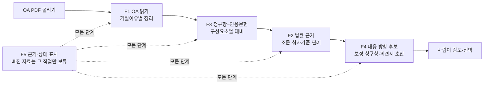
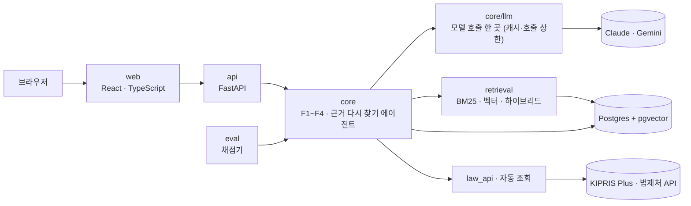

<a id="readme-top"></a>

<div align="center">

# Patent AI Workspace

<sub>거절은 거절해</sub>

**의견제출통지서(OA) 한 통을 올리면, 거절이유 정리부터 검토용 보정 청구항·의견서 초안까지**

변리사의 국내 특허 OA 대응을 돕는 AI 업무 공간. 모든 결과에 원문 위치·판본·확인 상태가 붙고, 고르고 제출하는 것은 사람이 한다.


[문서 지도](docs/README.md) · [PRD](docs/product.md) · [전체 설계](docs/architecture.md) · [실험 점수 표](experiments/index.md)

</div>

<details>
<summary>목차</summary>

1. [소개](#소개)
2. [주요 기능](#주요-기능)
3. [설계 원칙](#설계-원칙)
4. [성과](#성과)
5. [시스템 구조와 기술 스택](#시스템-구조와-기술-스택)
6. [시작하기](#시작하기)
7. [폴더 구조](#폴더-구조)
8. [AI와 같이 개발한 방식](#ai와-같이-개발한-방식)

</details>

## 소개

출원인이 특허청에서 의견제출통지서(OA)를 받으면, 변리사는 거절이유를 읽고, 인용문헌과 청구항을 하나씩 대비하고, 법령·심사기준을 확인하고, **어느 청구항을 어떻게 고칠지** 정해 보정서와 의견서를 쓴다. 문서 여러 개를 오가며 근거를 맞추는 일이 대부분이다.

이 프로젝트는 그 흐름을 한 화면에 잇는다. OA PDF 하나를 올리면 출원번호로 나머지 자료(OA 당시 청구항, 공보, 인용문헌)를 조회해 묶고, 단계마다 근거가 달린 결과를 쌓아 마지막에 **검토용 보정 청구항 초안과 의견서 초안**을 낸다.

- **대상**: 국내 OA, 컴퓨터 비전 분야, 거절이유는 진보성(특허법 29조 2항)·신규성(29조 1항)·명확성(42조 4항 2호). 2019~2022년 OA 약 70만 건을 직접 집계해 보니 이 세 가지만 있는 통지서가 76.7%였다 ([PRD 3.2절](docs/product.md#32-지원하는-거절이유)).
- **AI가 하지 않는 것**: 법률 결론, 등록 가능성 보증, 대응 방향 확정, 자동 제출. AI는 후보를 순위·이유·확신도와 함께 내고, 확신이 낮으면 "직접 판단 필요"라고 표시한다 ([ADR 0001](docs/decisions/0001-ai-amended-claim-draft.md)).

<p align="right">(<a href="#readme-top">맨 위로</a>)</p>

## 주요 기능



| 기능 | 하는 일 |
|---|---|
| **F1 OA 읽기·거절이유별 정리** | OA PDF에서 거절이유마다 조항·대상 청구항·인용문헌·인용 위치를 원문 위치와 함께 뽑는다. 출원번호로 사건 자료를 자동 조회하고 **OA 시점까지만** 넣는다 (뒤에 나온 보정·등록 청구항은 넣지 않음). |
| **F3 청구항–인용문헌 대비** | 진보성·신규성이면 청구항 구성요소마다 인용문헌 문단을 찾아 대비한다. 심사관 지적 / AI 대비 / AI가 새로 찾은 문단을 나눠 보인다. 명확성이면 짚인 문구를 청구항과 명세서에서 확인한다. |
| **F2 법률 근거 조사** | 지적마다 특허법·시행령·심사기준·판례를 **그 OA 시점의 판본**으로 찾아 붙인다. 사건 없이 법률 질문만 하는 화면에서도 같은 기능을 쓴다. |
| **F4 대응 방향과 초안** | 거절이유 묶음마다 대응 방향 후보(예: 종속항 특징을 독립항에 합치기 / 보정 없이 반박)를 순위·이유·확신도와 함께 내고, 1등 후보로 검토용 보정 청구항 초안과 의견서 초안을 만든다. 보정 근거가 되는 최초 명세서 위치도 붙인다. |
| **F5 근거·상태 표시** | 모든 결과에 `확인됨 / 조회 범위 내 없음 / 확인되지 않음 / 충돌` 중 하나와 "검토할 사항 N건"이 붙는다. 자료가 빠지면 사건 전체가 아니라 그 자료에 기대는 작업만 멈춘다. |

화면은 사건 목록 → 올리기 → OA 작업대 → 대비 → 법률 근거 → 대응 방향 → 초안 순서로 이어지고, 사건을 다시 열면 저장된 결과에서 이어 본다.

<p align="right">(<a href="#readme-top">맨 위로</a>)</p>

## 설계 원칙

**1. 진행은 코드, 판단은 LLM, 결정은 사람**
- 답이 정해진 일(번호 정규화, 날짜 계산, PDF 파싱, OA 시점 자르기, 청구항 비교)은 코드 도구로 만든다.
- LLM은 의미 비교·요약·초안처럼 판단이 필요한 곳에만 쓴다.
- 대응 방향을 고르고 제출하는 것은 변리사다. 화면과 데이터에서 사람의 판단과 AI 결과를 나눠 저장한다.
- 처음에는 지휘 에이전트가 사건 진행을 정하게 했지만, 실제 사건에서 늘 같은 순서를 골랐다. 그래서 지금 앱은 진행 순서를 코드로 고정해 돌리고, 에이전트는 "근거를 못 찾은 곳 다시 찾기"처럼 앞 결과를 보고 다음 행동을 정해야 하는 자리에만 두는 방향을 비교하고 있다 ([ADR 0004](docs/decisions/0004-code-flow-agent-recheck.md), 제안).

**2. 못 찾음 ≠ 없음**
- 검색에서 못 찾은 것을 "없다"로 확정하지 않는다. 결과 상태를 `확인됨 / 조회 범위 내 없음 / 확인되지 않음 / 충돌`로 나눈다.
- 법령·심사기준은 출처와 적용 시점·판본을 같이 저장하고, 판본을 모르면 "확인되지 않음"을 돌려준다.

**3. 판이 다른 문서는 섞지 않는다**
- OA 당시 청구항, 최초 명세서, 공개·등록공보 청구항은 서로 다른 판이다. 출원번호 + 발송번호(OA) / 접수번호(보정)로 묶고, 날짜만으로 합치지 않는다.

**4. 정답을 미리 보지 않는다**
- 평가 세트를 연습(tune)·검사·예비로 나누고, 최종 평가 세트(report)는 개발하는 세션이 열지 않는다 (저장소 훅으로 막음). 합격 기준은 돌리기 전에 적는다.

<p align="right">(<a href="#readme-top">맨 위로</a>)</p>

## 성과

### 보정 청구항 추천: 그냥 Opus보다 정확하게, 괜한 수정은 절반 가까이 줄임
"OA와 출원서만 보고, 실제 보정서에서 어느 청구항이 **정정·삭제·그대로**였는지 맞히기"로 문제를 정하고, 실제 보정서(청구항 이력)를 정답으로 코드가 채점했다. 비교 기준선은 같은 입력을 받은 그냥 Claude Opus.

| 지표 (처음 보는 사건 27건, 한 번) | 그냥 Opus | 우리 방식 |
|---|---|---|
| 청구항마다 정정·삭제·그대로를 맞힌 비율 | 67.7% | **73.0%** (+5.3%p, 구간 +0.7 ~ +9.9) |
| 고칠 필요 없는데 고치라고 한 항 | 39항 | **22항** (−44%) |

- 우리 방식: 짚인 청구항 정리 + 비슷한 과거 사건 3건 + 보정안 3개 + 코드 검사.
- 이 실험의 기록은 사건 원문이 들어 있어 저장소 밖에 둔다.

### 검색: 자료마다 맞는 방식을 같은 채점기로 골랐다
| 자료 | 비교 | 결과 | 실험 카드 |
|---|---|---|---|
| 법령 조문 | BM25 vs 벡터 | BM25가 hit@5 **1.000** 대 0.316 | [BM25](experiments/m2-i1-law-bm25-baseline/card.md) · [벡터](experiments/m2-i2-law-vector-baseline/card.md) |
| 인용문헌 문단 | BM25 vs 벡터 vs 하이브리드(RRF) | 하이브리드가 hit@5 **0.574** (BM25 0.500, 벡터 0.559) | [하이브리드](experiments/m2-i2-cite-search-hybrid-rrf/card.md) |

### 숫자로 남긴 개발
- 비교 실험 **44개**를 같은 형식(설정 `config.yaml`, 점수 `scores.json`, 해석 `card.md`)으로 기록했다. 점수 표는 스크립트가 만든다 → [experiments/index.md](experiments/index.md)
- 파이썬 테스트 **3,000개 이상**이 네트워크·DB·API 키 없이 돈다 (외부 응답은 기록된 파일로 테스트). PR마다 GitHub Actions가 테스트·린트·화면 빌드를 돈다.
- 큰 결정은 ADR **4건**으로 남겼다 ([docs/decisions/](docs/decisions/)).

<p align="right">(<a href="#readme-top">맨 위로</a>)</p>

## 시스템 구조와 기술 스택



| 영역 | 기술 | 고른 이유 |
|---|---|---|
| 서버 | FastAPI, uv, Python 3.14 | AI 코어와 같은 언어로 한 저장소에 |
| 화면 | React + TypeScript (Vite) | 대비표·초안처럼 상태가 많은 화면 |
| DB | Postgres + pgvector, Alembic | 표·JSON·벡터를 DB 하나에. 스키마는 마이그레이션으로만 |
| 에이전트 | LangGraph | 단계 기록, 사람 승인 전 멈춤 |
| 모델 | Claude Haiku(앱 기본), Claude Opus(실험), Gemini 임베딩(인용문헌) | 단계마다 설정 파일(`config/`)에서 고름 |
| 검색 | BM25(법령), BM25 + 벡터 RRF(인용문헌) | 위 [검색 실험](#검색-자료마다-맞는-방식을-같은-채점기로-골랐다) |
| 실행 기록 | Langfuse | LLM 호출 기록 (docker compose 안) |
| 개발 환경 | Docker Compose | `make up` 한 줄로 DB·서버·화면 |

부르는 방향은 `api → core → retrieval·law_api·db`만 허용한다. 자세한 이유와 버린 선택지는 [ADR 0003](docs/decisions/0003-tech-stack.md), 엔티티·결과 스키마는 [데이터 모델](docs/data-model.md), API는 [API 명세](docs/api/README.md).

<p align="right">(<a href="#readme-top">맨 위로</a>)</p>

## 시작하기

### 준비물
- Docker (Desktop·OrbStack·colima 중 하나)
- [uv](https://docs.astral.sh/uv/)
- Node 26

### 실행
```bash
git clone https://github.com/merge-mates/patent-ai-workspace.git
cd patent-ai-workspace
cp .env.example .env   # API 키는 각자 채운다 (없어도 화면·서버는 뜬다)
make up                # DB·서버·화면. 서버가 켜질 때 마이그레이션 자동
```
- 화면: http://localhost:5173
- 서버 상태: http://localhost:8000/health
- 끄기: `make down` · 명령 목록: `make help`
- DB 켜기·끄기·다시 만들기·검색 색인 불러오기: [docs/team/local-db.md](docs/team/local-db.md)

### 테스트와 린트
```bash
make test   # 파이썬 테스트 (네트워크·DB·API 키 없이)
make lint   # 파이썬(ruff)·화면 린트
cd web && npm run build   # 화면 타입 검사 + 빌드
```

### 채점
```bash
uv run python eval/run_eval.py --config experiments/<실험>/config.yaml
uv run python eval/make_index.py   # 점수 표 다시 만들기
```
평가 세트(정답)는 git 밖 `data/goldsets/`에 둔다. 형식은 [eval/GUIDE.md](eval/GUIDE.md).

<p align="right">(<a href="#readme-top">맨 위로</a>)</p>

## 폴더 구조

```
src/patent_ai/
  api/          FastAPI 라우터 (사건·OA·실행·대응 방향·초안·법률 질문)
  core/         AI 코어: F1 OA 읽기, F2 법률 근거, F3 대비, F4 방향·초안, 모델 호출, 검증
  retrieval/    BM25·벡터·하이브리드 검색과 색인
  law_api/      법령·공보 조회 (캐시·호출 상한)
  db/           ORM 모델 (스키마는 alembic 마이그레이션으로만)
web/            화면 (React + TypeScript)
prompts/        프롬프트 파일 (코드와 분리)
config/         모델·검색·실험 설정
eval/           채점기
experiments/    비교 실험 하나 = 폴더 하나 (config · scores · card)
docs/           사람이 읽는 문서 전부 (지도: docs/README.md)
tests/          테스트 (API · 코어 · DB · E2E)
```
원본 데이터·사건 자료·정답은 `data/`, `work/`(git 밖)에 두고 어떤 커밋에도 넣지 않는다.

<p align="right">(<a href="#readme-top">맨 위로</a>)</p>

## AI와 같이 개발한 방식

두 사람이 3주 안에 끝에서 끝까지 만들기 위해, 첫날부터 Claude Code와 일하는 틀을 저장소에 넣었다.

- **팀 규칙** [`CLAUDE.md`](CLAUDE.md): 폴더 역할, 부르는 방향, 특허 도메인 규칙(판 섞지 않기, 못 찾음 ≠ 없음), 리뷰 심각도(막음 / 고칠 것 / 참고)를 사람과 AI가 같이 따른다.
- **스킬** [`.claude/skills/`](.claude/skills/README.md): 이슈 하나를 `/start → /implement → /check → /pr-draft` 순서로 돌린다. 기획 질문(`/interview`), 문서 검토(`/doc-review`), 실험 채점(`/experiment`), 상대 PR 리뷰(`/pr-review`)도 스킬로 부른다.
- **역할 에이전트** [`.claude/agents/`](.claude/agents/): 구현(테스트 먼저), 코드 리뷰, 설계 비판, 계획 리뷰, 실험 분석, 검증, 조사.
- **문서 흐름**: 기능마다 `requirements.md`(무엇) → `design.md`(어떻게) → `tasks.md`(이번 이터레이션 할 일), 되돌리기 어려운 결정은 ADR.
- **안전장치**: 최종 평가 정답을 개발 세션이 못 열게 막는 훅, gitignore된 파일 강제 추가 금지, push·PR·머지는 사람이 승인.
- **GitHub flow**: 계획 하나 = 브랜치 하나 = PR 하나, 상대가 리뷰, merge commit으로 머지.

<p align="right">(<a href="#readme-top">맨 위로</a>)</p>
