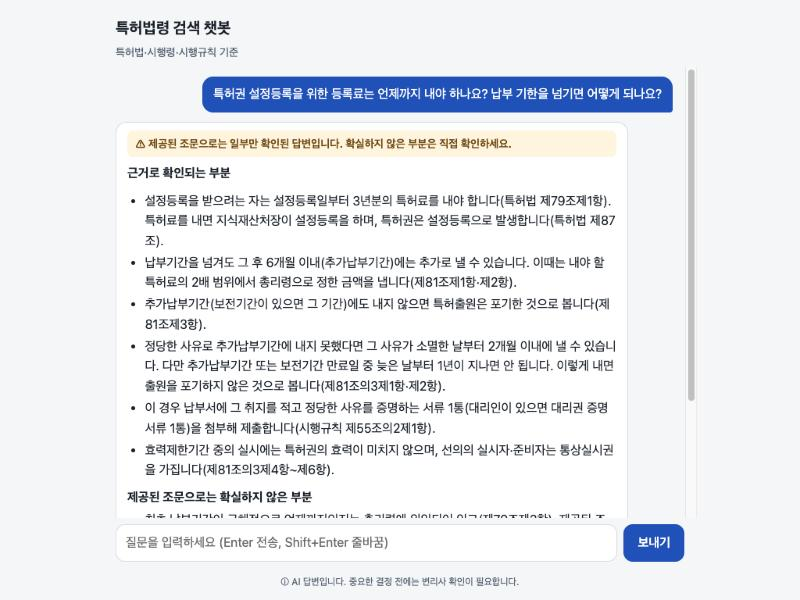
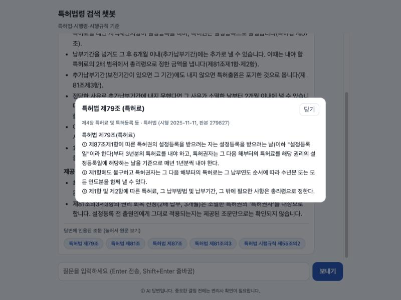

# 특허법령 RAG 챗봇 (개인 실험)

특허법·특허법 시행령·특허법 시행규칙의 현행 조문을 검색해서 **근거 조문과 함께 답하고, 근거가 없으면 없다고 알려 주는** 챗봇입니다.
팀 서비스와는 별개로 개인적으로 만든 RAG 확인용 구현이고, 코드를 합치려는 목적이 아니라 **아이디어와 결과를 공유**하려고 올렸습니다.

| 질문 → 답변과 상태 표시 | 인용 조문을 누르면 원문 |
|---|---|
|  |  |

## 동작 방식

```
질문
 → ① 질의 확장 (LLM이 일상어·실무어를 법률 용어로 바꿔 질문 뒤에 덧붙임)
 → ② 검색: 한국어 형태소 BM25 + 임베딩 검색을 순위 결합(RRF)
 → ③ LLM 재순위 (상위 10개를 질문과 함께 보여 주고 다시 정렬)
 → ④ 근거 조문 5개 선택
 → ⑤ 답변 생성 (근거 조문만 보고 답하고, 근거 번호(E1…)로 인용, 상태를 answered / partial / no_basis 중 하나로 표시)
 → ⑥ 코드 검증 (없는 근거 인용, 근거에 없는 조문·수치를 표시)
 → 화면: 인용을 조문 이름으로 바꿔 보여 주고, 누르면 원문과 판본(시행일)을 확인
```

- **청킹:** 법령 JSON을 조·항·호·목 구조로 정규화하고 항 단위(1,331개 청크)로 나눕니다. 삭제된 조문은 제외하고 장·절 제목은 메타데이터로 둡니다.
- **상태 표시:** `partial`은 "일부만 확인된 답변", `no_basis`는 "조문에서 근거를 찾지 못했습니다(규정이 없다는 뜻은 아님)"로 일반 답변과 구분해 보여 줍니다.
- **모델:** 질의 확장·재순위 `gpt-5.4-mini`, 임베딩 `text-embedding-3-small`, 생성 `claude-sonnet-5-5`. 질문 하나에 LLM 호출이 4번(확장, 질의 임베딩, 재순위, 생성)이고 15~20초쯤 걸립니다.

## 평가와 결과

- **질문과 정답:** 코퍼스를 모르는 에이전트가 변리사 질문을 쓰고, 서로 모르는 에이전트 2명이 조문 정답을 따로 지정해 **겹친 것만** 정답으로 썼습니다(`data/eval/`). 개발 질문과 봉인 질문을 나눠서, 봉인 질문은 최종 후보를 정한 뒤 한 번만 평가했습니다.
- **검색 결과(봉인 25문항, 1위 적중 / 3위 안 / 5위 안, MRR):**

| 구성 | Hit@1 | Hit@3 | Hit@5 | MRR |
|---|---|---|---|---|
| 기본 검색(BM25 + 임베딩) | 12 | 15 | 20 | 0.606 |
| + 질의 확장 | 13 | 21 | 23 | 0.698 |
| + LLM 재순위 | **22** | **24** | **24** | **0.926** |

  개발 47문항에서도 같은 방향이었습니다(1위 적중 26 → 40). 법 조문과 시행규칙 조문이 서로 밀어내는 문제는 "법 우선" 같은 순서 규칙으로는 오히려 나빠졌고, 재순위로 풀렸습니다(`docs/experiment-results-phase6.md`).
- **생성 결과:** 정답 조문 인용 개발 45/47, 봉인 25/25. 코드 검증 경고는 최종 설정에서 0건. 정답이 없는 질문(범위 밖·코퍼스 밖)은 "근거 없음"으로 답하거나 일부만 확인된 답변으로 표시했습니다(`docs/experiment-results-generation.md`).

## 한계 (먼저 알아 두세요)

- 질문·정답·평가를 모두 LLM이 만들었고 사람 전문가의 검증은 하지 않았습니다. 질문 수가 적어서(개발 47, 봉인 25) 수치는 "이 평가 세트에서 이렇게 나왔다"로 읽어야 합니다.
- 법령 3종만 다룹니다(판례·심사기준·그 밖의 법령은 없음). 질문마다 독립적으로 처리해서 앞 질문을 이어받지 못합니다.
- 서버에 인증이 없어서 `127.0.0.1`에서만 엽니다. 응답이 느리고 토큰 사용량(비용)은 아직 재지 않았습니다.

## 폴더

```
src/law_api/    법령 JSON → 조·항 단위 청크 (청커)
src/retrieval/  BM25, 임베딩, 순위 결합, 질의 확장, LLM 재순위 부품
src/eval/       질문 파일 읽기, 순위 채점(Hit@k, MRR)
src/rag/        생성·검증·꼬리표 치환·조문 원문 조회·서버(server.py)·화면(web/)
scripts/        법령 받기, 임베딩, 질의 확장, 검색·생성 평가 실행
tests/          파이썬 테스트와 화면 마크다운 해석기 테스트
data/eval/      평가 질문(개발·봉인·정답 없음)
docs/           설계 문서 2개, 실험 결과 2개, 화면 스크린샷
```

## 실행해 보려면 (내 환경 기준의 순서이며 그대로 한 번에 돌지는 않습니다)

데이터 파일(`data/raw`, `data/processed`)과 임베딩은 이 저장소에 없습니다(원본 재배포 금지, `.gitignore`로 제외). 직접 만들어야 합니다.

```bash
python3 -m venv .venv && source .venv/bin/activate && pip install -r requirements.txt
cp .env.example .env     # LAW_OC(법제처 API), OPENAI_API_KEY, ANTHROPIC_API_KEY 값을 채웁니다
python scripts/list_patent_laws.py && python scripts/fetch_law_body.py        # 법령 원본 받기 → data/raw
python -m src.law_api.chunker data/raw/body_<법령>_<MST>_<시행일>.json --strategy paragraph --max-chars 3000   # 법령 3개 각각 → data/processed
python -m src.law_api.chunker data/raw/body_<법령>_<MST>_<시행일>.json --strategy article                      # 조문 단위(원문 보기용)
python scripts/make_unit_corpora.py corpora       # 조문 단위 통합 파일. 항 단위 3개는 이어 붙여 chunks_법령3_paragraph_split3000.jsonl 로 둡니다
python scripts/embed_openai.py --what chunks --chunks data/processed/chunks_법령3_paragraph_split3000.jsonl --tag law3
python -m src.rag.server                          # http://localhost:3000 (CHATBOT_PORT=3100 처럼 포트 지정 가능)
```

- 코드가 법령 **판본(MST·시행일)이 들어간 파일명**과 임베딩 파일명을 `src/rag/settings.py`, `scripts/make_unit_corpora.py`에 고정해 두었습니다. 법령이 개정되었거나 다시 만든 임베딩이면 그 이름을 본인 파일에 맞게 바꿔야 합니다.
- 테스트: `python -m pytest tests -q` (데이터 파일이 없으면 일부는 건너뜁니다), 화면 해석기는 `node --test tests/rag-md.test.mjs`.
- 질문 한 개만 터미널에서: `python -m src.rag.ask "특허권이 공유일 때 내 지분만 팔 수 있나요?"`

## 문서

- `docs/superpowers/specs/2026-11-13-generation-stage-design.md` — 생성 단계 설계와 답변 정책
- `docs/superpowers/specs/2026-11-13-chat-ui-design.md` — 서버·화면 설계
- `docs/experiment-results-phase6.md` — 검색 실험 결과(청킹 단위, 질의 확장, 법령 간 경쟁, LLM 재순위)
- `docs/experiment-results-generation.md` — 생성 평가와 모델·프롬프트 비교
