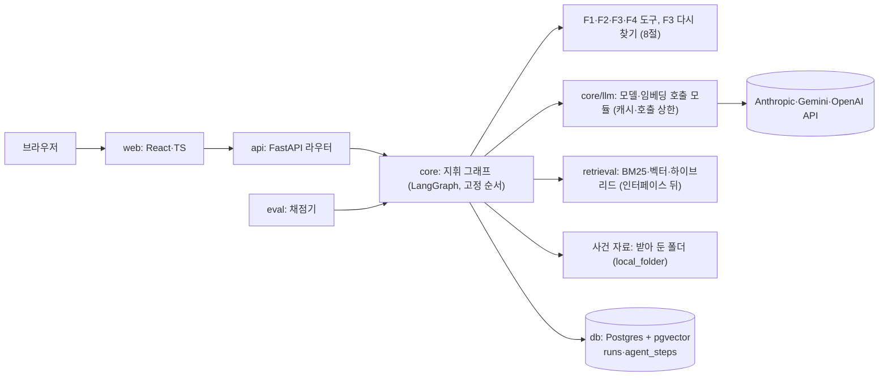
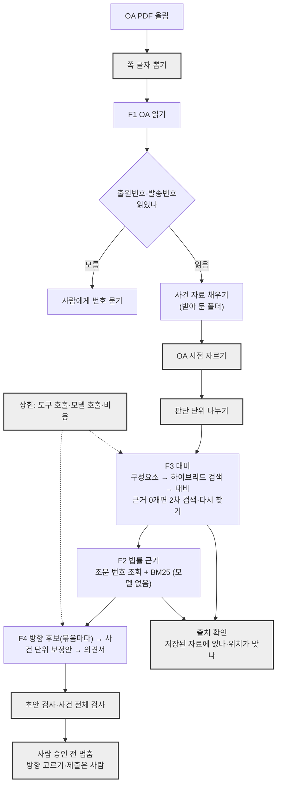

# 전체 설계

화면, 서버, AI 코어가 함께 보는 시스템 전체의 부품, 자료 흐름, 로그, 외부 모델 규칙을 적는다. 엔티티·결과 스키마·DB 모델은 [데이터 모델](data-model.md), API는 [API 명세](api/README.md), 기술 선택과 이유는 [ADR 0003](decisions/0003-tech-stack.md).

## 1. 구성도

- 부르는 방향은 `api → core → retrieval·law_api·db`만이다. 화면은 `api`만 본다.
  - 부르는 방향에 `retrieval → db`를 더한다. db는 retrieval을 import하지 않는다. ([ADR 0003](decisions/0003-tech-stack.md))
- 평가(채점기)는 API를 거치지 않고 `core/`를 직접 부른다.
- 모두 로컬 docker compose 안에서 돈다 (db·api·web). 밖으로 나가는 호출은 6절 "밖으로 나가는 호출" 표에 둔다.
- `law_api/`는 자리만 있다 (빈 모듈). 법령·판례는 미리 받아 색인한 것만 쓰고, 실행 중에는 부르지 않는다 (6절).

## 2. 기술 선택
서버 FastAPI·uv, 화면 React+TypeScript(Vite), DB Postgres 하나(표 + jsonb + pgvector), 에이전트 LangGraph, 실행 기록은 DB `runs`·`agent_steps`(Langfuse는 넣지 않음), 모델은 단계마다 설정 파일, 개발 환경 docker compose. 고른 것·버린 것·이유는 [ADR 0003](decisions/0003-tech-stack.md).

## 3. 폴더
폴더 구조와 부르는 방향은 [ADR 0003 폴더](decisions/0003-tech-stack.md#폴더)를 따른다.

## 4. 데이터 모델
엔티티·관계, 모든 결과에 붙는 공통 속성(상태·근거·출처 구분), 결과 스키마 ①~⑥, DB 모델은 [데이터 모델](data-model.md).

## 5. 로그
| 로그 | 쓰는 곳 | 담는 것 |
|---|---|---|
| DB `runs`·`agent_steps` | 앱 화면, 채점기, 사람이 흐름을 볼 때 | 실행 상태, 단계마다 모델·토큰·비용·시간·만든 결과, 다시 찾기 도구 호출 |
| 서버 로그 | 오류 찾기 | 오류·경고·조회 실패 |

## 6. 자료 출처
| 자료 | 미리 받아 두는 데이터셋 | 실행 중 API (사건마다) |
|---|---|---|
| 법령·심사기준 판본 | 미리 받아 색인한다 (`law-idx-v3`) | 없음 (없는 판은 "확인되지 않음") |
| 판례·심결 | 미리 받아 같은 색인에 넣는다 | 없음 |
| 인용문헌 본문 | 미리 받아 색인한다 (`cite-idx-v5`, Gemini 임베딩) | 없음 |
| 평가 사건 자료 | 받아 둔 자료를 OA 시점으로 잘라 둔다 (`data/processed/cases`) | 없음 |
| 새 사건의 이력·청구항 판·공보·인용문헌 | — | 아직 없음. 사건 자료 조회는 받아 둔 폴더(`local_folder`)만 구현했고, KIPRIS 조회는 같은 인터페이스 뒤 다음 구현이다 (`config/case_source.yaml`) |

- 사건 자료는 대응할 OA(발송번호) 시점까지만 넣는다. 그 OA와 앞 이벤트만 사건에 넣고, 청구항 판은 심사 대상 판까지(뒤 보정 판·등록공보 청구항은 넣지 않음), 인용문헌 본문은 가져온다. 자르기는 조회 구현 밖의 고정 단계(`cut_to_oa`)로 막고, 날짜만이 아니라 이력 순서·발송번호·접수번호로 자른다.
- 받은 자료는 저장해서 같은 사건을 다시 부르지 않는다.

### 밖으로 나가는 호출
앱 실행 중 밖으로 나가는 호출은 모델·임베딩 API뿐이다. 모두 모델 호출 모듈(`core/llm/`)을 거치고, 캐시와 호출 상한을 지난다. KIPRIS·법제처·심사기준은 데이터 받기 스크립트(`scripts/fetch_*.py`)로 미리 받는다.

| 호출 | 무엇 | 언제 |
|---|---|---|
| Anthropic API | 단계마다 LLM (기본 `claude-haiku-5-5`, 사건 단위 보정안은 `claude-opus-5-5`), LLM 저지 채점(`claude-opus-5-5`, `config/eval_judge.yaml`) | 앱 실행, 채점 |
| Gemini API | 인용문헌 검색 임베딩 `gemini-embedding-001` (v5 색인 문서 벡터, F3 질의 벡터, `config/f3.yaml` `embed`) | 색인 만들 때, 앱 실행 |
| OpenAI API | 임베딩 `text-embedding-3-small` (옛 색인 `cite-idx-v2`·`v4`, 법령 벡터 비교 실험) | 비교 실험만. 기본 설정의 앱 실행에서는 부르지 않는다 (F2는 BM25만) |
| KIPRIS Plus | 사건 이력·청구항 판·공보·인용문헌, 심판사항(심결). Open API 무료 옵션(월 1,000건), 키 `KIPRIS_PLUS_API_KEY` ([#54 댓글](https://github.com/merge-mates/patent-ai-workspace/issues/54#issuecomment-7029188711)) | 데이터 받을 때만 (앱 자동 조회는 아직 없음) |
| 법령 API (법제처) | 법령 판본, 판례 | 데이터 받을 때만 |
| 심사기준 | 특허청 공개 파일 내려받기 (판마다 한 번) | 데이터 받을 때만 |
| PDF 파싱 | 로컬 `pdfplumber` (외부 API 없음) | — |

## 7. 외부 모델로 보내는 자료
| 자료 | 외부 API·모델로 | git·공개 배포에 |
|---|---|---|
| 통지서(OA) 원문 | 보냄 | 막음 |
| 공보·인용문헌 원문 | 보냄 | 막음 |
| 법령·심사기준·판례·심결 | 보냄 | 막음 |
| OA 학습데이터 본문 (출원인·대리인·심사관 이름 포함) | 보냄 | 막음 |
| 평가 정답 (의견서·보정서, 정답 파일) | 보냄 | 막음 |
| 평가 사건 목록 (출원번호) | 보냄 | 막음 |
| 실제 고객 사건·미공개 출원 | 받지 않음 (범위 밖) | 막음 |
| API 키, `.env` | 막음 | 막음 |

- 평가 정답은 정답 초안 만들기(report는 떨어진 세션, `eval/GUIDE.md`)와 LLM 저지 채점에만 보낸다. 앱 실행 중에는 보내지 않는다 (앱 코드는 정답을 읽지 않음).
- "보냄"의 근거: KIPRIS Plus 이용약관(2025-10-01 시행)을 확인했다. 원본의 제3자 제공·재판매는 금지이고, 외부 AI 처리에 대한 조항은 없다. 팀은 비영리 연구 범위에서 외부 모델로 보내도 된다고 정했다(2026-11-17). 원본은 git·공개 배포에 넣지 않는다. 실제 고객 자료는 받지 않는다. 수익 목적으로 바뀌면 이 표를 다시 본다.
- 모델 API로는 Anthropic(LLM)과 Gemini(인용문헌·청구항 구성요소 글자 임베딩)에 보낸다. OpenAI 임베딩은 비교 실험 때만 보낸다.
- 미공개 출원과 실제 고객 사건은 처음부터 받지 않는다(범위 밖, [PRD](product.md) 3.4). 그래서 외부 전송을 막는 코드는 따로 두지 않는다. "막음"은 git·공개 배포 규칙이다. git 쪽은 `.gitignore`와 커밋 전 확인으로 막는다.
- 한계: '받지 않음'은 규칙이고 시스템이 막지 않는다. 사용자가 올린 PDF가 미공개 출원인지 시스템은 알 수 없다. 쓰는 사람이 팀 둘뿐이라 규칙으로 둔다. 밖에 내놓게 되면 이 줄을 다시 본다.
- 실행 기록은 외부 관측 서비스에 두지 않고 로컬 DB(`runs`·`agent_steps`)에만 남긴다. 기록에 OA 원문·청구항이 그대로 남기 때문이다.

## 8. LLM·검색·에이전트·코드 역할
| 역할 | 하는 일 | 하지 않을 일 |
|---|---|---|
| LLM | OA 읽기, 청구항 구성요소 나누기, 구성요소–문단 대비, 명확성 문구 검토, 효과 후보, 대응 방향 후보, 보정안, 의견서 초안 | 근거를 지어내기, 날짜·건수 계산 |
| 검색 | 인용문헌 문단(하이브리드: BM25 + Gemini 벡터, RRF), 법령·심사기준·판례(BM25)에서 근거 찾기 | 못 찾음을 없음으로 확정 |
| 지휘 그래프 | 사건 진행: 단계를 정해진 순서(F1 → F3 → F2 → F4)로 부르고, 자료가 빠진 단계만 넘기고, 번호를 모르면 사람을 기다림 | 답이 정해진 일을 LLM에게 시키기 |
| 다시 찾기 (F3 안) | 1차 검색에서 근거 0개인 구성요소만 다시 찾기: 안 함 / 고정 루프(질의 다시 쓰기) / 에이전트(검색 도구를 고르는 tool use 루프). 기본은 안 함 | 상한을 넘겨 찾기, 찾은 순위를 근거 이유로 쓰기 |
| 코드 도구 | 번호 정규화, 날짜 읽기, PDF 쪽 글자, 판단 단위 나누기, 인용 관계표·보정 범위, 청구항 비교 | 법률 판단 |
| 무조건 도는 코드 단계 | 쪽 글자 뽑기, OA 시점 자르기, 판단 단위 나누기, 출처 확인, 초안 검사·사건 전체 검사, 사람 승인 전 멈춤, 상한 | 지휘가 건너뛰기 |

- 지휘 그래프는 `plan: agent`(모델이 다음 도구를 고름)도 구현돼 있지만 기본은 `fixed_order`다 (`config/orchestrator.yaml`). tune을 돌려 보니 끝까지 돈 9통이 모두 같은 순서였고, 어느 기능을 부를지는 거절이유 종류로 코드가 이미 안다. 그래서 에이전트는 앞 결과를 보고 다음 행동을 정해야 하는 다시 찾기 자리에 두고 숫자로 비교한다 ([ADR 0004](decisions/0004-code-flow-agent-recheck.md), 제안 상태). 다시 찾기 비교 smoke 1회에서는 에이전트가 안 함보다 낮았다 ([실험 카드](../experiments/m3-i2-recheck-a/card.md)).
- F2는 모델을 부르지 않는다. 조문은 OA 발송일 시행판에서 번호로 찾고, 심사기준·판례·심결은 BM25로 후보만 남긴다. 근거 검토(원문이 주장을 뒷받침하나)는 아직 없어, 출처 확인을 지난 근거에 `needs_human_review`를 단다.
- 그래프 검색은 넣지 않았다.

### 에이전트 구조

- 굵은 테두리(회색) = 무조건 도는 코드 단계. 그래프 간선으로 늘 지나고, 그래프 테스트로 확인한다.
- F3 → F2 → F4 사이의 다음 단계는 지휘(`decide`)가 정한다. 기본 설정에서는 정해진 순서다.
- 경계 규칙은 [ADR 0003](decisions/0003-tech-stack.md#에이전트가-정하는-것과-코드로-고정하는-것), 바꾸자는 제안은 [ADR 0004](decisions/0004-code-flow-agent-recheck.md).

### F4 두 길
| 길 | 설정 | 흐름 |
|---|---|---|
| 사건 단위 보정안 (기본) | `amendment_enabled: false` + `case_amendment_enabled: true` | ① 묶음마다 방향 후보(순위·이유·확신도), 사람이 고름 ② 사건 한 번에 보정안 3개(`claude-opus-5-5`, OA·청구항 전체·출원서를 봄)를 만들어 1번 안을 쓰고, 다른 안·전략 글·코드 검사(지운 항을 아직 인용하는 항, 원문에서 거의 못 찾은 새 문구)를 같이 싣는다. 다른 안에서만 고친 항은 "검토해 볼 항"으로 보인다 ③ 의견서는 고른 방향의 반박 논점 + 그 보정안으로 묶음마다 반박, 사건 전체 한 번(지적 요지·보정 설명·마무리)으로 쓴다. 바깥에서 준 보정 결과가 있으면 그것을 먼저 쓰고, 보정안이 실패하면 "보정 결과 없음"으로 의견서만 쓴다 |
| 묶음마다 (옛 흐름) | `amendment_enabled: true` | 묶음마다 방향 후보 → 의견서 초안 → 검토용 보정 청구항 초안(명세서 근거 위치를 원문과 대조). 보정 범위는 같은 거절이유의 독립항과 그 종속항까지 넓힌다 ([ADR 0005](decisions/0005-f4-amendment-scope.md)) |

- 기본 길에서 사람이 고른 방향은 의견서 반박에 들어가고, 보정안은 방향과 따로 사건 전체를 보고 만든다. 방향의 보정 유무와 보정안이 어긋난 묶음은 `mismatch_units`에 남긴다.
- 기본 길의 보정안은 명세서 근거 위치를 주지 않는다. 그래서 근거 위치 대조 대신 위 두 가지 코드 검사만 표시한다. 적법성은 판정하지 않는다.

### 도구 목록
상한 숫자는 설정 파일(`config/*.yaml`)에 둔다.

| 도구 | 하는 일 | 입력 → 출력 | 종류 | 기능 |
|---|---|---|---|---|
| `extract_pages` | OA PDF 쪽 글자 | PDF → 쪽마다 글자 | 고정 단계 | F1 |
| `read_oa` | OA에서 필드와 원문 위치를 뽑음 | 쪽 글자 → OA 정리 ① | 지휘가 부름 | F1 |
| 사건 자료 채우기 | 출원번호·발송번호로 사건 자료를 받아 둔 폴더에서 채움 | 번호 → 사건 자료 | 고정 단계 | F1 |
| `cut_to_oa` | 대상 OA 시점 뒤 자료를 뺌 (이력 순서·발송번호·접수번호) | 사건 자료 → 자른 자료 | 고정 단계 | F1 |
| `prepare_units` | 거절이유 대상 청구항을 판단 단위로 묶음 | OA 정리 + 청구항 판 → 판단 단위 | 고정 단계 | F3, F4 |
| `run_f3` | 구성요소 나누기 → 문단 검색 → 대비, 명확성 검토, 효과 후보, 다시 찾기 | 판단 단위 + 자료 → 대비 결과 ② | 지휘가 부름 | F3 |
| `run_f2` | 조문 판본 조회, 심사기준·판례 후보, 출처 확인 | 판단 단위 + OA 발송일 → 법률 근거 묶음 ④ | 지휘가 부름 | F2 |
| `run_f4` | 방향 후보, 의견서, 보정 초안, 보정 범위, 초안 검사 | F1~F3 결과 → 방향·초안 ⑤⑥ | 지휘가 부름 | F4 |
| 사건 전체 검사 | 지원 안 하는 거절이유 남음, 두 묶음이 같은 항을 고침. 아직 안 보는 규칙은 "확인되지 않음" | 저장된 결과 → 검사 목록 | API에서 부름 (`/oas/{oa_id}/case-check`) | F4 |

## 9. 열린 것
- 데이터 모델 쪽 열린 것은 [데이터 모델](data-model.md) 6절.
- 발표용 웹 주소: 발표 형태를 정할 때.
- 아직 만들지 않은 것: 사건 자료 KIPRIS 조회(`case_source` 다음 구현), 법령 API 실행 중 조회(`law_api/`), F2 근거 검토(모델), 그래프 검색, 실행 기록 관측 도구.
- 지휘·다시 찾기 경계: [ADR 0004](decisions/0004-code-flow-agent-recheck.md) 제안을 확정할지 (판정용 2회 비교와 은진 님 동의).
