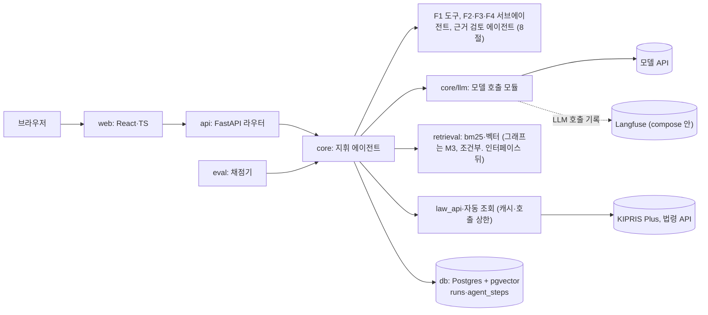
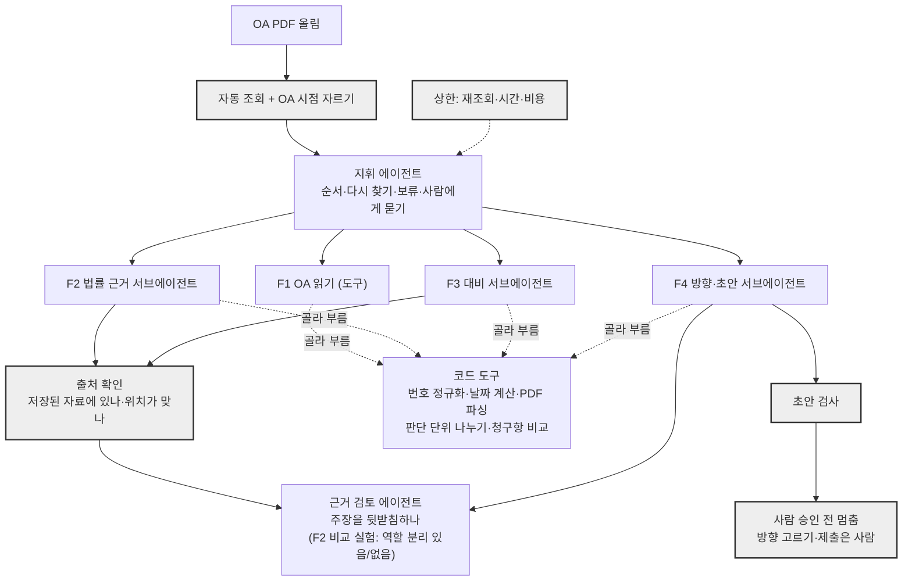

# 전체 설계

화면, 서버, AI 코어가 함께 보는 시스템 전체의 부품, 자료 흐름, 로그, 외부 모델 규칙을 적는다. 엔티티·결과 스키마·DB 모델은 [데이터 모델](data-model.md), API는 [API 명세](api/README.md), 기술 선택과 이유는 [ADR 0003](decisions/0003-tech-stack.md).

## 1. 구성도

- 부르는 방향은 `api → core → retrieval·law_api·db`만이다. 화면은 `api`만 본다.
- 평가(채점기)는 API를 거치지 않고 `core/`를 직접 부른다.
- 모두 로컬 docker compose 안에서 돈다 (Langfuse 포함). 밖으로 나가는 호출은 6절 "밖으로 나가는 호출" 표에 둔다.

## 2. 기술 선택
서버 FastAPI·uv, 화면 React+TypeScript(Vite), DB Postgres 하나(표 + jsonb + pgvector), 에이전트 LangGraph, 실행 기록 Langfuse(docker compose 안), 모델은 단계마다 설정 파일, 개발 환경 docker compose. 고른 것·버린 것·이유는 [ADR 0003](decisions/0003-tech-stack.md).

## 3. 폴더
폴더 구조와 부르는 방향은 [ADR 0003 폴더](decisions/0003-tech-stack.md#폴더)를 따른다.

## 4. 데이터 모델
엔티티·관계, 모든 결과에 붙는 공통 속성(상태·근거·출처 구분), 결과 스키마 ①~⑥, DB 모델은 [데이터 모델](data-model.md).

## 5. 로그
| 로그 | 쓰는 곳 | 담는 것 |
|---|---|---|
| DB `runs`·`agent_steps` | 앱 화면, 채점기 | 실행 상태, 단계마다 모델·토큰·비용·시간·만든 결과 |
| Langfuse | 사람이 흐름을 볼 때 | LLM 호출 전문과 흐름 |
| 서버 로그 | 오류 찾기 | 오류·경고·조회 실패 |

## 6. 자료 출처
| 자료 | 미리 받아 두는 데이터셋 | 실행 중 API (사건마다) |
|---|---|---|
| 법령·심사기준 판본 | 미리 받는다 | 없는 판만 |
| 판례·심결 | 심사기준이 인용한 것만 미리 | 그 밖은 필요할 때 |
| 그래프 관계 (M3, 벡터로 못 찾은 질문(CQ)이 있을 때만) | OA 학습데이터에서 미리 뽑는다 | — |
| 평가 사건 자료 | 받아 둔 자료를 쓴다 (API를 다시 부르지 않음) | — |
| 새 사건의 이력·청구항 판·공보·인용문헌 | — | API (평가 때는 받아 둔 자료를 같은 입력 경로로 넣음) |

- 자동 조회는 대응할 OA(발송번호) 시점까지만 넣는다. 그 OA와 앞 이벤트만 사건에 넣고, 청구항 판은 심사 대상 판까지(뒤 보정 판·등록공보 청구항은 넣지 않음), 인용문헌 본문은 가져온다. 자르기는 조회 도구 코드로 막고, 날짜만이 아니라 이력 순서·발송번호·접수번호로 자른다.
- 받은 자료는 저장해서 같은 사건을 다시 부르지 않는다.

### 밖으로 나가는 호출
모두 모델 호출 모듈(`core/llm/`) 또는 `law_api/`를 거치고, 캐시와 호출 상한을 지난다.

| 호출 | 무엇 | 정해짐 |
|---|---|---|
| Anthropic API | 에이전트·서브에이전트 LLM | 정함 |
| OpenAI API | LLM 저지 채점 (평가 때만) | 정함 |
| KIPRIS Plus | 사건 이력·청구항 판·공보·인용문헌 (자동 조회), 심판사항(심결) | 이력·공보는 정함, 심결 범위는 F2 설계 |
| 법령 API (법제처) | 법령 판본, 미리 받지 않은 판례를 사건번호로 | 정함, 키워드 판례 검색은 시간 나면 |
| 심사기준 | 특허청 공개 파일 내려받기 (판마다 한 번) | 정함 |
| 임베딩 API | 벡터 검색용 (로컬 모델이면 없음) | F2·F3 임베딩 비교 실험 뒤 |
| PDF 파싱 API | 외부 파싱 도구를 고르면 (로컬 도구면 없음) | PDF 파싱 이슈 |

## 7. 외부 모델로 보내는 자료
| 자료 | 외부 API·모델로 | git·공개 배포에 |
|---|---|---|
| 통지서(OA) 원문 | 보냄 | 막음 |
| 공보·인용문헌 원문 | 보냄 | 막음 |
| 법령·심사기준·판례·심결 | 보냄 | 막음 |
| OA 학습데이터 본문 (출원인·대리인·심사관 이름 포함) | 보냄 | 막음 |
| 평가 정답 (의견서·보정서, 정답 파일) | 보냄 | 막음 |
| 평가 사건 목록 (출원번호) | 보냄 | 막음 |
| 실제 고객 사건·미공개 출원 | 받지 않음 (범위 밖) | 막음 |
| API 키, `.env` | 막음 | 막음 |

- 평가 정답은 LLM 저지 채점에만 보낸다. 앱 실행 중에는 보내지 않는다 (앱 코드는 정답을 읽지 않음).
- "보냄"의 근거: KIPRIS Plus 이용약관(2025-10-01 시행)을 확인했다. 원본의 제3자 제공·재판매는 금지이고, 외부 AI 처리에 대한 조항은 없다. 팀은 비영리 연구 범위에서 외부 모델로 보내도 된다고 정했다(2026-11-17). 원본은 git·공개 배포에 넣지 않는다. 실제 고객 자료는 받지 않는다. 수익 목적으로 바뀌면 이 표를 다시 본다.
- 미공개 출원과 실제 고객 사건은 처음부터 받지 않는다(범위 밖, [PRD](product.md) 3.4). 그래서 외부 전송을 막는 코드는 따로 두지 않는다. "막음"은 git·공개 배포 규칙이다. git 쪽은 `.gitignore`와 커밋 전 확인으로 막는다.
- 한계: '받지 않음'은 규칙이고 시스템이 막지 않는다. 사용자가 올린 PDF가 미공개 출원인지 시스템은 알 수 없다. 쓰는 사람이 팀 둘뿐이라 규칙으로 둔다. 밖에 내놓게 되면 이 줄을 다시 본다.
- 실행 기록(Langfuse 같은 관측 도구)은 외부 서비스에 두지 않고 docker compose 안에 직접 띄운다. 기록에 OA 원문·청구항이 그대로 남기 때문이다.

## 8. LLM·검색·에이전트·코드 역할
| 역할 | 하는 일 | 하지 않을 일 |
|---|---|---|
| LLM | 청구항 요소 분석, 의미 비교, OA 요약, 의견서 초안 | 근거를 지어내기, 날짜·건수 계산 |
| 검색 | 특허 원문·법령·심사기준에서 근거 찾기 | 못 찾음을 없음으로 확정 |
| 그래프 검색 (M3, CQ가 있을 때) | 1~2단계 관계로 후보를 넓히고 가져온 이유(경로)를 남김 | 경로 없이 "관련 있음"만 말하기 |
| 지휘 에이전트 | 사건 진행 전체: 무엇을 어떤 순서로, 다시 찾기, 보류, 사람에게 묻기 | 답이 정해진 일을 LLM에게 시키기 |
| 코드 도구 (에이전트가 골라 부름) | 번호 정규화, 날짜 계산, PDF 파싱, 판단 단위 나누기, 청구항 비교 | 법률 판단 |
| 무조건 도는 코드 단계 | OA 시점 자르기, 출처 확인, 초안 검사, 사람 승인 전 멈춤, 상한 | 에이전트 판단으로 건너뛰기 |

### 에이전트 구조

- 굵은 테두리(회색) = 무조건 도는 코드 단계. 에이전트가 건너뛸 수 없고, 그래프 테스트로 늘 도는지 확인한다.
- 점선 = 에이전트가 필요할 때 골라 부르는 코드 도구.
- 어떤 서브에이전트를 몇 개 둘지, 단계별 검증 지점(대비 뒤 / 법률 근거 뒤 / 초안 뒤)을 어디에 둘지는 기능 설계에서 정한다. 경계 규칙은 [ADR 0003](decisions/0003-tech-stack.md#에이전트가-정하는-것과-코드로-고정하는-것).

### 도구 목록 (후보)
도구 세부는 기능 설계에서 정한다. 상한 숫자는 돌려 본 뒤 설정 파일에 둔다.

| 도구 | 하는 일 | 입력 → 출력 | 데이터 | 기능 |
|---|---|---|---|---|
| OA 읽기 | OA에서 필드와 원문 위치를 뽑음 | OA PDF → 필드 + 쪽 위치 | 의견제출통지서 | F1 |
| 사건 자료 묶기 | 올린 자료를 같은 사건·판으로 묶고 빠진 것 표시 | 파일들 → 사건 자료 목록·판·미확인 | 보정서, 명세서 | F1 |
| 문헌 문단 검색 | 청구항 요소에 맞는 인용문헌 문단 찾기 | 요소 + 문헌 → 문단 후보 + 위치 | 한국·미국 인용문헌 | F3 |
| 법령 판본 조회 | 조문의 특정 시점 판 찾기 | 조문 + 기준일 → 그 판 본문·시행일 | 법령, 부칙 | F2 |
| 심사기준·판례 검색 | 질문에 맞는 문단 찾기 | 질문 → 문단 + 위치 + 판본 | 심사기준, 판례·심결례 | F2 |
| 출처 확인 | 출처가 저장된 자료에 있나, 쪽·문단·조문 위치가 맞나 | 근거 + 출처 → 통과 / 확인되지 않음 (코드) | 저장된 자료 | F2, F3 (무조건 도는 코드 단계) |
| 근거 검증 | 주장을 뒷받침하나 (출처·위치는 출처 확인 단계가 먼저 봄) | 주장 + 출처 → 판정 + 이유 (근거 검토 에이전트, LLM) | 위 자료 전부 | F2, F3, F4 |
| 청구항 비교 | 당시 청구항과 보정안의 바뀐 곳 | v0 + v1 → 바뀐 부분 (코드) | 청구항 | F4 |
| 판단 단위 나누기 | 거절이유 대상 청구항을 독립항 묶음(진보성·신규성) 또는 청구항 하나(명확성)로 묶음 | F1 결과 + 청구항 판 → 판단 단위 목록 (코드) | 청구항 | F3, F4 |
| 초안 검사 | 번호·문단·조문 불일치, 대응 누락 | 초안 + F1~F3 결과 → 문제 목록 (코드) | - | F4 (무조건 도는 코드 단계) |
| 그래프 검색 (M3, CQ가 있을 때) | 노드에서 1~2단계 이웃과 경로 찾기 | 노드 ID → 이웃 + 경로 + 출처·판 | 인용·조문·분류·거절이유·청구항 요소–문단 관계 | F2, F3 |

## 9. 열린 것
- 데이터 모델 쪽 열린 것은 [데이터 모델](data-model.md) 6절.
- 발표용 웹 주소: 발표 형태를 정할 때.
