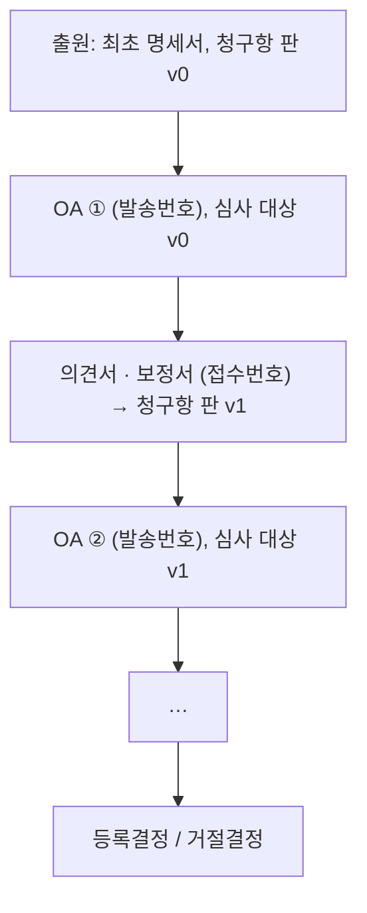
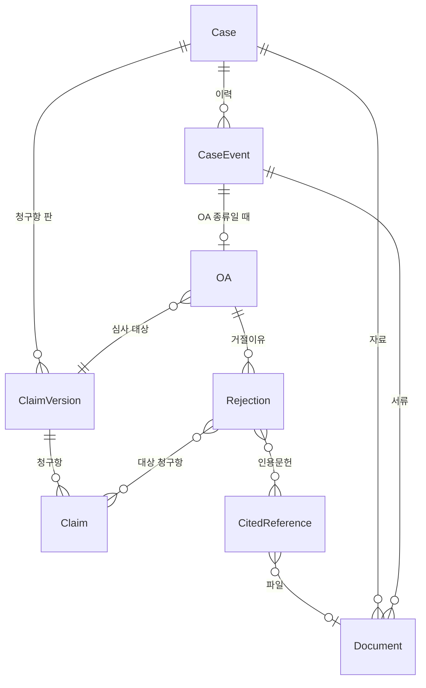

# 데이터 모델

화면, 서버, AI 코어가 같은 데이터 모델·스키마를 보고 동시에 만들 수 있게 엔티티, 결과 스키마, DB 모델을 적는다. 시스템 전체는 [전체 설계](architecture.md), API는 [API 명세](api/README.md), 기술 선택은 [ADR 0003](decisions/0003-tech-stack.md).

## 1. 이름
이름은 FastAPI 관례를 따른다. Pydantic 클래스는 **스키마**, SQLAlchemy 클래스는 **DB 모델**이라 부른다. **도메인 모델**은 코드 클래스가 아니라 엔티티와 관계의 정의다.

| 이름 | 무엇 | 코드 |
|---|---|---|
| 도메인 모델 | 사건·OA·거절이유·청구항·인용문헌·서류 같은 엔티티와 관계 (2절) | 코드로 어떻게 둘지 열림 (6절) |
| 결과 스키마 | AI 결과 ①~⑥. 단계 사이에 주고받는다 (4절) | `core/schemas/` Pydantic |
| 요청·응답 스키마 | 엔드포인트마다 하나 (Spring의 요청·응답 DTO). 결과 응답 스키마는 결과 스키마를 감싼다 ([API 명세](api/README.md)) | API 쪽 Pydantic (`response_model`) |
| DB 모델 | 테이블 (5절) | SQLAlchemy (ORM 모델) |

## 2. 도메인 모델 (엔티티·관계)
사건 시간축 (출원번호 하나 아래, 이력 순서대로):

- 청구항 판은 "어느 보정서(접수번호)로 생긴 판인가"로 붙이고, OA마다 심사 대상이 된 판을 가리킨다. 날짜만으로 판을 고르지 않는다.

- `Case`(출원번호, 출원일, 최초 명세서) 1:N `CaseEvent`(종류: OA / 보정서 / 의견서 / 등록결정 / 거절결정 / 기타, 문서번호, 날짜)
- `CaseEvent` 중 OA는 1:1 `OA`. `OA` 1:N `Rejection`
- `Case` 1:N `ClaimVersion`(판, 만든 보정서의 접수번호) 1:N `Claim`(번호, 독립/종속, 인용하는 앞 청구항)
- `OA` → 심사 대상 `ClaimVersion`
- `Rejection` N:M `Claim` (대상 청구항)
- `Rejection` N:M `CitedReference`(문헌 번호, 나라, 공개일, 파일 있음/없음 → `Document`). 인용 식별번호·심사관 지정 위치는 연결 쪽 칸
- `Document`(출처: 올림 / API) ← `Case`·`CaseEvent`
- 규칙: 출원번호 + 발송번호(OA) / 접수번호(보정)로 묶는다. 날짜만으로 합치지 않는다. 심사 대상 판을 모르면 "확인되지 않음"이고, 그 판에 기대는 작업만 보류한다.
- 쓰임: OA·보정서는 서비스 로직이 쓴다(F1·F3·F4). 의견서·등록결정·거절결정은 화면 표시와 평가에만 쓴다.

## 3. 공통 속성 (모든 결과에 붙음)
- API·DB 값은 영어 코드이고 화면에서 한국어로 보여 준다.
- `status`: 확인됨 `confirmed` / 확인되지 않음 `unverified` / 조회 범위 내 없음 `not_found_in_scope` / 충돌 `conflict`. 뜻은 "이 결과가 기대는 사실을 원문에서 확인했나"이다. AI 판단이 맞는지는 사람이 본다. 값은 객체 `{value, reason, checked, searched_scope}`이고 직렬화하면 늘 네 필드다. `confirmed`면 `checked`(무엇을 확인했나), `unverified`면 `reason`, `not_found_in_scope`면 `searched_scope`(찾아본 범위)를 꼭 채운다. `unverified` 이유는 여섯: `lookup_failed` · `body_missing` · `edition_unknown` · `not_extracted` · `ambiguous` · `input_unverified`. 기준은 코드 [`common.py`](../src/patent_ai/core/schemas/common.py).
- 결과 전체 `status`는 안쪽 필드 status 중 가장 나쁜 값이다 (`conflict` > `unverified` > `not_found_in_scope` > `confirmed`). 지원 안 하는 거절이유·나라는 빼고 `flags`로만 남긴다. 단 거절이유는 조문이 `confirmed`일 때만 빼고, 조문을 모르면(`unverified`·`conflict`) 넣는다. 거절이유 0개이고 위쪽 필드가 모두 `input_unverified`(스캔본)면 결과 `reason`은 `input_unverified`이고 경고는 남기지 않는다 (`worst_status`는 `common.py`, 모으는 쪽은 [`oa_result.py`](../src/patent_ai/core/schemas/oa_result.py)).
- `evidence` 목록: 문서 ID(`Document`) + 위치(쪽·문단·조문) + 판본 + 확인 기준일.
- `origin`: AI 생성 `ai_generated` / AI 기본값 `ai_default` / 사람이 고름 `human_selected` / 사람이 고침 `human_edited`. 사람이 고치는 것은 초안뿐이고, 고치면 AI 원본 값을 같이 남긴다 (덮어쓰지 않음). 중간 결과(F1·F2·F3)는 사람이 고치지 않는다.
- 그 밖 표시: `needs_recheck`(다시 확인 필요)는 status 값이 아니라 별도 필드(`recheck_reason` 같이)이고, 직접 판단 필요 `needs_human_judgment`·직접 검토 필요 `needs_human_review`는 `flags` 목록에 둔다. 기준은 `common.py`.
- 규칙 1 상태 전파: 실제로 기대는 입력이 "확인됨"이 아니면 뒤 결과는 "확인되지 않음(이유 코드 `input_unverified`)". 기대지 않는 입력은 영향이 없다.
- 규칙 2 다시 확인 필요: 앞 입력이 바뀌면(빠진 자료 추가, 대응 방향 바꾸기) 뒤 결과에 "다시 확인 필요"를 붙인다. 자동으로 다시 돌리지 않고 사람이 정한다.
- 모델·프롬프트·비용 같은 실행 정보는 결과 필드가 아니라 실행 기록(5절 `runs`·`agent_steps`)에 둔다.

## 4. 결과 스키마 (단계 사이에 주고받는 Pydantic 스키마, v0)
필드는 구현하면서 고칠 수 있다. 바꾸는 규칙은 [API 명세](api/README.md) 4절. 추출한 값 하나하나(출원번호·발송번호·통지일·제출기일·통지 종류·조문·대상 청구항·인용 식별번호)는 `{값, 원문 글자, 쪽, 상태}`로 둔다.

| # | 결과 스키마 | 누가 → 누구 | 필드 |
|---|---|---|---|
| ① | `OAResult` OA 정리 | F1 → 지휘·F3·F4 | 필드: oa_id, 출원번호·발송번호, 통지일·제출기일, 통지 종류, examined_claims(심사 대상 청구항 번호), 심사 대상 ClaimVersion, 심사관 힌트, rejections(no(OA 순번)·kind(novelty·inventive_step·clarity·other, 조문에서 정함)·조문·지원 여부·대상 청구항·인용문헌(label D1·D2…·키 꼴 번호·식별번호)·심사관 논리), 공통 필드. 기준은 코드 [`oa_result.py`](../src/patent_ai/core/schemas/oa_result.py) |
| ② | `JudgmentUnit` 판단 단위 | 판단 단위 나누기 도구(기본 묶기)·지휘(더 나누기) → F3·F4 | unit_id(내용으로 정함: `OA ID:조문:대표 청구항`, 예 `oa_1:29-2:c1`. 지휘가 더 나눈 하위 단위는 `oa_1:29-2:c1/a`. 다시 돌려도 같은 묶음은 같은 ID라 사람이 고른 선택이 이어진다. 청구항이 바뀌어 묶음이 달라지면 ID도 달라지고 "다시 확인 필요"), rejection, 단위 종류(독립항 묶음: 진보성·신규성 / 청구항 하나: 명확성), 결과: 신규성은 묶음 순서로 보되 청구항마다 ([ADR 0001](decisions/0001-ai-amended-claim-draft.md)), 청구항(대표 독립항 + 묶음 안 종속항), 가지("또는"형 종속항), 함께 읽을 청구항(명확성), 순서(독립항 먼저), 부모 단위(무너진 묶음을 나눌 때), 공통 칸 |
| ③ | `ComparisonTable` 대비표 | F3 → F4 | unit, 거절이유 유형(진보성/신규성), 신규성이면 비교 대상 인용문헌 하나, 인용문헌마다 대비함/지원 안 함(나라), rows[청구항 요소(문구+위치), 인용문헌, 위치(식별번호 또는 도면 번호), 판단(개시됨/차이 후보/불명), 문단 출처(심사관 지정/AI가 새로 찾음), 왜 가져왔나(AI가 새로 찾은 문단만), 공통 칸], 유형별 정리(이름만), 공통 칸. 명확성은 "명확성 문구 검토" 스키마(이름만) |
| ④ | `LegalEvidenceBundle` 법률 근거 묶음 | F2 → F3·F4 | 질문(원문 + 선택 조건: 시점·자료 유형), 기준일(사용자 시점, 없으면 현행 + 확인 기준일, 사건 적용일로 자동 확정 안 함), 주장들[주장 문장, 근거(공통 evidence + 자료 종류·식별자·전문/요지·법원 판단/당사자 주장), 공통 칸], 공통 칸. 근거 검토 결과는 상태로 남긴다. "적용된다" 칸은 두지 않는다 |
| ⑤ | `DirectionCandidates` 대응 방향 후보 | F4 → 화면 | unit, 후보들[순위(확신 낮음이면 없음), 거친 방향(반박만/보정+반박/보정만), 이유, 확신도(높음/중간/낮음, 낮음 = 직접 판단 필요), 거절이유별 대응, 보정 핵심(청구항별 보정 종류 + 부가한 구성의 출처), 반박 논리 유형 + 요지, 확인 사항, 공통 칸], 선택(AI 기본값/사람이 고름), 보정 제한(최초 / 최후 / 확인되지 않음), 공통 칸. 값 목록은 [대응 방향 분류](product/domain/대응_방향_분류.md)와 같은 코드. 후보 수·확신도 기준값은 설정 파일 |
| ⑥ | `CaseMaterials` 사건 자료·보류 목록 | 지휘 → 화면 | 필드: case_id, documents, missing(빠진 자료), held_tasks(보류한 작업), review_items_count(검토할 사항 N건). 기준은 코드 [`case_materials.py`](../src/patent_ai/core/schemas/case_materials.py), 검토할 사항 모으기는 [`propagation.py`](../src/patent_ai/core/schemas/propagation.py) |

②~⑤ 코드는 F2~F4 설계 때 (11/18). 그 전까지 ②~⑤ 줄은 방향만 적은 것이다.

- 법률 근거의 겉 포장은 둘이다(이름만): OA 흐름의 **법률 조사 요청/결과**(지휘 에이전트가 자동으로 F2를 부르고, 찾은 근거는 origin = AI 생성)와 **법률 질문 대화**(사건 없이 여러 번 묻고 답함). 칸은 F2·F3 설계 때 정한다.
- 이름만 자리 잡은 것(기능 설계 때): 대비표 유형별 정리, 명확성 문구 검토, 의견서·보정 청구항 초안, 초안 검사 결과, 사건 전체 검사 결과, 단계별 검증 결과. (그래프 노드·연결선은 M3에 그래프를 넣기로 하면 그때.)
- 도구 결과: `SearchResult`(검색, `retrieval/schemas.py`). 법령·인용문헌 조각 검색이 돌려주는 도구 결과이고 저장하지 않는다. 칸은 [검색 계약 design 3-2절](features/retrieval/design.md).
- 한 사건분 가짜 결과 파일(`tests/fixtures/`)은 결과 스키마 코드와 같이 만든다 (#14).

## 5. DB 모델 (저장)
여기 적은 테이블 이름과 컬럼은 v0 방향이다. 컬럼 타입·제약·인덱스·마이그레이션은 서버 이슈(#55)에서 서버 코드로 정하고, 그때 이 절을 맞춘다.

- 엔티티 표: `users`(기본 한 명) · `cases`(`user_id`) · `case_events` · `documents`(경로·해시·출처·받은 시각) · `claim_versions` · `claims` · `oas` · `rejections` · `cited_references` · N:M `rejection_claims`, `rejection_citations`(심사관 지정 위치).
- 결과 표: 결과 스키마마다 표 하나. 본문은 `jsonb`, `status`·`origin`·`run_id`·`oa_id`는 보통 컬럼. M1은 `oa_results`와 `case_materials`(⑥, 사건마다 최신 한 줄). ⑥은 지휘가 실행이 끝날 때·자료가 더해질 때 다시 써서 저장하고, 사건을 다시 열면 저장본을 읽는다. 스키마 검증은 Pydantic이 한다.
- 같은 OA를 여러 번 돌리면 API는 판단 단위마다 가장 최근에 성공한 실행(`succeeded`)의 결과를 준다. 판단 단위가 없는 결과(①, 사건 전체 검사)는 OA마다, ⑥은 사건마다 가장 최근 것을 준다. 앞 결과는 지우지 않고 남긴다 (이력·채점용). 고르는 방법은 서버 코드에서 정한다 (#55·#56).
- 실행 기록: `runs`(API 실행 상태 겸) · `agent_steps`(LLM 단계와 코드 도구 단계 모두. 모델·토큰·비용·시간·만든 결과 ID).
- `result_inputs`(뒤 결과 → 기댄 앞 결과·자료): 상태 전파와 "다시 확인 필요"에 쓴다.
- `api_cache`: 외부 API 응답. 외부 API 호출은 이 캐시와 호출 상한을 거친다.
- 원본 파일은 디스크에 두고 DB에는 경로만 둔다. 위치: `data/raw/cases/<출원번호>/`(평가 사건, 자동 조회, 사용자 업로드가 같은 자리) → 가공본 `data/processed/cases/<출원번호>/`, 법령은 `data/raw/legal/`. 파일 이름 규칙은 자동 조회 이슈(#54)에서 정한다.
- 벡터 조각과 그래프는 원본에서 만든 검색 인덱스라 여기서 정하지 않는다 (벡터 조각은 F2·F3 설계, M2. 그래프는 M3에 넣기로 하면 그때).
- M1은 위 표만 만든다. M2·M3 표는 그때 마이그레이션으로 더한다.

## 6. 열린 것
| 무엇 | 어디서 정하나 |
|---|---|
| 도메인 모델을 코드로 어떻게 둘지 (core Pydantic 스키마로 따로 둘지, DB 모델만 둘지) | AI 코어 분담 회의 |
| 에이전트 상태 (LangGraph State 스키마): 실행 중 들고 다니는 값 | 지휘 에이전트 호출 이슈 |
| 외부 API 응답 스키마: KIPRIS·법령 API 응답 파싱 | 자동 조회 이슈 (#54) |
| LLM 출력 스키마 (structured output): 결과 스키마와 같을지 일부일지 | F1 설계 |
| 화면 TS 타입: OpenAPI에서 자동 생성 (손으로 안 만듦). 생성 도구 | 화면 설계 |
| 그래프 노드·연결선 스키마와 저장 | M3에 그래프를 넣기로 하면 (11/24 판단) |
| 법률 질문 대화의 칸 | F2 설계 |
| F4 초안 결과 스키마 | F4 설계 |
