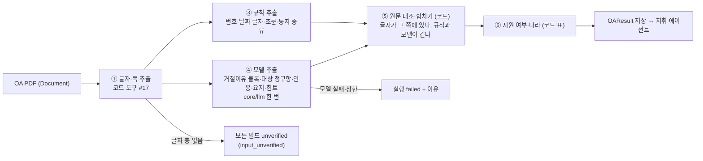

# F1 OA 읽기·거절이유별 정리 세부 설계
<!-- 모르는 곳은 [확인 필요: 무엇]으로 남긴다. [가정]은 모르지만 일단 정한 것, [확인 필요]는 아직 못 정한 것.
     requirements.md에 쓴 것(무엇, 합격 기준, 사람이 고르는 곳)은 다시 쓰지 않고 번호로 가리킨다. -->

## 1. 합격 기준 ↔ 설계
| 기준 (requirements 번호) | 설계의 어디가 만족시키나 | 이슈 |
|---|---|---|
| 1 필드 + 쪽 | 2절 ③ 규칙 추출 + ④ 모델 추출, 모든 값이 `ExtractedValue{value, raw_text, page, status}` (3-2) | #18 (글자·쪽은 #17) |
| 2 못 뽑음·애매 = 확인되지 않음, 지어내지 않음 | 2절 ⑤ 원문 대조: 원문 글자가 그 쪽 텍스트에 없으면 값·쪽을 버리고 `unverified` | #18 (상태 모양은 #14) |
| 3 청구항 하나에 거절이유 여럿 | 3-2 `rejections[].claims`는 거절이유마다 따로 두고 합치지 않음. 청구항 번호 범위 펼치기는 코드 (2절 ③) | #18 |
| 4 빠진 자료 표시·그 작업만 보류 | ⑥ `CaseMaterials.missing`·`held_tasks` (3-2), 기대는 작업은 `result_inputs`로 | #14 (모양), #16·#54 (채우기) |
| 5 지원 안 하는 이유 = 직접 검토 필요 | 2절 ⑥ 조문 → 지원 표 (코드), `flags: ["needs_human_review"]` | #18 |
| 6 통지 종류 | 2절 ③ 규칙: "최후" 표시 → `final`, 머리말을 읽었는데 표시 없음 → `initial`, 머리말을 못 읽음 → `unknown` + `unverified(not_extracted)` (정답 형식 f1-oa-gold.md 2.1) | #18 |
| 7 저장·다시 열기 | 5절 `oa_results`·`documents` | #55·#56 |
| 8 묶기·OA 시점까지만 | 4절 판 고르기. 자르기는 무조건 도는 코드 단계(조회 결과 + 올린 자료, #54), 묶기는 #16 | #54·#16 |
| 9 tune 점수 | 7-1절 | #18 (채점은 #20·#22) |

## 2. 흐름

1. 입력: 대상 OA의 `Document`(올린 PDF). 사건·출원번호는 몰라도 된다 (출원번호도 이 흐름에서 읽는다).
2. 처리:
   - ① 글자·쪽 추출 (#17): PDF → `PageText[{page, text}]` + 글자 추출 status. 글자 층이 없으면(스캔본) `unverified(body_missing)`.
     - 쪽 번호는 PDF 물리 쪽 순서(1부터), 인쇄된 쪽 표시와 다를 수 있음.
   - ③ 규칙 추출 (코드, 정규식): 출원번호(`10-YYYY-NNNNNNN`), 발송번호, 통지일·제출기일의 원문 글자(날짜로 바꾸지 않음), 조문(`제29조제2항` → `29-2`), 청구항 번호 범위(`제1항 내지 제4항, 제6항` → `[1,2,3,4,6]`), 통지 종류(`initial`/`final`/`unknown`, 아래 필드 출처 표). [가정] 국내 OA는 출원번호·발송번호·날짜가 정해진 칸에 글자로 있다 → 표본 OA 5건에서 확인 (#22).
   - ④ 모델 추출 (#13 모델 호출 모듈 한 번): 거절이유 블록마다 조문 원문, 대상 청구항 원문, 인용문헌 번호, 인용 식별번호, 심사관 논리 요지(원문 + 쪽), 「특허 가능한 청구항」, 【보정에 관한 참고사항】. 모델은 값마다 **원문 글자와 쪽**을 같이 돌려준다. 출력은 LLM 출력 스키마 `OAExtraction`(3-2)이고, 상태는 모델이 정하지 않는다.
   - ⑤ 원문 대조·합치기 (코드): 모델이 준 원문 글자가 그 쪽 텍스트에 실제로 있는지 본다 (공백·줄바꿈만 무시). 없으면 값과 쪽을 버리고 `unverified(not_extracted)`. 규칙 값과 모델 값이 둘 다 있고 다르면 `conflict`(둘 다 남김). 하나뿐이면 그 값. 모델이 "애매"라고 표시하면 `unverified(ambiguous)`. 청구항 번호 범위·조문은 모델 원문 글자를 ③ 코드로 다시 정규화한다.
   - ⑥ 지원 여부·나라 (코드 표): 조문 `29-1`(신규성)·`29-2`(진보성)·`42-4-2`(명확성)만 지원, 그 밖은 `flags: ["needs_human_review"]`. 지원 표는 `config/f1.yaml`이 아니라 코드 상수 (실험 값이 아님). 나라는 인용문헌 표기에서 정규식으로 정한다: `공개특허공보 제10-YYYY-NNNNNNN호`·`등록특허공보 제10-NNNNNNN호`·`KR …` → KR, `US YYYY/NNNNNNN`·`US N,NNN,NNN`·`미국 …` → US, `JP`·`CN`·`EP`·`WO`·`일본`·`중국` → 그 나라(지원 안 함, 직접 확인), 맞는 것이 없으면 `null` + `unverified(ambiguous)`. [가정] 국내 OA 인용문헌 표기는 이 몇 가지 안에 든다 → 표본 OA로 확인 (#22).

**필드 출처 표** (누가 뽑고 어떻게 합치나):
| 필드 | 규칙 ③ | 모델 ④ | 합치기 ⑤ |
|---|---|---|---|
| 출원번호, 발송번호 | 뽑음 | 뽑음 | 둘 다 대조 통과 + 같음 → `confirmed` / 다름 → `conflict`(둘 다 남김) / 하나만 통과 → 그 값 |
| 통지일·제출기일 (글자) | 뽑음 | 안 뽑음 | 규칙 값만. `value`는 비우고 `raw_text`·`page` |
| 통지 종류 | 뽑음 | 안 뽑음 | 규칙 값만. "최후거절이유통지" 표시가 있으면 `final`(원문 글자 + 쪽). 1쪽 머리말 글자를 읽었는데 표시가 없으면 `initial`, `raw_text`·`page`는 `null`, `confirmed`(`checked` = "최후 표시 없음, 1쪽 머리말·거절이유 표 아래·[첨 부] 앞을 봄"). 1쪽 머리말을 못 읽으면 `unknown` + `unverified(not_extracted)`. 이력(앞 보정서)과의 대조는 #16 묶기에서 `conflict`로 |
| 거절이유 블록 나누기, 조문 | 안 뽑음 | 블록마다 조문 원문 | 모델 `raw_text`를 대조한 뒤 ③ `normalize_article`로 정규화한 값만 씀 |
| 대상 청구항 | 안 뽑음 | 블록마다 원문 | 모델 `raw_text`를 대조한 뒤 ③ `expand_claims`로 펼침. 규칙 값과 비교하지 않음 |
| 인용문헌 번호, 인용 식별번호 | 안 뽑음 | 블록마다 원문 | 대조 뒤 나라는 ⑥ 정규식 |
| 심사관 논리 요지 | 안 뽑음 | 요지 + 원문 | 원문 `raw_text`만 대조 (요지 글은 대조하지 않음, `origin: ai_generated`) |
| 「특허 가능한 청구항」, 【보정에 관한 참고사항】 | 안 뽑음 | 원문 (칸이 없으면 "없음") | 대조 뒤 청구항은 `expand_claims`. 칸이 없으면 "없음": 값 `[]` / `null`, `raw_text`·`page`는 `null`, `confirmed`(`checked` = "원문에 칸 없음"). "확인되지 않음"과 다름 (정답 형식 f1-oa-gold.md 2.1·4절) |
- 원문에 글자가 없어서 정한 값(통지 종류 `initial`, 힌트 "없음")은 쪽이 없는 `confirmed`이고 `checked`에 본 범위를 적는다. "확인하지 않은 원문 위치 0건"은 쪽이 있는 값에만 건다.
- `ambiguous` 표시: 모델이 애매하다고 하면 `value`는 `null`, `raw_text`·`page`는 대조에 통과할 때만 남기고 `unverified(ambiguous)`.
- 글자 층이 없으면(① `unverified`) ③④를 건너뛰고 모델을 부르지 않는다.
3. 결과 저장: `OAResult`(①)를 지휘 에이전트에 돌려주고, 서버가 `oa_results`에 저장한다 (5절).
- 실패하면: 글자 추출 실패 → 실패로 끝내지 않고 필드 전부 `unverified(input_unverified)`, 결과 status `unverified`. 모델 호출이 상한·오류로 끝내 실패 → 실행 `failed` + 이유 (#13이 남김). 모델 출력이 `OAExtraction` 검사에 떨어지면 한 번 다시 부르고, 또 떨어지면 `failed`.
- 비면: 거절이유 0개 → 경고 로그 + 결과 status `unverified(not_extracted)` (requirements 실패할 때).
- 느리면: OA는 짧아 한 번 호출이면 된다. [가정] 국내 OA는 10쪽 안쪽이라 한 번 호출 입력에 들어간다 → tune 묶음 쪽 수로 확인 (#22). 넘으면 쪽을 나눠 부르는 것은 그때 정한다.

### 2-1. 흐름 방식
- **코드 흐름** (에이전트 루프 아님). F1 "OA 읽기"는 지휘 에이전트가 부르는 도구 하나다 ([architecture.md](../../architecture.md) 8절). 안의 순서(①→③④→⑤→⑥)는 늘 같고, 다시 찾기·보류·사람에게 묻기 같은 진행 판단이 없어 루프가 필요 없다. 모델은 ④에서만 쓴다 ([ADR 0003](../../decisions/0003-tech-stack.md): 정해진 일은 코드).
- 진행 판단은 지휘 에이전트(#15)에 있다: 출원번호가 `unverified` 또는 `conflict`면 `waiting_for_human`(기다리는 것: 출원번호)으로 멈추되 F1 결과는 그대로 저장, 사건 묶기·자동 조회(#16·#54) 부르기, 같은 OA 판정.
- `extract_pages`(#17)는 지휘가 `read_oa` 앞에 늘 부르는 코드 도구다 (#15 도구 규약). 서버는 부르지 않는다 (서버는 `run_case()`만 부름, #15).
- 단계 기록: 도구 호출 한 번이 `agent_steps` 한 줄 (도구 이름 `read_oa`, 만든 결과 ID). ④ 모델 호출의 모델·토큰·비용·시간은 #13이 같은 실행(`run_id`)에 남긴다.

## 3. 데이터 모양
### 3-1. 앞 기능에서 받는 것
- 앞 기능 없음. 받는 것은 `Document`(OA PDF)와 그 `PageText`(#17).
- `PageText`가 `unverified`(스캔본)이면 ⑤에서 모든 필드가 `unverified(input_unverified)`, 뒤 작업(F3·F4)은 규칙 1로 보류.

### 3-2. 다음 기능에 주는 것
공통 칸 (이슈 #14 제안, requirements "입력과 출력". 확정은 #14 PR):
```json
{
  "status": {"value": "unverified", "reason": "not_extracted", "checked": null, "searched_scope": null},
  "evidence": [{"document_id": "d_1", "page": 2, "raw_text": "제1항 내지 제4항", "edition": null, "checked_on": "2026-11-18"}],
  "_주석": "아래 OAResult 예시는 status를 줄여 적었다. 직렬화하면 status는 늘 네 키 {value, reason, checked, searched_scope}, 없는 키는 null",
  "origin": "ai_generated",
  "needs_recheck": false, "recheck_reason": null,
  "flags": []
}
```
`OAResult` (①, F1이 더하는 칸):
```json
{
  "oa_id": "oa_1",
  "application_number": {"value": "10-2099-0000001", "raw_text": "10-2099-0000001", "page": 1, "status": {"value": "confirmed", "checked": "1쪽 출원번호 칸 글자와 일치"}},
  "dispatch_number": {"value": "9-5-2099-000000001", "raw_text": "...", "page": 1, "status": {"value": "confirmed", "checked": "..."}},
  "notice_date":  {"value": null, "raw_text": "2099.01.26", "page": 1, "status": {"value": "confirmed", "checked": "원문 글자만, 날짜 확정 안 함"}},
  "response_due": {"value": null, "raw_text": "2099.03.26", "page": 1, "status": {"value": "confirmed", "checked": "원문 글자만, 기한 확정 안 함"}},
  "notice_kind":  {"value": "final", "raw_text": "최후거절이유통지", "page": 1, "status": {"value": "confirmed", "checked": "..."}},
  "examined_claim_version": null,
  "examiner_hints": {"allowable_claims": {"value": [5, 7], "raw_text": "청구항 5, 7", "page": 3, "status": {"...": "..."}},
                     "amendment_note": {"value": null, "raw_text": "…", "page": 3, "status": {"...": "..."}}},
  "rejections": [
    {"article": {"value": "29-2", "raw_text": "특허법 제29조제2항", "page": 2, "status": {"...": "..."}},
     "supported": true,
     "claims": {"value": [1, 2, 3, 4], "raw_text": "제1항 내지 제4항", "page": 2, "status": {"...": "..."}},
     "citations": [{"number": {"value": "KR10-0000001", "raw_text": "...", "page": 2, "status": {"...": "..."}},
                    "country": {"value": "KR", "raw_text": "KR10-0000001", "page": 2, "status": {"...": "..."}}, "country_supported": true,
                    "cited_paragraphs": {"value": ["0023", "0031"], "raw_text": "식별번호 [0023], [0031]", "page": 2, "status": {"...": "..."}}}],
     "examiner_reasoning": {"value": "…요지…", "raw_text": "…원문…", "page": 2, "status": {"...": "..."}},
     "status": {"...": "..."}, "evidence": [], "origin": "ai_generated", "needs_recheck": false, "recheck_reason": null, "flags": []}
  ],
  "status": {"...": "칸들 중 가장 나쁜 값"}, "evidence": [], "origin": "ai_generated", "needs_recheck": false, "recheck_reason": null, "flags": []
}
```
- 값 하나하나는 `ExtractedValue{value, raw_text, page, status, candidates}` ([data-model.md](../../data-model.md) 4절 첫 줄에 `candidates`를 더함). 날짜·기한은 `value`를 비우고 `raw_text`만 둔다 (합격 기준 2). `candidates: [{value, raw_text, page, source: rule|model}]`는 `conflict`일 때만 채우고 그때 `value`는 `null` (규칙·모델 값을 둘 다 남김).
- `notice_kind.value`: `initial` / `final` / `unknown`(이때만 `unverified`). 정답 형식과 같은 코드.
- `examined_claim_version`: F1이 채우지 않는다. 사건 묶기·자동 조회(#16·#54)가 4절 규칙으로 정해 넣고, 모르면 `unverified`.
- 지원 안 하는 거절이유: `supported: false` + `flags: ["needs_human_review"]`. 지원 안 하는 나라 인용문헌: `country_supported: false` + `flags: ["needs_human_review"]`.
- 결과 전체 `status` = 칸들 중 가장 나쁜 값 (`conflict` > `unverified` > `not_found_in_scope` > `confirmed`). 단 지원 안 하는 거절이유는 상태를 나쁘게 하지 않는다 (flags로만). 전체 `reason`은 가장 나쁜 칸의 `reason`(같은 값이 여럿이면 앞 칸 순서: 식별 정보 → 통지 → 거절이유 순), `confirmed`면 `checked = "모든 칸 원문 대조"`. 거절이유 하나의 `status`도 같은 규칙으로 그 안 칸들을 모은다.
- 결과 단위 `evidence` = 값마다 `{document_id, page, raw_text}`를 모은 목록 (대조에 통과한 것만).
- LLM 출력 스키마 `OAExtraction` ([data-model.md](../../data-model.md) 6절 열린 것을 여기서 정함): 결과 스키마의 일부. 값마다 `{value, raw_text, page, ambiguous: bool}`만 두고 `status`·`supported`·`country`·`flags`는 없다 (코드가 ⑤⑥에서 붙임). 모델이 상태를 정하지 않게 하려는 것이다.
- `CaseMaterials`(⑥) 중 F1에서 쓰는 칸: `documents[]`, `missing[{what, depends_on_tasks, lookup_result, ask_upload: true}]`, `held_tasks[{task, waiting_for}]`, `review_items_count`. 채우는 것은 #16·#54, 모양은 #14.
- 앞 기능 결과가 바뀌면 "다시 확인 필요": F1은 맨 앞이라 없다. 다만 사람이 출원번호를 넣거나(`PATCH /cases/{id}`) 빠진 자료를 올리면, 그 자료에 기댄 뒤 결과(F3·F4)에 `needs_recheck`를 붙인다 (data-model 3절 규칙 2, #14).
- 인터페이스 변경: **있음**. 받는 쪽에 알림 (서버 담당: API, 결과 스키마 #14).

| 바뀌는 곳 | 지금 (api/README.md) | 바꿀 것 | 확정 |
|---|---|---|---|
| `POST /cases` | `{case_id, oa_id, run_id}` | 같은 파일(해시)이면 409 `{code: "oa_already_exists", case_id, oa_id}` | 서버 담당 리뷰 |
| `POST /cases/{id}/oas` | `{oa_id, run_id}` | 같은 파일(해시)이면 409 `{code: "oa_already_exists", case_id, oa_id}` | 서버 담당 리뷰 |
| `PATCH /cases/{id}` | 없음 | 출원번호 넣기 → 기다리던 실행이 이어 감 (이어 가는 방식 #15) | 서버 담당 리뷰 |
| `GET /cases/{id}` | 사건 + OA 목록 | + `events[{kind, doc_number, date}]`, `claim_versions[{version, created_by_receipt_number, claim_count}]`, 각 OA에 `examined_claim_version{version, created_by_receipt_number}`. events·claim_versions는 올라온 OA 중 가장 늦은 OA 시점까지. 청구항 본문은 넣지 않음 | 서버 담당 리뷰 |
| 실행 `waiting_for_human` | 확신 낮은 묶음의 방향 고르기를 기다림 | + 출원번호 입력 기다림 (`waiting_for: application_number`, 목록은 #15) | 서버 담당 리뷰 |
| 실행 결과 `case_id` | 없음 | 기존 사건에 붙거나 중복이면 실행에 최종 `case_id`를 남김 (11/18 확인, requirements 실패할 때) | 서버 담당 리뷰 |
| `GET /documents/{id}` | 원문과 쪽 | 메타 + `pages[{page, text}]` + 글자 추출 status | 서버 담당 리뷰 |
| `GET /documents/{id}/file` | 없음 | 원본 PDF | 서버 담당 리뷰 |
| 실행 `failed` 오류 | `{code, message}` | 같은 OA면 `{code: "oa_already_exists", case_id, oa_id}` | 서버 담당 리뷰 |
| 결과 공통 칸 | data-model 3절 | 위 JSON (Status 객체, 이유 셋 더함, `needs_recheck`, `flags`) | #14 PR |

승인되면 api/README.md·data-model.md는 #14·#56 PR에서 같이 고친다 (이 문서가 기준이 되지 않게).

## 4. 판과 근거
- **쓰는 청구항 판:** F1은 청구항 본문을 읽지 않고 번호만 뽑는다. 심사 대상 판(`examined_claim_version`)은 #16·#54가 정한다: 행정 이력 순서에서 대상 OA(발송번호) **앞**에 있는 마지막 보정서(접수번호)가 만든 판, 보정서가 없으면 출원 때 판(v0). 날짜만으로 고르지 않는다. 이력을 못 가져오면 `unverified(lookup_failed)`.
- **OA 시점 자르기 (합격 기준 8):** 이력 순서·발송번호·접수번호로 대상 OA 뒤 이벤트를 버린다. 자른 사건 자료가 그 OA 실행의 코어 입력이다. 자르기는 #54 조회 결과와 #16 올린 자료(`POST /cases/{id}/documents`) **모두**에, F1이 출원번호를 읽은 뒤 무조건 도는 코드 단계로 돈다 ([ADR 0003](../../decisions/0003-tech-stack.md) 고정 단계). 지휘는 건너뛸 수 없다. 이력에서 순서를 정할 수 없는 자료는 입력에서 빼고 `unverified`. 시험은 9절 `case_two_oas/`·`case_unordered/`.
- [architecture.md](../../architecture.md) 8절 그림은 자르기(CUT)가 F1보다 앞이지만, 출원번호는 F1이 읽어야 알 수 있어 순서는 "F1 OA 읽기 → 자동 조회 + 자르기"다. 그림은 #15 PR에서 맞춘다.
- **쓰는 법령·심사기준 판:** 해당 없음 (F1은 조문 번호만 읽고 본문을 보지 않는다).
- **근거 위치 적는 법:** `evidence{document_id, page, raw_text}`. 화면은 `GET /documents/{id}`의 그 쪽 `text`에서 `raw_text`를 찾아 강조한다. 원본 PDF가 필요하면 `/file`.

## 5. 저장
- 읽는 테이블: `documents` (OA PDF 경로). 쓰는 테이블: `documents`(쪽 텍스트 가공본 경로), `oa_results`(jsonb + `status`·`origin`·`run_id`·`oa_id` 컬럼), `agent_steps`, `result_inputs`(OAResult → OA Document). 테이블은 #55.
- 파일: 올린 OA는 출원번호를 읽기 전에 `case_id` 자리의 임시 폴더(제안 `data/raw/uploads/<case_id>/`)에 두고, 출원번호를 읽으면 `data/raw/cases/<출원번호>/`로 옮긴다. 정확한 경로·파일 이름 규칙은 #54. 같은 파일 판정은 `documents`의 해시로 한다 (409). 쪽 텍스트는 `data/processed/cases/<출원번호>/`.
- 검색: 해당 없음.
- 외부 API에서 받는 자료: F1 자체는 없음 (자동 조회는 #54, `api_cache` 거침).
- 외부 모델로 보내는 자료: 통지서(OA) 원문 → [architecture.md](../../architecture.md) 7절 표 "보냄". 그 밖의 자료는 F1 모델 호출에 넣지 않는다.

## 6. 화면 (시연용)
- 시연 흐름 한 줄: OA PDF 끌어 놓기 → "통지서 읽는 중" → 거절이유 카드 목록 (조문·대상 청구항·인용문헌·식별번호, 값마다 쪽 링크와 상태 점) → "검토할 사항 N건" → 빠진 자료 "올려 주세요".
- 와이어프레임:
```
┌ 사건 10-2099-0000001 · OA 9-5-2099-000000001 (최후거절이유통지 ●확인됨) ┐
│ 통지일 2099.01.26 [1쪽]   제출기일 2099.03.26 [1쪽] (원문 글자, 직접 확인)   │
├─────────────────────────────────────────────────────────────┤
│ ① 진보성 29조 2항  청구항 1~4 [2쪽]  인용 KR10-0000001 [0023][0031] [2쪽] │
│ ② 명확성 42조 4항 2호  청구항 1 [3쪽]                                      │
│ ③ 발명의 설명 42조 3항  ⚠ 직접 검토 필요                                   │
│ 심사관 힌트: 특허 가능한 청구항 5, 7 [3쪽]                                  │
├─────────────────────────────────────────────────────────────┤
│ 검토할 사항 2건: 인용문헌 US 2099/0000001 본문 없음 [올려 주세요]           │
└─────────────────────────────────────────────────────────────┘
```

## 7. AI
### 7-1. 공통 칸
- 인터페이스: `read_oa(pages: PageText, document_id: str, oa_id: str, run_id: str, *, ctx: RunContext) -> OAResult` (`core/f1_oa_reader/`). 지휘 에이전트는 이 함수를 도구로 등록한다 (#15 도구 규약).
- 평가 세트·지표: `data/goldsets/tune/` 통지서 읽기 정답 (판 번호는 #22에서 정함). 지표는 필드별 추출 정확도, 지어낸 값 수, 확인하지 않은 원문 위치 수 (뜻은 requirements 9번 아래). 정확도 문턱은 #20·#22 기준선 뒤 requirements 9번에 적는다 (이 설계는 지표 정의만). 지어낸 값·확인하지 않은 위치는 0건.
- 데이터: tune 통지서 묶음 (#21·#22). 정답 형식은 PR #91.
- 채점 스크립트: `eval/` (#20에서 생김).
- 실행 상한: `config/f1.yaml`의 `read_oa.max_model_calls`(검사 실패 재시도 포함), `read_oa.max_input_tokens`. 단계마다 두고 실행(`run_id`) 하나 안에서 센다. 값은 돌려 본 뒤 정한다.
- 결과에 남길 것: 모델 이름, 프롬프트 판(`prompts/f1/read_oa.md` 커밋), `config/f1.yaml` 판 → `agent_steps`·실험 카드.

### 7-2. 방식 (한 사람)
- 재아: 규칙으로 되는 것(번호·조문·청구항 범위·날짜 글자·통지 종류 문구)은 정규식 코드, 블록 나누기와 관계 잇기·요지·힌트만 모델 한 번. 모델 출력은 원문 글자를 같이 받아 코드로 대조한다 (지어낸 값 0건의 장치).
- 모델 호출: `core/llm/` (#13)에서만, OA마다 한 번 (+ 출력 검사 실패 때 한 번).
- 프롬프트 파일: `prompts/f1/read_oa.md`
- 실험 설정: `config/f1.yaml`의 `read_oa.model`, `read_oa.temperature`, `read_oa.prompt` (모델은 [ADR 0003](../../decisions/0003-tech-stack.md)대로 Haiku 5.5로 시작).

## 8. 이 기능 안의 결정
| 고른 것 | 버린 것 | 이유 | 계기 | 근거 |
|---|---|---|---|---|
| F1 안은 코드 흐름 + 모델 한 번 | 에이전트 루프 | 순서가 늘 같고 진행 판단이 없음. 진행 판단은 지휘(#15) | 설계 | ADR 0003, architecture 8절 |
| 모델은 원문 글자·쪽을 같이 내고 코드가 대조 | 모델 값을 그대로 씀 | 지어낸 값·틀린 쪽 0건(합격 기준 2)을 코드로 막음 | 설계 | CLAUDE.md 특허 도메인 규칙 |
| LLM 출력 스키마 `OAExtraction`은 결과 스키마 일부(상태 없음) | 결과 스키마를 모델이 바로 채움 | 상태는 원문 대조 결과라 코드가 정함 | 설계 (data-model 6절 열린 것) | — |
| 번호·조문·범위는 정규식 | 전부 모델 | 답이 정해진 일, 비용·재현성 | 설계 | ADR 0003 |
| 규칙·모델 값이 다르면 `conflict`로 둘 다 남김 | 하나를 골라 씀 | 고르는 것은 사람 | 설계 | product.md 5절 F5 |
| 지원 조문 표는 코드 상수 | 설정 파일 | 실험 값이 아니라 범위 결정 (product.md 3.2) | 설계 | — |
| 통지 종류는 규칙만 (`initial`/`final`/`unknown`) | 규칙 + 모델 비교 | 표시 문구 하나로 정해지는 일. 정답 형식과 같은 코드 | 11/18 (정답 형식 PR #91) + Claude (모델 뺌) | docs/evaluation/f1-oa-gold.md 2.1 |
| PDF 글자 추출은 pdfplumber, `extract_pages` 인터페이스 뒤 | PyMuPDF(AGPL), Docling, Upstage(외부) | 라이선스 가볍고 쪽 번호가 남음. tune 10건에서 거절이유 표가 깨지면 Docling과 비교 | 11/18 | #17 |
| 보내도 되는 자료 검사 코드 없음 | `MaterialKind` 표 코드·거부 테스트 (이슈 #13 원래 기준) | architecture.md 7절(11/17 확정): 받지 않는 자료는 규칙으로 막음 | 11/18 | architecture.md 7절 |
| 출원번호·발송번호 결정 4개 (임시 자리, 같은 사건에 붙이기, 409, 중복 임시 사건 숨김) | 올릴 때 출원번호 입력 / 못 읽으면 거절 / 중복을 200으로 붙임 | "PDF 하나만 올림" 흐름 유지, 실수로 올린 것을 알림 | 설계 (11/18 인터뷰) | requirements "실패할 때" |
| 순서: F1 읽기 → 자동 조회 + 자르기 | 자르기 먼저 (architecture 8절 그림) | 출원번호를 F1이 읽어야 조회할 수 있음 | 설계 (doc-review) | 4절 |

## 9. 테스트 방법
- 어디서 테스트하나: `read_oa(pages, document_id, oa_id, run_id, *, ctx: RunContext) -> OAResult` 한 곳 (#18). 글자·쪽 추출은 `extract_pages(pdf_path, document_id) -> PageText` 한 곳 (#17, 쪽마다 status, 모든 쪽에 글자가 없을 때만 문서 `unverified`). OA 시점 자르기는 고정 단계 `cut_to_oa`의 출력(실행 입력) 한 곳 (#54, 조회 결과와 올린 자료 둘 다).
- 가짜 응답 / 녹화 응답: 테스트의 모델 답은 사람이 직접 쓴 가짜 전송층 답(fixture 이름으로 찾음, 아래 `llm/*`)이라 프롬프트를 고쳐도 깨지지 않는다. 네트워크·API 키 없이 돈다. 진짜 모델 답(녹화 응답, 입력 해시 → 답 파일)은 `scripts/record_llm.py`(#13)로 사람이 지어낸 통지서에 한 번 돌려 프롬프트가 실제로 도는지 손으로 볼 때만 쓴다. 녹화가 없으면 진짜 호출로 몰래 메우지 않는다.
- 예시 파일 (`tests/fixtures/f1/`, 지어낸 글자만):

| 파일 | 상황 | 기대 | 기준 |
|---|---|---|---|
| `notice_basic.pages.json` | 진보성(청구항 1~4, KR·US 인용 + 식별번호) + 명확성(청구항 1), 최초거절이유통지, 심사관 힌트 있음 | 모든 필드 `confirmed` + 쪽, 청구항 1에 거절이유 둘 | 1, 3, 6 |
| `notice_final.pages.json` | 최후거절이유통지 | `notice_kind=final` | 6 |
| `notice_no_kind.pages.json` | 머리말은 있는데 최후 표시 없음 | `notice_kind=initial`, `page=null`, `confirmed`(본 범위) | 6 |
| `notice_header_cut.pages.json` | 1쪽 머리말이 잘림 | `notice_kind=unknown`, `unverified(not_extracted)` | 6 |
| `notice_no_hints.pages.json` | 심사관 힌트 칸 없음 | `allowable_claims=[]`·`amendment_note=null`, `page=null`, `confirmed`("원문에 칸 없음") | 1 |
| `notice_missing_fields.pages.json` | 제출기일·식별번호 없음 | 그 필드 `unverified(not_extracted)`, 값·쪽 없음 | 2 |
| `notice_unsupported.pages.json` | 42조 3항 + JP 인용문헌 | `supported=false`·`country_supported=false` + `needs_human_review` | 5 |
| `notice_scanned.pages.json` | 쪽은 있는데 글자 없음 | 필드 전부 `unverified(input_unverified)`, failed 아님 | 2 |
| `llm/hallucinated.json` (FakeTransport 답) | 모델이 원문에 없는 식별번호를 냄 | 그 값 버림, `unverified(not_extracted)` | 2 |
| `llm/conflict.json` (FakeTransport 답) | 모델 출원번호 ≠ 규칙 출원번호 | `conflict`, 둘 다 남김 | 2 |
| `llm/ambiguous.json` (FakeTransport 답) | 모델이 대상 청구항을 애매로 표시 | `value=null`, `unverified(ambiguous)` | 2 |
| `llm/no_rejections.json` (FakeTransport 답) | 거절이유 0개 | 경고 로그 + 결과 `unverified(not_extracted)` | 2 |
| `llm/error` (가짜 전송층) | 모델 호출 오류 | `failed` + 이유, 결과 저장 안 함 | 실패할 때 |
| `llm/invalid_twice.json` (FakeTransport 답) | 출력 검사 두 번 실패 | 호출 2번 뒤 `failed` | 실패할 때 |
| 모으기 단위 테스트 | 칸 하나 `conflict`, 지원 안 하는 이유 하나 | 전체 `conflict`, 지원 안 함은 status 안 바꿈 | 2, 5 |
| `case_two_oas/` | OA ①·보정서·OA ② 이력 | OA ① 입력에 보정서·v1 없음, OA ② 입력에 있음 | 8 (#54) |
| `case_two_oas_uploaded/` | OA ① 뒤 보정서를 사용자가 직접 올림 (`POST /cases/{id}/documents`) | OA ① 입력에 그 보정서 없음 | 8 (#54·#16) |
| `case_unordered/` | 이력에 순서·번호가 없는 자료가 섞임 | 그 자료 `unverified`, 실행 입력에서 빠짐 | 8 (#54) |
| `case_missing_citation/` | 인용문헌 2건 중 1건 본문 없음 | ⑥ `missing` 1건, `held_tasks`에 그 인용문헌 F3 대비만 | 4 (#14·#16) |
| 테스트 안에서 만드는 작은 PDF | 글자 있는 2쪽 / 글자 없는 1쪽 | 쪽마다 글자 / `unverified(body_missing)` | #17 |
