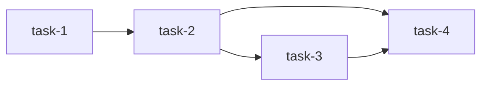

# F1 tasks 2 (구현 계획 + 진행)

<!-- tasks.md의 이슈 계획이 4개를 넘어 나눈 파일. 규칙은 tasks.md 머리와 같다.
     지휘 에이전트 뼈대(#15)는 F1만의 일이 아니라 F0 기반(다음 세션 문서)에 더 가깝다. F0 문서가 생기면 이 계획을 그쪽으로 옮기고 여기에는 링크만 남긴다. -->

## m1-i2-15  (11/19)  상태: 끝  (이슈 #15)
**구현할 design 부분**: design.md 2-1 (진행 판단은 지휘, `extract_pages` → `read_oa` 순서, 출원번호 기다림), 4절 (OA 시점 자르기는 무조건 도는 단계), architecture.md 8절   **맡은 합격 기준**: requirements.md "실패할 때"(출원번호 기다림·같은 OA·모델 실패), 8 (자르기가 늘 돎), #15 합격 기준 "기록된 응답으로 사건 1건 끝까지", "최대 횟수에 닿으면 확인되지 않음과 찾아본 범위"
**목표** (한 줄): 서버가 부르는 `run_case()` 하나 뒤에서 지휘 에이전트가 F1 도구를 부르고, 멈춤·사람 기다림·단계 기록을 남기는 뼈대를 만든다.
**끝나면 보여 줄 것** (데모 한 줄): 가짜 전송층으로 지어낸 사건 1건을 `run_case()`로 끝까지 돌리면 `OAResult`가 나오고, 출원번호를 지운 통지서는 `waiting_for_human`으로 멈춘다 (`uv run pytest tests/core/agents -q`).
**나눔** (11/18, PR 400줄): 이어 가기(`resume_case`, LangGraph 체크포인터)와 단계 기록 DB 구현은 #55 테이블 뒤 다음 이슈 계획(새 이슈)으로 뺀다.
**이슈 #15 본문에서 새 이슈로 옮길 것**: 합격 기준 "사람 확인이 필요하면 멈추고 그 상태가 저장된다"(이 계획은 멈추고 상태를 돌려주는 데까지), "단계 기록이 DB에 남는다"(이 계획은 메모리 구현까지).

### task-1: 도구 규약과 등록
- 담당: 재아
- 합격 기준: #15 "도구 등록과 공통 규약", 11/18 "심사 대상 판 고르기·사건 자료 묶기는 코드 도구라고 표시"
- 고칠 파일: `src/patent_ai/core/agents/tools.py`, `tests/core/agents/test_tools.py`
- 만들 함수·인터페이스 모양: `Tool{name, kind: "code_tool" | "fixed_stage" | "subagent", input_schema, output_schema, run(input) -> ToolResult{result, status, evidence}}`, `ToolRegistry.register/get`. F1 등록: `extract_pages`(code_tool), `read_oa`(code_tool, 안에서 모델 한 번), `cut_to_oa`(fixed_stage, 몸통은 #54 전까지 입력을 그대로 넘기는 가짜)
- 테스트할 경우: 평소(등록·조회) / 빈 입력(없는 도구 이름 → `ToolNotFound`) / 실패(출력이 `output_schema`에 안 맞음 → 거부, status 없는 결과 → 거부)
- 확인 방법: `uv run pytest tests/core/agents/test_tools.py -q` → 모두 통과
- materials는 #54 전까지 문서 ID 문자열 목록, #54에서 DocumentRef로
- 먼저: #14 task-1·task-2, #17 task-1, #18 task-3

### task-2: 지휘 그래프 뼈대와 `run_case()`
- 담당: 재아
- 합격 기준: #15 "AI 코어는 `run_case()` 하나만 밖으로", "계획을 설정 파일에서 고정 순서로 바꿀 수 있게", design.md 4절 (자르기는 건너뛸 수 없음)
- 고칠 파일: `src/patent_ai/core/agents/orchestrator.py`, `src/patent_ai/core/agents/case_input.py`, `src/patent_ai/core/__init__.py`(`run_case` 내보내기), `config/orchestrator.yaml`, `prompts/agents/orchestrator.md`, `tests/core/agents/test_orchestrator.py`, `docs/architecture.md` 8절 그림 순서 (design.md 4절)
- 만들 함수·인터페이스 모양: `CaseInput{case_id, oa_document: Path, oa_document_id, materials: list[DocumentRef]}`, `CaseStore` 프로토콜 `find_oa(application_number, dispatch_number) -> (case_id, oa_id) | None` (서버가 넣어 줌, core는 api를 import하지 않음), `run_case(case_input: CaseInput, oa_id: str, run_id: str, store: CaseStore, config_path: Path) -> RunOutcome{state, results, waiting_for, error, case_id}`. LangGraph 그래프: 지휘 노드(모델은 `core/llm` 경유) → 도구 노드. `fixed_stage` 도구는 그래프 간선으로 늘 지난다 (지휘가 고르지 않음). 설정 `plan: agent | fixed_order`
- 테스트할 경우: 평소(`fixed_order`로 `extract_pages` → `read_oa` → `cut_to_oa`) / 지휘가 `cut_to_oa`를 안 골라도 돎 (그래프 테스트) / 실패(도구가 `ModelCallFailed`·`ModelCallLimitExceeded`·`ModelOutputInvalid`·`PdfReadError` 중 하나 → `state=failed` + 이유, `succeeded`로 끝나지 않음)
- 확인 방법: `uv run pytest tests/core/agents/test_orchestrator.py -q` → 모두 통과 (가짜 전송층)
- 먼저: task-1, #13 task-3

### task-3: 멈추는 조건과 사람 기다림 (멈춤까지)
- 담당: 재아
- 합격 기준: #15 "최대 횟수에 닿으면 확인되지 않음과 찾아본 범위", "사람 확인이 필요하면 멈추고 그 상태가 저장된다"(돌려주는 상태까지, 저장은 #57), requirements "출원번호를 끝내 못 읽을 때", "같은 OA"
- 고칠 파일: `src/patent_ai/core/agents/orchestrator.py`, `tests/core/agents/test_waiting.py`
- 만들 함수·인터페이스 모양: `max_steps` (설정 키. 재조회 `max_retries`는 F2·F3 붙을 때). `WaitingFor`(`application_number`, `dispatch_number`, `direction_selection`). 출원번호 `unverified`·`conflict` → `state=waiting_for_human`, `waiting_for=application_number`, F1 결과는 그대로 돌려줌. 출원번호는 확인됐는데 발송번호가 `unverified`·`conflict`면 같은 OA인지 판정할 수 없어 `waiting_for=dispatch_number` (11/19). 기다리는 동안 자르기·저장소 조회는 하지 않음. `store.find_oa(...)`가 있으면 `state=failed`, `error={code: "oa_already_exists", case_id, oa_id}`. 같은 출원번호의 다른 OA면 `RunOutcome.case_id` = 기존 사건
- 테스트할 경우: 평소(출원번호 없는 통지서 → 멈춤) / 경계(`max_steps` 도달 → `failed`(code `max_steps`) + 찾아본 도구 목록) / 같은 OA → `failed` + 기존 ID / 기존 사건의 다음 OA → 최종 `case_id`
- 확인 방법: `uv run pytest tests/core/agents/test_waiting.py -q` → 모두 통과
- 먼저: task-2

### task-4: 단계 기록(메모리)과 사건 1건 시나리오
- 담당: 재아
- 합격 기준: #15 "기록된 응답으로 사건 1건을 처음부터 끝까지 돌리는 테스트", "단계 기록"(메모리 구현까지)
- 고칠 파일: `src/patent_ai/core/agents/steps.py`, `tests/core/agents/test_scenario.py`
- 만들 함수·인터페이스 모양: `StepRecorder` 프로토콜 `record(step: StepRecord{run_id, step_kind, tool_name, reason, result_status, result_id(#55 뒤 채움), model_call_count(셀 수 없으면 None), outcome})` + 메모리 구현. 시나리오는 #14 `tests/fixtures/case_missing_citation/`과 #18 가짜 통지서·가짜 전송층 답을 쓴다
- 테스트할 경우: 사건 1건 끝까지(`succeeded`, `OAResult`가 fixture와 같음, 도구 호출마다 기록 1줄 + 왜 불렀나) / 인용문헌 1건 없음 → 보류 목록에 뜨고 실행은 `succeeded` / 실패한 도구도 기록
- 확인 방법: `uv run pytest tests/core/agents/test_scenario.py -q` → 통과
- #54에서 cut_to_oa가 자료를 묶으면 "인용문헌 없음 → 보류 목록"을 run 결과로 다시 잼 (지금은 fixture 사건으로 잼)
- 먼저: task-2, task-3

### 이번에 안 하는 것
- `resume_case(run_id, answer)`·LangGraph Postgres 체크포인터, `StepRecorder` DB 구현(`agent_steps`) → #55 뒤 새 이슈.
- F2~F4 서브에이전트(자리만), 근거 검토 에이전트, Langfuse. `cut_to_oa`의 진짜 몸통(#54). 서버의 실행 상태 저장·폴링(#57).

### 진행
- [x] task-1
- [x] task-2
- [x] task-3
- [x] task-4
- 다음: /pr-draft (아침, 사람 확인 뒤), 이어 가기·DB 기록 새 이슈
- 막힌 것: 

### 끝난 뒤 (11/19)
- 된 것: 도구 규약(tools.py: code_tool·fixed_stage·subagent, F1 도구 셋 등록), 지휘 그래프(LangGraph: extract_pages → decide → read_oa → check_oa → cut_to_oa 고정 간선 → decide, plan agent|fixed_order), `run_case(case_input, oa_id, run_id, store, config_path, *, ctx, steps)` 하나만 밖으로, 출원번호·발송번호를 모르면 waiting_for_human, 같은 OA → failed + 기존 ID, 기존 사건에 붙이기, max_steps → failed + 찾아본 도구 목록, 실패 경로마다 단계 기록(메모리). `uv run pytest -q` 346 passed. /check: 증거 통과, 이슈 리뷰 막음 없음. 진짜 모델 호출 없음.
- 안 된 것·사람 판단: 이어 가기(resume·체크포인터)와 단계 기록 DB는 새 이슈(#55 뒤). cut_to_oa는 #54 전까지 가짜 몸통(unverified + 경고). 발송번호를 모르면 사람 기다림(Claude 판단). 코드(테스트 제외) 약 480줄로 400줄 기준을 넘음. agent 모드에서 지휘가 read_oa를 고르는 것과 architecture 8절 그림(F1 고정 흐름)의 관계, extract_pages kind. 실행 하나의 시간·비용 상한(ADR 0003)은 아직 없음. 지휘 모델에 원문을 안 보낸다는 단언 테스트 없음(코드로 확인).
- 다음 이슈로: 서버(#56·#57)가 run_case에 넘길 ctx·store·steps 만들기.
