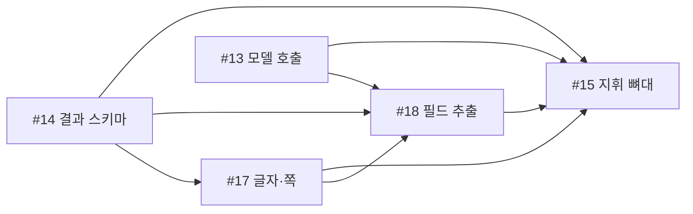
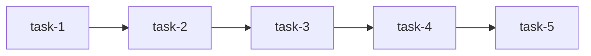
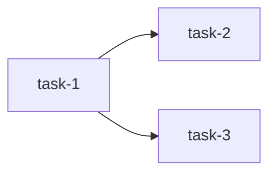
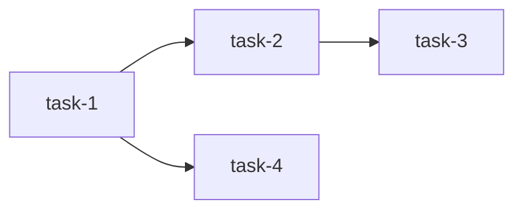
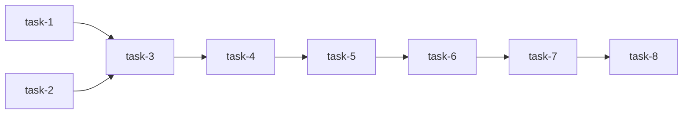

# F1 tasks (구현 계획 + 진행)

<!-- design.md를 바탕으로 쓴 구현 계획이다. 이슈 계획 하나 = 이슈 하나 = 브랜치 하나 = PR 하나.
     task마다 확인 방법(명령 한 줄 → 기대 결과). 네트워크·API 키 없이 돈다. 진행 칸은 Claude가 task를 끝낼 때마다 고친다.
     이슈 계획이 4개를 넘어 지휘 에이전트 뼈대(#15)는 tasks-2.md에 둔다. -->

- 이름: 한 이터레이션(M1-i2, 11/18~11/19)에 이슈가 여럿이라 계획 제목을 `m1-i2-<이슈번호>`로 쓴다.
- 구현 순서 (11/18): #14 → #17 → #13 → #18 → #15([tasks-2.md](tasks-2.md)). #17과 #13은 서로 기대지 않아 동시에 해도 된다.
- 이 파일 밖 F1 이슈: #16 사건 자료 올리기·묶기(합격 기준 4·7·8), #54 자동 조회와 OA 시점 자르기(합격 기준 4·8), #55·#56 서버(합격 기준 7). 그 이슈 계획은 각 이슈 본문이나 다음 세션에서.
- task 머리의 "#14 task-1"처럼 이슈 번호가 붙은 것은 다른 이슈 계획의 task다. 번호 없는 "task-1"은 같은 계획 안.

## m1-i2-14  (11/18~11/19)  상태: 끝  (이슈 #14)
**구현할 design 부분**: design.md 3-2 (공통 칸, `OAResult`, `CaseMaterials` F1 칸)   **맡은 합격 기준**: requirements.md 1·2·4·5 (모양), product.md 5절 F5 1·2·3
**목표** (한 줄): F1이 내고 화면·서버가 받는 결과 스키마와 상태 규칙을 `core/schemas/`에 코드로 둔다.
**끝나면 보여 줄 것** (데모 한 줄): `uv run pytest tests/core/schemas -q` 통과 + 사건 1건 fixture가 스키마 검사를 통과하고, 네 값 밖 status는 저장 전에 거부된다.

### task-1: 공통 칸 (Status·Evidence·ExtractedValue·결과 바탕)
- 담당: 재아
- 합격 기준: requirements.md 2 (이유 `not_extracted`·`ambiguous`, `conflict`면 둘 다 남김), F5 1 ("확인됨"에 무엇을 확인했나)
- 고칠 파일: `src/patent_ai/core/schemas/common.py`, `tests/core/schemas/test_common.py`
- 만들 함수·인터페이스 모양: `StatusValue`(네 값), `UnverifiedReason`(여섯 값), `Status{value, reason, checked, searched_scope}`(값에 맞는 칸 필수 검사, 직렬화는 늘 네 키), `Evidence{document_id, page, raw_text, edition, checked_on}`, `Origin`(네 값), `Flag`(`needs_human_judgment`·`needs_human_review`), `ResultBase{status, evidence, origin, needs_recheck, recheck_reason, flags}`, `ExtractedValue[T]{value, raw_text, page, status, candidates}` (`candidates: list[{value, raw_text, page, source: rule|model}]`는 `conflict`일 때만 채우고 그때 `value`는 `null`), `worst_status(statuses: list[Status], checked_summary: str) -> Status` (같은 등급이면 앞 칸의 reason, `confirmed`면 `checked = checked_summary`)
- 테스트할 경우: 평소(네 값 각각 바른 칸, 순서 `conflict` > `unverified` > `not_found_in_scope` > `confirmed`, 같은 등급이면 앞 칸) / 빈 입력(`worst_status([])` → `unverified(not_extracted)` + 경고 로그) / 실패(다섯 번째 값, `unverified`인데 이유 없음, `confirmed`인데 `checked` 없음, `not_found_in_scope`인데 범위 없음, `conflict`인데 candidates 1개 이하 → `ValidationError`)
- 확인 방법: `uv run pytest tests/core/schemas/test_common.py -q` → 모두 통과
- 먼저: 없음

### task-2: OAResult·CaseMaterials (F1 칸)
- 담당: 재아
- 합격 기준: requirements.md 1·3·5·6, 4 (빠진 자료·보류 모양)
- 고칠 파일: `src/patent_ai/core/schemas/oa_result.py`, `src/patent_ai/core/schemas/case_materials.py`, `tests/core/schemas/test_oa_result.py`
- 만들 함수·인터페이스 모양: `OAResult`, `Rejection{article, supported, claims, citations, examiner_reasoning}`, `Citation{number, country, country_supported, cited_paragraphs}`, `ExaminerHints{allowable_claims, amendment_note}`, `NoticeKind`(`initial`/`final`/`unknown`, 정답 형식 f1-oa-gold.md와 같은 코드), `CaseMaterials{case_id, documents, missing[{what, depends_on_tasks, lookup_result, ask_upload}], held_tasks[{task, waiting_for}], review_items_count}` (design.md 3-2 그대로)
- 테스트할 경우: 평소(청구항 1이 거절이유 둘에 들어간 결과, 쪽 없는 `confirmed` 값: 통지 종류 `initial`·힌트 "없음") / 빈 입력(거절이유 0개 → 결과 status `unverified(not_extracted)`) / 실패(`notice_kind=unknown`인데 `confirmed` → 거부, 날짜 칸에 `value`를 넣음 → 거부, `supported=false`인데 `needs_human_review` 없음 → 거부, 지원 안 하는 나라인데 `ask_upload=true` → 거부)
- 확인 방법: `uv run pytest tests/core/schemas/test_oa_result.py -q` → 모두 통과
- 먼저: task-1

### task-3: 상태 전파·검토할 사항 모으기
- 담당: 재아
- 합격 기준: requirements.md 4, F5 3, data-model 3절 규칙 1·2
- 고칠 파일: `src/patent_ai/core/schemas/propagation.py`, `tests/core/schemas/test_propagation.py`
- 만들 함수·인터페이스 모양: `propagate(depends_on: list[Status]) -> Status` (기대는 입력이 `confirmed`가 아니면 `unverified(input_unverified)`), `mark_recheck(result, reason) -> result` (덮어쓰지 않고 새 값), `ReviewItem{kind: unverified|conflict|needs_recheck|needs_human_judgment|needs_human_review|missing_material, target, reason}`, `collect_review_items(results: list[ResultBase], materials: CaseMaterials) -> list[ReviewItem]`
- 테스트할 경우: 평소(앞 결과 `unverified` → 뒤 결과가 검토할 사항에 뜸, 빠진 자료가 뜸) / 빈 입력(결과 0개 → 결과 줄은 없고 경고 로그, 빠진 자료 줄은 남음. 결과는 있는데 검토할 사항 0건 → 빈 목록, 경고 없음) / 기대지 않는 입력은 영향 없음 / `needs_recheck`가 status를 바꾸지 않음
- 확인 방법: `uv run pytest tests/core/schemas/test_propagation.py -q` → 모두 통과
- 먼저: task-2

### task-4: 사건 1건 fixture와 스키마 검사
- 담당: 재아
- 합격 기준: #14 "fixture 1건이 스키마 검사를 통과한다", "API 명세 응답 예시가 fixture와 같다"
- 고칠 파일: `tests/fixtures/case_missing_citation/oa_result.json`, `tests/fixtures/case_missing_citation/case_materials.json`, `tests/core/schemas/test_fixtures.py`
- 만들 함수·인터페이스 모양: 없음 (design.md 9절 `case_missing_citation/`: 지어낸 사건 1건, 진보성+명확성+42조 3항, 인용문헌 2건 중 1건 본문 없음)
- 테스트할 경우: fixture가 `OAResult`·`CaseMaterials`로 읽힘 / api/README.md 5절 `GET /oas/{oa_id}/oa-result` 예시 JSON 블록을 파싱해 겉 키(`oa_id`, `run_id`, `status`, `result`)가 fixture 응답과 같음 / 바깥 `status` = `result.status.value` / 검토할 사항이 빠진 인용문헌 1건 + 직접 검토 필요 1건
- 확인 방법: `uv run pytest tests/core/schemas/test_fixtures.py -q` → 모두 통과
- 먼저: task-3

### task-5: 문서를 코드 기준으로 줄이기
- 담당: 재아
- 합격 기준: #14 "data-model.md 4절 칸 목록을 이름 + 주고받는 것 + 코드 링크로", "칸을 현업 말로 (테이블·컬럼 / 필드)", design.md 3-2 "인터페이스 변경" 표 중 결과 공통 칸
- 고칠 파일: `docs/data-model.md` 3·4절, `docs/api/README.md` 2절 (status 객체, 바깥 status 복사)
- 만들 함수·인터페이스 모양: 없음 (문서)
- 테스트할 경우: 해당 없음
- 확인 방법: `grep -n "core/schemas" docs/data-model.md` → ①·⑥ 줄마다 코드 링크가 있음
- 먼저: task-4

### 이번에 안 하는 것
- ②~⑤ 결과 스키마(`JudgmentUnit`·`ComparisonTable`·`LegalEvidenceBundle`·`DirectionCandidates`) 코드: F2~F4 설계 때 (11/18). 이슈 #14 "모든 결과 모양에 상태 칸"은 공통 칸 + ①⑥으로 본다.
- DB 저장(`oa_results`·`result_inputs`)은 #55. 여기서는 Pydantic 검사까지.
- 화면 TS 타입 생성은 화면 설계.

### 진행
- [x] task-1
- [x] task-2
- [x] task-3
- [x] task-4
- [x] task-5
- 다음: /pr-draft (아침, 사람 확인 뒤)
- 막힌 것: 

### 끝난 뒤 (11/19)
- 된 것: 공통 칸(Status 객체·이유 여섯·ExtractedValue·candidates·frozen·extra forbid), OAResult·CaseMaterials, build_*·summarize_*·collect_evidence, 상태 전파·검토할 사항(필드마다 한 줄), 사건 1건 fixture(`tests/fixtures/case_missing_citation/`), data-model.md·api/README.md 줄이기. `uv run pytest -q` 105 passed. /check: 증거 통과, 이슈 리뷰 막음 1 → 2회차 통과.
- 안 된 것·사람 판단: 코드(테스트 제외) 약 670줄로 400줄 기준을 넘음(나눌지). pdfplumber·reportlab 의존성 커밋(c077068)이 이 브랜치에 있음(#17용). API 예시와 fixture는 겉 키만 비교. 정답 형식의 청구항×거절이유 줄·인용 라벨(D1)·거절이유 kind는 OAResult에 없음(#20 전에 정함).
- 다음 이슈로: ②~⑤ 결과 스키마(F2~F4 설계), review_items_count를 collect_review_items로 채우기(#16·#54).

## m1-i2-17  (11/18~11/19)  상태: 끝  (이슈 #17)
**구현할 design 부분**: design.md 2절 ①, 9절 (#17 줄)   **맡은 합격 기준**: requirements.md 1 (쪽 위치의 바탕), 2 (스캔본 = 확인되지 않음)
**목표** (한 줄): 통지서 PDF에서 쪽마다 글자를 뽑고, 글자 층이 없으면 실패 대신 "확인되지 않음"을 남긴다.
**끝나면 보여 줄 것** (데모 한 줄): `uv run python scripts/check_pages.py <PDF 폴더>` → 파일마다 쪽 수·글자 수·상태 한 줄.
**PDF 도구**: pdfplumber (11/18). `extract_pages` 인터페이스 뒤에 두어 바꿀 수 있게 한다. 고른 것·버린 것·이유는 design.md 8절.

### task-1: 쪽 글자 뽑기
- 담당: 재아
- 합격 기준: requirements.md 1, #17 "쪽마다 글자가 나온다", "테스트는 저장소에 넣어도 되는 예시 파일로만"
- 고칠 파일: `pyproject.toml`(`pdfplumber`, pdfplumber는 PDF를 쓰지 못해 테스트 PDF를 만드는 dev 의존성 하나, 예 `reportlab`), `src/patent_ai/core/schemas/document.py`(`PageText`), `src/patent_ai/core/f1_oa_reader/pages.py`, `tests/core/f1/test_pages.py`
- 만들 함수·인터페이스 모양: `Page{page, text, status}`, `PageText{document_id, pages: list[Page], status}`, `extract_pages(pdf_path: Path, document_id: str) -> PageText`
- 테스트할 경우: 평소(테스트 안에서 지어낸 글자로 만든 2쪽 PDF → 쪽 번호 1·2와 글자, 모두 `confirmed`) / 실패(PDF가 아닌 파일·깨진 파일 → `PdfReadError`, 조용히 빈 결과 아님)
- 확인 방법: `uv run pytest tests/core/f1/test_pages.py -q` → 모두 통과
- 먼저: #14 task-1 (Status)

### task-2: 글자 없는 쪽 알아보기 (스캔본)
- 담당: 재아
- 합격 기준: requirements.md 2, #17 "스캔본은 실패로 끝나지 않고 확인되지 않음과 이유"
- 고칠 파일: `src/patent_ai/core/f1_oa_reader/pages.py`, `tests/core/f1/test_pages.py`
- 만들 함수·인터페이스 모양: 쪽마다 `Page.status` (글자 없음 → `unverified(body_missing)`). 문서 `PageText.status`: 모든 쪽에 글자가 없을 때만 `unverified(body_missing)`. 일부 쪽만 없으면 문서는 `confirmed`(`checked` = "글자 있는 쪽 N/M")이고 글자 없는 쪽은 쪽 status로 남는다
- 테스트할 경우: 모든 쪽 글자 없음(그림만 넣은 1쪽 PDF) → 문서 `unverified` / 일부 쪽만 없음 → 문서 `confirmed`, 그 쪽만 `unverified` / 0쪽 PDF(라이브러리가 만들 수 있으면) → 문서 `unverified` + 경고
- 확인 방법: `uv run pytest tests/core/f1/test_pages.py -q -k "scanned or blank"` → 통과
- 먼저: task-1

### task-3: 폴더 손 확인 스크립트
- 담당: 재아
- 합격 기준: #17 "tune 통지서 묶음에서 쪽마다 글자가 나온다" (스크립트 준비까지. 실제 묶음 확인은 끝난 뒤 칸)
- 고칠 파일: `scripts/check_pages.py`
- 만들 함수·인터페이스 모양: `check_pages.py <폴더>` → 파일마다 `이름 쪽수 글자수 상태` (원문 글자는 출력하지 않음). 읽기 실패한 파일은 이유 줄을 찍고 끝에 종료 코드 1. 빈 폴더는 경고 + 종료 코드 1
- 테스트할 경우: 스크립트라 테스트 없음 (루트 CLAUDE.md 예외)
- 확인 방법: task-1 테스트가 만든 PDF를 임시 폴더에 두고 `uv run python scripts/check_pages.py <임시 폴더>` → 파일마다 한 줄, 종료 코드 0
- 먼저: task-1

### 이번에 안 하는 것
- OCR (requirements [가정]). 쪽 텍스트 파일 저장 위치·이름은 #54.
- tune 통지서 묶음 실제 확인: #21 데이터를 받은 뒤 "끝난 뒤" 칸에 한 줄. tune 10건에서 거절이유 표가 깨지면 Docling과 비교한다 (design.md 8절).

### 진행
- [x] task-1
- [x] task-2
- [x] task-3
- 다음: /pr-draft (아침, 사람 확인 뒤)
- 막힌 것: 

### 끝난 뒤 (11/19)
- 된 것: `extract_pages(pdf_path, document_id) -> PageText` (pdfplumber, 쪽마다 status·글자 수, 모든 쪽이 글자 없을 때만 문서 unverified, 0쪽 경고, 읽기 실패는 PdfReadError), `scripts/check_pages.py`. `uv run pytest -q` 157 passed. /check: 증거 통과, 이슈 리뷰 막음 없음.
- tune 통지서 묶음 실제 확인 (11/19, PR #109 리뷰): 10/10 confirmed, 3~7쪽, 2,335~8,816자. 정답의 원문 글자+쪽 73개 중 72개가 같은 쪽 텍스트에 있음(공백 무시). 물리 쪽 번호 = OA에 찍힌 쪽 번호.
- 안 된 것: 글자 수 하한은 지금 두지 않음 (tune 최소 21자 쪽이 정상 본문 끝 쪽이라 하한을 두면 정상 쪽을 내림). 머리말만 글자인 스캔 쪽이 채점용 세트에서 나오면 그때 정함 (쪽 `checked`에 글자 수가 남음).
- 다음 이슈로: OCR은 범위 밖([가정]).

## m1-i2-13  (11/18~11/19)  상태: 끝  (이슈 #13)
**구현할 design 부분**: design.md 2절 ④·7-1 (상한 키)·7-2 (모델 호출)·9절 (녹화 다시 하기), architecture.md 6절 "밖으로 나가는 호출"·7절   **맡은 합격 기준**: requirements.md 실패할 때 "모델 호출이 실패할 때", #13 합격 기준 5개
**목표** (한 줄): 모델 호출을 `core/llm/` 한 곳에서만, 설정·프롬프트 파일·캐시·호출 상한·기록을 거쳐 하게 한다.
**끝나면 보여 줄 것** (데모 한 줄): 가짜 전송층으로 같은 호출 두 번 → 두 번째는 캐시, 상한 넘으면 이유와 함께 멈춤 (`uv run pytest tests/core/llm -q`).
**이슈 #13 본문에서 지울 것** (11/18, architecture.md 7절을 따름): 하는 일 "외부 모델로 보내도 되는 자료 표를 코드로 둔다…" 줄, 합격 기준 "막힌 자료 종류를 보내려 하면 거부된다" 줄.

### task-1: 호출 인터페이스와 설정·프롬프트 읽기
- 담당: 재아
- 합격 기준: #13 "모델 이름은 설정 파일에서", "프롬프트는 분리한 파일에서"
- 고칠 파일: `src/patent_ai/core/llm/client.py`, `src/patent_ai/core/llm/config.py`, `src/patent_ai/core/llm/prompts.py`, `src/patent_ai/core/llm/transport.py`, `tests/core/llm/test_client.py`, `tests/fixtures/llm/config/test.yaml`
- 만들 함수·인터페이스 모양: `call_model(step: str, variables: dict, output_schema: type[BaseModel] | None, run_id: str, attempt: int = 1) -> ModelResult{text, parsed, model, input_tokens, output_tokens, cost, elapsed_ms, from_cache}`. `step = "<기능>.<단계>"` → `config/<기능>.yaml`의 `<단계>.model`·`temperature`·`prompt`(프롬프트 파일 경로). `Transport` 프로토콜: 진짜 = Anthropic SDK(`transport.py` 안에서만 import), 테스트 = `FakeTransport`(테스트가 직접 쓴 답을 이름으로 돌려줌)
- 테스트할 경우: 평소(가짜 전송층 → `ModelResult`, `parsed`가 스키마 객체) / 빈 입력(설정에 단계가 없음 → `ModelConfigError`) / 실패(프롬프트 파일 없음, 출력이 `output_schema` 검사에 떨어짐 → `ModelOutputInvalid`에 이유)
- 확인 방법: `uv run pytest tests/core/llm/test_client.py -q` → 모두 통과 (API 키 없이)
- 먼저: 없음

### task-2: 캐시와 녹화 응답
- 담당: 재아
- 합격 기준: #13 "같은 입력 두 번이면 두 번째는 캐시", "테스트가 API 키 없이 돈다", design.md 9절 녹화 다시 하기
- 고칠 파일: `src/patent_ai/core/llm/cache.py`, `src/patent_ai/core/llm/recorded.py`, `scripts/record_llm.py`, `tests/core/llm/test_cache.py`
- 만들 함수·인터페이스 모양: 캐시 키 = (모델, 프롬프트 파일 내용 해시, 변수, 설정 값, `attempt`)의 해시. `Cache` 프로토콜 + 파일 구현(`work/llm_cache/`, git 밖). `output_schema` 검사에 떨어진 답은 캐시에 쓰지 않는다. `RecordedTransport(dir)`: 키로 저장한 답 파일을 읽고, 없으면 `RecordingMissing` (조용히 진짜 호출하지 않음). `scripts/record_llm.py <단계> <입력 파일>`: 사람이 돌려 진짜 모델 답을 저장 (키 출력·저장 안 함)
- 테스트할 경우: 평소(두 번째 호출 `from_cache=True`, 전송층 호출 1회) / 변수 하나 또는 프롬프트 파일 글자 하나 바뀌면 캐시 안 씀 / 검사 실패한 답 → 캐시 0건, `attempt=2` 호출은 전송층으로 감 / 녹화 없음 → `RecordingMissing`
- 확인 방법: `uv run pytest tests/core/llm/test_cache.py -q` → 모두 통과
- 먼저: task-1

### task-3: 호출 상한·전송 오류·기록
- 담당: 재아
- 합격 기준: #13 "상한을 넘으면 멈추고 이유를 남긴다", "호출마다 토큰·비용·시간 기록", requirements 실패할 때
- 고칠 파일: `src/patent_ai/core/llm/limits.py`, `src/patent_ai/core/llm/client.py`, `tests/core/llm/test_limits.py`
- 만들 함수·인터페이스 모양: 상한은 단계마다 설정 키(`config/<기능>.yaml`의 `<단계>.max_model_calls`·`max_input_tokens`)이고 실행(`run_id`) 하나 안에서 센다 (design.md 7-1과 같음). 넘으면 `ModelCallLimitExceeded(limit, used)`. 전송 오류·429는 `max_retries`(설정) 뒤 `ModelCallFailed(reason)`. `CallRecorder` 프로토콜로 호출마다 기록 (메모리 구현. DB `agent_steps` 구현은 #55 뒤)
- 테스트할 경우: 평소(상한 안 → 기록 1줄) / 경계(딱 상한) / 실패(상한 + 1 → 예외에 어느 상한·쓴 양, 성공으로 끝나지 않음; 가짜 전송층이 429를 계속 → `max_retries` 뒤 `ModelCallFailed`) / 캐시 적중은 상한에 세지 않음
- 확인 방법: `uv run pytest tests/core/llm/test_limits.py -q` → 모두 통과
- 먼저: task-2

### task-4: SDK 직접 호출 금지 검사
- 담당: 재아
- 합격 기준: #13 "다른 코드에서 모델 SDK를 직접 부르지 않는다"
- 고칠 파일: `tests/test_no_direct_sdk.py`
- 만들 함수·인터페이스 모양: 없음 (파일 검사 테스트)
- 테스트할 경우: `src/` 아래 `core/llm/transport.py` 밖에서 `import anthropic`·`from anthropic`·`import openai`·`from openai` 0건 / 일부러 넣은 가짜 파일(임시 폴더)은 잡아냄
- 확인 방법: `uv run pytest tests/test_no_direct_sdk.py -q` → 통과
- 먼저: task-1

### 이번에 안 하는 것
- DB `api_cache`·`agent_steps` 구현 (#55 뒤 다음 이슈). Langfuse 연결 (M2 초, ADR 0003). OpenAI 저지 전송층 (#20 채점기 때).
- 보내도 되는 자료 종류 표 코드·거부 테스트 (11/18: architecture.md 7절대로 막는 코드 없음).

### 진행
- [x] task-1
- [x] task-2
- [x] task-3
- [x] task-4
- 다음: /pr-draft (아침, 사람 확인 뒤)
- 막힌 것: 

### 끝난 뒤 (11/19)
- 된 것: `call_model(step, variables, output_schema, *, ctx: RunContext, attempt)` (설정 `config/<기능>.yaml`, 프롬프트 `$var` 파일, 캐시 키 = 단계·모델·프롬프트 내용 해시·변수·설정·attempt, 검사 실패 답은 캐시 안 씀, 진짜 전송층이면 기본 FileCache), 상한(단계 키, 실행마다 CallBudget 필수)·429 재시도·호출마다 기록(CallRecord), FakeTransport(답·예외 목록), SDK 직접 import 금지 검사, tests/conftest.py(진짜 호출·키 막기), scripts/record_llm.py(git 밖 work/에 저장, data/ 거부). `uv run pytest -q` 165 passed. /check: 증거 통과, 이슈 리뷰 막음 없음.
- 안 된 것·사람 판단: 코드(테스트 제외) 약 790줄로 400줄 기준을 넘음. record_llm.py는 call_model을 거치지 않음(루트 CLAUDE.md 예외 문구는 scripts/fetch_*만) — 예외에 넣을지. 실행 하나의 시간·비용 상한(ADR 0003)은 없음(#15에서). DB 기록기·api_cache 테이블은 #55 뒤. 이슈 #13 본문에서 지울 두 줄은 아직 그대로(본문은 고치지 않기로 함).
- 다음 이슈로: RecordedTransport는 지금 손 확인용이라 쓰는 곳이 적음 — 계속 둘지.

## m1-i2-18  (11/19)  상태: 승인  (이슈 #18)
**구현할 design 부분**: design.md 2절 ③④⑤⑥과 필드 출처 표, 3-2 `OAExtraction`, 7절, 9절   **맡은 합격 기준**: requirements.md 1·2·3·5·6 (9번 tune 점수는 데이터 뒤 따로)
**목표** (한 줄): 쪽 글자에서 OA 필드·거절이유를 뽑아 원문 대조를 거친 `OAResult`를 만든다.
**끝나면 보여 줄 것** (데모 한 줄): `uv run pytest tests/core/f1 -q` 통과 (가짜 통지서 글자 + 가짜 전송층).

### task-1: 규칙 추출 (번호·날짜 글자·조문·청구항 범위·통지 종류)
- 담당: 재아
- 합격 기준: requirements.md 1·2·6
- 고칠 파일: `src/patent_ai/core/f1_oa_reader/rules.py`, `tests/core/f1/test_rules.py`
- 만들 함수·인터페이스 모양: `Found{value, raw_text, page, ambiguous}`(verify.py에 있음, rules가 import), `RuleFields{application_number, dispatch_number, notice_date, response_due}` → 각각 `Found | None` (통지 종류는 `notice_kind_of`로 따로), `extract_by_rules(pages: PageText) -> RuleFields`, `normalize_article(text) -> str | None` (`"특허법 제29조제2항"` → `"29-2"`), `expand_claims(text) -> list[int] | None` (`"제1항 내지 제4항, 제6항"` → `[1,2,3,4,6]`), `notice_kind_of(pages: PageText) -> ExtractedValue[NoticeKind]` ("최후거절이유통지" 표시가 모든 쪽 중 어디든 있으면 → `final` + 원문·쪽 / 1쪽 머리말(첫 15줄)에 "의견제출통지서"가 있는데 표시 없음 → `initial`, 쪽 없음, `confirmed` + 본 범위 / 머리말에 제목 없음 → `unknown` + `unverified(not_extracted)`, design.md 필드 출처 표)
- 테스트할 경우: 평소(형식마다 하나, 통지 종류 셋: 최후 표시 / 표시 없음 / 머리말 잘림) / 빈 입력(빈 쪽 → 모든 필드 `None`, 통지 종류 `unknown`) / 실패·애매(`제1항 내지 제A항`, 조문 표기 깨짐 → `None`, 지어내지 않음)
- 확인 방법: `uv run pytest tests/core/f1/test_rules.py -q` → 모두 통과
- 먼저: #14 task-1, #17 task-1 (`PageText`)

### task-2: 원문 대조·합치기와 지원 표
- 담당: 재아
- 합격 기준: requirements.md 2 (지어낸 값·확인하지 않은 원문 위치 0건), 5
- 고칠 파일: `src/patent_ai/core/f1_oa_reader/verify.py`, `src/patent_ai/core/f1_oa_reader/support.py`, `tests/core/f1/test_verify.py`
- 만들 함수·인터페이스 모양: `raw_text_on_page(pages, page, raw_text) -> bool` (공백·줄바꿈만 무시), `merge(rule: Candidate | None, model: Candidate | None, pages) -> ExtractedValue` (design.md 필드 출처 표: 대조 실패 → `unverified(not_extracted)`, 둘이 다름 → `conflict` + `candidates`, `ambiguous` → `value=null` + `unverified(ambiguous)`), `SUPPORTED_ARTICLES = {"29-1-1","29-1-2","29-2","42-4-2"}`, `country_of(text) -> str | None` (design.md 2절 ⑥ 정규식)
- 테스트할 경우: 평소(같은 값) / 빈 입력(둘 다 없음 → `unverified(not_extracted)`) / 실패(원문에 없는 글자, 다른 쪽 번호, 둘이 다름) / 지원 안 하는 조문·JP 인용 → flags / 나라 표기 맞는 것 없음 → `unverified(ambiguous)`
- 확인 방법: `uv run pytest tests/core/f1/test_verify.py -q` → 모두 통과
- 먼저: #14 task-2, #17 task-1 (`PageText`)

### task-3: `read_oa` (모델 추출 + 합치기)
- 담당: 재아
- 합격 기준: requirements.md 1·2·3·5·6
- 고칠 파일: `src/patent_ai/core/f1_oa_reader/read_oa.py`, `src/patent_ai/core/f1_oa_reader/extraction.py`(`OAExtraction`), `prompts/f1/read_oa.md`, `config/f1.yaml`, `tests/core/f1/test_read_oa.py`, `tests/fixtures/f1/*.pages.json`, `tests/fixtures/f1/llm/`
- 만들 함수·인터페이스 모양: `read_oa(pages: PageText, document_id: str, oa_id: str, run_id: str, *, ctx: RunContext) -> OAResult` (design.md 7-1). 모델 호출은 `call_model(step="f1.read_oa", …, output_schema=OAExtraction)` 한 번 + 검사 실패 때 `attempt=2` 한 번. 모델 실패는 결과로 돌려주지 않고 예외를 그대로 던진다: 전송 실패·상한은 `ModelCallFailed`·`ModelCallLimitExceeded`, 두 번째 검사 실패는 `ModelOutputInvalid` (지휘가 셋 다 실행 `failed` + 이유로 남김, #15 task-2). `invalid_twice`는 `FakeTransport`가 시도마다 다른(둘 다 잘못된) 답을 차례로 준다. 날짜 칸은 `value`가 비어 있어 `merge`의 비교는 `raw_text`로 한다. 글자 층 없음 → 전송층 호출 0회
- 테스트할 경우: design.md 9절 표의 `notice_*`·`llm/*`·모으기 줄 전부 (14건). 모델 답은 사람이 직접 쓴 `FakeTransport` 답(fixture 이름으로 찾음)이라 프롬프트를 고쳐도 깨지지 않는다. 프롬프트 문구는 테스트하지 않음
- 확인 방법: `uv run pytest tests/core/f1/test_read_oa.py -q` → 모두 통과 (API 키 없이)
- 먼저: task-1, task-2, #13 task-3

### task-4: 결과 값 모양을 정답 형식에 맞추기 (11/19 결정)
- 담당: 재아
- 합격 기준: requirements.md 1·2·9 (값 모양이 정답 형식과 같아야 채점기가 비교함)
- 고칠 파일: `src/patent_ai/core/f1_oa_reader/{rules,support,read_oa,extraction}.py`, `src/patent_ai/core/schemas/{oa_result,propagation}.py`, `prompts/f1/read_oa.md`, `docs/features/F1/design.md`, `tests/core/f1/*`, `tests/core/schemas/*`, `tests/fixtures/`
- 만든 함수·칸: `support.citation_key(text) -> str | None`(인용문헌 키 꼴: KR·US·JP, 종류 코드가 없으면 None), `rules.parse_cited_locations(raw) -> list[str] | None`(식별번호 `[0016]`·`[0080]-[0081]`·`도 4c`·`청구항 9`·`요약`·`3:5-10`), `OAResult.examined_claims`(심사 대상 청구항, `청구항 전항` 펼칠 때 씀), `Rejection.no`, `Citation.label`, 출원·발송번호 숫자만, 조문 호 여럿 `29-1-1|29-1-2`
- 확인 방법: `uv run pytest tests/core/f1 -q` → 모두 통과
- 먼저: task-3

### task-5: 거절이유 종류 `Rejection.kind` (11/19 승인)
- 담당: 재아
- 합격 기준: requirements.md 1·9 (정답 형식 2.2 종류·4절 `kind` 코드와 같아야 채점기가 비교함)
- 고칠 파일: `src/patent_ai/core/schemas/oa_result.py`, `tests/core/schemas/test_oa_result.py`, `tests/core/f1/test_read_oa.py`, `tests/fixtures/case_missing_citation/*.json`
- 만들 함수·칸: `RejectionKind`(`novelty`/`inventive_step`/`clarity`/`other`), `kind_of_article(article: str | None) -> RejectionKind`(규칙, 모델 안 씀: `29-1-1`·`29-1-2`·`29-1-1|29-1-2` → novelty, `29-2` → inventive_step, `42-4-2` → clarity, 그 밖·조문 모름 → other), `Rejection.kind`(필수 칸, `build_rejection`이 조문에서 채우고 사람이 넣지 못함, 조문과 안 맞으면 거부). 조문이 unverified면 kind는 other이되 supported·flags·status 규칙은 그대로
- 테스트할 경우: 조문 코드마다 / 조문 모름·충돌 → other / 호 여럿 / kind를 직접 넣으면 TypeError / 조문과 안 맞는 kind는 거부 / read_oa 결과에 kind가 붙음
- 확인 방법: `uv run pytest tests/core -q` → 모두 통과
- 먼저: task-4

### task-6: 청구항 줄 `claim_rows`와 명확성 표현 (11/19 승인)
- 담당: 재아
- 합격 기준: requirements.md 1·3·9 (정답 형식 2.4 청구항 줄, 3절 애매한 경우 1~11, 4절 JSON)
- 고칠 파일: `src/patent_ai/core/schemas/{oa_result,propagation}.py`, `src/patent_ai/core/f1_oa_reader/{rules,read_oa,extraction}.py`, 새 파일 `src/patent_ai/core/f1_oa_reader/claim_rows.py`(줄 대조), `prompts/f1/read_oa.md`, `docs/features/F1/design.md`(3-2 JSON·필드 출처 표), `docs/data-model.md`(① 줄), `tests/core/f1/*`, `tests/core/schemas/*`, `tests/fixtures/f1/notice_claim_rows*.pages.json`, `tests/fixtures/f1/llm/claim_rows*.json`, `tests/fixtures/case_missing_citation/*.json`(`build_*` 도우미로 다시 만듦)
- 만들 칸·함수 모양: `ClaimRow{claim, rejection(=Rejection.no), citations: 라벨 목록, locations: {라벨: 정답 꼴 위치 목록}, same_as: [`claim:<n>`·`rejection:<n>`], clarity_terms, clarity_reason, raw_text, page, status}`, `OAResult.claim_rows`. 모델 추출 `OAExtraction.claim_rows`(청구항 번호 원문, 거절이유 순번, 인용 라벨 또는 인용 원문, 짚은 위치 원문, 위치 없음 표현 원문, 같은 취지 원문, 명확성 표현 원문, 판단이 적힌 원문 글자·쪽). 코드가 원문 대조: 행 `raw_text`가 그 쪽에 있어야 confirmed, 위치는 원문 글자에서 `parse_cited_locations`로 다시 뽑음(모델 값 안 씀), 명확성 표현은 따옴표 안 글자이고 원문에 있어야 함, 청구항 번호는 `expand_claims`. 대조 실패 → 그 행 `unverified(not_extracted)`, 값 버림
- 정답 3절과 대응: 1 같은 취지 → locations 비우고 same_as만 / 2 짝 없는 같은 취지 → 펼친 목록 / 3 자기 위치 + 같은 취지 둘 다 / 4 위치 없음 → `위치 없음 (<OA 표현>)` / 5 도면 부호만 → 부호 그대로(`parse_cited_locations`에 부호 꼴 추가) / 6 `[16, 38, 78]` → `[0016]`… (task-4에서 됨) / 7 결합 진보성 → citations `D1`+`D2`, 위치는 짚은 것만 / 8 "1-1에서 본 바와 같이" → same_as `rejection:1` / 9 지원 안 하는 이유 → 거절이유 표에만, 줄 없음 / 10 묶어서 짚은 청구항 → 5·6·7 줄에 같은 위치 / 11 따옴표 없는 명확성 → clarity_terms 빈 목록
- 결과 status 모으기·검토할 사항: `claim_rows` 행을 넣는다 (행 unverified → 그 행 경로 한 줄, 지원 안 하는 이유 행은 없음)
- 테스트할 경우: 평소(청구항 1이 이유 둘) / 3절 1~11 / 대조 실패(원문에 없는 글자·없는 쪽) → 그 행만 unverified / 스키마 검사 / 모으기·검토할 사항. 프롬프트 문구는 테스트하지 않음
- 확인 방법: `uv run pytest -q` → 모두 통과
- 먼저: task-5

### task-7: 인용 없는 줄의 `위치 없음 (<OA 표현>)` (11/19 승인, 구현은 11/19 아침)
- 담당: 재아
- 합격 기준: requirements.md 1·3 (정답 형식 3절 4번: 인용 위치가 없으면 `위치 없음 (<OA 표현>)`), 정답 4절 JSON
- 왜: 지금은 `위치 없음 (…)`을 인용 라벨 아래(`locations[라벨]`)에만 담을 수 있어, 인용이 하나도 없는 줄(예: "설계 사항"만 적은 줄)은 담을 자리가 없다 (work/gold_diff_f1.md 4절 3번)
- 고칠 파일: `src/patent_ai/core/schemas/oa_result.py`(`ClaimRow`), `src/patent_ai/core/f1_oa_reader/{claim_rows,extraction}.py`, `prompts/f1/read_oa.md`, `docs/features/F1/design.md`(3-2·필드 출처 표), `tests/core/f1/test_claim_rows.py`, `tests/core/schemas/test_oa_result.py`, `tests/fixtures/f1/notice_claim_rows*.pages.json`, `tests/fixtures/f1/llm/claim_rows*.json`
- 만들 칸·함수 모양: `ClaimRow.no_location: str | None` — 인용 없는 줄의 `위치 없음 (<OA 표현>)`. 모델 추출에 줄 단위 `no_location` 원문 칸을 더하고, 코드가 판단 원문(`judgment.raw_text`) 안에 그 표현이 있는지 대조(모델 값 안 씀). 인용이 있는 줄은 지금처럼 `locations[라벨]`. 정답 JSON으로 낼 때의 키 이름은 #20 채점기와 맞춘다
- 테스트할 경우: 인용 없는 줄 + "설계 사항" → `no_location = "위치 없음 (설계 사항)"`, confirmed / 표현이 판단 원문에 없음 → 그 줄 unverified(not_extracted) / 인용 있는 줄의 위치 없음은 그대로 `locations` / 스키마: `no_location`과 `locations`·`clarity_terms`를 같이 두면 거부
- 확인 방법: `uv run pytest tests/core/f1/test_claim_rows.py -q` → 모두 통과
- 먼저: task-6

### task-8: 쪽을 넘어간 거절이유 표 칸 (11/19 승인, 이슈 #18 은진 님 댓글)
- 담당: 재아
- 합격 기준: requirements.md 1·2 (거절이유의 대상 청구항·조문이 빠지지 않고, 지어낸 값 0건)
- 왜: tune 10건 중 2건은 1쪽 거절이유 표의 "대상 청구항" 칸이 2쪽으로 넘어감(1쪽 "…제8항 내지", 2쪽 맨 위 "제10항"). 쪽 글자만 보면 값이 두 쪽에 걸쳐 원문 대조가 `unverified`가 되고 대상 청구항 일부가 빠짐
- 고칠 파일: `src/patent_ai/core/schemas/document.py`(`Page.tables`, 기본 빈 목록, 공유 스키마), `src/patent_ai/core/f1_oa_reader/{pages,tables,verify,read_oa}.py`, `docs/features/F1/design.md`(2절 ①·3-2·필드 출처 표), `tests/core/f1/{test_pages,test_tables,test_verify,test_read_oa}.py`
- 만들 칸·함수 모양: `Page.tables: list[list[list[str]]] = []` (표마다 행, 행마다 칸 글자. `extract_pages`가 pdfplumber `extract_tables`(=`find_tables`)로 채움, 빈 칸은 ""). `tables.py`: `merged_tables(pages)` — 다음 쪽 첫 표의 첫 줄 첫 칸(순번)이 비면 앞 쪽 마지막 표 마지막 줄 같은 칸에 붙임(시작 쪽 번호로). `rejection_rows(pages) -> list[RejectionRow(no, page, part, article)]` — "순번 / 거절이유가 있는 부분 / 관련 법조항" 머리 줄 뒤 줄들(다음 쪽 첫 표가 순번을 이어 가면 그 줄도). `read_oa`는 이 줄을 대상 청구항·조문의 규칙 쪽 값으로 merge에 넘김. 원문 대조(`raw_text_on_page`)는 쪽 글자 + 그 쪽에서 시작하는 (이어 붙인) 표 칸 글자에서 찾음 → 시작 쪽 번호
- 테스트할 경우: PDF 표가 `Page.tables`에 행·칸으로 / 표 없는 쪽은 빈 목록, 예전 JSON(`tables` 없음)도 읽힘 / 평소(한 쪽 안) / 잘린 칸(다음 쪽 첫 줄 순번 빈칸 → 앞 줄에 붙음, 시작 쪽) / 줄 사이 끊김(다음 쪽 첫 줄 순번 4 → 줄로 이어짐) / 앞 쪽에 표가 없거나 앞 표가 거절이유 표가 아니거나 목록 이음말이 없으면 붙이지 않음 / 쪽 끝 줄인데 조각을 못 찾으면 규칙 값을 안 씀(리뷰에서 더함) / 표 찾기만 실패하면 그 쪽 표는 빈 목록 + 경고 / 원문 대조가 이어 붙인 칸에서 통과, 아무 칸에도 없는 글자는 실패 / read_oa: 쪽을 넘은 칸이 확인됨 [1..4]·시작 쪽, 표와 모델 값이 다르면 conflict
- 확인 방법: `uv run pytest tests/core/f1 -q` → 모두 통과
- 먼저: task-7

### 이번에 안 하는 것
- tune 점수 (requirements 9번): 11/18 "데이터 받은 뒤 따로". #20 채점기·#21 데이터·#22 정답 뒤 `/experiment m1-i2-f1-read-oa-baseline`으로 한 줄 내고 이 계획 "끝난 뒤" 칸과 #18에 적는다. PR은 점수 없이 연다 (PR 본문에 "tune 점수: 데이터 뒤" 명시).
- 진짜 모델 녹화: 지어낸 통지서로 `scripts/record_llm.py`를 한 번 돌려 프롬프트가 실제로 도는지 손으로 본다 (비용 아주 작음, 돌리기 전에 사람에게 물음). 테스트에는 쓰지 않는다.
- 쪽을 나눠 부르기 (design.md [가정] 10쪽 안쪽이 틀리면). 사건 묶기·심사 대상 판(#16·#54).

### 진행
- [x] task-1
- [x] task-2
- [x] task-3
- [x] task-4
- [x] task-5
- [x] task-6
- [x] task-7
- [x] task-8
- 다음: tune 점수 (#20·#22 뒤), /pr-draft
- 막힌 것: 

### 끝난 뒤 (11/19)
- 된 것: 규칙 추출(rules.py: 번호·날짜 글자·조문·청구항·통지 종류 initial/final/unknown, 본문 속 최후 언급 거름, 조의N 거부), 원문 대조·합치기(verify.py: 값은 원문 글자에서 다시 뽑음, 한쪽이라도 애매하면 확인되지 않음), 지원 표(support.py: 29-1-1·29-1-2·29-2·42-4-2, 나라 판정), `read_oa(pages, document_id, oa_id, run_id, *, ctx)` + OAExtraction·프롬프트·config/f1.yaml. 조문을 모르면 결과 status에 넣고 힌트 칸 누락을 확인되지 않음으로(공유 스키마 oa_result.py 규칙 변경, 문서 맞춤). `uv run pytest -q` 289 passed(task-1~3 /check 때), task-6 뒤 455 passed(11/19 2차, /check 증거 다시 모음: 통과). 진짜 모델 호출 없음(FakeTransport 답만).
- 안 된 것·사람 판단: tune 점수(#20·#22 뒤). 프롬프트가 진짜 모델에서 도는지(scripts/record_llm.py, 비용 작음, 사람 확인 뒤). 코드(테스트 제외) 약 660줄로 400줄 기준을 넘음. 값 모양은 task-4에서 맞춤, 구조 차이(claim_rows·clarity_terms·kind)는 work/gold_diff_f1.md 4절. 호 없는 "제29조제1항"은 지원 안 함으로 둠(Claude 판단). 칸 제목 표기·인용 표기·OA 쪽 수는 [가정](#22 표본으로).
- 11/19 2차: task-5 kind(조문 코드 → novelty/inventive_step/clarity/other), task-6 claim_rows·clarity_terms(정답 2.4·3절 1~11). 리뷰 막음(줄 빠짐·엇붙음, 인용 언급 규칙) 고침, 재리뷰 2회 다 씀 — 마지막 고침(b52d3a4)은 3회차 리뷰 없이 사람 확인. 남은 정답 차이는 work/gold_diff_f1.md 4절.
- 11/19 3차: task-8 쪽을 넘어간 거절이유 표 칸(`Page.tables` 공유 스키마 칸, 기본 빈 목록). 리뷰 막음 없음·고칠 것 3(잘렸을 수 있는 쪽 끝 줄, 이음말 없는 붙이기, 시작 쪽 단언) 고침. `uv run pytest -q` 496 passed. 실제 OA 5건(로컬)에서 표 줄이 나오고 C 파일 3번 줄이 "…제8항 내지 제10항"으로 이어짐. 한계: 표가 1쪽 안에서 끝나도 그 쪽 마지막 표의 마지막 줄은 `may_be_cut`이라 규칙 값을 안 씀(예전처럼 모델 값만, 5건 중 3건의 마지막 줄).
- 다음 이슈로: config/f1.yaml max_input_tokens, 가격 키(비용 기록).
