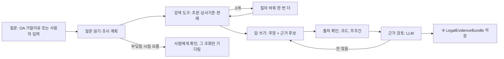

# F2 법률 근거 조사 세부 설계
<!-- 이슈 #45. requirements에 쓴 것(무엇, 합격 기준, 사람이 고르는 곳)은 다시 쓰지 않고 번호로 가리킨다.
     재아 님과 같이 정할 칸은 "[제안 — 재아 님 확인 필요]". 검색 계약(Searcher·조각 표·채점기)은
     features/retrieval/design.md를 그대로 쓰고, 여기서는 F2가 그 위에 얹는 것만 쓴다. -->

## 1. 합격 기준 ↔ 설계
| 기준 (requirements 번호) | 설계의 어디가 만족시키나 |
|---|---|
| 1 입력 하나 + 선택 조건, 부딪힘 확인 | 2절 1단계 질문 읽기, 3-2 `LegalQuestion`·`clarifications` |
| 2 할 수 있는 조사부터, 주요 작업 상태, 범위 바뀜 | 2절 2단계 계획(시점이 걸린 조회만 기다림), 3-2 `LegalChat.prior_evidence`, `runs` 상태 |
| 3 시점·판본, 적용 기준일 확정 안 함 | 4절 판 고르기, 7-1 `get_article` 도구 |
| 4 주장마다 출처·위치 | 2절 4단계 출처 확인(무조건 도는 코드 단계), 3-2 `Claim.evidence` |
| 5 판례 전문/요지, 판단/당사자 주장 | 5-1 조각 종류, 8절 결정 |
| 6 근거 검토 | 2절 5단계 근거 검토, 7-2 비교 축 1 |
| 7 못 찾음·확인되지 않음 구분, 추가 검토할 자료 | 2절 3단계 빈 결과, 3-2 `further_review` |
| 8 OA 흐름 자동 호출 | 2절 OA 흐름 질문 만들기, 4절 입력 자료 검사 |
| 9 검색 지표 | 7-1 평가 세트·지표, 7-3 검색 실험 목록 |
| 10 근거 검토 지표 | 7-1 평가 세트·지표 (#35) |

## 2. 흐름

1. **질문 읽기:** 입력 글에서 자료 유형·시점·사건번호·조문을 뽑아 `LegalQuestion`을 만든다. 날짜 계산과 사건번호·조문 번호 꼴 맞추기는 코드 도구(`normalize_refs`)다. 자연어 시점과 선택 조건 시점이 다르면 `clarifications`에 한 줄을 넣는다.
   - OA 흐름: 지휘 에이전트가 거절이유 하나마다 `LegalQuestion`을 만든다. 글 = 심사관 논리 글(조문 표기는 가리지 않음, 앱에서는 정답 누출이 없음), 조문 = F1 조문, 시점 = OA 발송일(검색 기준일), 자료 유형 = 전부. 청구항 글은 넣지 않는다 [가정: 조문·심사기준·판례 찾기에 청구항 글은 잡음. 7-3 실험에서 확인].
2. **조사 계획:** 시점이 걸리지 않는 조회(판례 검색)는 바로 하고, 시점이 걸린 조회(조문·심사기준)는 `clarifications`가 비었을 때만 한다. 계획은 서브에이전트가 정하지만 고를 수 있는 도구는 7-1 목록뿐이다.
3. **검색:** 도구마다 검색 계약 `SearchResult`를 받는다. 0개면 질의를 바꿔(결론 문장만, 핵심어만) 한 번 더 찾는다 (설정 `f2.max_research_retries`). 그래도 0개면 그 유형은 `not_found_in_scope` + 찾아본 범위.
4. **출처 확인 (무조건 도는 코드 단계, [ADR 0003](../../decisions/0003-tech-stack.md)):** 근거마다 `chunk_id`가 색인에 있는지, 근거의 원문 인용 글이 그 조각 글에 그대로(공백만 무시) 있는지, 판본이 계획한 기준일 범위인지 본다. 안 맞는 근거는 빼고, 근거가 0개가 된 주장은 `unverified`(이유 `not_extracted`)로 남긴다. 모델이 쓴 조문 번호·사건번호가 조각에 없으면 여기서 걸린다 (없는 출처 0건).
5. **근거 검토 (LLM):** 남은 근거가 주장을 뒷받침하는지 판정(뒷받침 / 일부 / 아님 / 판단 못 함) + 이유. "아님"이면 4단계로 돌아가 근거를 바꿔 한 번 고치고(설정 `f2.max_review_fixes`), 그래도 아니면 주장에 "확인 필요"(`flags: needs_human_review`). 검토 입력은 주장 글 + 근거 조각 글뿐이다 (답 쓰기의 추론 과정은 주지 않음).
6. **저장:** ④를 `legal_evidence_bundles`에 저장 (OA 흐름은 `oa_id`·거절이유 순번, 법률 질문은 `chat_id`·질문 순번).
- 실패하면: requirements "실패할 때". 모델 호출 실패는 실행 `failed`, 이미 확인된 조각 목록은 실행 기록에 남긴다.
- 비면: 3단계. 결과가 모두 비어도 ④는 저장한다 (`status = not_found_in_scope`, 빈 성공 아님).
- 느리면: 상한은 설정 `f2.max_model_calls`·`f2.max_seconds` [가정: 값은 돌려 본 뒤].

### 2-1. 흐름 방식
- **서브에이전트 루프 + 무조건 도는 코드 단계 둘.** 질의 바꾸기와 다시 찾기가 질문마다 달라 고정 파이프라인으로 못 짠다 ([product.md](../../product.md) 2절 "왜 에이전트인가"). 출처 확인과 근거 검토 순서는 건너뛸 수 없게 그래프 간선으로 고정한다.
- 도구 목록: 7-1. 멈추는 조건: 거절이유(또는 질문)마다 주장이 다 출처 확인·근거 검토를 지났거나, 상한에 닿음. 최대 단계 수 `config/agents.yaml`의 `f2_research.max_steps` [가정].
- 단계 기록: `agent_steps` (도구 호출, 검색 범위, 모델 호출). 검색 결과 조각 ID 목록도 여기에 남겨 CQ 후보를 앱 실행에서도 모을 수 있게 한다.

## 3. 데이터 모양
### 3-1. 앞 기능에서 받는 것
- F1 ① `OAResult`: `rejections[].kind`·조문·심사관 논리 글, OA 발송일·출원일 (`{값, 원문 글자, 쪽, 상태}`).
- 받은 결과가 "확인되지 않음"·"충돌"이면: requirements "근거"의 세 줄. `kind = other`는 부르지 않는다.

### 3-2. 다음 기능에 주는 것
④ `LegalEvidenceBundle` (F3·F4가 받음). [제안 — 재아 님 확인 필요] 칸 이름과 모양:
```json
{
  "bundle_id": "leb_…",
  "question": {
    "text": "<심사관 논리 글 또는 사용자 질문>",
    "source": "oa_rejection",
    "oa_id": "oa_…", "rejection_no": 1,
    "conditions": {"as_of": "2020-05-04", "as_of_source": "oa_dispatch_date", "material_types": ["article", "guideline", "precedent"]},
    "article_refs": ["특허법 제29조 제2항"]
  },
  "search_date": {"as_of": "2020-05-04", "checked_on": "2026-11-20", "is_current": false},
  "clarifications": [],
  "claims": [
    {
      "text": "진보성은 통상의 기술자가 선행기술로부터 쉽게 발명할 수 있는지로 판단한다.",
      "evidence": [{
        "chunk_id": "law-idx-v3:특허법_212229_20200311:a290002",
        "material_type": "article",
        "doc_id": "특허법_212229_20200311",
        "location_label": "제29조 제2항",
        "edition": {"status": "confirmed", "effective_from": "2020-03-11", "effective_to": "<다음 판 전날>", "label": null},
        "quote": "<조각 안 원문 일부>",
        "precedent": null
      }],
      "review": {"verdict": "supported", "reason": "…"},
      "status": {"value": "confirmed", "checked": "출처·위치·판본 확인, 근거 검토 뒷받침"},
      "flags": []
    }
  ],
  "further_review": [{"chunk_id": "…", "why": "opposite_holding | edition_unknown | not_used_candidate", "note": "…"}],
  "searched_scope": [{"material_type": "precedent", "index_version": "law-idx-v3", "as_of": null, "queries": 2, "hits": 0}],
  "origin": "ai_generated",
  "status": {"value": "confirmed", "checked": "…"}
}
```
- 판례 근거의 `precedent`: `{"case_number": "2007후3660", "court": "대법원", "decided_on": "<선고일>", "text_kind": "full | summary", "speaker": "court | party | unknown"}`. `text_kind`는 조각 종류에서 정해지고(5-1), `speaker`는 8절 결정. `unknown`이면 주장에 `needs_human_review`.
- `as_of_source`: `user_text` / `user_condition` / `oa_dispatch_date` / `none`(현행). "적용 기준일" 칸은 두지 않는다 (requirements 3).
- OA 흐름에서 발송일판과 출원일판의 글이 다르면 두 판 근거를 다 넣고 주장에 `needs_human_review` + `further_review`에 다른 판 한 줄 (requirements 열린 질문 4).
- 공통 칸은 [data-model.md](../../data-model.md) 3절 그대로. 더하는 칸: `question`, `search_date`, `clarifications`, `claims[].review`, `further_review`, `searched_scope`.
- 다시 확인 필요: F1 ①이 다시 써져 거절이유 글이나 발송일이 바뀌면 그 ④에 `needs_recheck` (규칙 2).
- 인터페이스 변경: 있음 (④ 코드가 새로 생김, `core/schemas/legal_evidence.py`). 받는 기능 F3·F4 문서에 알린다. data-model 4절 ④ 줄은 스키마 코드를 만드는 구현 PR에서 고친다.

**법률 질문 대화 `LegalChat`** (data-model 6절 "법률 질문 대화의 칸"):
```json
{"chat_id": "lc_…", "case_id": null,
 "turns": [{"no": 1, "question": {"…": "LegalQuestion"}, "bundle_id": "leb_…", "scope_changed": false, "run_id": "run_…"}],
 "prior_evidence": ["<chunk_id>", "…"]}
```
- 여러 번 묻고 답하기: 질문 하나 = 실행 하나 = ④ 하나. 다음 질문은 앞 질문의 조건을 물려받고(사용자가 바꾼 것만 덮음), 바뀐 조건이 있으면 `scope_changed = true`로 알린다 (requirements 2).
- `prior_evidence`: 앞 답들에서 출처 확인을 지난 조각 ID. 다음 답은 이 조각을 다시 검색하지 않고 먼저 후보로 넣는다. 범위가 바뀌어 기준일 밖이 된 조각은 버리지 않고 `further_review`(`edition_out_of_scope`)로 보인다.
- 대화 기억은 이 목록과 앞 질문 조건뿐이다. 앞 답 글 전체를 모델에 다시 넣지 않는다 [가정: 비용].

## 4. 판과 근거
- 쓰는 청구항 판: F2는 청구항 글을 쓰지 않는다 (2절 1단계 [가정]). 쓰게 되면 OA 당시 판만. 등록공보·대상 OA 뒤 자료는 입력 자료 검사에서 막는다 (지휘 에이전트가 넘기는 자료 목록에 `claim_versions.source_kind = registration`이 있으면 멈춤).
- 쓰는 법령·심사기준 판: 기준일 = `conditions.as_of`. 검색 계약 `as_of` 거르기(그날 시행판)를 그대로 쓴다. 없으면 현행판 + `checked_on`. 판본 모름 조각은 기준일 검색에서 빠지고 `searched_scope`에 건수.
  - OA 흐름: 발송일판으로 찾고, 같은 조문의 출원일판을 `get_article`로 한 번 더 읽어 글이 다르면 3-2 규칙.
  - 색인에 없는 판(2017년 이전 등): 법령 API(`law_api`, 캐시·호출 상한)로 한 번 조회, 실패하면 `unverified(lookup_failed)`.
- 근거 위치 적는 법: 검색 계약 그대로 `doc_id` + `location.label` + `edition` + `index_version`. 화면은 `label`을 보이고 원문 보기로 잇는다 (조문은 그 조 전체, 심사기준은 그 쪽 PDF, 판례는 그 문단).

## 5. 저장
- 읽는 표: `law_chunks` (조문·심사기준·판례), `oa_results`, `api_cache`. 쓰는 표: `legal_evidence_bundles`, `legal_chats` (새 마이그레이션, #29), `runs`·`agent_steps`, `result_inputs`(④ → ①).
- 검색: BM25 + 벡터 (검색 계약). 기본 `impl`은 실험 뒤 고른다. 지금 조문은 BM25가 훨씬 높다 (Hit@5 1.000 대 0.316).
- 외부 API: 법령 API(색인에 없는 판), KIPRIS Plus 심판(열린 질문 3, M2는 안 부름). 먼저 `api_cache`에 저장하고 쓴다.
- 외부 모델로 보내는 자료: 법령·심사기준·판례 원문, OA 거절이유 글 ([architecture.md](../../architecture.md) 7절 "보냄"). 평가 정답은 앱 실행 중 보내지 않는다.

### 5-1. 색인 `law-idx-v3` (#24가 만듦, 여기서는 모양만)
[제안 — 재아 님 확인 필요] 검색 계약 조각 표에 그대로 넣는다. 새 말뭉치·새 표를 만들지 않는다.

| 자료 | `doc_id` | 조각 단위 | `chunk_kind` | `loc_kind`·`loc_label` | 판본 |
|---|---|---|---|---|---|
| 조문 | `law-idx-v2`와 같음 | 항 | `article` | `article`, `제29조 제2항` | 법령 시행 기간 |
| 심사기준 | `심사기준_<예규번호>_<시행일>` | 절 제목 아래 문단 묶음 (쪽을 넘으면 쪽에서 자름) | `guideline` | `page`, `3203쪽 (제3부 제3장 4.1)` | 예규 시행일 ~ 다음 판 전날 |
| 판례 요지 | `판례_<사건번호>` | 판시사항·판결요지 한 칸씩 | `judgment_summary` (새 값) | `paragraph`, `판결요지 [1]` | `not_applicable` |
| 판례 전문 | `판례_<사건번호>` | 판례내용 "이유" 아래 번호 문단 | `judgment` | `paragraph`, `이유 2. 가.` | `not_applicable` |

- `judgment_summary`를 더하는 것은 검색 계약 5-1 "값을 더하면 이 문서를 고치는 PR" 규칙대로 #24 PR에서 검색 계약 design도 고친다.
- 자료 유형 거르기: 검색 계약에 유형 인자가 없다. F2 도구가 `doc_ids`에 그 유형의 문헌 목록(저장소에서 `doc_id` 앞머리로 뽑음)을 넘긴다. 계약은 바꾸지 않는다.
- 심사기준 HWP→PDF 변환본 2판(제108·116호)은 쪽 번호가 원본과 다를 수 있다 (데이터 카드 3절). 그 판 조각의 `loc_label`에 "(변환본 쪽)"을 붙인다.

## 6. 화면 (시연용)
- 시연 흐름: 사건 열기 → 진보성 거절이유 → "법률 근거" 칸에 29조 2항(발송일판)·심사기준 진보성 문단·대법원 판결 요지가 주장마다 → 판결 하나를 눌러 "이유" 문단 원문 → 법률 질문 창에서 "2020년 기준으로는?"
- 와이어프레임: #34에서 그린다.

## 7. AI
### 7-1. 공통 칸 (비교 실험이라 둘이 같이 정함, 구현 전에 확정) [제안 — 재아 님 확인 필요]
- **인터페이스:** `research(question: LegalQuestion, ctx: RunContext) -> LegalEvidenceBundle` (`core/f2_legal_research/`). 구현은 `config/f2.yaml`의 `impl`로 고른다 (`single`: 한 에이전트가 쓰고 스스로 검토 / `split`: 답 쓰기와 근거 검토 에이전트를 나눔). 출처 확인은 두 구현 밖에서 같은 코드로 돈다.
- **도구 (서브에이전트가 골라 부름):**

  | 도구 | 입력 → 출력 | 실패 시 |
  |---|---|---|
  | `get_article` | 법령 이름 + 조·항 + 기준일 → 그 판 조각 + 시행 기간 | 판 없음 `unverified(edition_unknown)`, API 실패 `unverified(lookup_failed)` |
  | `search_guideline` | 질의 + 기준일 → `SearchResult` (심사기준만) | 0개 `not_found_in_scope`, 색인 없음 `unverified(body_missing)` |
  | `search_precedent` | 질의 (+ 사건번호) → `SearchResult` (판례만, 기준일 없음) | 같음 |
  | `get_precedent` | 사건번호 → 그 판례 조각들 | 없음 `not_found_in_scope` (+ 찾아본 범위: 받은 74건) |
  | `normalize_refs` | 글 → 조문·사건번호·날짜 꼴 맞춘 목록 (코드) | 못 읽음은 빈 목록 + 경고 |
- **평가 세트·지표:**
  - 검색: `data/goldsets/tune/retrieval/law_gold.jsonl` (v2, 19줄, 조문). 심사기준·판례 줄은 #35에서 더한다 (requirements 열린 질문 5). 지표 Hit@k·Recall@k, 줄 평균 + OA 한 통 단위 Hit (그 OA의 모든 줄이 Hit). 채점기 `eval.retrieval.score` (검색 계약). OA 한 통 단위 집계는 채점기에 칸 하나를 더하는 일이라 검색 계약 PR로 한다.
  - 근거 검토: `data/goldsets/tune/f2/` 실제 질문 + 오류 주입 5종 (#35, 20개 이상). 지표 출처 존재·위치·판본 일치율, 뒷받침 판정 정확도, 주입 오류 탐지율·고친 비율. 채점기 `eval/run_eval.py --config experiments/<실험>/config.yaml` (`feature: f2`, 새 채점기는 #29).
  - 문턱: [확인 필요: 기준선 뒤]. 지킬 선: 없는 출처 0건, 확인하지 않은 위치 0건.
- **데이터:** `law-idx-v2` (지금), `law-idx-v3` (#24 뒤). 평가 단위는 OA 한 통(출원번호 + 발송번호), 범위는 컴퓨터 비전 분야 tune 사건 ([product.md](../../product.md) 7절).
- **실행 상한:** `config/f2.yaml`의 `max_model_calls`, `max_seconds`, `max_research_retries`, `max_review_fixes`. 값은 돌려 본 뒤.
- **결과에 남길 것:** 모델 이름, 프롬프트 판, 설정 파일 판, 색인 판·지문 (`runs`·`agent_steps`, 실험은 `scores.json`).

### 7-2. 각자 칸
[제안 — 재아 님 확인 필요] 한 사람(은진)이 구현하고 설정만 바꿔 비교한다 (requirements "비교 실험").
- 은진: `single`과 `split` 두 `impl`. 모델은 `config/agents.yaml`의 `f2_research`·`f2_review` 단계 칸 (기본은 지휘와 같은 계열, 값은 실험에서). → `experiments/m2-i3-f2-review-split/`
- 모델 호출: 거절이유마다 답 쓰기 1~3번 + 근거 검토 1~2번 [가정]. OA 한 통(거절이유 2~3개)에 10번 안팎.
- 프롬프트 파일: `prompts/f2/research.md`, `prompts/f2/review.md`.
- 실험 설정: `config/f2.yaml`의 `impl`, `query_style`, `search_mode`.

### 7-3. 비교 실험 목록 (M2 안, 순서대로)
1. 법령 질의 모양: 거절이유 본문 전체(지금) / 결론 문장만 / 모델이 다시 쓴 질의. 벡터가 BM25보다 낮은 이유가 긴 질의 잡음인지 본다 (벡터 기준선 카드 "다음"). 말뭉치 `law`, 색인 `law-idx-v2`.
2. 심사기준·판례 BM25 / 벡터 기준선 (`law-idx-v3`, #24 뒤).
3. hybrid: 1·2 뒤 BM25·벡터가 서로 다른 줄을 찾을 때만 (검색 계약에 자리만 있음).
4. 근거 검토 역할 분리 `single` / `split` (PRD 비교 축, #29 뒤).
- 임베딩 모델 비교(3-large, 한국어 모델)는 1에서 벡터가 여전히 크게 낮을 때만 한다 [제안].
- 각 실험의 CQ 후보는 검색 계약대로 `work/retrieval/<실험>/`에 쌓는다.

## 8. 이 기능 안의 결정
| 고른 것 | 버린 것 | 이유 | 계기 | 근거 |
|---|---|---|---|---|
| 심사기준·판례도 `law_chunks` 한 표 (`law-idx-v3`) | 말뭉치 새로 (`guideline`, `prec`) | 검색 계약이 법령·판례를 법령 표에 넣기로 함. 계약·채점기를 안 고침 | 설계 | 검색 계약 requirements 2 |
| 자료 유형 거르기 = 도구가 `doc_ids`로 | `search()`에 유형 인자 | 계약을 안 바꿈. 판례 74건·심사기준 8판이라 목록이 짧음 | 설계 | |
| 판례 요지 = 새 `chunk_kind: judgment_summary` | `judgment` 하나 + 다른 칸 | 요지/전문 구분(기준 5)을 조각에서 바로 앎 | 설계 | |
| 판단/당사자 주장 = [제안] 색인 때 제목 규칙("원고의 주장", "판단" 등)으로 표시, 못 정하면 `unknown` → 사람 확인 | 답할 때 모델이 정함 | 규칙이면 테스트로 잴 수 있음. 모델이 정하면 "판단처럼 쓰기" 오류가 근거 검토에만 걸림 | 설계 | 열린 질문 6 |
| OA 흐름 질의 = 심사관 논리 글 (청구항 글 없음) | 청구항 + 논리 | 조문·법리 찾기에 청구항 글은 잡음 [가정] | 설계 | 7-3 실험 1 |
| OA 흐름 검색 기준일 = 발송일, 출원일판은 비교만 | 출원일 / 사용자에게 묻기 | 검색 정답(#66)과 같은 기준. 적용일은 사람이 정함 | 설계 | requirements 3 |
| 출처 확인 = 무조건 도는 코드 단계 | 근거 검토 LLM이 같이 | 없는 출처 0건을 코드로 보장 | 설계 | ADR 0003 |
| 지식 그래프 M2에 없음 | M2에 넣기 | ADR 0002 11/18. 넣지 않는 것으로 바꿀지는 열린 질문 1 | 멘토링 | |

## 9. 테스트 방법
- 어디서: `research()` 입력 → 출력 한 곳. 출처 확인은 따로 촘촘히 (꼭 지킬 선).
- 가짜 응답: 검색은 검색 계약 `fake` 구현 + `tests/fixtures/f2/chunks.jsonl`(지어낸 조문 두 판, 심사기준 문단, 판례 요지·전문). 모델은 녹화 응답 `tests/fixtures/f2/llm/`.
- 상태마다 하나씩 (`tests/fixtures/f2/`):
  - `confirmed`: 진보성 질문 → 조문·심사기준·판례 근거, 근거 검토 뒷받침.
  - `not_found_in_scope`: 어느 조각과도 안 겹치는 질문 → 다시 찾기 1번 뒤 빈 결과 + 찾아본 범위.
  - `unverified(edition_unknown)`: 판본 모름 조각만 있는 조문 + 기준일.
  - `unverified(body_missing)`: 심결 질문, 심사기준 색인 없음.
  - `unverified(input_unverified)`: F1 조문이 `unverified`인 거절이유.
  - 오류 주입 5종: 녹화 응답에 없는 사건번호 / 주장과 반대인 인용 / 다른 판본 / 요지를 전문으로 / 개정 전 기한 → 출처 확인 또는 근거 검토에서 걸림.
  - 부딪힘: 글 시점 ≠ 선택 시점 → `clarifications` 1건, 판례 검색은 끝남.
  - 대화 두 번: 두 번째에 시점 바꿈 → `scope_changed`, `prior_evidence` 유지.
  - 금지 낱말: 녹화 응답에 "적용된다"를 넣으면 저장 전에 거부.
