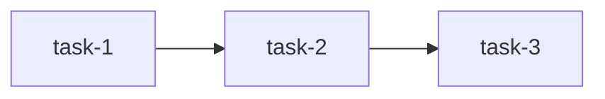
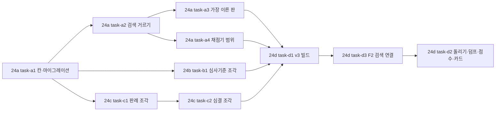
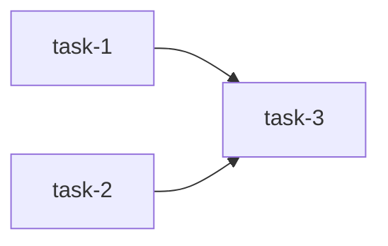

# F2 법률 근거 조사 tasks (구현 계획 + 진행)

<!-- design.md(초안, #147)를 바탕으로 쓴 구현 계획이다. 이슈 계획 하나 = 브랜치 하나 = PR 하나.
     이슈 #28(검색 도구)에 PR 여러 개: m2-i3 = 도구 + 걷는 뼈대 연결 (Refs #28),
     다음 계획 = law-idx-v3(#24) 뒤 심사기준·판례 검색과 tune Hit@k·CQ (Closes #28).
     답 쓰기·근거 검토 에이전트(모델 호출)는 #29. 어림 크기는 코드 + 테스트 줄. -->

## m2-i3  (11/21)  상태: 승인 (11/21 은진 "얼른 시작해", 상대 리뷰는 PR에서)  (이슈 #28, Refs)
**구현할 design 부분**: 2절 3·4단계(검색, 출처 확인), 4절 쓰는 법령 판, 7-1 도구 표의 `get_article`·`search_article`·`search_guideline`·`search_precedent`·`normalize_refs`
**맡은 합격 기준**: #28 본문 1(모든 결과에 출처·판본·원문 위치), 2(없는 출처 0건). 3·4(tune 점수·Hit@k)와 5(CQ)는 다음 계획 (심사기준·판례 정답 줄이 #35, 색인이 #24 뒤라서)
**목표** (한 줄): 모델 호출 없이, F3 판단 단위마다 OA 발송일에 시행 중인 거절이유 조문을 색인에서 읽어 `LegalEvidenceBundle`(④)을 만들고, 지휘 고정 순서 F1 → F3 → F2 → F4로 F4에 넘긴다.
**끝나면 보여 줄 것** (데모 한 줄): `uv run pytest tests/core/f2 tests/core/agents/test_fixed_order_f3_f4.py tests/e2e` → 고정 순서 한 바퀴(E2E 포함)에서 `run_f2`가 돌고, F4 입력 `legal`에 29조 2항·42조 4항(발송일판) 근거 묶음이 들어간다.
**어림 크기**: 코드 약 330줄 + 테스트 약 300줄. 400줄을 넘지만 셋이 이어져야 뼈대가 돌아서 PR 하나로 두고, 커밋별 리뷰 순서(task 순서)를 PR 본문에 적는다.
**걷는 뼈대에서 줄인 것** (design과 다르게, 다음 계획·#29에서 채움):
- 주장 글은 모델이 쓰지 않는다. 주장 = "거절이유 근거 조문: <조문> (OA 발송일 시행판)" 한 줄, 근거 = 그 조문 조각. 근거 검토를 안 했으므로 `review = null` + `needs_human_review`.
- 심사기준·판례·심결은 `law-idx-v2`에 조각이 없어 `search`를 부르지 않고 `search_log` 줄마다 `status = unverified(body_missing)`로 남긴다 (design 2절 3단계 그대로. `SearchLogEntry.status` 칸은 #222 리뷰로 더함).
- 출원일판 비교, 법령 API 조회(색인에 없는 판), `agent_steps` 도구 단계 기록, 실행 상한은 다음 계획.
- design 7-1 인터페이스 `research(question, ctx)`와 `impl` 고르기(`split`/`code_only`) 대신 진입 함수 `run_f2(F2Input)` 하나. 답 쓰기·근거 검토가 붙는 #29에서 `research`를 그 뒤에 둔다.
- 법령 색인 판이 저장소에 없으면(색인을 안 올린 DB) 모든 묶음을 `unverified(body_missing)` + 경고 (리뷰 반영).
- F4는 법률 주장의 `needs_human_review`를 그 묶음 후보 flags와 확인 사항으로 옮긴다 (11/22 은진 B안: 근거 검토 전 F2 묶음이 후보에서 "확인됨 + 표시 없음"으로 보이지 않게).
- F2 결과의 서버 저장(`step_results` kind `f2` 마이그레이션 + `legal-evidence` API)은 다음 계획, 별도 PR (11/22 은진).

### task-1: 조문 번호·발송일 꼴 맞추기 (`normalize_refs`의 OA 흐름 몫)
- 합격 기준: #28 1
- 고칠 파일: `src/patent_ai/core/f2_legal_research/refs.py`, `tests/core/f2/test_f2_refs.py`
- 만들 함수:
  - `article_ref(code) -> ArticleRef | None`: F1 조문 코드(`29-2`, `29-1-1`, `42-4-2`) → `ArticleRef(law="특허법", jo, gaji=0, hang, ho, label)`. 색인 위치 번호 `jo*10000 + gaji*100 + hang`(호는 항 조각 안). label은 `특허법 제29조제2항`·`특허법 제29조제1항제1호`. 호가 여럿(`29-1-1|29-1-2`)이면 같은 항이라 항 하나로 합친다. 꼴이 다르면 None.
  - `parse_dispatch_date(raw) -> date | None`: OA 발송일 원문 글자(`2099.01.26.`, `2020. 5. 4.`, `2020-05-04`) → 날짜. 못 읽으면 None.
- 테스트할 경우: 평소 셋(29-2, 29-1-1, 42-4-2) / 여러 호 합치기 / 빈 값·이상한 꼴 None / 날짜 세 꼴 / 없는 날(2월 30일) None
- 확인 방법: `uv run pytest tests/core/f2/test_f2_refs.py`

### task-2: 검색 도구 + 출처 확인
- 합격 기준: #28 1·2
- 고칠 파일: `src/patent_ai/core/f2_legal_research/tools.py`, `tests/core/f2/test_f2_tools.py`
- 만들 함수 (모두 코드, 모델 안 씀. 저장소·검색기는 인자로 받음):
  - `get_article(pool, ref, as_of) -> ArticleLookup`: 그날 시행 중인 `특허법_*` 판의 그 위치 조각. 판본 모름 조각만 있으면 `unverified(edition_unknown)`, 그 위치 조각이 아예 없으면 `not_found_in_scope`(+ 찾아본 범위), 시행판이 둘 이상이면 `conflict`.
  - `search_article(searcher, query, as_of, k) -> SearchResult`: law corpus BM25 (질의 = 심사관 논리 글).
  - `search_not_indexed(pool, source_kind, as_of)` (심사기준·판례·심결): `search`를 부르지 않고 `status = unverified(body_missing)` 기록 + 경고 (조각 0개여도, 조각이 있어도. 검색은 다음 계획).
  - `LawPool.load(repo, index_version)`: law corpus를 실행마다 한 번만 읽어 위 도구들이 같이 쓴다 (#222 리뷰).
  - `check_source(pool, chunk_id, raw_text, as_of) -> bool`: `chunk_id`가 색인에 있고, `raw_text`가 그 조각 글에 공백 빼고 그대로 있고, 판본이 기준일에 시행 중인지. 하나라도 아니면 False (없는 출처 0건).
- 테스트할 경우: 시행판 고르기(구판·신판 중 기준일 판) / 판본 모름 조각만 → edition_unknown / 다른 판만 있음 → edition_unknown / 어느 판에도 없음 → not_found_in_scope / 다른 법(특허법 시행령) 섞이지 않음 / 심사기준·판례·심결 → body_missing status + 경고 / law corpus 한 번만 읽기 / 출처 확인: 있는 조각 통과, 없는 chunk_id·바뀐 인용 글·기준일 밖 판 거부
- 확인 방법: `uv run pytest tests/core/f2/test_f2_tools.py`
- 먼저: task-1

### task-3: `run_f2`와 지휘 연결
- 합격 기준: #28 1·2 + 걷는 뼈대(F1 → F3 → F2 → F4)
- 고칠 파일: `src/patent_ai/core/f2_legal_research/run.py`, `config/f2.yaml`, `src/patent_ai/core/agents/tools_f2.py`, `src/patent_ai/core/agents/step_inputs.py`(`f2_input`, `f4_input`의 `legal`), `src/patent_ai/core/agents/orchestrator.py`(`run_f2` 노드), `config/orchestrator.yaml`(`skip_if_missing` 비움), `tests/core/f2/test_f2_run.py`, `tests/core/agents/test_fixed_order_f3_f4.py`, `tests/core/agents/test_fixed_order.py`(없는 단계 예시 이름 `run_later`), `tests/e2e/test_e2e_case_flow.py`(#200 E2E를 F2까지)
- 만들 것:
  - `F2Result(oa_id, bundles, status)`: 묶음 status를 모은 값 (가장 나쁜 것). 묶음 0개면 `unverified(input_unverified)` + 경고.
  - `run_f2(oa, units, checked_on, *, repo=None) -> F2Result`: 단위마다 묶음 하나 (`bundle_id = lb:<unit_id>`, F4 `legal_bundle_for`가 `unit_id`로 찾음). 기준일 = 발송일(`oa_dispatch_date`), 못 읽으면 조문을 찾지 않고 `unverified(input_unverified)` 묶음. 조문 근거는 출처 확인을 지난 것만 넣는다. repo가 없으면 `make_law_repo()`(Postgres, `DATABASE_URL`).
  - `config/f2.yaml`: `index_version: law-idx-v2` 한 칸 (`search_article` 설정은 run_f2가 쓰기 시작하는 다음 계획에서).
  - 지휘: `run_f2` code_tool 등록, `f2_input` = read_oa + run_f3 units + `checked_on`, F4 입력 `legal` = F2 묶음 (F2가 넘겨졌으면 지금처럼 빈 목록).
- 테스트할 경우: 진보성·명확성 단위 → 29조 2항·42조 4항 묶음(confirmed 근거 + needs_human_review) / 발송일 못 읽음 → input_unverified 묶음 / 그날 판이 색인에 없음 → edition_unknown 묶음, 어느 판에도 없음 → not_found_in_scope 묶음 / 법령 색인 판이 없음 → body_missing 묶음 / 같은 날 시행판 둘 → ambiguous + further_review / 출처 확인에서 빠진 근거는 안 들어감 / 고정 순서 한 바퀴: trace에 run_f2, F4 입력 `legal`이 F2 묶음 / run_f3를 넘기면 run_f2도 input_unverified로 넘김
- 확인 방법: `uv run pytest tests/core/f2 tests/core/agents`
- 먼저: task-2

### 진행
- [x] task-1
- [x] task-2
- [x] task-3
- 다음: /check, PR
- 막힌 것: 없음

## m2-i3b  (11/22)  상태: 승인 (11/22 은진 "너 추천대로")  (이슈 #28, Refs)
**목표** (한 줄): 서버 실행이 낸 F2 결과(`F2Result`)를 `step_results`에 저장하고 `GET /oas/{id}/legal-evidence`로 다시 연다 (걷는 뼈대의 "저장·다시 열기").
**먼저**: m2-i3 (PR #222). **공유 자원**: 마이그레이션 하나 (`step_results.kind`에 `f2`).
**끝나면 보여 줄 것**: `uv run pytest tests/api/test_results_api.py tests/core/runs/test_run_case_executor.py tests/core/cases/test_step_results.py` → 올리기 뒤 `legal-evidence`가 판단 단위마다 29조 2항·42조 4항 묶음을 돌려주고, 다시 열어도 같다.

### task-1: `step_results`에 f2 칸 + 실행기 저장 + 결과 API
- 고칠 파일: `src/patent_ai/db/migrations/versions/20261122_b3f8d2e6a914_step_results_kind_f2.py`, `src/patent_ai/db/models/results.py`, `src/patent_ai/core/cases/step_results.py`, `src/patent_ai/core/cases/result_views.py`, `src/patent_ai/core/runs/run_case_executor.py`, `docs/data-model.md`, `docs/api/README.md`, 테스트(`tests/api/test_results_api.py`, `tests/core/cases/test_step_results.py`, `test_step_results_db.py`, `tests/core/runs/test_run_case_executor.py`)
- 테스트할 경우: F2 저장·왕복(메모리·DB) / 결과 API가 F2 묶음을 주고 다시 열어도 같음 / F2를 넘기면 빈 목록 + `넘김: input_unverified` / 저장본을 못 읽으면 `확인되지 않음: 저장된 결과를 읽지 못함`
- 확인 방법: 위 데모 명령 + `make test-db`(CI)

### 진행
- [x] task-1
- 다음: PR
- 막힌 것: 없음

## m3-i1-24  (11/22~11/23)  상태: 승인 (11/22 은진 "오케이")  (이슈 #24, 계획 넷 = PR 넷. 24a·24b·24c는 Refs, 24d가 Closes #24)
<!-- 이슈 #24 하나에 PR 넷. 24a(검색 계약 넓히기, 공유 자원)가 먼저다. 24b·24c(조각 만들기)는 24a 브랜치 위에서 시작하는 쌓인 PR(base = 24a 브랜치)이고 24a가 머지되면 base를 main으로 바꾼다. 24d가 셋을 모아 law-idx-v3를 만든다.
     requirements·design은 아직 `상태: 초안`이다 (m2-i3·m2-i3b도 같은 상태에서 승인함). 이 계획은 design 5-1절 표와 "바뀌는 것" 여섯을 따른다. -->
**구현할 design 부분**: 5-1 색인 `law-idx-v3` (표, 바뀌는 것 1~6), 4절 판례·심결 날짜 거르기(`decided_on`), 8절 결정(한 표·`not_applicable`·`judgment_summary`·메타데이터 거르기·판단/당사자 표시)
**맡은 합격 기준**: #24 본문 1(조문·심사기준 + 기준일 → 그 시점 판), 2(판본 모름 → "확인되지 않음"), 3(같은 조문·같은 절의 두 판이 둘 다 남음). F2 requirements 3(시점·판본), 4(출처·판본·원문 위치), 5(요지/전문, 판단/당사자 구분을 조각에 남김). F2 검색 점수(Hit@k·CQ, #28 본문 3~5)는 이 계획 밖 (#28 다음 계획, Closes #28)
**목표** (한 줄): 특허법·시행령 조문(v1·v2 그대로) + 심사기준 8판의 신규성·진보성·명확성 장 + 판례 74건 + 심결 12건을 판본·선고일과 같이 `law_chunks` 한 표의 새 판 `law-idx-v3`로 넣고, 자료 유형·날짜로 미리 걸러 찾을 수 있게 한다.
**끝나면 보여 줄 것** (데모 한 줄): `uv run pytest tests/retrieval tests/retrieval_eval` → 심사기준 같은 절 두 판 중 기준일 판만 나오고, 판본 모름은 `skipped_unverified_edition`, 선고일이 기준일 뒤인 판례는 빠지고 날짜 모름은 `skipped_unknown_date`에 센다 (검색은 건수만 내고, 0개 + 건수 > 0을 `unverified(edition_unknown)`으로 바꾸는 것은 지금처럼 F2 도구 몫). 데이터로는 `make index-dump CORPUS=law` 뒤 `.fingerprint.json`에 `law-idx-v3` 지문.
**어림 크기**: 24a 코드 약 250 + 테스트 약 250 (400 넘음: 검색 계약 한 번에 리뷰하려고 한 PR, 커밋별 리뷰 순서를 PR 본문에), 24b 약 180 + 150, 24c 약 200 + 170, 24d 약 60 + 60 (+ 데이터 카드).
**이번에 안 하는 것** (design에 있지만 뒤로):
- `rejection_ground` 칸과 선필터는 7-3 실험 1b에서 (조문 조각에만 붙는 칸이라 v3 조각 모양과 따로 간다). v3에서는 칸을 만들지 않는다.
- 심결 더 받기(requirements 열린 질문 9), 74건 밖 판례 법령 API 조회, 조 조각(7-3 1d), 조각 앞말(1c). 심사기준은 세 장 밖을 넣지 않는다.
- F2 도구(`search_guideline`·`search_precedent`·`get_precedent`)를 v3에 붙이는 일은 #28 다음 계획. 그때 "판 사이 빈 기간(심사기준 2018.4.24~7.31, 2023.3.22~2026.3.12)이면 `edition_unknown`" 규칙과 그 재료(판 표 또는 저장소 메서드)를 같이 넣는다 (24b 리뷰).
**정한 작은 것** (추천대로 정함, 바꿀 수 있음):
- 새 칸은 넷이고 **법령 표(`law_chunks`)에만** 둔다 (`ChunkColumns` 공통 칸이 아니라 `LawChunk`에. 인용문헌 표는 안 바뀜): `source_kind`(`statute`/`guideline`/`precedent`/`trial`, NOT NULL + CHECK, v1·v2 행은 마이그레이션에서 `statute`로 채움), `decided_on`(date, 판례·심결만), `speaker`(`court`/`party`/`unknown`, 판례·심결만), `attrs`(JSONB: 법원·사건명·심결 결과·IPC 같은 후보 칸. 거르기에는 안 쓰고 보이기·나중 거르기용).
- 심사기준 장 범위: 제3부 제2장 신규성, 제3부 제3장 진보성, 제2부 제4장 청구범위 기재요건(명확성, 42조 4항). 판마다 장 첫 쪽·끝 쪽은 장 제목으로 찾고, 못 찾으면 그 판에서 멈추고 알린다 (빈 판으로 넘어가지 않음).
- 이름: 날짜 거르기 인자는 `decided_on_or_before` (그날 포함).
- 판례 요지 조각의 `speaker`는 `court` (판시사항·판결요지는 법원이 쓴 글).
- 임베딩: v3에는 채우지 않는다 (11/23 정함: F2 검색은 BM25). 유료 호출·`embed_missing`·`index_embed.py`도 이 계획에서 뺀다. vector가 필요해지면 새 판에서 채운다.

### 24a: 검색 계약 넓히기 (공유 자원: 마이그레이션·검색 계약·채점기, 재아 리뷰)  주인: 은진
#### task-a1: 조각 칸 + 마이그레이션 + 변환 (design 5-1 바뀜 1·2·3)
- 합격 기준: #24 3, F2 requirements 4·5
- 커밋 둘: ① 칸·마이그레이션·변환, ② 판례·심결 `not_applicable` 허용 (리뷰가 쉽게)
- 마이그레이션 갈래 주의: PR #257(`chore/228-invalid-output-reason`, #70 ①-2도 예정)의 `d9e4b1c7a352`(agent_steps.invalid_kind)도 down = `b3f8d2e6a914`다. 늦게 머지되는 쪽이 main을 받아 down_revision을 먼저 머지된 rev로 바꾼다 (head 둘이 되면 `alembic upgrade head`가 멈춤). PR 본문에 적는다.
- 고칠 파일: `src/patent_ai/retrieval/schemas.py`(`ChunkKind`에 `judgment_summary`, `Chunk`에 `source_kind`·`decided_on`·`speaker`·`attrs`, 모두 선택 칸), `src/patent_ai/db/models/chunks.py`(`LawChunk`에만 새 칸 + 검사 함수), `src/patent_ai/db/migrations/versions/20261123_<rev>_law_chunks_source_meta.py`(down = `b3f8d2e6a914`), `src/patent_ai/retrieval/repository.py`(`chunk_to_row`·`row_to_chunk`, `from_jsonl`), `src/patent_ai/retrieval/law_index_db.py`(`_check`, `read_chunks_jsonl`), `src/patent_ai/db/index_dump.py`(`fixture_rows`), `src/patent_ai/retrieval/law_index.py`(조문 조각 `source_kind=statute`), `docs/features/retrieval/design.md`(5-1 `not_applicable` 뜻·`chunk_kind` 값), `docs/features/F2/design.md`(5-1 바뀜 3·4의 `rejection_ground`를 "7-3 1b로 미룸"으로), `docs/data-model.md`(조각 표 칸), 테스트(`tests/retrieval/test_schemas.py`, `test_row_mapping.py`, `test_law_index_db.py`, `test_index_dump.py`, `test_repository.py`, `tests/test_migrations.py`, `tests/test_db_models.py`)
- 규칙:
  - 법령 표의 `not_applicable`은 `chunk_kind`가 `judgment`·`judgment_summary`일 때만. 검사 함수 `check_law_chunk(chunk_kind, edition_status, source_kind, decided_on, speaker)`(인용문헌은 `check_cite_chunk_meta`)는 `db/models/chunks.py`에 문자열만 받게 둔다 (db는 retrieval을 import하지 못하므로, retrieval 넣기·저장소와 db 덤프가 이 하나를 부른다).
  - `decided_on`·`speaker`는 `source_kind`가 `precedent`·`trial`일 때만 값이 있을 수 있다. 인용문헌 조각은 새 칸이 모두 비어야 한다.
  - 옛 JSONL(새 칸 없음)의 `source_kind`는 함수 하나 `fill_law_defaults(chunk) -> Chunk`가 `statute`로 채운다. `from_jsonl`과 `read_chunks_jsonl` 둘 다 이것을 부른다 (마이그레이션으로 채운 DB 행과 `content_sha256`이 같게).
- 테스트할 경우: 판례 조각 `not_applicable` 넣기 통과 / 조문 조각 `not_applicable` 거부 (세 곳) / 새 칸 왕복(메모리·행 변환·덤프 fixture) / 옛 v1 JSONL을 읽으면 `statute` / v2 JSONL 다시 넣기 → 내용 같음(멈추지 않음) / `judgment_summary` 값 / 인용문헌 조각에 `source_kind` 거부 / 마이그레이션 upgrade·downgrade (DB)
- 확인 방법: `uv run pytest tests/retrieval tests/test_db_models.py` + `make test-db` (`tests/test_migrations.py`·`tests/test_retrieval_db.py`)

#### task-a2: `search()`와 세기의 미리 거르기 (design 5-1 바뀜 4)
- 합격 기준: #24 1·2, F2 requirements 3
- 고칠 파일: `src/patent_ai/retrieval/contract.py`(`Searcher.search`·`CheckedSearcher` 검사), `schemas.py`(`SearchScope`에 같은 칸, `SearchResult.skipped_unknown_date`), `repository.py`(메모리·Postgres), `fake.py`, `bm25.py`, `vector.py`, `hybrid.py`, `src/patent_ai/core/f2_legal_research/tools.py`(`search_article`에 `chunk_kinds=["article"]`만), `docs/features/retrieval/design.md`(`search` 모양·결과 예시·상태 설명), 테스트(`tests/retrieval/test_contract.py`, `test_fake_search.py`, `test_bm25.py`, `test_vector.py`, `test_hybrid.py`, `test_repository.py`, `tests/test_retrieval_db.py`)
- 만들 모양:
  - `search(query, corpus, mode, k, doc_ids=None, as_of=None, *, chunk_kinds=None, source_kinds=None, decided_on_or_before=None)`. 모두 점수 매기기 전에 거른다.
  - 저장소: `chunks`·`count_chunks`·`count_unverified_edition`이 같은 세 인자를 받고, `count_unknown_date(corpus, index_version, doc_ids, chunk_kinds, source_kinds) -> int`를 더한다. 검색기는 body_missing 판단·`skipped_*` 건수를 이 거른 범위로 센다.
  - `decided_on_or_before`는 `decided_on ≤ 날짜`만 남기고, `decided_on`이 null인 판례·심결 조각은 빼서 `skipped_unknown_date`에 센다 (조문·심사기준은 그냥 통과). `decided_on_or_before=None`이면 `skipped_unknown_date = 0`.
  - 상태는 지금 계약 그대로: 그 범위 조각 0개 → `unverified(body_missing)`, 거른 뒤 0개 → `not_found_in_scope` + `skipped_unverified_edition`·`skipped_unknown_date` 건수. `edition_unknown`으로 바꾸는 것은 F2 도구 몫(design 2절 3단계)이라 `StatusReason`은 안 늘린다. 채점기 `excluded_body_missing` 셈도 그대로 맞다.
  - hybrid는 두 쪽 건수 중 큰 값 (지금 `skipped_unverified_edition`과 같은 규칙).
  - `CheckedSearcher` 검사: 빈 목록(`[]`)은 `doc_ids`처럼 오류, 모르는 kind 값 오류, `corpus="cite"`에 `source_kinds`·`decided_on_or_before`를 주면 오류.
- 테스트할 경우: 심사기준 같은 절 두 판 + `as_of` → 그날 판만 / `chunk_kinds=[guideline]`이면 조문·판례 안 나오고 조문의 판본 모름 조각도 안 셈 / 심사기준 0개 + `chunk_kinds=[guideline]` → `body_missing` / `source_kinds=[trial]` / 선고일이 기준일 뒤 → 빠짐 / 날짜 모름 하나만 → 0개 + `not_found_in_scope` + `skipped_unknown_date=1` / 날짜 거르기 없음 → 0 / 빈 목록·모르는 값·cite에 판례 인자 → 오류 / 거르기 없이 부르면 전과 같은 결과 / Postgres 저장소가 메모리와 같은 결과 (DB)
- 확인 방법: `uv run pytest tests/retrieval tests/core/f2` + `make test-db`
- 먼저: task-a1

#### task-a3: 가장 이른 판 시행일 세기 (design 5-1 바뀜 5)
- 합격 기준: #24 2 (가장 이른 판보다 앞선 기준일 → F2 도구가 `edition_unknown`을 내는 재료. 유형 조각 수는 a2의 `count_chunks(chunk_kinds=…)`)
- 고칠 파일: `repository.py`(`earliest_effective_from(corpus, index_version, chunk_kinds, source_kinds=None) -> date | None`, 메모리·Postgres), `tests/retrieval/test_repository.py`, `tests/test_retrieval_db.py`
- 테스트할 경우: 심사기준 2판 → 가장 이른 시행일 / 유형 조각 0개 → None / 판본 모름만 → None / 판례(`not_applicable`) → None
- 확인 방법: `uv run pytest tests/retrieval/test_repository.py` + `make test-db`
- 먼저: task-a2 (같은 파일 `repository.py`)

#### task-a4: 채점기 검색 범위에 `chunk_kinds` (design 5-1 바뀜 6. 판례 줄 날짜는 #35 정답이 생긴 뒤)
- 합격 기준: v3에서 조문 정답 줄 점수가 v2와 비교된다 (조문 줄 범위에 심사기준·판례가 섞이지 않음)
- 고칠 파일: `eval/retrieval/gold.py`(정답 줄 `chunk_kinds`, 없으면 law corpus는 `[article]`), `eval/retrieval/score.py`(`search`·`repo.chunks`·`count_chunks`에 넘김), `eval/GUIDE.md`(칸 하나), `tests/retrieval_eval/` 채점기 테스트
- 테스트할 경우: law 줄 칸 없음 → `[article]`로 찾음 (판례 조각이 더 잘 맞아도 안 걸림) / 무작위 기준선 범위 크기 = 조문 조각 수 / cite 줄은 그대로
- 확인 방법: `uv run pytest tests/retrieval_eval` + `uv run python eval/run_eval.py --config experiments/m2-i2-law-bm25-v2/config.yaml --chunks data/processed/law/law-idx-v2.jsonl` → `scores.json`의 metrics·failures가 전과 같음 (commit·seconds 칸이 바뀌므로 비교 뒤 파일은 `git checkout`으로 되돌린다)
- 먼저: task-a2

### 24b: 심사기준 조각 (8판 × 세 장)  주인: 은진  (24a 브랜치 위 쌓인 PR)
#### task-b1: 심사기준 PDF → 조각
- 합격 기준: #24 1·3, F2 requirements 4
- 고칠 파일: `src/patent_ai/retrieval/guideline_index.py`(새), `config/index/guidelines.yaml`(판 표: 파일·예규·시행일·변환본 여부), `tests/retrieval/test_guideline_index.py`, `tests/fixtures/retrieval/guideline/`(지어낸 쪽 글. 원문 안 넣음)
- 만들 함수: `chapter_pages(pages, chapter) -> range`(장 제목으로 쪽 범위, 못 찾으면 오류), `chunk_guideline(pages, doc_id, edition, index_version) -> list[Chunk]`(절 제목 `6.4.1` 아래 문단 묶음, 쪽을 넘으면 쪽에서 자름, 머리·꼬리말 줄 버림, `loc_label` = `<쪽>쪽 (제3부 제3장 6.4.1)`, 변환본 판은 `(변환본 쪽)`), `guideline_editions(table) -> dict`(시행일 → 다음 판 전날, 마지막은 현행). `doc_id` = `심사기준_<예규번호>_<시행일>`, `chunk_kind=guideline`, `source_kind=guideline`, `loc_kind=page`. 쪽 글은 `pdftotext -layout`(poppler) 또는 `pdfplumber` 중 실제 판 하나에서 덜 깨지는 쪽을 task 안에서 골라 카드에 적는다.
- 명령: `uv run python -m patent_ai.retrieval.guideline_index --config config/index/guidelines.yaml` → `data/processed/law/guideline-v3.jsonl` (판본 `law-idx-v3`). 파일이 없거나 한 판이라도 장을 못 찾으면 종료 1 + 이유 한 줄, 판마다 조각 수를 찍는다.
- 테스트할 경우: 절 둘이 한 쪽 / 절 하나가 두 쪽 → 두 조각 / 머리말 줄 버림 / 장 범위 밖 쪽 안 들어감 / 장 제목 못 찾음 → 오류 / 같은 절 두 판 → `chunk_id`가 다르고 둘 다 남음 / 시행 기간 이어짐 (앞 판 끝 = 다음 판 시작 전날) / 같은 입력 같은 바이트
- 확인 방법: `uv run pytest tests/retrieval/test_guideline_index.py`
- 먼저: 24a task-a1

### 24c: 판례·심결 조각  주인: 은진  (24a 브랜치 위 쌓인 PR, 24b와 파일 안 겹침)
#### task-c1: 판례 74건 JSON → 요지·전문 조각
- 합격 기준: F2 requirements 4·5, design 8절 (요지/전문, 판단/당사자)
- 고칠 파일: `src/patent_ai/retrieval/precedent_index.py`(새), `tests/retrieval/test_precedent_index.py`, `tests/fixtures/retrieval/precedent/`(지어낸 판례 JSON 둘)
- 만들 함수: `chunk_precedent(data, index_version) -> list[Chunk]`: 판시사항·판결요지는 `[1]` 칸마다 `judgment_summary`, 판례내용은 【이 유】 아래 번호 문단(`1.`, `가.`)마다 `judgment`. `doc_id=판례_<사건번호>`, `decided_on`=선고일자, `edition=not_applicable`, `speaker`는 문단 제목 규칙("원고의 주장"·"상고이유 주장" → `party`, "판단" 아래 → `court`, 못 정하면 `unknown`. 요지 조각은 `court`), `attrs`에 법원명·사건명. ` ` 정리. `select_precedents(logs, expected)`: 받은 기록 셋에서 성공한 것 + v2 기록의 신규성 아님 8건 뺌 + 사건명 (상)·(디) 뺌 → 건수가 `expected`(설정 값 74)가 아니면 멈춤.
- 명령: `uv run python -m patent_ai.retrieval.precedent_index --config config/index/precedents.yaml` → `data/processed/law/precedent-v3.jsonl` (판례·심결 같이, c2에서 심결을 더함). 건수가 다르거나 파일이 없으면 종료 1 + 이유 한 줄.
- 테스트할 경우: 요지 칸 셋 → 조각 셋 / 이유 번호 문단 / 당사자 주장·판단·모름 / 선고일 못 읽음 → `decided_on=null` + 경고 / 요지 없는 판례 → 전문만 / 뺄 판례 거르기 / 같은 입력 같은 바이트
- 확인 방법: `uv run pytest tests/retrieval/test_precedent_index.py`
- 먼저: 24a task-a1

#### task-c2: 심결 12건 PDF → 전문 조각
- 합격 기준: F2 requirements 4
- 고칠 파일: `src/patent_ai/retrieval/precedent_index.py`(심결 함수), `tests/retrieval/test_precedent_index.py`, `tests/fixtures/retrieval/trial/`(지어낸 쪽 글)
- 만들 함수: `chunk_trial(pages, file_name, index_version) -> list[Chunk]`: "이 유" 아래 번호 문단마다 `judgment`, `doc_id=심결_<심판번호>`(파일명 13자리 → `2026원634` 꼴), `decided_on`=심결일(못 뽑으면 null + 경고), `source_kind=trial`, `attrs`에 결과(원결정 취소/기각)·유형(README 표).
- 테스트할 경우: 번호 문단 / 심결일 못 뽑음 → null + 경고 / 파일명 → 심판번호 / 이유 제목 없음 → 오류
- 확인 방법: `uv run pytest tests/retrieval/test_precedent_index.py`
- 먼저: task-c1
- 주의: 심결 12건 다수는 심결일이 2025~2026년이라 OA 발송일(2019~2022) 기준 검색에서는 대부분 `decided_on_or_before`로 빠진다. 데이터 카드에 날짜 분포를 적는다.

### 24d: `law-idx-v3` 만들기와 덤프 (Closes #24)  주인: 은진
#### task-d1: v3 빌드 명령 + 설정
- 합격 기준: #24 1·2·3 (실제 데이터 모양에서)
- 고칠 파일: `src/patent_ai/retrieval/law_v3.py`(새: 조문(원본에서 다시) + `guideline-v3.jsonl` + `precedent-v3.jsonl`을 `law-idx-v3` 판으로 모음, 임베딩 없음), `config/index/law-idx-v3.yaml`, `tests/retrieval/test_law_v3.py`
- 명령: `uv run python -m patent_ai.retrieval.law_v3 --config config/index/law-idx-v3.yaml` → `data/processed/law/law-idx-v3.jsonl` (임베딩 없음). 입력 파일이 없거나 유형 하나가 0개면 종료 1 + 이유 한 줄.
- 테스트할 경우: 세 유형이 한 판으로 / 유형별 0개면 멈춤 (빈 판 안 냄) / 같은 입력 같은 바이트 / 받지 못한 법령 판 앞 판 끝 날짜 끊기
- 확인 방법: `uv run pytest tests/retrieval/test_law_v3.py`
- 먼저: 24a 전체, 24b, 24c

#### task-d3: F2 심사기준·판례·심결 검색 연결 (11/23 추가, 임베딩 없이 BM25)
- 합격 기준: #24 1·2, F2 requirements 3·4·5 (요지/전문, 판단/당사자 구분)
- 고칠 파일: `src/patent_ai/core/f2_legal_research/source_search.py`(새), `config/f2.yaml`·`F2Settings`(BM25 값을 법률 질문과 같이 쓰고 `source_search_k` 추가, `index_version` v3. 처음엔 `f2_search.yaml`로 따로 뒀다가 #316 머지 뒤 합침, 11/23 은진 결정), `run.py`(`search_not_indexed` 부르던 한 줄만 바꿈), `tests/core/f2/test_f2_source_search.py`
- 규칙:
  - BM25는 `unique_query_terms: true`, 낱말 자르기 `char_bigram` (기준선 `m2-i2-law-bm25-char-bigram`과 같게).
  - 심사기준: `chunk_kinds=[guideline]`, 기준일 판만. 기준일에 시행 중인 판이 없는데 조각은 있으면(가장 이른 판 앞, 판 사이 빈 기간 2018.4.24~7.31·2023.3.22~2026.3.12) `unverified(edition_unknown)`. 0개면 `body_missing`.
  - 판례·심결: `source_kinds`로 가르고 `decided_on_or_before=기준일`. 기준일을 모르면 검색하지 않고 `unverified(input_unverified)`. 요지(`judgment_summary`)와 전문(`judgment`)은 `text_kind`로, 법원·당사자·모름은 `speaker`로 근거 후보에 남긴다.
  - 걸린 조각은 근거 후보일 뿐이다. 주장으로 올리는 것은 근거 검토(#29) 몫이라 묶음에는 `further_review`(`not_used_candidate`)로만 둔다.
- 테스트할 경우: 같은 절 두 판 중 기준일 판만 / 빈 기간 → `edition_unknown` / 가장 이른 판 앞 → `edition_unknown` / 심사기준 0개 → `body_missing` / 선고일이 기준일 뒤인 판례 빠짐 + 날짜 모름 건수 / 요지·전문 `text_kind` / `speaker` 그대로 / 기준일 없음 → 검색 안 함 / 반복 낱말 질의가 `unique_query_terms`로 한 번만 세어짐 / 검색 칸이 빠지면 멈춤
- 확인 방법: `uv run pytest tests/core/f2 tests/retrieval`
- 먼저: task-d1

#### task-d2: 돌리기 (사람 OK가 필요한 단계) + 데이터 카드
- 할 일: 24b·24c 명령 → `law_v3` 빌드 → 공유 DB `alembic current` 확인 뒤 `uv run alembic upgrade head` → `law_index_db --index-version law-idx-v3` → `make index-dump CORPUS=law` → 지문·`.revision` 확인. 마이그레이션 판이 바뀌므로 cite 덤프의 `.revision`도 새 rev로 바꿔야 한다 (표는 안 바뀌고 `.revision`만, 재아 님 몫).
- 고칠 파일: `docs/data/law-go-kr.md`(4절 `law-idx-v3`: 유형별 조각 수, 판본 모름·날짜 모름 수, 심사기준 글자 뽑는 도구·판, 판례 고른 규칙, 심결 날짜 분포, 임베딩 없음 기록), `docs/data/trials-kipris.md`(색인 위치), `experiments/m3-i1-law-bm25-v3/`(`card.md`·`config.yaml`·`scores.json`), `experiments/index.md`(`uv run python eval/make_index.py`로 다시 만듦)
- 확인 방법: `uv run python eval/run_eval.py --config experiments/m3-i1-law-bm25-v3/config.yaml` (`m2-i2-law-bm25-v2` 설정에서 `index_version`만 v3) → 조문 Hit@1·Recall@5가 v2와 같음 (같아야 a4가 맞음). 점수 한 줄을 PR 본문에.
- 재아 님께 알릴 것 (PR 본문 + 스레드): 새 마이그레이션 rev, 덤프 이름(`law-idx-v3`)·지문, 드라이브에서 바꿀 파일(law 셋, cite `.revision`), `index-load` 순서.

### 진행
- [x] 24a: task-a1 (30919ab·14c059c·9f79dfe, 마이그레이션 c7e2a5d9f103) · task-a2 (4a25c69·950e8ad) · task-a3 (dd7b1d4) · task-a4 (7cd0587). v2 실제 점수 비교는 24d task-d2로 (로컬 jsonl 없음, 공유 DB가 새 마이그레이션 전)
- [x] 24b: task-b1 (ab4345c·5764db2·4625199, 8판 1,076조각. 빠진 판 제102·131·140호 → 101·124호에 끝 날짜) — PR #277 머지
- [x] 24c: task-c1 (2cc940a) · task-c2 (7fd601c) · 리뷰 반영 a0379c5·5faf52c. 판례 74건·심결 12건 1,116조각 (max_chars 3000) — PR #291
- [ ] 24d: task-d1 (4a36dac·90d6239, 임베딩 뺌) · task-d3 (bafcd70) · task-d2 일부 (공유 DB에 v3 넣고 점수·카드 씀. 남음: `make index-dump CORPUS=law`·`.revision`·재아 님께 알림)
- 다음: #291 리뷰·머지, 24d
- 막힌 것: 없음

## m3-i2-29a  (11/23)  상태: 승인 (11/23 은진 "승인할게 가자")  (이슈 #29, 계획 둘 = PR 둘. 29a는 Refs, 29b가 Closes #29)
**구현할 design 부분**: 3-2 `LegalChat`(여러 번 묻고 답하기, `prior_evidence`), 5절 `legal_chats` 표, 2절 1·3·4단계를 사용자 질문에 (질문 읽기의 조문 번호 꼴 맞추기, 검색, 출처 확인)
**맡은 합격 기준**: #29 본문 2(조회 범위 내 없음 ↔ 확인되지 않음 + 이유), 3(사건에 적용된다는 문장 없음), 11/17 멀티턴. 1(주입 오류 탐지율)은 29b.
**목표** (한 줄): 화면 법률 질문 탭이 부르는 `/legal-chats` 세 엔드포인트를 만들고, 모델 호출 없이 질문 하나마다 출처 확인을 지난 조문 근거 묶음(④)을 돌려주고 저장한다 (E2E 막힘 풀기).
**끝나면 보여 줄 것**: `uv run pytest tests/api/test_legal_chats_api.py tests/core/f2` → 대화를 만들고 "특허법 제29조제2항"을 물으면 그 조문 근거 묶음, 이어 묻기에서 시점을 바꾸면 `scope_changed = true`, `GET`으로 다시 열어도 같다. 화면은 법률 질문 탭 스크린샷.
**어림 크기**: 코드 약 350줄 + 테스트 약 300줄. 400줄을 넘지만 셋이 이어져야 탭이 돌아서 PR 하나, 커밋별 리뷰 순서(task 순서)를 PR 본문에 적는다.
**공유 자원**: 마이그레이션 하나 (`legal_chats`·`legal_chat_turns`). `down_revision = f1c8b3e7a925` (처음 c7e2a5d9f103, 11/23 #303 머지 뒤 맞춤).
**29a에서 줄인 것** (design과 다르게, 29b에서 채움):
- 주장 글은 모델이 쓰지 않는다. 주장 = 번호로 읽은 조문은 "질문에서 찾은 조문: <조문> (<판본>)", 검색으로 찾은 조문은 "질문 글로 검색한 조문 (BM25 상위 <k>): <조문> (<판본>)" 한 줄, 근거 = 그 조각. 근거 검토 전이라 `review = null` + `needs_human_review` (m2-i3 OA 흐름과 같은 규칙).
- 심사기준·판례·심결은 OA 흐름처럼 `search_not_indexed` (status `unverified(body_missing)`). 질문 글 속 자연어 시점("2020년 기준")과 선택 조건이 부딪힐 때의 `clarifications`도 29b (29a는 선택 조건 시점만 읽는다).
- 질문 하나 = 실행 하나(`runs`)는 29b. 29a는 모델을 안 불러 금방 끝나므로 요청 안에서 바로 답한다 (화면 `askLegal`이 답을 바로 받는 모양).
- 지난 질문 목록(`GET /legal-chats`)과 답 맨 위 한 문장 답·"한 일" 줄은 #264 (#239 뒤, 이 계획이 먼저). 29a는 대화·턴마다 `created_at`을 저장해 #264가 "대화는 최근 것이 앞, 한 대화 안 질문은 질문 순서"로 읽을 수 있게만 한다.
- 0개면 질의를 바꿔 한 번 더 찾기(design 2절 3단계)는 29b.
- `prior_evidence`: 앞 답에서 출처 확인을 지난 조각 ID를 모은다. 바뀐 시점에서 시행판이 아닌 조각은 `further_review`(`edition_out_of_scope`)로 보인다. 시행판인 앞 조각을 다시 후보로 넣는 것은 답 쓰기가 붙는 29b.

### task-1: 사용자 질문 → 근거 묶음 (코드, 모델 없음)
- 합격 기준: #29 2·3, 멀티턴 조건 물려받기
- 고칠 파일: `src/patent_ai/core/f2_legal_research/refs.py`(`article_refs_in_text`), `src/patent_ai/core/f2_legal_research/chat.py`(새), `tests/core/f2/test_f2_refs.py`, `tests/core/f2/test_f2_chat.py`(새)
- 만들 것:
  - `article_refs_in_text(text) -> list[ArticleRef]`: 글 속 `특허법 제29조제2항`·`제42조 제4항 제2호`·`29조 2항` 꼴을 `ArticleRef`로 (법 이름이 없으면 특허법, 다른 법 이름이 붙으면 버림). 같은 조·항은 하나로.
  - `ChatAsk(text, as_of: date | None | 빠짐, source_kinds: list | 빠짐)`: 요청 본문. 빠진 칸은 앞 질문을 물려받고, `source_kinds = []`는 전부.
  - `next_question(prev: LegalQuestion | None, ask) -> (LegalQuestion, scope_changed)`: `as_of`가 있으면 `user_condition`, 없으면 `none`(현행). 앞 질문과 시점·자료 유형이 다르면 `scope_changed = true`.
  - `answer_question(question, *, bundle_id, pool, searcher, checked_on, prior_evidence) -> LegalEvidenceBundle`: 검색 기준일 = `as_of` 또는 `checked_on`(design 4절). 법령을 찾으면: 글에 조문 번호가 있으면 `get_article`, 없으면 `search_article`(BM25, k = `config/f2.yaml` `chat_search_k`). 근거마다 `check_source`, 통과한 것만 주장에. 심사기준·판례·심결은 `search_not_indexed`. 주장 0개면 `not_found_in_scope`(+ 찾아본 범위) 또는 그 이유의 `unverified`. `prior_evidence` 중 기준일 판이 아닌 조각 → `further_review(edition_out_of_scope)`.
- 테스트할 경우: 조문 꼴 셋 + 다른 법 버림 + 중복 합침 / 조건 물려받기·덮기·`scope_changed` / 조문 번호 질문 → 그 조문 confirmed 근거 + needs_human_review / 번호 없는 질문 → BM25 상위 조문 / 판 없음 → `unverified(edition_unknown)`, 어느 판에도 없음 → `not_found_in_scope` / 법령을 안 고르면 법령을 안 찾음 / 심사기준 등 body_missing 기록 / 주장 글에 "적용" 판단 문장이 없음 / 앞 조각이 기준일 밖 → further_review
- 확인 방법: `uv run pytest tests/core/f2`

### task-2: 대화 저장 (`legal_chats` 표)
- 고칠 파일: `src/patent_ai/db/migrations/versions/20261123_<rev>_legal_chats.py`, `src/patent_ai/db/models/legal_chats.py`(새, `models/__init__.py`에 등록), `src/patent_ai/core/f2_legal_research/chat_store.py`(Protocol + 메모리), `chat_store_pg.py`(Postgres), `docs/data-model.md`(6절 "법률 질문 대화의 칸"), 테스트 `tests/core/f2/test_chat_store.py`, `tests/core/f2/test_chat_store_db.py`(`@pytest.mark.db`)
- 표: `legal_chats(chat_id PK, case_id NULL, created_at)`, `legal_chat_turns(chat_id FK, no, question JSONB, scope_changed, bundle JSONB, created_at, PK(chat_id, no))`. 묶음은 턴 줄에 둔다 (`legal_evidence_bundles` 표는 OA 흐름이 `step_results`를 쓰고 있어 아직 없다).
- 저장소: `create(case_id) -> chat_id`, `get(chat_id) -> LegalChat | None`, `add_turn(chat_id, turn)`. 되읽을 때 스키마 검사, 못 읽으면 오류로 (조용히 빈 대화 안 됨).
- 테스트할 경우: 만들기·턴 더하기·되읽기(메모리·DB) / 없는 대화 None / 턴 번호 1부터 이어짐
- 확인 방법: `uv run pytest tests/core/f2/test_chat_store.py` + PR 전용 test DB에서 `make test-db`

### task-3: `/legal-chats` API + 화면 연결
- 고칠 파일: `src/patent_ai/api/legal_chats.py`(새), `api/main.py`, `api/deps.py`, `docs/api/README.md`(법률 질문 표·응답 예시), `web/src/api/index.ts`(`askLegal`이 `result`를 꺼냄), `web/src/types/provisional/case.ts`(`LegalChatView`), `web/src/api/mock.ts`(모양 맞춤), `tests/api/test_legal_chats_api.py`(새)
- 모양: `POST /legal-chats` `{case_id?}` → 201 `{chat_id}`. `POST /legal-chats/{id}/messages` `{text, as_of?, source_kinds?}` → 200 `{chat_id, no, scope_changed, result: ④}`. `GET /legal-chats/{id}` → `{chat_id, case_id, turns: [{no, question, scope_changed, result}], prior_evidence}`. 오류 404 `chat_not_found`, 422 `invalid_question`(빈 글). 법령 색인을 못 읽으면 묶음이 `unverified(body_missing)` + 경고 (run_f2와 같음).
- 테스트할 경우: 만들기 → 묻기 → 보기 / 이어 묻기 scope_changed / 없는 대화 404 / 빈 글 422 / 색인 없음 → body_missing 묶음
- 확인 방법: `uv run pytest tests/api/test_legal_chats_api.py`, `npm run build`(web), 화면 스크린샷

### 진행
- [x] task-1 (c8aa508, 리뷰 반영 c21d845: 옛 시점 BM25 0개는 `unverified(edition_unknown)`, 검색 조문 문구 나눔)
- [x] task-2 (2f5c49f, 마이그레이션 `d4a8c2e6b915`. 저장소 모양은 계획과 조금 다름: `create(case_id, now) -> LegalChat`, `add_turn(chat_id, question, scope_changed, bundle, now) -> LegalChatTurn`. 시각을 밖에서 받아 테스트가 쉬움)
- [x] task-3 (087cefa·0e033fa, 리뷰 반영 e369f10: 색인 캐시는 메모리 조각만 두고 DB 세션을 닫음(`PostgresChunkRepository.close()` 추가), 요청 스키마를 OpenAPI에 실음). 저장본 못 읽음은 500 `chat_corrupt`
- 다음: PR #316 머지 (/check 통과. task별·이슈 리뷰를 합쳐 막음 2·고칠 것 8 반영, 이 중 이슈 전체 리뷰는 막음 1·고칠 것 3: 6db2177·ee3ad79·4d38f38, 재리뷰 통과. 재아 리뷰 고칠 것 2 반영)
- 막힌 것: 없음

## m3-i2-29b  (뒤에)  상태: 계획 전  (이슈 #29, Closes)
- 답 쓰기(모델) + 근거 검토 에이전트(`split`/`code_only`, `config/f2.yaml` `impl`), 질문 하나 = 실행 하나(`runs`·`agent_steps`), 자연어 시점과 `clarifications`, 주입 오류 탐지율(#35 정답, `feature: f2` 채점기). `run_f2`와 `answer_question` 두 진입점을 design 7-1 `research()` 하나로 모은다. 29a 머지 뒤 계획을 쓴다.
