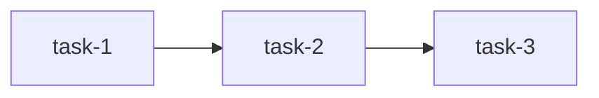

# F2 법률 근거 조사 tasks (구현 계획 + 진행)

<!-- design.md(초안, #147)를 바탕으로 쓴 구현 계획이다. 이슈 계획 하나 = 브랜치 하나 = PR 하나.
     이슈 #28(검색 도구)에 PR 여러 개: m2-i3 = 도구 + 걷는 뼈대 연결 (Refs #28),
     다음 계획 = law-idx-v3(#24) 뒤 심사기준·판례 검색과 tune Hit@k·CQ (Closes #28).
     답 쓰기·근거 검토 에이전트(모델 호출)는 #29. 어림 크기는 코드 + 테스트 줄. -->

## m2-i3  (11/21)  상태: 승인 (11/21 은진 "얼른 시작해", 상대 리뷰는 PR에서)  (이슈 #28, Refs)
**구현할 design 부분**: 2절 3·4단계(검색, 출처 확인), 4절 쓰는 법령 판, 7-1 도구 표의 `get_article`·`search_article`·`search_guideline`·`search_precedent`·`normalize_refs`
**맡은 합격 기준**: #28 본문 1(모든 결과에 출처·판본·원문 위치), 2(없는 출처 0건). 3·4(tune 점수·Hit@k)와 5(CQ)는 다음 계획 (심사기준·판례 정답 줄이 #35, 색인이 #24 뒤라서)
**목표** (한 줄): 모델 호출 없이, F3 판단 단위마다 OA 발송일에 시행 중인 거절이유 조문을 색인에서 읽어 `LegalEvidenceBundle`(④)을 만들고, 지휘 고정 순서 F1 → F3 → F2 → F4로 F4에 넘긴다.
**끝나면 보여 줄 것** (데모 한 줄): `uv run pytest tests/core/f2 tests/core/agents/test_fixed_order_f3_f4.py` → 고정 순서 한 바퀴에서 `run_f2`가 돌고, F4 입력 `legal`에 29조 2항(발송일판) 근거 묶음이 들어간다.
**어림 크기**: 코드 약 330줄 + 테스트 약 300줄. 400줄을 넘지만 셋이 이어져야 뼈대가 돌아서 PR 하나로 두고, 커밋별 리뷰 순서(task 순서)를 PR 본문에 적는다.
**걷는 뼈대에서 줄인 것** (design과 다르게, 다음 계획·#29에서 채움):
- 주장 글은 모델이 쓰지 않는다. 주장 = "거절이유 근거 조문: <조문> (OA 발송일 시행판)" 한 줄, 근거 = 그 조문 조각. 근거 검토를 안 했으므로 `review = null` + `needs_human_review`.
- 심사기준·판례·심결은 `law-idx-v2`에 조각이 없어 `search`를 부르지 않고 `unverified(body_missing)`로 `search_log`에 남긴다 (design 2절 3단계 그대로).
- 출원일판 비교, 법령 API 조회(색인에 없는 판), `agent_steps` 도구 단계 기록, 실행 상한은 다음 계획.

### task-1: 조문 번호·발송일 꼴 맞추기 (`normalize_refs`의 OA 흐름 몫)
- 합격 기준: #28 1
- 고칠 파일: `src/patent_ai/core/f2_legal_research/refs.py`, `tests/core/f2/test_refs.py`
- 만들 함수:
  - `article_ref(code) -> ArticleRef | None`: F1 조문 코드(`29-2`, `29-1-1`, `42-4-2`) → `ArticleRef(law="특허법", jo, gaji=0, hang, ho, label)`. 색인 위치 번호 `jo*10000 + gaji*100 + hang`(호는 항 조각 안). label은 `특허법 제29조제2항`·`특허법 제29조제1항제1호`. 호가 여럿(`29-1-1|29-1-2`)이면 같은 항이라 항 하나로 합친다. 꼴이 다르면 None.
  - `parse_dispatch_date(raw) -> date | None`: OA 발송일 원문 글자(`2099.01.26.`, `2020. 5. 4.`, `2020-05-04`) → 날짜. 못 읽으면 None.
- 테스트할 경우: 평소 셋(29-2, 29-1-1, 42-4-2) / 여러 호 합치기 / 빈 값·이상한 꼴 None / 날짜 세 꼴 / 없는 날(2월 30일) None
- 확인 방법: `uv run pytest tests/core/f2/test_refs.py`

### task-2: 검색 도구 + 출처 확인
- 합격 기준: #28 1·2
- 고칠 파일: `src/patent_ai/core/f2_legal_research/tools.py`, `tests/core/f2/test_tools.py`
- 만들 함수 (모두 코드, 모델 안 씀. 저장소·검색기는 인자로 받음):
  - `get_article(repo, index_version, ref, as_of) -> ArticleLookup`: 그날 시행 중인 `특허법_*` 판의 그 위치 조각. 판본 모름 조각만 있으면 `unverified(edition_unknown)`, 그 위치 조각이 아예 없으면 `not_found_in_scope`(+ 찾아본 범위), 시행판이 둘 이상이면 `conflict`.
  - `search_article(searcher, query, as_of, k) -> SearchResult`: `law` 말뭉치 BM25 (질의 = 심사관 논리 글).
  - `search_guideline(repo, index_version) / search_precedent(repo, index_version)`: 그 유형 조각(`chunk_kind` guideline / judgment)이 0개면 `search`를 부르지 않고 `unverified(body_missing)` 기록. 조각이 있으면 다음 계획이라 `NotImplementedError`가 아니라 같은 `body_missing` + 경고 (#24 전에는 생기지 않는 길).
  - `check_source(repo, index_version, evidence, as_of) -> bool`: `chunk_id`가 색인에 있고, `raw_text`가 그 조각 글에 공백 빼고 그대로 있고, 판본이 기준일에 시행 중인지. 하나라도 아니면 False (없는 출처 0건).
- 테스트할 경우: 시행판 고르기(구판·신판 중 기준일 판) / 판본 모름만 → edition_unknown / 조각 없음 → not_found_in_scope / 다른 법(특허법 시행령) 섞이지 않음 / 심사기준·판례 0개 → body_missing / 출처 확인: 있는 조각 통과, 없는 chunk_id·바뀐 인용 글·기준일 밖 판 거부
- 확인 방법: `uv run pytest tests/core/f2/test_tools.py`
- 먼저: task-1

### task-3: `run_f2`와 지휘 연결
- 합격 기준: #28 1·2 + 걷는 뼈대(F1 → F3 → F2 → F4)
- 고칠 파일: `src/patent_ai/core/f2_legal_research/run.py`, `config/f2.yaml`, `src/patent_ai/core/agents/tools_f2.py`, `src/patent_ai/core/agents/step_inputs.py`(`f2_input`, `f4_input`의 `legal`), `src/patent_ai/core/agents/orchestrator.py`(`run_f2` 노드), `tests/core/f2/test_run.py`, `tests/core/agents/test_fixed_order_f3_f4.py`
- 만들 것:
  - `F2Result(oa_id, bundles, status)`: 묶음 status를 모은 값 (가장 나쁜 것). 묶음 0개면 `unverified(input_unverified)` + 경고.
  - `run_f2(oa, units, checked_on, *, repo=None) -> F2Result`: 단위마다 묶음 하나 (`bundle_id = lb:<unit_id>`, F4 `legal_bundle_for`가 `unit_id`로 찾음). 기준일 = 발송일(`oa_dispatch_date`), 못 읽으면 조문을 찾지 않고 `unverified(input_unverified)` 묶음. 조문 근거는 출처 확인을 지난 것만 넣는다. repo가 없으면 `make_law_repo()`(Postgres, `DATABASE_URL`).
  - `config/f2.yaml`: `index_version: law-idx-v2`, `search`(bm25, char_bigram, k) 칸.
  - 지휘: `run_f2` code_tool 등록, `f2_input` = read_oa + run_f3 units + `checked_on`, F4 입력 `legal` = F2 묶음 (F2가 넘겨졌으면 지금처럼 빈 목록).
- 테스트할 경우: 진보성·명확성 단위 → 29조 2항·42조 4항 묶음(confirmed 근거 + needs_human_review) / 발송일 못 읽음 → input_unverified 묶음 / 색인에 그 판 없음 → not_found_in_scope 묶음 / 출처 확인에서 빠진 근거는 안 들어감 / 고정 순서 한 바퀴: trace에 run_f2, F4 입력 `legal`이 F2 묶음 / run_f3를 넘기면 run_f2도 input_unverified로 넘김
- 확인 방법: `uv run pytest tests/core/f2 tests/core/agents`
- 먼저: task-2

### 진행
- [ ] task-1
- [ ] task-2
- [ ] task-3
- 다음: task-1
- 막힌 것: 없음
