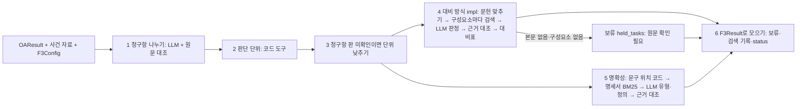

# F3 청구항–인용문헌 대비 세부 설계
<!-- 이슈 #45. requirements에 쓴 것(무엇, 합격 기준, 사람이 고르는 곳)은 다시 쓰지 않고 번호로 가리킨다.
     코드 출처 `파일:줄 (c093221)` = 커밋 c093221 기준 (PR #182로 main에 머지됨. 그 뒤 main에서 바뀐 동작은 커밋을 붙여 적는다). 경로 앞 `src/patent_ai/core/f3_claim_compare/`는 `f3/`로 줄인다.
     검색 계약(Searcher·조각 표·채점기)은 features/retrieval/design.md, 인용문헌 조각·색인은 features/cite-search/design.md를 그대로 쓰고 여기서는 F3가 그 위에 얹는 것만 쓴다.
     안 정해진 곳은 `질문:` 줄로 남기고 10절에 모은다. -->

## 1. 합격 기준 ↔ 설계
| 기준 (requirements 번호) | 설계의 어디가 만족시키나 |
|---|---|
| 1 진보성 구성요소·문단·요약, 부모 구성요소 | 2절 1·4단계, 3-2 `InventiveSummary`, 8절 부모 구성요소 결정 |
| 2 심사관 지정 / AI 찾음, 왜 가져왔나 | 2절 4단계 후보 만들기, 3-2 `paragraph_source`·`why_retrieved` |
| 3 한 번 더 찾기, 조회 범위 내 없음 | 2절 4단계 `second_search`, 3-2 `searched_scope` |
| 4 명확성 문구 위치·정의·유형 | 2절 5단계, 3-2 `ClarityReview` |
| 5 한국·미국만 | 2절 4단계 인용문헌 맞추기 (`f3/citations.py`) |
| 6 신규성 문헌 하나, 세 값, 시점 | 2절 4단계(문헌마다 표), 3-2 `NoveltySummary`, 3-3 세 값 맞추기 |
| E1·E2 (점수 기준) 검색 회수율, CQ | 7-1 평가 세트·지표, 7-4 CQ |
| E3 (지킬 선) | 2절 출처 대조(코드), 7-1 채점기 멈춤 조건 |
| E4 (점수 기준) 대비·명확성·신규성 지표 | 7-1 (지금 잴 수 있는 것과 `skipped_metrics`) |

## 2. 흐름

진입 함수 `run_f3(oa_result, case_materials, config, *, ctx) -> F3Result` (`f3/run.py:82-162 (c093221)`).
1. **청구항 나누기** (`f3/elements.py`, 프롬프트 `prompts/f3/split_elements.md`): 거절이유 대상 청구항과, 그들이 인용하는 앞 청구항을 번호 순으로 하나씩 나눈다 (`f3/run.py:49-79`). 모델은 구성요소 글자와 인용 관계(`depends_on` + 원문 인용구)를 낸다. 코드는 확인만 한다: 구성요소 글자가 원문에 순서대로 그대로 있나(공백 줄이기만 허용), 인용구가 원문에 있고 번호가 그 사건 청구항이며 자기보다 작은가. 떨어지면 검사 오류를 붙여 한 번 다시, 그래도 틀린 것은 버리지 않고 "확인되지 않음" (`f3/elements.py:1-8`). 코드가 "제N항"을 정규식으로 읽지 않는다. 독립항(`depends_on: []`)은 대조할 인용구가 없어 `confirmed` + "원문 대조 없음"을 적는다 (`f3/elements.py:158-159`, 11/21 재아 확인).
2. **판단 단위** (`f3/units.py`, 코드 도구, 같은 입력 → 같은 결과): 진보성·신규성은 독립항 묶음(여러 항을 인용한 종속항은 묶음마다), 명확성은 청구항 하나 + 함께 읽을 앞 청구항. 독립항이 그 거절이유 대상이 아니면 대상 중 가장 앞 청구항이 대표다 (`f3/units.py:92-107`). 인용 관계를 모르는 청구항은 혼자 단위 + `input_unverified`.
3. **청구항 판 미확인:** `F3Inputs.claims_status`가 확인됨이 아니면 단위를 모두 `input_unverified` + "직접 검토 필요"로 낮춘 뒤 대비한다 (`f3/run.py:116-119`).
4. **대비 방식** (`config/f3.yaml` `impl`, 지금 `split_search` 하나, `f3/strategies.py:69-84`). 진보성·신규성 단위만 맡는다 (`f3/compare.py:1-13`, `:806-913`):
   - 인용문헌 맞추기 (`f3/citations.py:48-74`): 지원 안 하는 나라 → 대비 안 함(`lookup_failed`, 직접 확인) / 번호·나라 모름 → 대비 안 함(`ambiguous`) / 색인 조각 0개(미국 포함) → 대비 안 함(`body_missing`) + 보류. 번호는 F1 값 그대로, 새로 정규화하지 않는다.
   - 문헌 묶기: 진보성은 거절이유의 문헌을 한 표에, 신규성은 문헌마다 표를 따로 만든다 (`f3/compare.py:840`). 청구항마다 그 청구항 줄에 심사관이 적용한 문헌만 쓴다 (`:793-798`).
   - 부모 구성요소 (11/21 재아 결정, 커밋 911410e·c093221): 종속항 대비 목록 = 거슬러 올라간 앞 청구항들의 구성요소 + 자기 구성요소. 그 부모가 같은 묶음에서 이 종속항이 대비되는 문헌을 모두 대비받으면 다시 넣지 않는다 (신규성은 문헌마다 따짐). 인용 가지가 여럿이면 넣지 않고 경고. 부모 나누기가 비었거나 확인되지 않음이면 경고 + 그 종속항 줄 `input_unverified` (`f3/compare.py:165-239`, `:876-890`).
   - 검색: 질의 = 구성요소 글자뿐. 인용문헌 하나 안에서 하이브리드(RRF) 상위 k=10 (`config/f3.yaml:27-36`). 같은 (질의, 문헌) 검색은 한 번만 (`f3/compare.py:242-258`). 심사관 지정 위치는 질의에 절대 넣지 않는다.
   - 후보: 검색 상위 k ∪ (설정 `use_examiner_paragraphs`가 켜졌을 때만) 심사관 지정 조각. 어느 쪽인지 표시 없이 모델에 준다. 줄의 출처(심사관 지정 / AI가 찾음)는 코드가 붙인다 (`f3/examiner.py`, `f3/compare.py:497-555`).
   - 판정: 모델 1회가 청구항 하나의 구성요소 × 문헌마다 `disclosed`/`difference_candidate`/`unclear` + 근거(chunk_id + 옮긴 글자) (`prompts/f3/compare.md`).
   - 출처 대조 (코드, 늘 돎): 근거 글자가 그 후보 조각에 그대로 있고 `min_quote_chars`(10자) 이상인가. 떨어지면 한 번 다시, 그래도 틀린 근거는 버린다 (`f3/compare.py:370-421`). 근거 없이 "개시됨"이면 불명 + `evidence_rejected`. 근거를 못 고르면 `not_found_in_scope` + 찾아본 범위 "D1 조각 N개 중 hybrid 상위 10 (cite-idx-v2)" (`:138-141`, `:537-540`).
   - 한 번 더 찾기 (`second_search`, 기본 켬으로 바꿈: 11/21 재아 결정, 설정 한 줄 PR 전까지 main은 끔): 1차에서 근거를 못 고른 구성요소만 같은 질의로 상위 `second_search_depth`(20)까지 + 도면 설명 조각을 받아 1차 조각을 빼고 다시 판정 (`f3/compare.py:557-642`).
   - 독립항 먼저 (진보성만, 이슈 #30, 11/22): 묶음마다 대표 청구항(독립항, 독립항이 대상 밖이면 대상 중 가장 앞 청구항)을 먼저 대비한다. 그 줄이 모두 개시됨(위 3-3 "무너짐")이면 나머지 종속항을 따로 대비한다(부모 구성요소 규칙은 위 그대로). 차이 후보·불명이 하나라도 있으면 **둘 다 맞는 종속항만** 건너뛴다: 대표 청구항을 거슬러 올라가 인용해(인용 가지가 여럿이면 아님) 대표의 구성요소를 다 갖고, 그 청구항에 붙은 인용문헌이 모두 대표에도 붙어 있다. 아니면(형제 종속항, 종속항에만 더 붙은 문헌) 그대로 대비한다(11/21 부모 구성요소 결정). 건너뛴 청구항도 **검색(구성요소마다 BM25+벡터 하이브리드, 같은 k·인용문헌 범위)은 하고** 검색 기록을 기존 `search_log`에 남긴다(`compare.py` `_search_skipped`, 11/22 재아 결정 1 (나)). LLM 대비 호출·second_search·대비표 줄만 생략한다(호출 절감 유지, 임베딩 호출만 는다). 대표 판정이 틀려도 종속항 후보 문단이 남고 채점기가 search_recall로 센다. 의견서 실무 흐름(독립항 진보성 뒤 종속항)을 따른 것이고, ADR 0001:30의 신규성 순서와는 어긋난다(재아 결정, 그대로 둠). 보류는 `f3_compare:<unit_id>:claim<N>:dependent` + 이유 글("대표 청구항 M에 차이 후보·불명 구성요소가 있어 종속항을 대비하지 않음 (검색은 함, 대비는 생략…)")을 남긴다. 이 보류는 F3 결과 status도 F4 후보 status·`needs_human_review`도 낮추지 않고, F4 확인 사항 글에만 보인다(판별 `core/bundle_errors.py` `is_dependent_skip` 한 곳). 대표 줄이 없어 무너졌는지 모르면 종속항을 그대로 대비한다. 신규성은 이 순서를 쓰지 않는다. 대표가 안 무너지면 건너뛴 종속항 호출이 없어 모델 호출이 준다.
   - 효과 후보 (진보성 ③, 이슈 #30, 11/22, `f3/effects.py`, 프롬프트 `prompts/f3/effect.md`, 설정 `config/f3.yaml` `effect`: 호출 상한 80, 조각 수는 최상위 `effect_search.k`): 표마다 차이점(개시됨 없고 글자를 확인한 구성요소)이 있을 때만 모델 1회(검사 실패 때 1번 더). 후보 조각은 그 사건 최초 명세서를 메모리 BM25로 차이점마다 상위 `effect_search.k`개. 모델이 효과 문장을 하나도 못 고르면(빈 목록) 경고를 남긴다(못 찾은 것이지 없다는 판단이 아님). 모델은 차이점 번호 + 조각 chunk_id + 조각 글에서 옮긴 효과 문장을 낸다. 코드가 문장이 명세서 글에 그대로 있나(`min_quote_chars` 이상) 확인한다: 고른 조각에 없으면 명세서 전체(모든 조각, 쪽을 넘어 이어진 문단 포함)에서 한 번 더 찾아 `[0016] <원문 문장> (관련 차이점: 청구항 1 [구성 1-2])`로 `effect_candidates`에 싣는다. 그래도 없으면 후보에서 빼고(근거를 지어내지 않음, F4 모델 입력으로 가므로) 경고 + 보류 `f3_compare:<unit_id>:effect`(확인되지 않음, 뺀 건수만 적고 원문 글자는 없음). 효과 단계의 모델 호출이 실패(형식 두 번·전송 오류·상한)해도 대비표는 남기고 효과 후보만 빈 목록 + 보류 `f3_compare:<unit_id>:effect:call_failed`·`:limit_reached`. 결과 칸이 문자열 목록이라 위치·상태를 칸으로 나누지 못한다. 질문: `effect_candidates`를 `{문장, evidence, status}` 칸으로 바꿀지 (스키마 PR). 최초 명세서가 입력에 없으면 모델을 부르지 않고 빈 목록 + 보류 `f3_compare:<oa_id>:spec`(`waiting_for` "최초 명세서 본문 (올려 주면 효과 후보 뽑기)", 본문 미확보로 셈)와, F4가 그 묶음 확인 사항에 싣도록 진보성 단위마다 `f3_compare:<unit_id>:spec`도 같이 남긴다(같은 글, 본문 미확보로 셈). 효과 문장은 반박 후보일 뿐 진보성 결론이 아니다.
   - 요약 (코드가 줄을 모음, 새 글을 만들지 않음): 진보성 = 어느 문헌에도 "개시됨"이 없는 구성요소(부모에서 온 것은 "(청구항 N에서 인용)") + 심사관 결합 논리 원문 + 효과 후보(아래 "효과 후보" 줄). 신규성 = 대표 청구항 줄로 세 값을 정하고 reason에 "AI 정리, 판정 아님" (`:755-790`). 모든 대비표에 "직접 검토 필요" (`:899-906`, 커밋 010bb1a).
5. **명확성** (`f3/clarity.py`, 대비 방식과 따로): OA가 짚은 문구(F1 `clarity_terms`)의 청구항 위치는 코드가 찾는다. 같은 문구가 여러 번이면 몇 곳인지 적는다. 정의 후보는 그 사건 출원서만 메모리 BM25 상위 5 (청구범위·요약서·도면 머리 줄 구간은 뺌, `config/f3.yaml:67-78`). 모델 1회가 문구마다 문제 유형 4개 중 하나 + 정의 근거. 근거는 명세서 조각과 대조 (`f3/clarity.py:1-8`, `:360-396`).
6. **모으기** (`f3/run.py:135-162`): 결과 status = 단위·대비표·명확성 검토·보류의 가장 나쁜 값. 보류가 있으면(본문 기다림 `body_missing`, 그 밖 `not_extracted`) 확인됨으로 모으지 않는다 (커밋 010bb1a). 결과가 없는 단위도 `not_extracted`로 센다.
- 실패하면 (정함 #211, #166 (가)): 판단 단위(묶음) 하나의 모델 호출 실패는 그 묶음만 보류(`f3_compare:<unit_id>:call_failed`, `f3_clarity:<unit_id>:call_failed`) + 확인되지 않음 + 이유, 같은 묶음에서 이미 나온 본문 미확보 보류는 남긴다. 대비와 명확성을 합쳐 모델을 부른 모든 묶음이 실패하면(모델을 부르기 전에 보류로 끝난 묶음, 예: 인용문헌 본문 없음·짚은 문구를 청구항에서 못 찾음은 분모에서 뺀다) 마지막 원래 예외를 올리고 지휘가 실행을 failed로 남긴다 (`core/bundle_errors.py`). 호출 상한에 닿은 묶음은 `…:limit_reached` 보류 + `unverified(limit_reached)`. 청구항 나누기(`_split_claims`) 상한과 DB 연결 오류는 그대로 올린다.
- 비면: 판단 단위 0개, 대비 줄 0개, 명세서 조각 0개는 경고를 남기고 보류 또는 확인되지 않음 (성공으로 숨기지 않음).
- 느리면: 지금 순서대로 1건씩 돈다 (tune 9건 합 1,386초, 사건 4개 병렬, [`experiments/m2-f3-skeleton/card.md`](../../../experiments/m2-f3-skeleton/card.md)). 시간 상한 키는 없다 (호출 수 상한만).

### 2-1. 흐름 방식
- **코드 흐름**이다. 지휘는 `run_f3`를 코드 도구 하나로 부른다 (`core/agents/tools_f3.py:32-34 (c093221)`, 도구 종류 `code_tool`). 안에서 모델은 단계마다 정해진 횟수만 부르고 검색어를 모델이 정하지 않는다. 이유: M2 뼈대는 가장 단순한 구현으로 끝에서 끝까지 먼저 잇는다 (product.md 9절).
- ADR 0003 폴더 이름은 "F3 서브에이전트와 도구"지만 지금은 루프가 없다. 질문: 모델이 검색어를 바꿔 다시 찾는 루프를 `impl` 하나로 비교할지
- 단계 기록: 모델 호출·질의 임베딩은 `core/llm`이 `RunContext`로 호출 기록(`agent_steps`, `step_kind = model_call`)에 남긴다. 검색 한 번마다의 기록은 `F3Result.search_log`(구성요소 원문 대신 해시, 걸린 조각 ID 순서)에 둔다 (`f3/result.py:17-32`).

## 3. 데이터 모양
### 3-1. 앞 기능에서 받는 것
- F1 ① `OAResult` (거절이유, `claim_rows`의 인용 라벨·심사관 지정 위치·`same_as`·`clarity_terms`), ⑥ `CaseMaterials`(문서 ID 목록, 청구항 문서가 목록에 있는지 확인만).
- 글자 입력 `F3Config.inputs: F3Inputs` = `claims_at_oa`(번호 → OA 당시 청구항 글자), `claims_status`(그 판이 맞는지), `claims_document_id`, `spec`(최초 명세서 쪽 글자, 없으면 null) (`f3/inputs.py:72-90`). 도구 입력은 model_dump → model_validate로 왕복하므로 검색기 같은 객체는 싣지 않는다.
- OA 당시 판을 고르는 일은 부르는 쪽이 한다 (`f3/inputs.py:1-4`). 앱 쪽에 판을 복원하는 코드는 아직 없고, 지휘 실행 입력이 이 글자를 받는다 (이슈 #166·#57). 질문: OA 당시 청구항 복원을 앱 코드 어디에 둘지 (새 질문)
- F2 ④는 받지 않는다 (11/21 재아 결정, 10절 1번).
- 받은 결과가 "확인되지 않음"·"충돌"이면: requirements "근거" 절의 전파 규칙.

### 3-2. 다음 기능에 주는 것
F3가 돌려주는 묶음 `F3Result` (`f3/result.py:48-60`, 결과 스키마 폴더 밖 내부 모델). 안의 ②③은 결과 스키마 (`core/schemas/judgment_unit.py`, `comparison.py`, PR #176).
```json
{
  "oa_id": "oa_1",
  "units": [{"unit_id": "oa_1:29-2:c1", "rejection_kind": "inventive_step", "claims": [1, 3], "...": "②"}],
  "comparisons": [{
    "unit_id": "oa_1:29-2:c1", "rejection_kind": "inventive_step",
    "citations": [{"label": "D1", "number": "KR…A", "compared": true},
                  {"label": "D2", "number": "US…", "compared": false, "skipped_reason": "본문 미확보 · 올려 주면 대비", "skipped_status": {"value": "unverified", "reason": "body_missing"}}],
    "rows": [{"claim": 3, "element": "…", "element_location": "청구항 1 [구성 1-2]", "citation": "D1",
              "judgment": "disclosed", "paragraph_source": "ai_found",
              "why_retrieved": "구성요소 글자를 질의로 검색 (D1 조각 120개 중 hybrid 상위 10 (cite-idx-v2)): 2위",
              "evidence": [{"document_id": "KR…A", "location": "[0023]", "raw_text": "…", "chunk_id": "…", "index_version": "cite-idx-v2"}],
              "status": {"value": "confirmed", "checked": "근거 글자가 인용문헌 조각에 그대로 있음"}}],
    "summary": {"kind": "inventive_step", "differences": ["청구항 3 [구성 3-1] … "], "combination": "(심사관 논리 원문)", "effect_candidates": ["[0016] 물통이 물을 담아 … 효과가 있다 (관련 차이점: 청구항 3 [구성 3-1])"]},
    "flags": ["needs_human_review"], "status": {"value": "…"}
  }],
  "clarity_reviews": [{"unit_id": "oa_1:42-4-2:c2", "claim": 2, "term": "상기 제어부", "claim_location": "청구항 2 …",
                       "spec_definition": {"document_id": "…", "location": "[0016]", "raw_text": "…"}, "note": "[문제 유형 후보: 앞에 없던 상기] …"}],
  "held_tasks": [{"task": "f3_compare:oa_1:D2", "waiting_for": "D2 본문 (올려 주면 대비)"}],
  "search_log": [{"unit_id": "…", "claim": 3, "element_claim": 1, "element_no": 2, "element_hash": "…", "citation": "D1", "round": 1, "hit_chunk_ids": ["…"]}],
  "examiner_locations": [{"claim": 1, "citation": "D1", "location": "[0016]", "chunk_ids": ["…"]}],
  "status": {"value": "unverified", "reason": "body_missing"}
}
```
- 공통 속성(`status`·`evidence`·`origin`)은 [data-model.md](../../data-model.md) 3절. PR #176에서 공통 `Evidence`에 `location`·`chunk_id`·`index_version`이, `unverified` 이유에 `evidence_rejected`·`limit_reached`가 더해졌다 (커밋 851546f·`core/schemas/common.py`). main의 data-model.md 3절은 아직 이유 여섯 개다 (PR #176에서 맞춤).
- 이 기능에서 더하는 칸:
  - 줄 `claim` = 대비 대상 청구항(OA 시점 번호), `element_location` = 구성요소가 실제로 있는 청구항의 위치 글자. `element_location` 꼴은 `청구항 <N> [구성 <N>-<순번>]`로 고정이다 (`f3/elements.py:72-74`). 비교할 정수 칸은 없어서, 앞의 `청구항 <N>`을 줄 `claim`과 비교해 다르면 "청구항 N에서 인용"으로 보인다 (요약도 같은 방식, `f3/compare.py:725`. 11/21 재아 결정). 질문: `ComparisonRow`에 `element_claim: int`를 더할지 (스키마 PR, requirements 열린 질문 9 "또는"형 종속항과 같이)
  - 대비하지 않은 구성요소(원문에서 글자를 확인 못 함)의 줄도 `paragraph_source=ai_found` + why "…확인하지 못해 찾지 않음"으로 나간다 (`f3/compare.py:525-527`). 화면에서 "AI가 찾음"처럼 보인다. 질문: 이런 줄의 출처 값을 따로 둘지(예: 찾지 않음), 화면이 why로 가릴지 (새 질문)
  - 대비 안 한 문헌은 `citations[].compared=false` + 이유·상태로 남고 status를 나쁘게 하지 않고 flags로만 알린다 (`comparison.py:136-140`).
  - 신규성 표는 `compared=true` 문헌이 정확히 하나 (`comparison.py:130-135`).
  - `held_tasks` (`HeldTask{task, waiting_for}`, ⑥과 같은 모양). 화면 글자는 모두 "원문 확인 필요" (11/21 재아 결정, 코드에 글자는 아직 없음). 이름 꼴:

    | `task` 꼴 | 언제 | `waiting_for` | 코드 |
    |---|---|---|---|
    | `f3_compare:<oa_id>:<라벨>` | 인용문헌 색인 조각 0개 (본문 미확보, 미국 포함) | `<라벨> 본문 (올려 주면 대비)` | `f3/citations.py:67-69` |
    | `f3_compare:<unit_id>` | 단위에 대비할 수 있는 인용문헌이 하나도 없음 | `대비할 수 있는 인용문헌 (본문 확보·직접 확인)` | `f3/compare.py:836` |
    | `f3_compare:<unit_id>:claim<N>` | 단위 안 청구항 N의 구성요소가 없음 | `청구항 <N> 구성요소 나누기` | `f3/compare.py:862-866` |
    | `f3_compare:<unit_id>:claim<N>:dependent` | 진보성 대표 청구항에 차이점이 있어 종속항 N을 대비하지 않음 (status를 낮추지 않음) | `청구항 N: 대표 청구항 M에 … 대비하지 않음 (검색은 함, 대비는 생략. 필요하면 직접 요청)` | `core/bundle_errors.py` `DEPENDENT_SKIPPED` |
    | `f3_compare:<unit_id>:effect` | 효과 문장이 명세서 원문과 안 맞아 뺌 (not_extracted) | `효과 문장 N건이 … 뺌 (직접 확인)` | `f3/compare.py` `_effect_candidates` |
    | `f3_compare:<unit_id>:effect:call_failed`·`:limit_reached` | 효과 단계 모델 호출 실패·상한 (표는 남음) | `원문 확인 필요: <이유>` | `f3/compare.py` `_effect_candidates` |
    | `f3_compare:<oa_id>:spec` | 진보성 차이점이 있는데 최초 명세서 글자가 없어 효과 후보를 못 뽑음 (본문 미확보) | `최초 명세서 본문 (올려 주면 효과 후보 뽑기)` | `f3/compare.py` `_effect_candidates` |
    | `f3_compare:<unit_id>:<라벨들>` | 그 문헌 묶음으로 대비 줄이 0개 | `대비할 청구항 구성요소` | `f3/compare.py:874` |
    | `f3_split:<oa_id>:claim<N>` | OA 당시 청구항 N 글자가 없음 | `OA 당시 청구항 <N> 글자` | `f3/run.py:69-72` |
    | `f3_units:<oa_id>:r<N>` | 거절이유 N의 대상 청구항을 모름 | `거절이유의 대상 청구항 확인 (직접 확인)` | `f3/units.py:127-130` |
    | `f3_units:<oa_id>:r<N>:c<N>` | 같은 unit_id가 또 나옴 | `같은 단위 <unit_id>가 이미 있음 (직접 확인)` | `f3/units.py:138-141` |
    | `f3_clarity:<unit_id>` | 명확성 줄에 짚은 문구가 없음 | `OA가 짚은 문구 확인 (직접 확인)` | `f3/clarity.py:320-322` |
    - 결과 status에 주는 값: 끝말이 `:dependent`인 보류는 status를 낮추지 않는다(F4도 같음). 콜론으로 나눠 세 조각이고 앞이 `f3_compare:<oa_id>`이면(`<라벨>`·`spec`) 본문 기다림(`body_missing`), 그 밖은 `not_extracted` (`f3/run.py:165-174`). `unit_id` 안에 콜론이 있어 `f3_compare:<unit_id>…`는 세 조각이 넘으므로 본문 기다림으로 세지 않는다.
- 다음 기능으로 가는 길: F4는 `F3Result` 중 `units`·`comparisons`·`clarity_reviews`만 받는다 (F4 design 3-1 `F4Input`). `held_tasks`와 `F3Result.status`는 지휘가 ⑥ `CaseMaterials.held_tasks`로 옮긴다 (지금 코드 없음, 이슈 #166). 또 표 status는 rows만 모으므로(`comparison.py:136-143`), 대비하지 않은 문헌(`compared=false`, `body_missing`)이 있어도 표는 확인됨일 수 있다. 예: 신규성에서 D2 본문이 없어도 D1 표는 confirmed이고, F4 후보도 confirmed가 될 수 있다. 단위 안 청구항 보류(`f3_compare:<unit_id>:claim<N>`)도 그 청구항이 단위 `claims`에 남아 F4 누락 검사에 안 걸린다. 정함 (11/21 재아 결정): F3 표 status는 그대로 두고 F4가 `compared=false` 문헌 status와 표의 `needs_human_review`를 후보 status·flags로 옮긴다 (F4 design 3-1, F2 연결 전에 고침).
- 앞 기능 결과가 바뀌면 "다시 확인 필요"를 붙이나: 붙인다 (data-model 3절 규칙 2, 빠진 인용문헌을 올리면 그 문헌 대비만 다시). 지금 코드에는 없다. 질문: `result_inputs` 기록과 "다시 확인 필요"를 F3 저장과 같이 만들지 (5절 저장 질문과 같이)
- 인터페이스 변경: 있음. ②③ 스키마는 PR #176, `run_f3` 서명에 `ctx` 키워드가 더해졌고 받는 쪽(지휘 #166, F4 #39)에 알림 (커밋 1f9bc68). 스키마 칸 더하기(문제 유형·신규성 청구항별·시점·가지)는 공유 자원 PR로.

### 3-3. ③ 대비 판단 값과 PRD F3-6 신규성 분류 맞추기 (이슈 #45 doc-review 줄)
| 층 | 값 (코드) | PRD F3-6과의 관계 |
|---|---|---|
| 줄 (구성요소 × 문헌) `ComparisonRow.judgment` | `disclosed` 개시됨 / `difference_candidate` 차이 후보 / `unclear` 불명 (`comparison.py:25-28`) | 진보성·신규성 공통 |
| 표 (단위 × 문헌 하나) `NoveltySummary.verdict` | `no_difference` 차이 없음 / `substantially_same_candidate` 실질적 동일 후보 / `different` 차이 있음 (`comparison.py:36-39`) | PRD F3-6 세 값과 같은 이름 |
- 지금 모으는 규칙 (`f3/compare.py:775-782`): 대표 청구항 줄이 모두 개시됨 → 차이 없음, 차이 후보가 하나라도 → 차이 있음, 그 밖(불명만 남음) → 실질적 동일 후보 + reason "가리기 어려운 구성요소만 있음, 실질적 동일 판단 아님". 즉 "실질적 동일 후보"가 모델이 실질적 동일을 본 것이 아니라 남는 값으로 쓰인다 (11/21 재아 확인, 그대로).
- 어긋나는 곳: 지표 제안은 구성요소마다 `차이 있음`/`실질적 동일 후보`를 보고(f3-compare-gold.md 2절), ADR 0001은 신규성 결과를 청구항마다 남기라 하는데, 코드는 표 하나에 값 하나다. 질문: (a) 줄 값에 신규성용 값을 더하고 청구항별 결론 칸 / (b) 줄 값은 그대로 두고 청구항마다 `NoveltySummary`, 지표 문서에 대응표

## 4. 판과 근거
- 쓰는 청구항 판: OA 당시 청구항 판 하나. 부르는 쪽이 출원번호 + 발송번호와 행정 이력 순서로 고른다(날짜로 자르지 않음, [cite-search design](../cite-search/design.md) 3-1절과 같은 규칙). 그 판을 확인하지 못하면 2절 3단계.
- 쓰는 법령·심사기준 판: 해당 없음 (F2 몫).
- 인용문헌 판: OA가 짚은 공보 번호 그대로. 공개 `A`만 색인에 있고 OA가 등록 `B`를 짚으면 본문 미확보로 보류한다 (번호를 바꿔 찾지 않음, `f3/citations.py:1-6`).
- 근거 위치 적는 법: `Evidence{document_id = 색인 doc_id, location = "[0023]"·"도 3"·"청구항 9"·"요약", raw_text = 조각 안 옮긴 글자, chunk_id, index_version}` (`f3/compare.py:469-477`). 명확성 정의는 메모리 색인이라 `chunk_id`·색인 판을 싣지 않고 명세서 문서 ID + 식별번호 위치 (`f3/clarity.py` `_SPEC_INDEX` 주석). 화면은 `raw_text`를 그 쪽 글에서 찾아 강조한다.

## 5. 저장
- 읽는 테이블: `cite_chunks` (색인 판 `cite-idx-v2`, 조각 1,998개, [`experiments/m2-i2-cite-search-hybrid-rrf/card.md:30`](../../../experiments/m2-i2-cite-search-hybrid-rrf/card.md)). 명확성은 DB를 읽지 않는다(그 사건 출원서를 메모리 색인).
- 쓰는 테이블: 없음. F3는 `F3Result`를 돌려주기만 한다. ②③ 결과 표(data-model 5절 "결과 스키마마다 표 하나")는 아직 마이그레이션이 없다. 질문: ②③ 결과 표와 `result_inputs` 마이그레이션을 언제 누가 (서버 이슈 #57과 같이)
- 검색: 하이브리드(BM25 + 벡터, RRF `rrf_k`=60, 가중치 0.5/0.5), 질의 임베딩 `text-embedding-3-small` (색인과 같은 모델) (`config/f3.yaml:27-56`). 채택 근거는 [`experiments/m2-i2-cite-search-hybrid-rrf/`](../../../experiments/m2-i2-cite-search-hybrid-rrf/card.md) (모든 k에서 BM25·벡터 이상. 다만 상위 10에서 갈린 줄은 하이브리드 대 BM25가 8 대 2(부호 검정 p≈0.11), 하이브리드 대 벡터는 4 대 3(p=1.0)이라 tune에서 단정 못 함, 같은 카드 73줄). 질문: 하이브리드·벡터에서 "조회 범위 내 없음"을 점수 문턱으로도 정할지 (10절 6번)
  - 문헌 통째 LLM과 비교 (이슈 #248, 11/22 재아·은진 정함): 기본은 하이브리드 RRF 그대로 둔다. 통째 LLM(`impl: whole_doc_llm`)은 Hit@1이 크게 낫지만(0.368·0.382 vs 0.162) Hit@10은 흔들림 안이고(0.750·0.765, 시제품 포함 3회 0.691~0.765 vs 0.706) 줄당 약 $0.003·3.4초가 든다 ([`experiments/m3-i1-cite-search-whole-doc/`](../../../experiments/m3-i1-cite-search-whole-doc/card.md), 검색 단독 점수). 두 방식이 서로 다른 줄을 맞혀 합집합 Hit@10이 0.88~0.93이라, 다음 실험은 "하이브리드 상위 N → LLM 재순위"다.
- 외부 API에서 받는 자료: 인용문헌 PDF는 색인 스크립트가 미리 받아 둔 것만 쓴다 (실행 중 조회 없음). 질의 임베딩은 `core/llm`이 캐시·호출 상한을 거친다.
- 외부 모델로 보내는 자료: 청구항 글자, 인용문헌 조각, 최초 명세서 조각, OA의 심사관 논리 (architecture.md 7절 "공보·인용문헌 원문", "통지서(OA) 원문" = 보냄). 평가 정답은 앱 실행에서 보내지 않는다 (`use_examiner_paragraphs=false` 채점 실행에서는 심사관 지정 위치도 보내지 않음).

## 6. 화면 (시연용)
- 시연 흐름 한 줄: tune 사건 하나의 진보성 거절이유를 열어 → 대비표에서 차이 후보 구성요소의 D1 원문 문단을 누르고 → 진보성 요약과 "원문 확인 필요"(본문 미확보 문헌)를 보인다.
- 와이어프레임: 화면 이슈 #34 (PR #152, `web/src/pages/compare/ComparisonView.tsx`·`ClarityView.tsx` 예시 데이터). 결과 스키마 v0에 맞춘 판은 PR #176.

## 7. AI
### 7-1. 공통 칸
- 인터페이스: `run_f3(oa_result: OAResult, case_materials: CaseMaterials, config: F3Config, *, ctx: RunContext, searcher=None, repo=None) -> F3Result` (`f3/run.py:82-90`). 대비 방식은 `CompareStrategy` Protocol (`units, oa, splits, config, *, ctx, resources) -> CompareOutput` (`f3/strategies.py:30-40`). 새 방식은 `register_strategy("<이름>")`로 더하고 `config/f3.yaml` `impl`로 고른다. 청구항 나누기·판단 단위·단위 낮추기·명확성은 어느 방식이든 같은 공통 단계라 방식이 빠뜨릴 수 없다 (`f3/strategies.py:1-8`).
- 평가 세트·지표: `data/goldsets/tune/` VERSION 2 (git 밖). 검색 정답 `retrieval/cite_gold.jsonl`(한 줄 = 거절이유 × 청구항 × 인용문헌, [search-gold.md](../../evaluation/search-gold.md)) + F1 정답의 `clarity_terms`. 지표:
  - 심사관 지정 위치 회수율 두 층: 검색 단계(`search_hit`·`search_recall`, 구성요소별 상위 k 합집합)와 모델이 고른 근거(`selected_hit`·`selected_recall`). 대표 청구항 먼저 규칙으로 대비를 건너뛴 종속항 정답 줄(예측 `held_tasks`의 끝말이 `:dependent`, `core/bundle_errors.py` `is_dependent_skip`와 같은 규칙을 `eval/f3/score.py` `_skipped_dependent`가 읽음)은 search_*에는 검색 기록으로 세고, selected_*에서는 분모에서 빼 `failures.skipped_dependent_rows`로 따로 센다(0점이 아님). 검색 기록이 아예 없는 건너뛴 줄은 `not_searched_rows`에도 센다. `skipped_dependent_rows`가 0이 아닌 실행의 selected_*는 이전 셈법(건너뛴 줄 0점)과 분모가 다르다. 옛 셈법 값은 `selected_recall_incl_skipped`로 같이 낸다. 건너뛴 줄은 1차 검색만이고 기준선은 2차 검색(round 2)이 `search_log`에 섞이므로, 비교는 1차 기록만 센 `search_recall_round1`로 한다. 한 OA의 정답 줄이 모두 건너뛴 줄이면 selected 평균에서 빠지므로 경고한다. 건너뛴 청구항에 그 단위 대비 줄이 있으면 앱 보류가 잘못 붙은 것이라 채점을 멈춘다. 겹침 규칙은 검색 채점기 `CiteMatcher` 그대로 (`eval/f3/score.py:1-20 (c093221)`).
  - 신규성 한 문헌 위반 수 (0이어야 함), 명확성 문구 위치 일치.
  - 사람 검수 정답이 필요한 지표(정의 회수, 문제 유형, 신규성 차이 회수·시점, 구성요소 판정 정확도)는 `skipped_metrics`에 "정답 없음".
  - 멈춤: 예측에 "심사관 지정" 줄이나 심사관 위치 기록이 있으면(지정 번호를 준 실행) 채점을 멈춘다. 예측을 만든 색인 판이 설정과 다르면 멈춘다.
  - 지금 기준선: requirements E1 숫자. 문턱은 질문.
  - 검색 단독 점수(질의 = 청구항 전문, cite-search)와 F3 전체 점수(질의 = 구성요소)는 질의가 달라 바로 비교하지 않는다. 카드에 두 이름으로 나눠 적는다. 질문: 이렇게 둘로 나눠 보는 것을 그대로 둘지
- 데이터: 인용문헌 색인 `cite-idx-v2` (tune 8건 인용문헌 16개 [`experiments/m2-i2-cite-search-hybrid-rrf/card.md:74`](../../../experiments/m2-i2-cite-search-hybrid-rrf/card.md), 미국 문헌 0건 [cite-search requirements](../cite-search/requirements.md) 46줄), OA 당시 청구항(청구항 이력으로 복원), 최초 명세서(출원서. 출원서가 없는 사건은 명세서 없음 → 명확성 정의는 본문 미확보).
- 예측 만들기: tune 사건마다 `run_f3`를 돌려 `F3Result` 폴더를 만드는 명령은 지금 git 밖 스크립트뿐이다. 질문: 예측 만드는 스크립트를 `scripts/`(또는 `eval/f3/`)로 들일지, 누가 (새 질문)
- 채점 스크립트: `uv run python eval/run_eval.py --config experiments/<실험>/config.yaml --predictions <F3 결과 폴더>` (`feature: f3`, 색인 DB 또는 `--chunks`).
- 실행 상한(비용·시간): `config/f3.yaml`의 `split_elements.max_model_calls`, `compare.max_model_calls`(`compare_variant: recall`이면 `compare_recall.max_model_calls`, 같은 값), `clarity.max_model_calls`, `effect.max_model_calls`, `embed.max_model_calls`, 단계마다 `max_retries`. 시간·비용 상한 키는 없다. 대비·명확성 상한에 닿으면 그 묶음부터 `limit_reached` 보류(효과 단계 상한은 대비표를 남기고 효과 후보만 `…:effect:limit_reached`), 청구항 나누기 상한은 예외 (#211).
- 결과에 남길 것: 모델 이름·effort·프롬프트 판·설정 파일 판은 호출 기록과 `scores.json`(`commit`, `index_version`, `impl`, `goldset_version`, `gold_sha256`). 1회 실행 비용 약 $0.28 ([가정] 단가, 모델 호출 190 + 질의 임베딩 176, [`experiments/m2-f3-skeleton/card.md`](../../../experiments/m2-f3-skeleton/card.md)).
- 원인 모름 (기준선 카드 `남은 것`): selected_recall 0.186이 search_recall 0.584의 약 1/3이다 (검색은 덮었는데 모델이 근거로 고르지 않음). 정답 줄인데 F3가 찾지 않은 줄 6. 같은 설정 반복 실행 흔들림은 안 쟀다. 부모 구성요소 넣기(911410e·c093221) 뒤 판으로는 다시 재지 않았다.

### 7-2. 각자 칸
- 재아 (`impl: split_search`): 모델이 청구항을 구성요소로 나누고 → 구성요소마다 인용문헌 하나 안을 하이브리드 검색 상위 10 → 모델 1회가 청구항 하나의 구성요소 × 문헌을 판정 → 코드가 근거 글자 대조. 명확성은 출원서 메모리 BM25 + 모델 1회. → [`experiments/m2-f3-skeleton/`](../../../experiments/m2-f3-skeleton/card.md)
- 모델: `claude-haiku-5-5`, effort medium, max_tokens 64000 (세 단계 같음, `config/f3.yaml:17-65`). 64000은 스트리밍 전송층(이슈 #172) 위에서만 돈다.
- 모델 호출 (실행 하나): 나누기 = 청구항마다 1번(+ 검사 실패 1번), 대비 = 판단 단위 × 청구항마다 1번(신규성은 × 인용문헌, 한 번 더 찾기를 켜면 최대 두 배), 명확성 = 명확성 청구항마다 1번, 질의 임베딩 = 구성요소 글자마다 1번(같은 글은 한 번). 모두 `core/llm` 한 곳.
- 프롬프트 파일: `prompts/f3/split_elements.md`, `compare.md`(기본), `compare_recall.md`(`compare_variant: recall`: 구성요소별 후보 묶음으로 맞는 문단을 모두 고르게 함), `clarity.md`.
- 실험 설정(config): `config/f3.yaml`의 `impl`, `compare_variant`(standard|recall), `second_search`, `second_search_depth`, `use_examiner_paragraphs`, `min_quote_chars`, `search.*`, 단계별 `model`·`effort`.

### 7-3. 비교 실험 후보 (축은 질문, requirements 열린 질문 10)
| 후보 | 바꾸는 것 | 출처 |
|---|---|---|
| `split_search` vs 문헌 통째로 모델에 주기 | `impl` (PRD "대비 방식") | 추천 (판단) |
| 한 번 더 찾기 켬/끔 | `second_search` | `config/f3.yaml:6` 주석 "M3에서 켬/끔 비교" |
| 검색어를 모델이 바꾸는 루프 | `impl` | 10절 8번 |
| 심사관 지정 조각을 후보에 넣음/안 넣음 | `use_examiner_paragraphs` (시연 동작과 채점 동작 차이 확인) | 판단 |
| 검색 방식·가중치 | `search.impl`·`hybrid.weights` | cite-search 실험 카드 "다음". 다음은 하이브리드 상위 N → LLM 재순위 (5절, 이슈 #248) |
- 임베딩 모델은 지금 `text-embedding-3-small` 하나다 (색인 `cite-idx-v2`와 같아야 함). 질문: F3 쪽 임베딩 모델 비교 목록을 둘지, 둔다면 무엇 (F2 requirements 열린 질문 1이 F3 PR로 넘긴 것)

### 7-4. CQ 모으기와 11/24 그래프 판단
- 어디에: 채점 실행만 CQ를 만든다. 앱은 정답을 모르므로 `search_log`만 남긴다 (`f3/result.py:1-5`). 채점기가 검색 단계가 정답 위치를 하나도 못 덮은 (청구항, 인용문헌) 질문을 git 밖 CQ 파일에 한 줄씩 쓰고, 0건이면 경고한다. CQ 폴더가 git에 들어갈 수 있는 경로면 멈춘다 (`eval/f3/score.py:186-200`, `:472-478`, `:516-518 (c093221)`).
- 무엇을: 검색 계약 CQ 줄(`row_id`, 정답 판·해시, 색인 판, `impl`, `k`, 질의, 정답 항목, 찾은 조각, `why` 빈칸, [retrieval design](../retrieval/design.md) 7-1절) + F3 칸 `claim`·`doc_id`·`element_nos`. `why`는 사람이 채운다.
- 여러 실험 모으기: 검색 계약 `eval.retrieval.cq_merge` (교집합, 정답 판이 다르면 멈춤, retrieval design 7-5절).
- 지금 숫자: 검색 단독 상위 10 밖 BM25 26 / 벡터 21 / 하이브리드 20 (세 방식 공통 15, 68줄 중), F3 전체 14 (검색 기록이 없는 줄 6은 `not_searched_rows`로만 셈) ([cite-search 카드](../../../experiments/m2-i2-cite-search-hybrid-rrf/card.md), [F3 카드](../../../experiments/m2-f3-skeleton/card.md)).
- 11/24 판단 기준: 정해지지 않았다.
  - 질문: 그래프를 M3에 넣을지 기준. 예: "모든 검색 방식이 못 찾은 CQ 중 관계(같은 인용·같은 분류·같은 거절이유)로 풀 수 있어 보이는 것이 몇 건 이상" — 손으로 몇 건 나눠 본 뒤 숫자를 정할지, 강사님 조언대로 ADR 0002를 "넣지 않음"으로 보완할지 (F2 requirements 열린 질문 1. F2 requirements 132줄이 "F3 PR에서 채운다"고 한 것인데 아직 질문이라 11/22 interview 첫 안건)
  - 질문: CQ에 원인 칸(질의 문제 / 청킹 / 어휘 차이 / 도면에만 있음 / 관계로만 찾음 / 정답 문제)을 더하고 나누는 이슈를 11/24 전에 만들지
  - 질문: 그래프 없이 코드로 되는 관계(같은 인용문헌의 다른 문단·도면 따라가기)를 `second_search`로 먼저 할지

## 8. 이 기능 안의 결정
| 고른 것 | 버린 것 | 이유 | 계기 | 근거 |
|---|---|---|---|---|
| OA 흐름에서 F2는 지휘가 부르고 F3는 대비만 | F3가 대비 중 F2를 부름 (PRD 3.1 "O5, F2 호출") | 순서가 단순하고 #166 순서(F1 → F3 → F2 → F4)와 같음 | 설계 | 11/21 재아 결정. PRD 고침은 10절 X2 |
| 종속항 대비에 대상 밖이어도 부모 청구항 구성요소를 넣고, 줄마다 어느 청구항 것인지 표시 | 대상 청구항 구성요소만 + "독립항이 대상이 아님" 경고 | 종속항은 인용하는 앞 청구항의 특징을 모두 포함한다 (심사기준 5204쪽, [신규성](../../product/domain/신규성.md) 77줄) | 구현 중 리뷰 [사람 판단] | 11/21 재아 결정, 커밋 911410e |
| 부모를 "이미 대비됨"으로 치는 것은 문헌별로, 인용 가지 여럿·부모 나누기 실패는 경고·`input_unverified` | 단위 안에 있으면 이미 대비됨 / 가지 합집합을 한 청구항처럼 | 신규성은 문헌마다 표가 따로. 조용히 빠지지 않게 | 리뷰 막음 | 커밋 c093221 |
| F3 보류 글자 "원문 확인 필요" | F4와 같은 "직접 판단 필요" | F3 보류는 원문을 확인하지 못한 것, F4는 사람 판단 | 설계 | 11/21 재아 결정 |
| 보류가 있으면 F3 결과 status를 확인됨으로 모으지 않음 (F4는 보류가 있어도 status를 안 내림) | F3·F4 같게 | 두 기능의 보류 뜻이 다름 | 브랜치 리뷰 | 커밋 010bb1a, 11/21 재아 확인 |
| 모든 대비표에 "직접 검토 필요", 신규성 세 값은 "AI 정리, 판정 아님" | 값에 따라 붙임 | "차이 있음"도 신규성 결론처럼 읽힐 수 있음 | 브랜치 리뷰 [사람 판단] | 커밋 010bb1a, 11/21 재아 확인 |
| 신규성 세 값은 코드가 줄 판정에서 모음, 불명만 → 실질적 동일 후보 + "판단 아님" | 모델이 세 값을 직접 냄 | 판정하지 않는다. 스키마 세 값 안에서 | 리뷰 [사람 판단] | 11/21 재아 확인 (3-3절) |
| 독립항(`depends_on: []`)의 인용 관계는 confirmed + "원문 대조 없음" | unverified | unverified면 결과 전체가 늘 확인되지 않음 | 구현 중 | `f3/elements.py:158-159`, 11/21 재아 확인 |
| 판단 단위는 코드 도구, 인용 관계는 나누기 모델 응답을 원문 대조해 씀 | 코드가 "제N항"을 정규식으로 읽음 | 해석은 모델, 코드는 확인만 | 설계 | 커밋 8e26d15. ADR 0003과 어긋날 수 있는 곳은 10절 |
| 심사관 지정 조각을 표시 없이 후보에 섞고 출처는 코드가 붙임, 채점 실행은 `use_examiner_paragraphs=false` | 표시해서 줌 / 늘 줌 | 모델이 심사관 표시에 끌리지 않게, 평가 누출 막기 | 설계 | 커밋 3ec845d·f865f66 |
| CQ는 채점기가 만듦, 앱은 `search_log`만 | 앱이 CQ를 만듦 | CQ는 정답이 있어야 정해짐 | 설계 | 커밋 f4dba41, retrieval design 7-1 |
| 대비 방식은 `impl` 전략 패턴, 공통 단계는 `run_f3`에 | 방식마다 전체 흐름 | 방식이 공통 단계를 빠뜨리지 않게 | 리뷰 | 커밋 8ca79e7·ed8c9d8 |
| 검색 기본 하이브리드 RRF k=10 | BM25 / 벡터 | 모든 k에서 둘 이상 (단정은 못 함) | 실험 | [`experiments/m2-i2-cite-search-hybrid-rrf/`](../../../experiments/m2-i2-cite-search-hybrid-rrf/card.md). 채택 확정은 tune 30건(#168) 뒤 |
| `second_search` 기본 켬, 끔은 비교 실험 설정으로만 | 기본 끔 (M3에 켬/끔 비교) | PRD F3 3번이 필수라 기본 실행이 지켜야 함. 켜면 못 찾은 청구항마다 대비 모델 호출이 한 번 더(유료) | PR #184 리뷰 [사람 판단], 11/21 재아 결정 | 설정 한 줄 PR (기준선 카드 `m2-f3-skeleton`은 끔으로 잰 값) |
| 구성요소 나누는 규칙은 프롬프트에 판단으로 둠 | 이슈 #25 "eval/GUIDE.md와 같게" | GUIDE에 그 규칙이 없음 | 구현 중 | `prompts/f3/split_elements.md`, 출처 없음·판단 |

## 9. 테스트 방법
- 어디서 테스트하나: `run_f3` 입력 → `F3Result` (`tests/core/f3/test_f3_run.py`), 단계마다 함수 경계(나누기·단위·대비·명확성·한 번 더 찾기·부모 구성요소), 채점기 CLI (`tests/f3_eval/test_f3_cli.py`).
- 가짜 응답 / 기록된 모델 응답: 모델 응답은 사람이 쓴 가짜 응답(지어낸 청구항·조각용), 검색은 메모리 조각 저장소 + 가짜 질의 임베딩 (`tests/core/f3/fakes.py`·`scenario.py`). 네트워크·API 키·DB 없이 돈다. 실제 원문 fixture는 넣지 않는다 (CLAUDE.md).
- 상태마다 나오는 경우:
  - 확인됨: 근거 글자가 조각에 그대로 (`test_f3_compare.py::test_다시_불러_고쳐_오면_통과한다`)
  - 조회 범위 내 없음: 근거를 못 고름 + 찾아본 범위 (`::test_근거를_못_고르면_조회_범위_내_없음과_찾아본_범위를_남긴다`, 명확성 `test_f3_clarity.py::test_정의를_못_고르면_…`)
  - 확인되지 않음: `input_unverified`(청구항 판), `evidence_rejected`(근거 대조 탈락), `body_missing`(본문 미확보·명세서 없음), `not_extracted`(판정 빠짐·문구 못 찾음), `ambiguous`(번호 모름·같은 문구 여러 번)
  - 보류: 본문 미확보 문헌, 청구항 글자 없음, 짚은 문구 없음 (`test_f3_run.py::test_신규성_단일_인용이_본문_미확보면_결과가_확인됨이_아니다`, `::test_짚은_문구가_없는_명확성_줄만_있으면_결과가_확인됨이_아니다`)
  - 충돌: F3는 내지 않는다 (해당 없음).
- 문서를 쓸 때 2023 passed (c093221, 그 브랜치 전체 `uv run pytest`). 지금 숫자는 CI를 본다.

## 10. 열린 질문 (design)
1. 질문: 11/21 결정(OA 흐름에서 F2는 지휘가 부름)과 [product.md](../../product.md) 4절 4단계·5절 F2 8번은 이미 같다(순서 F3 → F2 → F4). 어긋나는 곳은 넷: product.md 3.1 표 F3 줄 "OA 쟁점의 법률 근거 찾기(O5, F2 호출)", [data-model.md](../../data-model.md) 4절 ② 줄 "판단 단위 나누기 도구·지휘 → F3·F4"(실제는 `run_f3` 안 `build_units`가 만듦)·④ 줄 "F2 → F3·F4"(F3는 ④를 받지 않음), F2 design 51·66줄 "F3·F4가 받음"(은진 님이 이슈 #29 PR에서 고침). product.md·data-model.md를 고치는 PR을 낼지
2. 정함 (#211): 단계(F3 전체)가 못 돌면 failed, 판단 단위 하나는 그것만 확인되지 않음 + 보류 (#166 (가), PRD F5 3번).
3. 정함 (#211): 대비·명확성 호출 상한에 닿은 단위는 `unverified(limit_reached)` 보류로 두고 끝까지 간다 (ADR 0003 110줄). 남은 것: 찾아본 범위(`searched_scope`) 채우기, 청구항 나누기 상한, 실행 state의 `limit_reached` (서버·DB, #57·#206).
4. 질문: ADR 0003 "판단 단위 나누기는 F1 결과와 청구항 판(독립/종속, 인용하는 앞 청구항)만 보고 규칙대로, LLM은 OA 읽기와 더 나누기에만"과 달리, 인용 관계를 F3 나누기 모델이 읽고 코드가 원문 대조한다. 이대로 두고 ADR 0003 문장을 고칠지, 청구항 판 쪽에서 인용 관계를 받을지 (새 질문)
5. 질문: 공통 근거 검토 에이전트(ADR 0003)를 F3 대비 판정("개시됨")에도 붙일지, M3까지 코드 출처 대조만 둘지
6. 질문: 하이브리드·벡터는 범위 안 조각을 다 순위 매겨 "조회 범위 내 없음"이 검색에서 거의 안 나온다. 지금처럼 모델이 근거를 못 고르면 조회 범위 내 없음으로 둘지, 점수 문턱도 같이 둘지
7. 질문: "왜 가져왔나"를 F3 글 한 줄(`why_retrieved`)과 F2 목록(`search_log`) 중 한 모양으로 맞출지
8. 질문: 모델이 검색어를 바꿔 다시 찾는 루프를 `impl` 하나로 비교할지
9. 질문: 검색 단독 점수와 F3 전체 점수를 이름으로 나눠 보는 지금 방식을 그대로 둘지
10. 질문: OA 당시 청구항 판 복원을 앱 코드 어디에 둘지 (지금은 부르는 쪽이 글자를 만들어 줌) (새 질문)
11. 질문: ②③ 결과 표·`result_inputs` 마이그레이션과 "다시 확인 필요"를 언제 누가 (이슈 #57과 같이)
12. 질문: F3 쪽 임베딩 모델 비교 목록을 둘지, 둔다면 무엇 (F2 requirements 열린 질문 1)
13. 질문: 11/24 그래프를 M3에 넣을지 판단 기준 (11/22 interview 첫 안건)
14. 질문: CQ 원인 칸과 나누는 이슈
15. 질문: 같은 문헌 다른 문단·도면 따라가기를 그래프 없이 `second_search`로 먼저 할지
16. 정함 (11/21 재아 결정): 대비 못 한 인용문헌(`compared=false`)과 단위 안 청구항 보류는 F3 표 status를 바꾸지 않고 F4가 후보 status·flags로 옮긴다 (F4 design 3-1). F2 연결 전에 고친다.
17. 질문: `ComparisonRow`에 `element_claim: int`를 더할지 (스키마 PR, requirements 열린 질문 9 "또는"형 종속항과 같이)
18. 질문: 대비하지 않은 구성요소 줄이 `ai_found`로 나가 "AI가 찾음"처럼 보이는 것을 출처 값으로 가를지, 화면이 why로 가릴지 (새 질문)
19. 질문: 예측(`F3Result` 폴더) 만드는 스크립트를 `scripts/`(또는 `eval/f3/`)로 들일지, 누가 (새 질문)
- requirements 열린 질문 1~10도 같이 본다.
