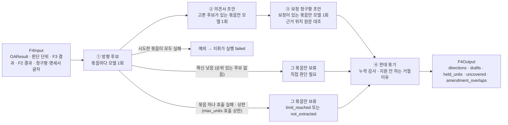

# F4 대응 방향 후보와 초안 세부 설계
<!-- 이슈 #45·#46. 코드 출처는 따로 적지 않으면 커밋 e07543d(PR #183으로 main에 머지됨)의 `파일:줄`이다. 그 뒤 main에서 바뀐 동작은 커밋을 붙여 적는다
     (`src/patent_ai/core/f4_response_draft/`는 줄여서 `f4/`, `src/patent_ai/core/schemas/`는 `schemas/`).
     안 정해진 것은 `질문:` 줄로 남기고 끝 "열린 질문"에 모은다. requirements.md에 쓴 것은 번호로 가리킨다. -->

## 1. 합격 기준 ↔ 설계
| 기준 (requirements 번호) | 설계의 어디가 만족시키나 | 이슈 | 지금 |
|---|---|---|---|
| 1 후보·순위·이유·확신도 | 2절 ① 방향 후보 단계, 3-2 ⑤ `DirectionCandidate`, 7-1 확신도·후보 수 | #39 | 구현 (확신도 기준은 질문) |
| 2 1등 기본값·사람 선택 구분·낮음 보류 | 3-2 `selection`, 2절 ②③이 고른 후보만 씀 | #39·#70 | 일부 (사람 선택 뒤 초안 다시 만들기는 이슈 #70, 3-2 질문) |
| 3 고른 방향으로만 의견서 | 2절 ② 의견서 단계, 3-2 의견서 칸 | #41 | 구현 |
| 4 보정 초안·바뀐 부분·근거 위치·적법성 표시 | 2절 ③ 보정 단계, 3-2 보정 청구항 칸, 4절 근거 대조 | #42 | 구현 |
| 5 초안 검사·누락 검사 | 2절 ④ 누락 검사(구현), 초안 검사(무조건 도는 코드 단계, 3-2 질문) | #40 | 누락만 구현 |
| 6 최후거절이유통지 제한 | 4절 보정 제한, 7-2 `final_rejection_limit` | #42 | 구현 (기본 켬) |
| 7 사건 전체 검사 | 2절 ④, 3-2 사건 전체 검사 칸 | #39 | 일부 (지원 안 하는 거절이유·겹친 청구항 `amendment_overlaps`) |
| 점수 1 tune 대응 방향 점수 | 7-1 채점 | #39·#38 | 채점기 구현, 정답 없음 |
| 점수 2 초안 주입 오류 탐지 | 3-2 초안 검사 | #40 | 없음 |

## 2. 흐름

1. **입력:** 지휘가 앞 단계 결과에서 `F4Input`을 만든다 (`src/patent_ai/core/agents/step_inputs.py:44-71`, 커밋 059429c). 3-1절.
2. **처리** (`f4/run.py:57-68`, 호출 순서는 방향 → 의견서 → 보정):
   - ① 방향 후보 (`f4/directions.py:324-375`): 판단 단위를 `order` 순으로 돌며 묶음마다 모델을 한 번 부른다. 모델 답을 결과로 만들어 보는 출력 검사에 떨어지면 검사 오류를 붙여 한 번 더 부른다 (`directions.py:232-245`). status·근거·origin·ID는 코드가 채운다.
   - ② 의견서 초안 (`f4/opinion.py:157-231`): 고른 후보(AI 기본값이든 사람 선택이든)가 있는 묶음만, 그 후보 하나만 프롬프트에 넣어 부른다. 고른 후보가 없는 묶음은 부르지 않고 보류한다.
   - ③ 보정 청구항 초안 (`f4/amendment.py:188-329`): ②가 만든 묶음 가운데 고른 방향에 실제 보정(`unchanged` 아닌 것)이 있는 묶음만 부른다. 명세서 근거는 원문 대조(4절).
   - ④ 한데 묶기 (`f4/run.py:68-133`): 의견서와 보정 청구항을 `Drafts` 하나로, 보류 묶음·누락 쌍·지원 안 하는 거절이유·알림 문구를 `F4Output`에.
3. **결과 저장:** `F4Output`은 저장 스키마가 아니다. 안의 `directions`(묶음마다)와 `drafts`(OA 하나)를 하나씩 저장한다 (`f4/result.py:1-5`). 5절.
- **실패하면 (정함 #211, #166 (가)):** 묶음 하나의 모델 호출 실패(출력 검사 실패 재시도 뒤, 전송 오류)는 그 묶음만 보류 + 확인되지 않음 + 이유로 두고 나머지를 끝까지 한다. 의견서·보정 단계 실패는 늘 그 묶음 보류다. 방향 후보 호출이 (상한 말고) 모든 묶음에서 실패하면 run_f4가 아무것도 못 낸 것이라 마지막 원래 예외를 올리고 지휘가 실행을 `failed`로 끝낸다 (`core/bundle_errors.py`). 프로그래밍 오류(`TypeError` 등)는 잡지 않는다.
  - 호출 상한(`max_model_calls`)에 닿은 묶음은 `unverified(limit_reached)` + 상한 숫자를 이유로 보류하고 끝까지 간다 (ADR 0003 110줄). F3가 상한으로 보류한 묶음도 F4 후보에서 `limit_reached`로 남는다. 묶음 수 상한 `max_units`도 같다: 넘는 묶음은 호출 없이 `unverified(limit_reached)` 보류(이유 글에 상한 숫자와 다룬 범위, 원문 글자 없음)이고 실행은 `failed`가 아니다. 남은 것: 실행 state·단계 outcome에 `limit_reached`를 따로 둘지는 서버·DB 일이라 남김 (#57·#206). F1 읽기·지휘 모델·F3 청구항 나누기의 상한은 이슈 #241로 넘김.
  - 방향 후보 호출이 실패(호출 상한 포함)한 묶음은 후보 0개 + 확인되지 않음 + `needs_recheck=true` + `recheck_reason`(실패·상한 이유)으로 남긴다. `needs_recheck`를 "앞 입력이 바뀌어 다시 확인" 말고 "호출 실패로 다시 돌려야 함" 표시로도 쓴다 (#211).
- **비면:** 판단 단위 0개 → 모델을 부르지 않고 경고, 빈 목록 (`directions.py:334-336`). 후보 0개 → 그 묶음 "확인되지 않음" + "직접 판단 필요" + 경고. 모든 묶음이 보류 → `drafts = null` + 경고.
- **느리면:** 한 실행의 묶음 수 상한 `max_units`, 단계마다 호출 상한 `max_model_calls`(= 2 × `max_units` 이상, 설정을 읽을 때 검사: `f4/config.py:49-58`). 묶음이 상한보다 많으면 order 앞 `max_units`개만 다루고, 넘는 묶음은 모델을 부르지 않고 `limit_reached`로 보류한다 (방향 후보 단계에서 한 번 자르고 의견서·보정은 그 결과를 따른다: `directions.py` `_over_limit_result`).
  - [ADR 0003](../../decisions/0003-tech-stack.md) 고정 단계 "상한"은 "도달하면 '확인되지 않음'과 찾아본 범위를 남기고 끝낸다"(110줄)이고 이유 코드 `limit_reached`가 있다. 묶음 안 상한은 위대로 맞췄다. 찾아본 범위(`searched_scope`)는 아직 채우지 않는다.

### 2-1. 흐름 방식
- **코드 흐름이다** (호출 3종 × 묶음, 정해진 순서). 이유: 재현·테스트가 쉽고 M2 뼈대 범위(묶음마다 후보 1회 → 의견서 1회 → 보정 1회)가 그렇게 정해졌다 (커밋 59f84fb·b2905f0·da5acaa). 사건 진행(F4를 부를지, 사람을 기다릴지)은 지휘 에이전트가 정한다 ([ADR 0003](../../decisions/0003-tech-stack.md)). F4는 멈추지 않고 끝까지 돈다 (`run.py:3`).
  - 질문: 후보를 낸 뒤 근거가 모자라면 F3·F2를 더 부르는 서브에이전트 루프로 바꿀지. M3는 코드 흐름 유지가 지금 상태.
- **지휘에서 보이는 모양:** 도구 하나 `run_f4(F4Input) -> F4Output`, 종류 `code_tool` (`src/patent_ai/core/agents/tools_f4.py:21-23`). 지휘 설정 기본은 `plan: agent`(모델이 다음 code_tool을 고름)이고, `plan: fixed_order`일 때만 `fixed_order: [extract_pages, read_oa, run_f3, run_f2, run_f4]` 순서로 돈다 (`config/orchestrator.yaml:2-4`, 커밋 059429c).
  - 질문: `plan: agent`일 때 지휘가 F4를 언제 부르나 (F3·F2 결과가 다 있을 때만인지). 지금은 모델이 고르고 규칙이 없다 (`orchestrator.py:5`, 커밋 059429c).
- **무조건 도는 코드 단계와의 관계:** [ADR 0003](../../decisions/0003-tech-stack.md)은 "초안 검사"·"사람 승인 전 멈춤"이 무조건 돈다고만 정하고, 초안 검사 폴더는 `f4_response_draft/`로 둔다 (ADR 0003 84줄). 지금 F4 안의 누락 검사(`f4/coverage.py`)를 초안 검사 때 `core/verify/`로 옮기는 것은 `coverage.py:4` 주석의 계획이다 (판단).
  - **사람 승인 전 멈춤:** 지금 F4는 멈추지 않고 AI 기본값(1등)으로 바로 초안을 만들고 확신 낮은 묶음만 보류한다 (`run.py:3`). 이것은 [product.md](../../product.md) 4절 6단계·5절 F4 2번, [ADR 0001](../../decisions/0001-ai-amended-claim-draft.md) 11/17 보완, [api/README.md](../../api/README.md) `PUT /directions/{unit_id}/selection`과 같다. [ADR 0003](../../decisions/0003-tech-stack.md) 108줄도 "그 묶음의 다음 단계(초안)로 가지 않는다"로 맞췄다 (#293). #70에서 정함 (11/22): 실행은 멈추지 않는다. 확신 낮은 묶음은 선택 null + 초안 보류이고, 사람이 고르면 그 OA에 작은 실행을 새로 만들어 앞 방향 후보를 그대로 쓰고 초안만 다시 만든다. 직접 쓴 방향은 AI가 초안을 만들지 않는다.
- **단계 기록:** 모델 호출은 `core/llm`이 단계 이름 `f4.direction`·`f4.opinion`·`f4.amendment`로 `agent_steps`에 남긴다. F4 도구 호출 한 번은 지휘 단계 한 줄.

## 3. 데이터 모양
### 3-1. 앞 기능에서 받는 것
`F4Input` (`f4/inputs.py:34-46`):
| 칸 | 어디서 | 없으면 |
|---|---|---|
| `oa: OAResult` | F1 ① | F4를 부르지 않음 (지휘가 `input_unverified`로 넘김) |
| `units: list[JudgmentUnit]` | F3 단계가 만든 ② | 빈 목록 → 경고, 후보 없음 |
| `tables: list[ComparisonTable]` | F3 ③ (진보성·신규성) | 그 묶음 후보 status `input_unverified` + 경고 (`directions.py:132-138`) |
| `clarity: list[ClarityReview]` | F3 명확성 검토 | 위와 같음 |
| `legal: list[LegalEvidenceBundle]` | F2 ④. **지휘가 부른다 (11/21 재아 결정)**. 묶음에 잇는 키는 아래 | 묶음마다 빈 묶음 `unverified(not_extracted)` (`inputs.py:49-78`) |
| `claims_text: list[ClaimText]` | 사건 자료: OA 당시 청구항 글자 (`claim`, `text`, `document_id`) | 그 묶음 `needs_human_review`, 보정 초안 보류 |
| `spec: PageText \| None` | 사건 자료: 최초 명세서 쪽 글자 | 보정 근거 위치만 보류 (`body_missing`) |
| `checked_on: date` | 실행 입력 (코드가 오늘 날짜를 몰래 읽지 않음) | F4를 부르지 않음 |

- **지휘가 F4를 아예 부르지 않는 경우:** `read_oa` 결과 없음 / `run_f3` 결과 없음 / 청구항·명세서 글자(`CaseInput.texts`) 없음 / 확인 기준일 없음. 그 단계를 "확인되지 않음(`input_unverified`)"으로 넘기고 이유를 단계 기록에 남긴다 (`step_inputs.py:48-57`, 커밋 059429c). requirements "근거"의 "OA 당시 청구항 없음 → F4 전체 보류"가 이것이다.

- 지금 지휘는 `legal`을 비워 넘긴다 (F2 도구 미등록, `step_inputs.py:63-64`).
- **④를 묶음에 잇는 키 (F2 연결 전에 코드를 고친다, 이슈 #29 전):** 지금 `legal_bundle_for`(`inputs.py:73-78`)는 `bundle.unit_id == unit.unit_id`만 찾고, 없으면 경고 없이 빈 묶음을 쓴다. F2는 ④를 거절이유 하나마다 만들어 `oa_id`·거절이유 순번으로 저장한다(F2 design 2절 1·6단계, [data-model.md](../../data-model.md) 4절 ④ `unit_id`·`oa_id`·`rejection`). 정할 규칙:
  1. `unit_id`가 같은 ④를 먼저 찾는다.
  2. 없으면 `oa_id`·`rejection`이 그 묶음과 같고 `unit_id`가 빈 ④를 그 거절이유의 모든 묶음에 쓴다.
  3. `legal`이 비지 않았는데 맞는 것이 없으면 경고하고 빈 묶음(`unverified(not_extracted)`)을 쓴다.
  - 버린 것: 지휘가 묶음마다 ④를 복사해 `unit_id`를 채움. 같은 ④가 여러 벌 저장돼 F2 저장 키와 엇갈린다.
- **F3가 대비 못 한 문헌은 지금 넘어오지 않는다:** `ComparisonTable.citations[]`에 `compared = false`(본문 미확보, 미국 문헌 등)와 `skipped_status`가 있지만, 표 status는 대비한 줄(rows)만 모은다 (`src/patent_ai/core/schemas/comparison.py:103-104, 141-143`, 커밋 c093221). F4는 표 status와 법률 근거 status만 전파하고(`directions.py:138`), 후보 flags도 확신 낮음 여부로만 정해 대비표의 `needs_human_review`를 옮기지 않는다(`directions.py:214, 228`). 미국 문헌은 늘 본문 미확보라, F2가 붙으면 한국+미국 결합 진보성 후보가 "확인됨" + 검토 표시 없음이 된다.
  - 고치는 쪽: F4 (11/21 재아 결정. 공유 스키마를 건드리지 않아 PR 하나로 끝남). `compared = false` 문헌의 `skipped_status`를 후보 status 전파에 넣고, 대비표의 `needs_human_review`를 후보 flags로 옮긴다. F2 연결 전에 고친다.
- **F3 보류 가운데 F4에서 안 보이는 것:** 단위를 못 만든 보류(`f3_split`·`f3_units`)만 그 청구항이 단위에 없어 누락 쌍(`uncovered`)으로 보인다. 단위 안 청구항 보류(`f3_compare:<unit_id>:claim<N>`, F3 design 3-2)는 청구항 N이 단위 `claims`에 남아 `uncovered`(`coverage.py:27`)가 세지 않고, 본문 미확보 보류도 F4에서 안 보인다. 그래서 대비 안 한 청구항이 확인됨 후보에 표시 없이 묶일 수 있다. 위 `compared = false`와 같은 고침에 넣는다. `F3Result.held_tasks` 자체는 F4 입력에 없고, 지휘가 ⑥ `CaseMaterials.held_tasks`로 옮길 예정이다 (지금 코드 없음, 이슈 #166).
- 받은 결과가 "확인되지 않음"·"충돌"이면: 후보 status = F3 결과 status와 법률 근거 묶음 status를 전파한 값 (`propagate`, `directions.py:138`). 초안 status = 고른 후보 + 법률 근거 묶음을 전파 (`opinion.py:198-200, 219-223`). 법률 근거가 확인되지 않음이면 초안에 `needs_human_review` (`opinion.py:215-216`).
- 질문: F3 결과에서 모델에 무엇을 넣나. 지금은 그 묶음의 F3 결과 전체 JSON (`directions.py:313`). 요약(차이점 후보·결합·효과 후보)으로 줄일지.
- 질문: F4 입력에 OA 당시 청구항 판의 확인 여부(`claims_status`)를 실을 칸이 없다 (첫 tune 실행 기록에서 나옴). 더할지.
- F3 출력 모양은 결과 스키마 v0(PR #176) 기준이다. F3 문서가 확정되면 이 표를 다시 본다.

### 3-2. 다음 기능에 주는 것
F4는 화면·API에 준다 (뒤 기능 없음). 결과 스키마 둘 + 도구 출력 하나.

**⑤ `DirectionCandidates` (묶음마다 하나, `schemas/direction.py:222-268`)**
```json
{
  "unit_id": "oa_1:29-2:c1",
  "candidates": [
    {"candidate_id": "oa_1:29-2:c1:d1", "rank": 1, "coarse": "amend_and_argue",
     "name": "종속항 3 특징을 독립항에 합치기", "confidence": "medium",
     "reason": "이유 한 줄", "checks": ["보정하면 권리범위가 어떻게 줄어드나", "..."],
     "per_rejection": [{"rejection": 1, "response": "대응 한 줄"}],
     "amendment_core": [{"claim": 1, "kind": "add", "source": "other_dependent"}],
     "rebuttal": {"rejection_kind": "inventive_step", "type": "difference", "summary": "요지"},
     "status": {"value": "unverified", "reason": "input_unverified"}, "evidence": [], "origin": "ai_generated", "flags": []},
    {"candidate_id": "oa_1:29-2:c1:d2", "rank": null, "confidence": "low", "flags": ["needs_human_judgment"], "...": "..."}
  ],
  "selection": {"candidate_id": "oa_1:29-2:c1:d1", "origin": "ai_default"},
  "amendment_limit": {"value": "initial", "raw_text": "...", "page": 1, "status": {"value": "confirmed"}},
  "status": {"value": "unverified", "reason": "input_unverified"}, "origin": "ai_generated", "flags": []
}
```
- 후보 칸: `rank`(1부터, 확신 낮음이면 `null`), `coarse` 거친 방향(`argue_only` 반박만 / `amend_and_argue` 보정+반박 / `amend_only` 보정만), `confidence`(`high`/`medium`/`low`), `reason`, `checks` 확인 사항, `per_rejection` 거절이유별 대응, `amendment_core` 청구항별 보정 종류(`unchanged`/`limit` 한정/`add` 구성 부가/`delete`/`correct_error` 오기 정정/`clarify` 명확화, `add`일 때만 `source` = `other_dependent`/`spec`/`other`), `rebuttal` 반박 논리 유형 + 요지 (`direction.py:32-157`).
- 스키마가 지키는 것: 확신 낮음 ⇔ 순위 없음 + `needs_human_judgment` / 순위는 1..n 빠짐·중복 없음 / 방향 종류와 보정·반박 짜임이 맞음 / 반박 유형이 거절이유 종류에 맞음 / `ai_default`는 1등만 가리킴 / 결과 status는 후보·보정 제한 status 중 가장 나쁜 값 (`direction.py:99-117, 166-192, 235-268`).
- **후보 목록 순서는 모델이 낸 순서 그대로다.** 다시 줄 세우지 않는다. 확신 낮은 후보는 `rank`가 없어 "모델이 먼저 낸 후보"는 이 순서로만 알 수 있고, 채점이 읽는다 (11/21 재아 결정, 커밋 999759a, `directions.py:171-173`). 화면에 보일 순위는 `rank` 칸이다.
- **선택 값 세 가지 (이슈 #46 11/18 문서 검토에서 넘어온 것):**
  | 상태 | 데이터 | 화면 글자 |
  |---|---|---|
  | AI 기본값 | `selection = {candidate_id: 1등, origin: ai_default}` | (1등 미리 선택) |
  | 사람이 고름 | `selection = {candidate_id, origin: human_selected}` (1등과 같아도) | 사람이 고름 |
  | 미선택 (확신 낮음) | `selection = null` + 결과 `flags`에 `needs_human_judgment`. 순위 있는 후보가 하나도 없는 묶음 (후보 0개 포함) | 직접 판단 필요 |
  - 근거: `direction.py:246-258`, `directions.py:217-228`, [api/README.md](../../api/README.md) `PUT /directions/{unit_id}/selection` 줄. 보류 글자는 "직접 판단 필요"다 (11/21 재아 결정). F3의 "원문 확인 필요"와 섞지 않는다.
  - "확신 낮은 묶음"은 코드에서 "순위 있는 후보가 없는 묶음"이다. 1등이 중간이고 2·3등이 낮음이면 1등을 미리 고른다.
  - 질문: 미선택을 `null` + flag로 둘지, `selection`에 값(예: `unselected_low_confidence`)으로 따로 둘지 (이슈 #46). 지금은 `null`이고 후보 0개 묶음도 같은 모양이다.
- `amendment_limit`: OA 통지 종류 사실을 그대로 옮긴 값(`initial`/`final`, 모르면 `null` + 원래 이유). 스위치와 상관없이 늘 채운다. 적법성 판정이 아니다 (`directions.py:95-121`).

**의견서·보정 청구항 초안 `Drafts` (OA 하나에 하나, `schemas/drafts.py:92-121`)**
- 맨 위: `draft_id`(`dr:<oa_id>`), `based_on`(묶음마다 쓴 후보 `{unit_id, candidate_id}`), `opinion`, `claims`, 공통 칸. `origin`은 고친 칸이 하나라도 있으면 `human_edited`.
- **의견서 칸** `OpinionSection{key, title, ai_text, human_text, origin}` (`drafts.py:14-51`): `key` 순서가 의견서 순서다 — `case_info` 사건 정보 → `points` 지적 요지 → `response` 대응과 근거 → `amendment` 보정 설명(고른 방향에 보정이 있을 때만) → `closing` 마무리.
  - 묶음마다 모델이 다섯 칸을 쓰고, 사건 정보·마무리는 첫 묶음 것만, 나머지는 같은 칸끼리 묶음 순서대로 잇는다 (`opinion.py:50-51, 203-210`). 그래서 의견서는 OA 하나에 하나다 (코드가 정함).
  - 보정 설명 유무가 고른 방향과 어긋나면 출력 검사 실패 (`opinion.py:91-109`).
- **보정 청구항 칸** `AmendedClaim{claim, unit_id, before, ai_text, human_text, origin, spec_basis, held_reason}` (`drafts.py:54-80`):
  - `before`: OA 당시 청구항 글자. `ai_text`: 보정 초안 AI 원문(보류면 `null`). 삭제는 `(삭제)`로만 쓴다 (`amendment.py:48, 104-105`).
  - **바뀐 부분:** 저장하지 않는다. `diff_claim(before, after)`가 글자 비교로 조각 `{op, before, after}` 목록을 만들어 화면·API가 쓴다. 뜻이 바뀌었는지는 보지 않는다 (`amendment.py:341-354`).
  - **최초 명세서 근거 위치:** `spec_basis: list[Evidence]` (문서 ID + 쪽 + 위치 + 원문 글자). 4절 대조를 통과한 것만.
  - **적법성 판단 안 함:** 문구 "검토용 초안이며 보정의 적법성은 판단하지 않았습니다"를 결과와 함께 보인다. 스키마 v0에 칸이 없어 도구 출력 `F4Output.legality_notice`에 싣는다 (`amendment.py:50`, `result.py:32`).
  - **최후통지 제한:** ⑤ `amendment_limit`(통지 종류 사실) + `F4Output.amendment_limit_applied`(제한 문구를 보정 프롬프트에 넣었나. 지켰다는 판정 아님, `result.py:27-29`). 스위치 `final_rejection_limit` (7-2).
  - `held_reason`: 보류 이유 (확신 낮음 "방향을 고르면 초안을 만듭니다" / 청구항 글자 없음) (`amendment.py:39-45`). 보류면 `spec_basis`는 빈 목록, 사람이 고칠 수 없음.
  - 청구항 하나에 초안 하나다 (번호 중복 없음). 두 묶음에 걸친 청구항은 `order`가 앞선 묶음의 실제 초안을 두고 뒤 묶음은 덮어쓰지 않는다 + `needs_human_review`. 보류 자리 표시는 뒤 묶음의 실제 초안을 막지 않는다 (`amendment.py:229-246`, 커밋 e5e83b4). 싣지 않은 뒤 묶음 초안은 `F4Output.amendment_overlaps`(`{claim, kept_unit, dropped_unit}`)와 확인 글에 남는다 (`Drafts.flags`로는 구분이 안 돼서, 커밋 a9421df). 의견서 쪽 겹침은 다루지 않는다.
- 질문: 청구항별 status(근거 확인 여부)를 `AmendedClaim` 칸으로 둘지. 지금은 `Drafts` 전체 status·flags로만 보인다.
- 질문: `AmendmentKind`에 "이전 보정 되돌리기"(최후통지 제한 네 번째)가 없다. 더할지.

**초안 검사 문제 목록 (이슈 #40, 아직 없음)**
- 정해진 것: 무조건 도는 코드 단계다. 인용 번호·문단·조문이 F1~F3 결과와 맞는지, 대응 누락을 "모든 거절이유 × 모든 대상 청구항"으로 검사한다 ([ADR 0003](../../decisions/0003-tech-stack.md)). API는 `GET /oas/{oa_id}/drafts`가 초안과 같이 돌려준다 ([api/README.md](../../api/README.md)).
- 지금 있는 것: 누락 검사만 `F4Output.uncovered`(덮지 않은 `(거절이유, 청구항)` 쌍)·`coverage_unchecked`(대상 청구항을 못 읽어 검사 못 한 거절이유) (`f4/coverage.py:15-40`, `result.py:24-26`).
- 질문: 문제 한 줄의 칸 (문제 종류 / 초안 안 위치(의견서 칸·청구항 번호) / 기대값(F1~F3 결과) / 실제값 / 심각도), 결과 스키마를 `Drafts` 안에 둘지 따로 둘지.

**사건 전체 검사 결과 (아직 일부)**
- 정해진 규칙 ([product.md](../../product.md) 5절 F4 7번, [청구항 단위](../../product/domain/청구항_단위와_보정방식.md)): 독립항 보정이 종속항에 번짐 / 삭제 뒤 인용 번호 / "또는"형 종속항 가지 엇갈림(가지끼리 결과가 다르면 표시하고 사람이 정함, ADR 0001 11/17 보완) / 지원 안 하는 거절이유 남음.
- 지금 있는 것: `F4Output.unsupported_rejections`(번호) + `needs_human_review`, status는 나쁘게 하지 않고 확인 글에 "AI가 다루지 않은 거절이유 N개(직접 대응 필요)"를 적음 (`run.py:91-97`, 커밋 f9ea396). 두 묶음이 같은 청구항을 고치려 할 때 `needs_human_review` + 경고 + `amendment_overlaps` (`amendment.py:234-246`, 커밋 a9421df).
- 질문: 남은 세 규칙을 M3에 다 할지 일부 먼저 할지, 결과 칸(검사 규칙 / 걸린 묶음·청구항 / 내용 / 사람이 정할 것), API `GET /oas/{oa_id}/case-check` 응답 스키마.

**도구 출력 `F4Output` (저장하지 않음, `f4/result.py:15-36`)**
- `oa_id`, `units`(이 실행의 판단 단위, 채점용), `directions`, `drafts`, `held_units`(초안을 보류한 묶음), `unsupported_rejections`, `uncovered`, `coverage_unchecked`, `amendment_overlaps`(커밋 a9421df), `amendment_limit_applied`, `rank_notice`("순위는 검토 순서 제안이고 등록 가능성을 보증하지 않는다"), `legality_notice`, `status`, `flags`, `checked_on`(이 결과를 만든 확인 기준일, redo가 이어 씀, 이 칸 전 결과는 null, #293).
- `status`는 방향 후보·초안 status 중 가장 나쁜 값이다. **보류·누락이 있어도 status를 내리지 않는다** (확신 낮음 보류 이야기. 호출 실패·상한 보류는 확인되지 않음) (status = 원문 확인 여부, 사람이 볼 것은 flags·`held_units`·`uncovered`). 대신 `checked` 글에 "보류 N묶음, 누락 쌍 M", AI가 다루지 않은 거절이유 수, 싣지 않은 겹친 초안 수를 적는다 (`run.py:110-118`, 11/21 재아 확인, 커밋 f9ea396·a9421df). F3는 보류가 있으면 결과 status를 내린다 — 두 기능의 보류 뜻이 달라서다.
- 질문: 알림 문구 두 개와 F4Output 칸(보류 묶음·누락 쌍 등)을 결과 스키마로 올릴지, 화면 상수와 한 곳으로 모을지 (이슈 #57·화면).

- 공통 속성은 [data-model.md](../../data-model.md) 3절 그대로. 후보와 ⑤ 맨 위 `origin`은 늘 `ai_generated`이고, 사람 선택은 `selection.origin` 한 곳에만 (`direction.py:159-164, 228-233`).
- **다시 확인 필요:** 사람이 선택을 바꾸면 그 묶음 초안에 "다시 확인 필요"를 붙인다 (data-model.md 3절 규칙 2). 아직 구현 없음.
  - #70에서 정함 (11/22): 실행은 멈추지 않는다. 확신 낮은 묶음은 선택 null + 초안 보류이고, 사람이 고르면 그 OA에 작은 실행을 새로 만들어 앞 방향 후보를 그대로 쓰고 초안만 다시 만든다. 직접 쓴 방향은 AI가 초안을 만들지 않는다. 같이: F4를 다시 돌린 뒤 사람 선택을 버리고 "다시 확인 필요"를 붙일지, 후보 ID를 내용으로 정해 선택을 잇게 할지는 열린 질문 (5절).
- 인터페이스 변경: 있음. ⑤·`Drafts`는 PR #176(결과 스키마 v0)에서 처음 생긴다. 질문으로 남긴 칸(청구항별 ②·출처 번호·미선택 값·초안 검사·사건 전체 검사)을 더하면 화면 타입이 바뀌어 화면 쪽(은진)에 알린다.

## 4. 판과 근거
- **청구항 판:** OA의 심사 대상 판(OA 당시 청구항). 지휘가 사건 자료에서 그 판의 글자를 `claims_text`로 넣는다. F4는 판을 고르지 않는다. 등록공보 청구항은 넣지 않는다.
- **법령·심사기준 판:** F4는 판을 고르지 않는다. F2 결과(④)에 붙은 판·확인 기준일을 그대로 쓴다.
- **보정 제한:** F1이 읽은 통지 종류(`OAResult.notice_kind`)를 `amendment_limit`으로 옮긴다. 모르면 값 없이 원래 이유(`unverified`). 짐작하지 않는다 (`directions.py:95-121`). 제한 네 가지는 특허법 47조 3항 ([보정 범위](../../product/domain/보정_범위.md)), 프롬프트 파일 `prompts/f4/amendment_limit_final.md`.
- **근거 위치 적는 법:**
  - 후보: 그 묶음 F3 결과의 `evidence`(문서 ID + 쪽·문단)를 모아 같은 것은 한 번만 (`directions.py:141-151`). 모델 출력 모양에 근거 칸이 없어 지어낸 근거는 출력 검사에 떨어진다 (`directions.py:67-69`).
  - 보정 청구항: 모델이 `{page, location, raw_text}`를 주면 코드가 최초 명세서 그 쪽 글자에 `raw_text`가 그대로(공백 무시) 있는지 대조한다. 통과하면 `Evidence`, 떨어지면 버리고 경고. 띄어쓰기 뺀 길이가 `min_basis_chars`(10) 미만인 글자는 어디든 맞아 근거로 받지 않는다 (`amendment.py:121-154`, 커밋 02459ee). 삭제하는 청구항은 근거를 요구하지 않는다.
  - 후보 근거는 F3 근거 그대로라 인용문헌 근거에는 쪽이 없고, `document_id`는 색인 doc_id + `chunk_id`(+ `index_version`)다 (`schemas/common.py:80-97`). 명확성 묶음은 F3가 근거를 `spec_definition` 한 곳에만 넣으므로(`f3_claim_compare/clarity.py:325-334`, 커밋 c093221) F4의 `_evidence_of`가 대비표 줄 근거와 함께 `spec_definition`도 모은다 (커밋 7262264).
  - 화면: 보정 근거(`spec_basis`, 문서 ID + 쪽)는 누르면 원문 쪽(`GET /documents/{id}`)으로 간다 (F1과 같은 길). 후보 근거(색인 조각)는 F3 대비 화면과 같은 길로 연다.

## 5. 저장
- 읽는 것: F4는 DB를 직접 읽지 않는다. 지휘가 만든 `F4Input`만 받는다 (AI 코어 부르는 방향 [ADR 0003](../../decisions/0003-tech-stack.md)).
- 쓰는 테이블: ⑤ 결과 표와 초안 결과 표 (결과 스키마마다 표 하나, 본문 `jsonb`, data-model.md 5절). 같은 OA를 다시 돌리면 판단 단위마다 가장 최근 성공 실행의 ⑤를 준다.
  - 사람 선택이 다시 돌린 뒤에 이어지는지는 정해지지 않았다. `unit_id`는 내용으로 정해 같지만(data-model.md 4절 ②), 후보 ID는 `{unit_id}:d{n}`이고 `n`은 모델이 낸 순서라(`directions.py:195`) 다시 돌리면 같은 ID가 다른 후보를 가리킬 수 있다.
  - 질문: ⑤·`Drafts` 결과 표 이름·마이그레이션, 사람 선택과 사람 고침을 결과 표 본문에 덮어 쓰나 따로 두나 (이슈 #57).
- `result_inputs`: 후보 ← F3 결과·법률 근거 묶음, 초안 ← 고른 후보·법률 근거 묶음 (상태 전파·다시 확인 필요).
- 검색: 쓰지 않는다.
- 외부 API 자료: 없음.
- 외부 모델로 보내는 자료: OA 정리, OA 당시 청구항 글자, F3 대비 결과(인용문헌 문단 포함), 법률 근거, 최초 명세서 쪽 글자. [architecture.md](../../architecture.md) 7절 표에서 통지서·공보·인용문헌·법령은 "보냄"이다. 출원서(최초 명세서)·보정서(OA 당시 청구항) 줄은 표에 없어 공보 원문에 준한다고 본다 (판단). 평가 정답은 보내지 않는다 (앱 코드는 정답을 읽지 않음).

## 6. 화면 (시연용)
- 시연 흐름: 사건 열기 → 대응 방향 탭에서 묶음마다 후보 카드(순위·확신도·이유, 1등 체크됨, 확신 낮음 묶음은 "직접 판단 필요"로 체크 없음) → 한 묶음 방향 바꾸기 → 초안 탭에서 의견서 칸·보정 청구항(바뀐 부분 표시, 근거 쪽 링크) → 칸 하나 고치기 → 검토할 사항 보기.
- 화면은 `web/src/pages/directions/DirectionsPage.tsx`·`web/src/pages/drafts/DraftsPage.tsx` (PR #153에서 예시 데이터로 만들고 PR #176에서 결과 스키마 v0 타입으로 바꿈).
- 와이어프레임:
```
[묶음 oa_1:29-2:c1  진보성  청구항 1~5]                 보정 제한: 최초
 (●) 1  종속항 3 특징을 독립항에 합치기   확신 중간   AI 기본값
 ( ) 2  보정 없이 차이점 반박             확신 중간
 ( ) -  명세서 구성 추가                  확신 낮음   직접 판단 필요
 ※ 순위는 검토 순서 제안이고 등록 가능성을 보증하지 않습니다
[묶음 oa_1:42-4-2:c6  명확성  청구항 6]   직접 판단 필요 (방향을 골라 주세요)
```

## 7. AI
### 7-1. 공통 칸
- **인터페이스:** `run_f4(inp: F4Input, *, ctx: RunContext, options: F4Options | None) -> F4Output` (`run.py:57`). 지휘 도구 이름 `run_f4`.
- **평가 세트·지표:** `data/goldsets/tune/` VERSION 2의 `f4/` (git 밖, 사람 검수 뒤 생김. 11/21 기준 없음). 정답 규칙은 [대응 방향 정답](../../evaluation/f4-direction-gold.md). 채점 단위는 OA 시점 청구항 × 거절이유 한 줄 → OA 평균 → 세트 평균 (`eval/f4/score.py:1-20`).
  - 주 지표 `direction_top1`: AI 기본 선택(순위 1 후보, 순위 후보가 없는 보류 묶음은 후보 목록 첫째)의 청구항별 거친 방향이 정답 ②와 같은 비율 (11/22 재아 결정 2, 이슈 #39). 옛 값(목록 첫째 후보)은 `direction_top1_list_first`로 같이 낸다. 후보 목록 순서 규칙: 순위 있는 후보(high·medium)를 rank 순서로 먼저, low(rank 없음) 후보는 그 뒤, 순위 후보가 없는 보류 묶음은 low 후보를 먼저 볼 순서로 (`prompts/f4/direction.md`). 보류 묶음도 센다. 후보 0개 묶음은 틀림 (11/21 재아 결정, 커밋 04cb253). 청구항별 방향은 후보의 청구항별 보정 종류에서 계산한다(물려받기·삭제 규칙, `score.py:79-109`).
  - 같이 내는 것: `direction_top1_conf_high`·`_medium`·`_low`(주 지표를 기본 선택 후보의 확신도로 나눔), `direction_top1_list_first_conf_*`(목록 첫째 후보 기준), `needs_human_judgment_rate`(보류 비율), `direction_top1_with_inherited`, 비교용 `direction_top1_ranked_only`(순위 1 후보로, 보류 줄 뺌), failures(누락 쌍 등) (`score.py:42-56, 174-230, 270-295`). ① 다뤘나 지표 `handled_accuracy`는 뺐다 (11/21 재아 결정, 커밋 73fb60d). 정답의 `handled`는 ② 채점 대상을 가르는 데만 쓰고(`excluded_not_handled`), 지표 정의는 정답 문서에서 정한 뒤 다시 넣는다.
  - 같은 크기 두 묶음("또는" 가지)에서 AI 기본 선택 방향이 엇갈리면 그 줄은 주 지표에서 빼고 건수만(`excluded_branch_conflict`), 목록 첫째 방향이 엇갈리면 `list_first`에서만 뺀다(`excluded_list_first_conflict`). 방향이 같고 확신도만 다르면 낮은 쪽 칸에 넣는다 (커밋 e07543d, `score.py:111-172`).
  - 문턱: 질문.
  - 정함 (11/22 재아 결정 2): 정답 문서의 "1등"·"모델 1번 후보"는 AI 기본 선택(순위 1, 없으면 목록 첫째)으로 읽는다. 정답 문서 글은 공유 문서라 정답 문서 PR에서 맞춘다.
  - 질문: 정답 문서 4절이 [사람 판단]으로 F4 설계에 넘긴 칸 — ④ 저지가 읽을 의견서 원문 위치 칸 이름, 최후거절이유통지 뒤 신설을 따로 세는 칸, 정답 `rejection`이 F1 `rejections[].no`(OA 순번)를 가리킨다는 연결 ([대응 방향 정답](../../evaluation/f4-direction-gold.md) 4절).
  - 질문: 청구항별 ②를 후보 안 칸으로 둘지(지금은 채점기가 계산), 더한 구성의 출처를 번호까지(`claim:2`·`spec:[0042]`) 둘지(지금은 `other_dependent`·`spec`·`other`만이라 "출처까지 맞은 비율"을 못 잼), 정답 `none`과 스키마 `unchanged` 같은 코드 이름 맞추기.
  - ③④층, 실제 방향 순위, 독립항만 점수, 심사관 힌트 있음/없음 점수, 단순 규칙 점수는 아직 내지 않는다.
- **확신도 기준:**
  - 정해진 것: 3단계, % 숫자로 내지 않음, 낮음이면 순위 없이 "직접 판단 필요", 기준은 설계에서 정하고 기준값은 설정 파일 ([ADR 0001](../../decisions/0001-ai-amended-claim-draft.md) 11/17 보완).
  - 지금: 모델이 매긴다. 프롬프트 기준은 한 줄 "자료만으로 방향을 가리기 어려우면 low" (`prompts/f4/direction.md:14`). 코드는 낮음 ⇔ 순위 없음만 지킨다. 설정 파일에 기준값 키는 없다.
  - 첫 tune 실행: 후보 91개 중 높음 2 · 중간 44 · 낮음 45, 1등이 낮음인 묶음 2 (실험 카드 [`experiments/m3-f4-skeleton/card.md`](../../../experiments/m3-f4-skeleton/card.md)).
  - 질문: 무엇을 보고 가르나(모델 값만 / 코드 규칙 / 모델 값 + 코드 상한), 기준값 설정 키 이름. F2가 비었을 때 상한.
- **후보 최대 개수:** `config/f4.yaml` `max_candidates: 3` (ADR 0001 첫 안 "2~3개"에서 3으로 시작, 커밋 59f84fb). 넘으면 출력 검사 실패 → 한 번 다시 부름 (`directions.py:167-168`). 질문: 돌려 본 뒤 바꿀지.
- **데이터:** tune 사건의 OA 시점 입력(F1 예측 + F3 실행 결과 + OA 당시 청구항·최초 명세서 글자). 평가 때 최초 명세서는 출원서를 사용자가 올린 자료로 넣는다 ([product.md](../../product.md) 8절).
- **채점 스크립트:** `uv run python eval/run_eval.py --config experiments/<실험>/config.yaml --predictions <run_f4 결과 폴더>` (`feature: f4`). 정답 폴더가 없으면 점수를 쓰지 않고 "정답 없음", 종료 코드 3 (커밋 1731de3). 예측 폴더는 git 밖이어야 한다.
- **실행 상한:** `config/f4.yaml`의 `max_units`, 단계마다 `max_model_calls`·`max_retries`, 실험 설정의 `budget.max_usd`·`budget.max_external_calls`. 값은 첫 실행 뒤 다시 본다.
- **결과에 남길 것:** 모델 이름·effort·프롬프트 판·설정 판은 `agent_steps`와 실험 카드 (data-model.md 3절: 결과 칸이 아님).

### 7-2. 방식 (한 사람)
- 재아: 묶음마다 방향 후보 → 고른 후보로 의견서 → 보정이 있으면 보정 청구항. 해석·글쓰기는 모델, 코드는 확인만(출력 검사·상태 전파·근거 대조·누락 검사). 기준선 실험 [`experiments/m3-f4-skeleton/card.md`](../../../experiments/m3-f4-skeleton/card.md) (점수 없음: 정답 없음).
- **모델 호출:** `core/llm` 한 곳. 묶음마다 단계별 1회, 출력 검사 실패 때 1회 더 (`f4/llm_call.py`). 첫 tune 실행 9건에서 호출 103번(다시 부름 3), 입력 토큰의 58%가 보정 단계의 명세서 전체 글자.
  - 질문: 보정 프롬프트에 명세서 쪽 글자 전체를 넣는 방식을 줄일지 (3-1 F3 결과 넣기와 같이).
- **프롬프트 파일:** `prompts/f4/direction.md`, `opinion.md`, `amendment.md`, `amendment_limit_final.md`.
- **실험 설정(config):** `config/f4.yaml` — 맨 위 `final_rejection_limit`(기본 `true`, 커밋 14d26fb), `max_units`(20 [가정]), `min_basis_chars`(10 [가정]), `max_candidates`(3 [가정]), 단계 칸 `direction`·`opinion`·`amendment`(`model: claude-haiku-5-5`, `effort: medium`, `max_tokens: 64000`, `prompt`, `max_model_calls: 40` [가정], `max_retries: 2`). [가정] 값은 재 본 값이 아니다. 형이 틀리거나 키가 빠지면 조용히 기본값으로 가지 않고 멈춘다 (`f4/config.py:25-64`).
- **`amendment_spec_excerpt`:** `{enabled: false, top_n: 5}` (기본 끔, 이슈 #42). 켜면 보정 프롬프트에 최초 명세서 쪽 글자 전체 대신 차이점 구성요소·묶음 청구항 글자와 겹치는 문단(청구범위 덩어리 제외) BM25 상위 `top_n`개를 원래 순서로 넣는다. 질의 = 대비표 차이 후보·불명 줄 구성요소 + 요약 `differences` + 묶음 청구항 글자 + 그 묶음에서 고른 방향(AI 기본 선택 또는 사람 선택, 의견서와 같은 후보)의 `name`·`reason`·`per_rejection[].response`. 가져다 붙이는 출처 종속항은 스키마에 번호가 없어 넣지 않는다(이슈 #238 `AmendmentCore.source_ref`에서 정함). 전체로 돌아가면 WARNING. 명세서 근거 위치 대조는 켜도 원문 전체 (`f4/spec_excerpt.py`). 칸이 없으면 끔, 값이 틀리면 멈춘다.
- **`final_rejection_limit`:** 기본 켬 (11/21 재아 결정, 커밋 14d26fb). 켜면 통지 종류가 최후일 때 보정 프롬프트에 47조 3항 네 가지 제한을 넣고 `amendment_limit_applied = true`. 모르면 제한을 넣지 않고 후보마다 "통지 종류 확인 필요" + `needs_human_review`. 끄면 제한을 넣지 않고, 최후통지인 사건의 후보에 "보정 제한을 적용하지 않은 초안 (최후거절이유통지, 직접 검토 필요)" + `needs_human_review` + 경고 (`run.py:38-54`, `directions.py:344-349`, 커밋 e7b42e1·14d26fb). 끄는 것은 비교 실험 설정으로만 쓴다. 기준선 카드 `m3-f4-skeleton`은 끈 채 잰 실행이다 (카드 15줄). tune에 최후거절이유통지 사건이 아직 없다.

## 8. 이 기능 안의 결정
| 고른 것 | 버린 것 | 이유 | 계기 | 근거 |
|---|---|---|---|---|
| 청구항·명세서 글자를 입력 모델 `F4Input`에 직접 싣기 | F4가 DB에서 읽기 | 도구 입력이 JSON으로 왕복하고 모델 호출 캐시 키가 JSON이어야 함. fixture를 JSON 하나로 | 구현 중 (뼈대) | 커밋 59f84fb, `inputs.py:1-4` |
| 결과를 도구 출력 `F4Output`에 한데 담고 저장은 ⑤·`Drafts`를 하나씩 | 결과 스키마 하나로 | 스키마 v0에 보류 묶음·누락 쌍 칸이 없음. 스키마로 올릴 때 이름 그대로 | 구현 중 | 커밋 838a626, `result.py` |
| 의견서는 OA 하나에 하나, 묶음 칸을 순서대로 이음 | 묶음마다 의견서 | 실제 제출 서류 모양, `Drafts.based_on` 목록과 맞음 | 구현 중 | 커밋 b2905f0, `opinion.py:203-210` |
| 1등을 AI 기본값으로, 확신 낮은 묶음은 미선택 + 그 묶음 초안만 보류 | 모두 사람 기다림 | ADR 0001 11/17 보완 | 설계 | `direction.py:246-258` |
| 후보 목록을 모델이 낸 순서 그대로 | 순위로 다시 줄 세우기 | 채점 주 지표가 보류 묶음도 1번 후보로 셈 | 11/21 재아 결정 | 커밋 999759a |
| 주 지표 = 모델 1번 후보, 보류 묶음 포함 + 확신도별 일치율 + 보류 비율 | 보류 줄을 뺀 1등 일치율 | 보류할수록 점수가 오르는 것을 막음 | 11/21 재아 결정 (11/22에 아래 줄로 바뀜) | 커밋 04cb253, e07543d |
| 주 지표 `direction_top1` = AI 기본 선택(순위 1, 없으면 목록 첫째), 옛 값은 `direction_top1_list_first`, 확신도별은 기본 선택 기준(`list_first_conf_*` 따로). 후보 목록은 순위 있는 후보 먼저 | 목록 첫째로만 세기 (순위 1이 둘째로 밀리면 0.106 vs 0.366처럼 어긋남) | 사람이 화면에서 보는 기본 선택과 점수가 같은 후보를 재야 함. low에 순위는 주지 않음 (ADR 0001) | 11/22 재아 결정 2, 이슈 #39 | `score.py:70-76`, `prompts/f4/direction.md` |
| 가지 충돌은 방향으로만 가르고 확신도만 다르면 낮은 쪽 | 확신도 차이도 충돌로 빼기 | 정답 문서 3절 5번 "AI 값" = 방향 | 리뷰 | 커밋 e07543d |
| 보정 근거는 원문 대조 통과만, 못 찾으면 초안은 남기고 근거만 비움 | 근거 없으면 초안도 보류 | 초안을 버리면 사람이 볼 것이 없어짐. 보류(`ai_text = null`)는 확신 낮음·글자 없음에만 | 구현 중 | 커밋 da5acaa·02459ee |
| `amendment_limit`은 통지 종류 사실만, 스위치는 프롬프트 제한만 | 코드가 보정 종류로 제한 위반 거르기 | 보정 종류와 네 가지 제한이 거의 겹쳐 코드로 못 가름, 적법성 판정이 됨 | 구현 중 | 커밋 e7b42e1 |
| 빈 법률 근거 묶음은 `unverified(not_extracted)` | `not_found_in_scope` | 찾아보지 않았는데 "조회 범위 내 없음"이면 못 찾음을 없음으로 씀 | 구현 중 | `inputs.py:49-70` |
| 보류·누락이 있어도 F4 결과 status를 내리지 않음 (flags·checked 글로 드러냄) | F3처럼 내림 | status = 원문 확인 여부, 확신 낮음은 사람 판단 쪽 | 리뷰 [사람 판단] | 11/21 재아 확인, `run.py:110-118` |
| 두 묶음에 걸친 청구항은 앞선 묶음 초안을 두고, 보류 자리 표시는 뒤 묶음 실제 초안을 막지 않음 | 뒤 묶음이 덮어씀 / 자리 표시가 막음 | 막으면 의견서엔 보정 설명이 있는데 보정 청구항이 없는 어긋난 데이터 | 리뷰 | 커밋 e5e83b4 |
| 보류 글자 "직접 판단 필요" | F3 "원문 확인 필요"와 같은 글자 | 뜻이 다름 (사람이 방향을 정할 일) | 11/21 재아 결정 | `direction.py:35`, flag `needs_human_judgment` |
| `final_rejection_limit` 기본 켬, 끄면 최후통지 후보에 "제한을 적용하지 않은 초안" 표시 | 기본 끔 | PRD F4 6번이 필수라 기본 실행이 지켜야 함 | 11/21 재아 결정 (리뷰) | 커밋 14d26fb |
| ① 다뤘나 지표 `handled_accuracy`를 뺌 | 이름만 바꾸기 | 정답 문서에 정의가 없어 잴 것이 정해지지 않음 | 11/21 재아 결정 (리뷰) | 커밋 73fb60d |
| 겹친 청구항으로 싣지 않은 초안을 `amendment_overlaps`로 남김 | 로그만 | `Drafts.flags`는 늘 붙어 구분이 안 됨 | 리뷰 | 커밋 a9421df |
| ④ 연결 키: `unit_id` 먼저, 없으면 같은 (`oa_id`, `rejection`) + `unit_id` 빈 ④, 못 맞추면 경고 | 지휘가 묶음마다 ④ 복사 | 같은 ④가 여러 벌 저장돼 F2 저장 키와 엇갈림 | PR #184 리뷰 | 코드는 F2 연결 전 (이슈 #29 전) |
| F3 대비 못 한 문헌·단위 안 보류는 F4가 후보 status·flags로 옮김 | F3 표 status에 반영 | 공유 스키마를 안 건드려 PR 하나로 끝남 | 11/21 재아 결정 (PR #184 리뷰) | 코드는 F2 연결 전 |

## 9. 테스트 방법
- 경계: AI 모듈 입력 → 출력 (`run_f4(F4Input) -> F4Output`)과 단계 함수 셋. 채점기는 `eval/f4/score.py`의 `score_f4`.
- 가짜 응답 / 기록된 모델 응답: 사람이 쓴 가짜 응답 `tests/fixtures/f4/llm/direction_inventive.json`·`direction_clarity.json`·`direction_low.json`·`opinion_*.json`·`amendment_*.json`. 네트워크·키 없이 돈다.
- 상태마다 나오는 경우 (`tests/core/f4/`, `tests/f4_eval/test_f4_score.py`):
  - 확인됨: 앞 단계가 모두 확인됨이면 결과도 확인됨이고 검토 표시가 없다 (`test_f4_run.py`).
  - 확인되지 않음: 빈 법률 근거 / F3 결과 없음 / 명세서 없음(`body_missing`) / 근거 대조 탈락(`evidence_rejected`) / 후보 0개 / 통지 종류 모름.
  - 직접 판단 필요: 확신 낮음 묶음(미선택·초안 보류), 모든 묶음 낮음(초안 없음).
  - 직접 검토 필요: 청구항 글자 없음, 지원 안 하는 거절이유, 누락, 겹친 청구항(`amendment_overlaps`), 스위치 끔 + 최후통지.
  - 출력 검사: 상한 넘는 후보 수, 낮은 확신에 순위, 묶음 밖 청구항, 거절이유 종류에 안 맞는 반박 유형, 보정 설명 어긋남, 삭제 표기 → 한 번 다시 부름, 두 번이면 예외.
  - 채점: 보류 묶음도 1번 후보로 셈, 후보 0개는 틀림, 가지 충돌, 정답 없음 종료 코드 3.
- 아직 없는 것: 초안 검사(#40) 주입 오류 세트, 사건 전체 검사 남은 규칙(#39), F1 → F3 → F4를 한 사건으로 잇는 끝에서 끝까지 테스트(#166 T3).

## 열린 질문
- 정함 #211: 묶음 하나의 호출 실패는 그 묶음만 보류, 상한 도달(`max_units`·호출 상한)은 `limit_reached`로 보류하고 끝냄. 묶음 밖 상한(F1 읽기·지휘·F3 청구항 나누기)은 이슈 #241
- #70에서 정함 (11/22): 실행은 멈추지 않는다. 확신 낮은 묶음은 선택 null + 초안 보류이고, 사람이 고르면 그 OA에 작은 실행을 새로 만들어 앞 방향 후보를 그대로 쓰고 초안만 다시 만든다. 직접 쓴 방향은 AI가 초안을 만들지 않는다. ADR 0003 108줄 문장도 이 결정에 맞췄다 (#293). 작은 실행은 앞 실행의 확인 기준일을 이어 쓴다 (#293)
- 질문: `plan: agent`일 때 지휘가 F4를 언제 부르나
- 질문: F3 결과에서 모델에 넣을 것, 보정 프롬프트의 명세서 전체 글자
- 질문: F2 근거가 "확인되지 않음"일 때 확신도 상한
- 질문: 초안 검사 문제 목록 칸과 자리 (이슈 #40)
- 질문: 사건 전체 검사 남은 규칙 범위와 결과 칸, `case-check` 응답 스키마 (이슈 #39)
- 질문: 문턱 `direction_top1`
- 질문: 서브에이전트 루프로 바꿀지
- 질문: 청구항별 ②·더한 구성 출처 번호·코드 이름 맞추기
- 질문: `AmendmentKind`에 이전 보정 되돌리기 없음
- 질문: 확신도 기준과 설정 키
- 질문: 후보 최대 개수
- 질문: ⑤ 미선택을 `null` + flag로 둘지 따로 값으로 둘지 (이슈 #46)
- #70에서 정함 (11/22): 실행은 멈추지 않는다. 확신 낮은 묶음은 선택 null + 초안 보류이고, 사람이 고르면 그 OA에 작은 실행을 새로 만들어 앞 방향 후보를 그대로 쓰고 초안만 다시 만든다. 직접 쓴 방향은 AI가 초안을 만들지 않는다. 선택을 버릴지 후보 ID를 내용으로 정할지와 "다시 확인 필요"는 열린 질문.
- 질문: 청구항별 근거 status 칸
- 질문: 알림 문구·F4Output 칸을 결과 스키마로 올릴지 (이슈 #57·화면)
- 질문: ⑤·`Drafts` 결과 표와 사람 선택·고침 저장 (이슈 #57)
- 질문: F4 입력에 OA 당시 청구항 판 확인 여부 칸
- 정함 (11/22 결정 2): 정답 문서 "1등" = AI 기본 선택 (정답 문서 글은 정답 문서 PR에서 맞춤)
- 질문: 정답 문서 4절이 넘긴 칸(④ 원문 위치 칸 이름, 최후통지 뒤 신설 칸, `rejection` ↔ F1 `rejections[].no`)
- 정함 (11/21): ④ 연결 키 규칙(3-1), F3 대비 못 한 문헌·단위 안 보류를 F4가 옮김(3-1), `final_rejection_limit` 기본 켬(7-2), 명확성 근거 `spec_definition`을 F4가 모음(4절)
