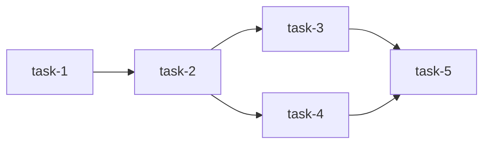

# F4 tasks (구현 계획 + 진행)

<!-- design.md를 바탕으로 쓴 구현 계획이다. 새 이슈를 시작할 때마다 아래에 이슈 계획을 하나 더한다.
     이슈 계획 하나 = 이슈 하나 = 브랜치 하나 = PR 하나. task = 혼자 끝나고 혼자 검증되는 가장 작은 단위.
     진행 칸은 task를 끝낼 때마다 고친다. 이 파일 전에 진행한 F4 일(#39~#42 등)은 이슈 본문과 design.md에 있다. -->

## m3-i2-scope-a  ADR 0005 보정 범위: 방향 후보·보정 초안  (11/24~)  상태: 승인 (재아 11/24)  (이슈 #349, Closes)  브랜치 `feat/349-f4-amendment-scope` (`docs/345-f4-amendment-scope` 위에 쌓음)
**구현할 design 부분**: [ADR 0005](../../decisions/0005-f4-amendment-scope.md) 결정 1~4·6·7, design.md 3-1 `claims_text`, 2절 ①③
**맡은 합격 기준**: requirements.md 1(방향 후보), 4(보정 초안). 바탕: 요구사항 예시 "종속항 특징을 독립항에 합치기"(24줄)
**목표** (한 줄): F4가 같은 거절이유의 독립항 전부 + 그 종속항을 보정 범위로 보고, 그 범위의 종속항을 합치는 후보·초안을 낼 수 있게 한다. F3·판단 단위·결과 스키마는 그대로.
**끝나면 보여 줄 것** (데모 한 줄): `uv run pytest tests/core/f4 -q` 통과 + tune F4 점수 한 줄 (`direction_top1`와 1차 실험 지표 `out_decision_recall`)
**어림 크기**: 코드 약 250줄 + 테스트 약 300줄

### task-1: 인용 관계표 (코드 도구, 모델 호출 없음)
- 담당: 재아
- 합격 기준: ADR 0005 결정 1
- 고칠 파일: 새 `src/patent_ai/core/f4_response_draft/claim_refs.py`, `tests/core/f4/test_claim_refs.py`
- 만들 함수·인터페이스 모양:
  - `ClaimRef(claim: int, depends_on: list[int] | None, head: str)` (frozen). `[]`는 독립항, `None`은 확인되지 않음.
  - `claim_refs(claims_text: list[ClaimText]) -> dict[int, ClaimRef]`: 청구항 앞머리("…에 있어서"·"…에 따른" 앞, 없으면 앞 120자)의 인용 표시를 읽는다.
    - 읽는 꼴: "제N항", "제 N 항", "청구항 N", "제N항 또는 제M항", "제N항 내지 제M항" (범위는 펼친다).
    - 자기보다 앞 번호만 남긴다.
    - 번호 없는 전제부("…방법에 있어서")는 독립항이다.
    - 앞머리에 항을 가리키는 말(청구항·N항·항 중)이 있는데 번호를 못 읽으면 `None` + WARNING.
  - 실험 `work/f4_amendment_scope/deps.py` 규칙을 옮긴다. tune 8건 105항·20건 294항에서 못 읽음 0·1항이었다.
- 테스트할 경우: 단일 인용, 범위, "또는", "청구항 N" 꼴, 전제부 독립항, 뒤 번호 인용(무시), 번호 못 읽음(None + 경고), 글자 0개(빈 dict + 경고)
- 확인 방법: `uv run pytest tests/core/f4/test_claim_refs.py -q` → 통과
- 먼저: 없음

### task-2: 보정 범위 계산 (코드 도구)
- 담당: 재아
- 합격 기준: ADR 0005 결정 2·6
- 고칠 파일: 새 `src/patent_ai/core/f4_response_draft/scope.py`, `tests/core/f4/test_amendment_scope.py`
- 만들 함수·인터페이스 모양:
  - `AmendmentScope(unit_id: str, claims: list[int], targets: list[int], same_rejection_targets: list[int], widened: list[int], unknown_refs: list[int])` (frozen).
  - `amendment_scope(unit: JudgmentUnit, units: list[JudgmentUnit], refs: dict[int, ClaimRef]) -> AmendmentScope`
    - 진보성·신규성 묶음: 같은 거절이유의 진보성·신규성 묶음 전부의 청구항이 거슬러 닿는 독립항들 + 그 독립항을 거슬러 인용하는 모든 항.
    - 여러 항을 인용하는 항은 닿는 독립항마다 들어간다.
    - 명확성 묶음: 지금처럼 `claims + read_with` (범위를 넓히지 않음).
    - 인용 관계가 `None`인 항은 범위에 넣지 않고 `unknown_refs`에 남긴다 (WARNING). 범위가 묶음 청구항보다 좁아지지는 않는다 (묶음 청구항은 늘 포함).
- 테스트할 경우:
  - 한 독립항 가족 (범위 = 독립항 + 종속항 전부)
  - 병렬 독립항 둘이 같은 거절이유 (두 가족 합침)
  - 다른 거절이유의 독립항은 넣지 않음
  - "제1항 내지 제12항" 인용 항
  - 명확성 묶음 그대로
  - 인용 모름 항
  - 1차 실험 사전 점검 예시 하나를 fixture로: 출처 쌍을 다 덮음
- 확인 방법: `uv run pytest tests/core/f4/test_amendment_scope.py -q` → 통과
- 먼저: task-1

### task-3: 방향 후보 단계에 보정 범위 적용
- 담당: 재아
- 합격 기준: ADR 0005 결정 3·4·7, requirements.md 1
- 고칠 파일: `src/patent_ai/core/f4_response_draft/directions.py` (`unit_variables`, `_build`, `build_directions`), `prompts/f4/direction.md`, `src/patent_ai/core/f4_response_draft/result.py` (`F4Output.amendment_scopes`), `tests/core/f4/test_f4_directions.py`(있는 파일에 더함)
- 만들 함수·인터페이스 모양:
  - `unit_variables(..., scope: AmendmentScope)`: `claims_text`를 보정 범위의 청구항 글자로 만든다. 새 변수 `scope_block`에는 거절 대상 / 같은 거절이유의 다른 묶음 대상 / 범위만 넓힌 항(인용문헌 대비 없음) / 인용 관계를 넣는다.
  - `_build`의 `allowed_claims` = `scope.claims`.
  - `F4Output.amendment_scopes: dict[str, list[int]]`: 묶음마다 넓어진 항. 도구 출력이라 결과 스키마는 바꾸지 않는다.
  - 프롬프트 `direction.md` 고치는 곳 셋 (1차 실험 `work/f4_amendment_scope/direction_scope.md`와 같은 문장):
    - 20줄 "이 판단 단위의 청구항 … 안에서만" → "아래 「보정 범위」의 청구항 안에서만"
    - 「보정 범위」 블록 추가
    - 결정 7 문장: "합친 종속항은 그대로 두거나 `delete`로만 적고, 인용 번호·문구 정리(`clarify`·`correct_error`)는 쓰지 않는다 (사건 전체 검사가 표시한다)"
- 테스트할 경우:
  - 범위만 넓힌 종속항을 `add`의 대상·출처로 쓴 답 → 통과
  - 다른 거절이유의 항을 쓴 답 → 출력 검사 실패
  - 명확성 묶음은 지금과 같음
  - 기록된 모델 응답 fixture 하나로 `amendment_scopes`가 채워짐
- 확인 방법: `uv run pytest tests/core/f4 -q` → 통과
- 먼저: task-2

### task-4: 보정 초안 단계에 보정 범위 적용
- 담당: 재아
- 합격 기준: ADR 0005 결정 4, requirements.md 4
- 고칠 파일: `src/patent_ai/core/f4_response_draft/amendment.py`, `prompts/f4/amendment.md`(9·12줄), `tests/core/f4/test_f4_amendment.py`
- 만들 함수·인터페이스 모양:
  - 보정 초안 프롬프트의 청구항 글자와 "고칠 수 있는 청구항"을 보정 범위로 바꾼다.
  - 프롬프트 9줄 "이 판단 단위 밖의 청구항은 고치지 않습니다" → "보정 범위 밖의 청구항은 고치지 않습니다"
  - 겹침(`amendment_overlaps`) 규칙은 그대로 둔다. 범위가 넓어져 겹침이 늘면 `needs_human_review`로 드러난다.
- 테스트할 경우:
  - 고른 방향이 범위만 넓힌 종속항을 `delete`로 둠 → 그 항 `(삭제)` 초안이 나옴
  - 두 묶음이 같은 종속항을 고침 → 뒤 묶음 초안을 싣지 않고 `amendment_overlaps`에 남음
- 확인 방법: `uv run pytest tests/core/f4/test_f4_amendment.py -q` → 통과
- 먼저: task-2

### task-5: tune 점수 한 줄
- 담당: 재아
- 합격 기준: 루트 CLAUDE.md "끝났다" (AI 동작을 바꾼 이슈면 tune 점수 한 줄)
- 고칠 파일: 새 `experiments/m3-i2-f4-scope-impl/card.md`·`config.yaml`·`scores.json`
- 만들 것:
  - tune F4 정답(VERSION 2)으로 기존 채점기 `direction_top1`을 2회 잰다.
  - 1차 실험 스크립트(`work/f4_amendment_scope/score.py`)로 `out_decision_recall`·`over_change_target`도 같이 낸다.
  - 모델은 `config/f4.yaml` 기본(Haiku)이다. 1차 실험(Sonnet)과 모델이 달라 숫자를 직접 비교하지 않고, 같은 설정의 변경 전(main) 2회와 비교한다.
- 확인 방법: `uv run python eval/run_eval.py --config experiments/m3-i2-f4-scope-impl/config.yaml --predictions <폴더>` → scores.json
- 먼저: task-3, task-4

### 이번에 안 하는 것
- 따라오는 정정 표시 (ADR 0005 결정 5, 요구사항 7번 "삭제 뒤 인용 번호·번짐"): 다음 계획 `m3-i2-scope-b`. 사건 전체 검사(`core/cases/case_check.py` `NOT_CHECKED`)를 채우는 일이라 PR을 나눈다.
- 출처 종속항 번호 칸 `AmendmentCore.source_ref` (이슈 #238): 결과 스키마(공유 자원) PR이다. 이 계획은 동작만 바꾸고, 출처 번호 채점은 #238 뒤에 한다.
- 병렬 독립항 맞추기·힌트 규칙: ADR 0005 "정하지 않는 것".
- F3가 범위만 넓힌 종속항을 대비하는 일: ADR 0005 "다시 볼 조건".

### 진행
- [x] task-1 (2e300ef)
- [x] task-2 (9417b10)
- [x] task-3 (ca26ba0). 의견서 단계도 `unit_variables`를 써서 청구항 글자가 보정 범위로 바뀐다 (범위만 넓힌 종속항을 합친 방향의 보정 설명에 필요)
- [x] task-4 (0295d07). 보정 프롬프트의 "같이 고쳐야 하는 청구항(인용 번호 등)도 낸다" 문장을 결정 7에 맞춰 "인용 번호·문구 정리는 쓰지 않는다"로 바꿈
- [ ] task-5. 점수 한 줄 (11/24 밤, 앱 모델을 Sonnet으로 바꾸기 전 Haiku 5.5): tune v2 tune10 F4 각 2회, 변경 전(main `9e7e235`) → 후(`59dd805`) direction_top1 0.348 → 0.380 (회차 흔들림 0.19 안), 범위 밖 출처 종속항이 범위에 들어옴 0/4 → 4/4, 과잉 보정 0/18 그대로, 보정 항 재현율 0.297 → 0.367 (정밀도 1.0 그대로), $1.07. `out_decision_recall`은 결과에 출처 번호 칸이 없어(#238 전) 대리 지표로 잼. 실험 카드는 아직 안 옮김 (재료 git 밖 `work/night-1124/`)
- 다음: task-5 실험 카드 `experiments/m3-i2-f4-scope-impl/` 옮기기

## m3-i2-scope-b  ADR 0005 따라오는 정정 표시  상태: 초안 (뼈대만, scope-a 뒤에 채움)  (이슈 미정)
**구현할 design 부분**: ADR 0005 결정 5, design.md 3-2 "사건 전체 검사" 칸   **맡은 합격 기준**: requirements.md 7
**목표** (한 줄): 묶음별로 고른 방향의 `amendment_core`를 모아, 삭제된 항을 인용하던 항과 보정된 독립항을 인용하는 종속항을 "확인 필요"로 표시한다 (글자는 고치지 않음).
- 쓸 것: task-1의 `claim_refs`.
- 바꿀 곳: `core/cases/case_check.py`의 `NOT_CHECKED`에서 두 규칙을 빼고 검사 항목으로 만든다. API `GET /oas/{oa_id}/case-check` 응답 칸은 design.md 3-2 질문을 정한 뒤 적는다.
