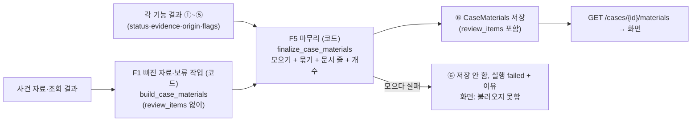

# F5 근거·상태 표시와 진행·보류 세부 설계
<!-- 모르는 곳은 [확인 필요: 무엇]으로 남긴다. [가정]은 모르지만 일단 정한 것, [확인 필요]는 아직 못 정한 것.
     requirements.md에 쓴 것(무엇, 합격 기준, 사람이 고르는 곳)은 다시 쓰지 않고 번호로 가리킨다. -->

F5의 규칙 대부분(상태 네 값·이유 여섯, `worst_status`, 전파 `propagate`, `mark_recheck`, 검토할 사항 `collect_review_items`, ⑥ `CaseMaterials`)은 #14에서 `core/schemas/`에 들어가 있다. 이 설계는 **남은 세 가지**를 정한다: ① 검토할 사항 목록을 화면까지 보내는 길, ② 목록을 사람이 읽을 만하게 모으는 규칙(전파된 줄 묶기, 사람 선택 기다림), ③ 화면 표시 규칙.

## 1. 합격 기준 ↔ 설계
| 기준 (requirements 번호) | 설계의 어디가 만족시키나 | 이슈 |
|---|---|---|
| 1 데이터: 네 값·필수 칸 | `Status` 검사 (`common.py`) | #14 (끝) |
| 1 데이터: 확인하지 않은 위치 0건 | 각 기능의 원문 대조 (F1 design 2절 ⑤). F5는 모으기만 | #18 (끝) |
| 1 화면: 네 값 구분, 위치 링크, checked·이유·범위 글 | 6절 상태 표시 규칙 | #19 |
| 2 데이터: origin 네 값, 사람 수정 시 원본 보존 | `Origin` (`common.py`), 초안은 F4 설계 | #14 (끝), F4 |
| 2 화면: 사람이 판단할 것 따로 보임 | 6절 "사람 판단 표시" 표 | #19 (M1), #43 (F4) |
| 3 데이터: 빠진 자료·기대는 작업만 보류 | ⑥ `missing`·`held_tasks` (`case_grouping.py`) | #14·#16 |
| 3 데이터: 올리면 줄·보류가 사라짐 | 2절 3번 ⑥ 다시 쓰기 (`build_case_materials` + `finalize_case_materials`) | 새 이슈, 저장 연결은 #16 |
| 3 데이터: 결과 0개여도 빠진 자료 줄 | `collect_review_items` | #14 (끝) |
| 3 검토할 사항 한곳 + N = 줄 수 | 3-2절 ⑥에 `review_items` 더함, 2절 모으기 규칙 | 새 이슈 (tasks.md m1-i3-new) |
| 3 화면: 줄마다 링크, "올려 주세요" | 6절 검토할 사항 패널 | #19 |
| 3 다시 확인 필요 | 3-2절 마지막: M1에는 표시할 뒤 결과가 없음 (F3가 첫 대상) | M2 F3 |

## 2. 흐름

1. 입력: 사건의 최신 결과들(API가 고르는 규칙 그대로, data-model 5절: OA마다·단위마다 가장 최근 성공 실행)과 사건 자료.
2. 처리:
   - 빠진 자료·보류 작업: `build_case_materials` (#16, `core/f1_oa_reader/case_grouping.py`). F1 일만 한다: 문서 목록(문서마다 `status`), `missing`, `held_tasks`. 검토할 사항은 만들지 않는다 (지금 코드 안의 `collect_review_items` 호출과 개수 계산은 빼서 아래로 옮긴다). 기대는 작업 이름은 3-2절 이름 규칙.
   - F5 마무리: `finalize_case_materials(results: list[ResultBase], materials: CaseMaterials) -> CaseMaterials` (`core/schemas/propagation.py`, 새로). 순서: `collect_review_items(results, materials)`(있음) + 문서 줄(아래) → **묶기**(아래) → `review_items`·`review_items_count`를 채운 새 ⑥. 결과 ①~⑤를 다 받으므로 F2~F4가 생겨도 이 함수만 쓴다.
   - 문서 줄: `CaseDocument`에 `status`를 더하고(3-2절), `confirmed`가 아닌 문서마다 한 줄: `kind = "unverified"`(또는 `"conflict"`), `target = "materials.documents[i]"`, `label = <문서 종류·번호>`, `reason = <이유 코드>`. 문서 `status`는 묶기 결과(`GroupedMaterial.status`: 다른 출원번호·번호 못 읽음)와 글자 추출 결과(`PageText.status`: 스캔본 `body_missing`) 중 나쁜 쪽(`worst_status`)이고, 지휘가 `build_case_materials`에 넘긴다. 이렇게 하면 지금 개수에만 더하던 "확인되지 않은 자료"(unsettled)도 줄이 되고, 스캔본의 **원인 줄**이 생긴다.
   - `review_items_count = len(review_items)` (검사로 강제).
3. 결과 저장: 지휘 에이전트가 실행이 끝날 때, 그리고 자료가 더해질 때(`POST /cases/{id}/documents`) ⑥을 다시 써서 `case_materials`에 저장한다 (data-model 5절, 사건마다 최신 한 줄). 화면은 저장본만 읽는다 (읽을 때 다시 계산하지 않음 → 사건을 다시 열어도 같은 목록). 둘이 겹치면 마지막에 쓴 쪽이 남는다 (덮어쓰기, 같은 입력이면 같은 ⑥이라 문제 없음). 이 저장 연결은 지휘·자료 올리기 쪽 이슈(#104·#16)가 하고, F5는 `finalize_case_materials`를 준다.

**묶기 규칙** (검토할 사항이 전파 줄로 넘치지 않게):
- 이유가 `input_unverified`인 필드 줄은 결과 하나에 한 줄로 묶는다: `kind = "unverified"`, `target = <결과 경로>`, `label = <결과 이름>`, `reason = "앞 입력이 확인되지 않음: <칸 N개>"`. 원인 줄(처음 확인되지 않은 값, 이유가 `input_unverified`가 아닌 것)은 그대로 둔다. 예: 스캔본 OA → 원인 줄 `{kind: "unverified", target: "materials.documents[0]", label: "OA <발송번호 또는 파일 이름>", reason: "body_missing"}` + 묶은 줄 `{kind: "unverified", target: "oa_result[0]", label: "oa_1", reason: "앞 입력이 확인되지 않음: 칸 N개"}` 두 줄.
- 같은 `target`·`kind`가 두 번 나오면 하나만 둔다. 생기는 경우: 같은 문서가 묶기와 글자 추출 둘 다에서 확인되지 않음 (문서 줄은 문서마다 한 줄로 만들지만, 뒤 기능이 같은 경로를 다시 낼 때를 막는 안전 장치).
- 순서: 빠진 자료 → 충돌 → 확인되지 않음 → 직접 판단 필요 → 직접 검토 필요 → 다시 확인 필요. 같은 종류 안에서는 결과 순서 그대로. 사람이 먼저 손대야 풀리는 것(자료 올리기)을 위에 둔다.
- 사람 선택 기다림(F4 확신 "낮음" 묶음)은 `held_tasks`에 넣지 않는다. 그 묶음 결과의 `needs_human_judgment` 플래그가 `kind = "needs_human_judgment"` 줄로 이미 나온다. 화면은 그 줄에 "고르기" 버튼을 단다 (M3, #43). 보류의 두 종류(자료 기다림 / 사람 선택 기다림)는 검토할 사항 한곳에서 보이고, 데이터는 각자 있던 자리에 둔다.
- 실패하면: `finalize_case_materials`는 예외를 그대로 올린다 (빈 목록으로 삼키지 않음). 받은 지휘가 ⑥을 저장하지 않고 실행을 `failed` + 이유로 끝낸다 (지휘 쪽 일, 테스트도 지휘 쪽). 이전 ⑥은 남는다. 화면은 "검토할 사항을 불러오지 못함"과 실패 이유 (개수 0으로 그리지 않음).
- 비면: 결과 0개 → 경고 로그(있음) + 빠진 자료 줄만. 검토할 사항 0개는 정상("검토할 사항 없음"으로 보임).
- 느리면: 해당 없음 (코드, 결과 수가 작음).

### 2-1. 흐름 방식
- **코드 흐름.** 모으기·묶기·보류 판정은 답이 정해진 일이라 모델을 부르지 않는다 ([ADR 0003](../../decisions/0003-tech-stack.md)). 지휘 에이전트가 ⑥을 쓸 때 늘 부르는 코드 단계다 (에이전트가 고르는 도구가 아님: 건너뛰면 검토할 사항이 비어 보이기 때문).
- 단계 기록: `agent_steps`에 `step_kind = fixed_stage`(무조건 도는 코드 단계, `db/models/runs.py` 검사 값), 이름 `finalize_case_materials`, 결과 status, 검토할 사항 수.

## 3. 데이터 모양
### 3-1. 앞 기능에서 받는 것
- 모든 결과 스키마 ①~⑤의 공통 칸 (data-model 3절). M1은 ① `OAResult`만.
- 받은 결과가 "확인되지 않음"·"충돌"이면: 고치지 않고 검토할 사항 줄로 낸다. 상태를 바꾸는 것은 그 결과를 낸 기능뿐이다.

### 3-2. 다음 기능(화면)에 주는 것
⑥ `CaseMaterials`에 `review_items`를 더한다 (공유 스키마 변경, PR로 상대 리뷰):
```json
{
  "case_id": "c_1",
  "documents": [{"document_id": "doc_oa_1", "kind": "oa", "source": "uploaded"}],
  "missing": [{"what": "US 2099/0000001 본문", "depends_on_tasks": ["f3_compare:oa_1:US20990000001A1"],
               "lookup_result": "body_missing", "ask_upload": true}],
  "held_tasks": [{"task": "f3_compare:oa_1:US20990000001A1", "waiting_for": "US 2099/0000001 본문"}],
  "review_items": [
    {"kind": "missing_material", "target": "materials.missing[0]", "label": "US 2099/0000001 본문", "reason": "body_missing"},
    {"kind": "needs_human_review", "target": "oa_result[0].rejections[2]", "label": "42-3", "reason": "지원 안 하는 거절이유 42-3"}
  ],
  "review_items_count": 2
}
```
- `review_items: list[ReviewItem]` (모양은 `propagation.py`의 `ReviewItem{kind, target, label, reason}` 그대로). `review_items_count`는 남기되(목록 화면 등에서 개수만 쓸 때) `== len(review_items)`를 검사로 강제한다.
- `target` 경로 규칙: `oa_result[i]…`는 사건의 i번째 OA(올라온 순서)의 `OAResult` 안 경로, `materials.missing[i]`는 ⑥ 안. 화면은 이 경로로 그 값의 카드로 이동한다. 뒤 결과(②~⑤)가 생기면 `units[i]`·`comparisons[i]`… 같은 꼴로 더한다 (그 기능 설계에서).
- **보류 작업 이름 규칙** (`held_tasks.task`, `missing.depends_on_tasks`): `<작업>:<oa_id>:<대상>`. `oa_id`는 `OAResult.oa_id`. 작업은 `f3_compare`(인용문헌 하나의 대비) / `f3_all`(그 OA의 F3 전체) / `f4_all`(그 OA의 F4 전체) / `f4_amend_basis`(보정 근거 위치). F1 requirements 합격 기준 4의 네 갈래가 이 넷이다. 대상은 `f3_compare`면 인용문헌 라벨 `Citation.label`(`D1`·`D2`, OA마다 늘 있고 겹치지 않음. 번호를 못 읽은 문헌도 라벨은 있다), 나머지는 `*`. 예: `f3_compare:oa_1:D2`. 화면 글은 이 이름이 아니라 `waiting_for`(사람 글, 예 "US 2099/0000001 본문")와 작업 종류 한국어("F3 대비")로 만든다.
- 이름을 바꾸면 같이 고칠 곳: `core/f1_oa_reader/case_grouping.py`, `tests/core/f1/test_case_grouping.py`, `tests/fixtures/case_missing_citation/case_materials.json`, `tests/core/schemas/test_fixtures.py`. 문서(F1 requirements·architecture·product·cite-search)의 "F3 대비" 글은 사람 말이라 그대로 둔다.
- `CaseDocument.status: Status` 더함 (2절 문서 줄). 기본값 없이 꼭 채운다 (모르는 문서를 확인됨으로 두지 않게).
- 공통 속성(`status`·`evidence`·`origin`)은 data-model 3절 그대로. F5가 결과에 더하는 칸은 없다.
- 앞 기능 결과가 바뀌면 "다시 확인 필요": 규칙 2 (`mark_recheck`, 있음). 빠진 자료를 올리면 `result_inputs`로 그 자료(`document`)에 기댄 결과를 찾아 `needs_recheck`를 단다. **M1에는 달 대상이 없다**: 빠진 인용문헌에 기대는 결과는 F3 대비(M2)인데, 보류돼서 아직 결과가 없기 때문이다. 그래서 M1은 ⑥을 다시 쓰는 것(빠진 자료 줄이 사라지고 보류가 풀림)까지만 하고, `needs_recheck` 달기는 F3 설계에서 구현한다.
- 인터페이스 변경: **있음**.

| 바뀌는 곳 | 지금 | 바꿀 것 | 확정 |
|---|---|---|---|
| ⑥ `CaseMaterials` | `review_items_count`만 | + `review_items: list[ReviewItem]`, 개수 = 줄 수 검사 | 상대 리뷰 (공유 스키마) |
| ⑥ `CaseDocument` | `document_id, kind, source` | + `status` | 상대 리뷰 (공유 스키마) |
| `build_case_materials` | 안에서 검토할 사항 개수까지 셈 | 빠진 자료·보류·문서 status만, 개수는 `finalize_case_materials` | 상대 리뷰 (#16 주인) |
| `held_tasks.task`·`depends_on_tasks` | 사람 글 | 3-2절 이름 규칙 | 상대 리뷰 (#16 코드도 같이) |
| `GET /cases/{id}/materials` | ⑥ | 그대로 (⑥에 칸이 더해질 뿐) | 서버 담당 리뷰 |

승인되면 data-model.md 4절 ⑥ 줄은 구현 PR에서 같이 고친다.

## 4. 판과 근거
- 쓰는 청구항 판: 해당 없음 (판을 고르지 않는다).
- 쓰는 법령·심사기준 판: 해당 없음. 각 결과의 `evidence.edition`을 그대로 보인다. 판본이 비어 있으면 화면은 "판본 확인되지 않음"으로 보인다 (빈칸으로 두지 않음).
- 근거 위치 적는 법: 각 기능이 정한다 (F1: `document_id` + 쪽 + `raw_text`). 화면 링크는 `GET /documents/{id}`의 그 쪽으로 가서 `raw_text`를 강조한다 (F1 design 4절과 같음).

## 5. 저장
- 읽는 테이블: 결과 표(M1 `oa_results`), `documents`, `result_inputs`. 쓰는 테이블: `case_materials`(⑥ jsonb, 사건마다 최신 한 줄), `agent_steps`.
- `case_materials` 표 컬럼은 그대로다 (본문 `CaseMaterialsRow.body`가 JSONB라 칸이 더해질 뿐, 마이그레이션 없음. `db/models/results.py` 확인).
- 검색: 해당 없음. 외부 API: 해당 없음. 외부 모델로 보내는 자료: 해당 없음 (모델을 부르지 않음).

## 6. 화면 (시연용)
- 시연 흐름 한 줄: 인용문헌 1건이 빠진 사건 열기 → 값마다 상태 표시 → "검토할 사항 3건" → 빠진 인용문헌 줄 "올려 주세요" → 올리면 그 줄이 사라지고 보류가 풀림.

**상태 표시 규칙** (모든 기능 화면이 같은 부품을 쓴다, `web/src/`의 상태 부품 하나):
| status | 글자 | 모양 (색만 쓰지 않음) | 같이 보이는 글 |
|---|---|---|---|
| `confirmed` | 확인됨 | ● 채운 점 | `checked` (예: "1쪽 출원번호 칸 글자와 일치") |
| `unverified` | 확인되지 않음 | ○ 빈 점 | 이유 한국어 (조회 실패 / 본문 없음 / 판본 모름 / 못 뽑음 / 애매함 / 앞 입력이 확인되지 않음) |
| `not_found_in_scope` | 조회 범위 내 없음 | ◌ 점선 점 | `searched_scope` ("찾아본 범위: …"). "없음"이라고 쓰지 않는다 |
| `conflict` | 충돌 | ◐ 반 점 | 후보 둘 이상을 나란히 (`candidates`), 고르지 않음 |
- 쪽이 있는 값만 위치 링크를 단다. 쪽이 없는 `confirmed`(통지 종류 `initial`, 힌트 "없음")는 링크 없이 `checked`만.
- 결과 카드 하나에는 그 카드의 결과 status(가장 나쁜 값)를 머리에, 칸마다 칸 status를 옆에.

**사람 판단 표시** (AI 결과와 다른 칸·글자):
| 무엇 | 데이터 | 화면 |
|---|---|---|
| AI가 만든 값 | `origin = ai_generated` | 작은 "AI" 표시 (기본) |
| 날짜·제출기일 | F1 `value = null`, `raw_text`만 | 원문 글자 + "직접 확인" 표시, 계산한 날짜를 보이지 않음 |
| 지원 안 하는 거절이유·나라 | `flags: needs_human_review` | "직접 검토 필요" 띠, AI 대비·초안 없음 |
| 출원번호 입력 기다림 | 실행 `waiting_for_human`, `waiting_for: application_number` | 사건 머리에 입력 칸 (`PATCH /cases/{id}`) |
| (M3) 대응 방향 | `origin = ai_default` / `human_selected`, `needs_human_judgment` | "AI 기본값" / "내가 고름" 표시, 직접 판단 필요 묶음은 선택 없이 "고르기" (#43) |
- 금지 글자: "적용된다", "등록 가능", "적법", "거절 해소" 같은 법적 결론을 AI 결과 글로 보이지 않는다.

**검토할 사항 패널**:
```
┌ 검토할 사항 3건 ─────────────────────────────────────────┐
│ ① 빠진 자료  US 2099/0000001 본문 (본문 없음)   [올려 주세요] │
│    → 보류: F3 대비 US 2099/0000001                           │
│ ② 확인되지 않음  OA 제출기일 (못 뽑음)                         │
│ ③ 직접 검토 필요  거절이유 ③ 42조 3항 (지원 안 하는 거절이유) │
└──────────────────────────────────────────────────────────┘
```
- 줄을 누르면 `target`의 카드로 이동한다. N은 `review_items` 줄 수. 패널 줄에는 원문 링크를 달지 않는다 (링크는 카드의 값 옆에만, 원문에서 확인된 값만: requirements 1).
- 실행이 `failed`이면 사건 머리에 실패 이유와 "이전 결과 (<실행 시각>)"를 보이고 이전 결과는 그대로 보인다 (API가 가장 최근 성공 실행 결과를 줌, data-model 5절).

## 7. AI
해당 없음 (모델을 부르지 않는다). 비교 실험 아님.

## 8. 이 기능 안의 결정
| 고른 것 | 버린 것 | 이유 | 계기 | 근거 |
|---|---|---|---|---|
| 규칙은 F1~F4 전부, M1 합격 확인은 F1 결과로 | F1에만 쓰고 뒤에 다시 | 상태 규칙이 기능마다 다르면 화면 부품도 갈라짐 | 11/19 인터뷰 [사람 판단 2] | product.md 3.1 "뒤 기능에도 계속 적용" |
| 검토할 사항 목록을 ⑥ 안에 저장 | 새 엔드포인트에서 읽을 때마다 계산 | 다시 열어도 같은 목록, 서버가 core를 매번 부르지 않음, ⑥이 이미 "사건 자료·보류 목록" | 설계 | data-model 5절 (⑥ 저장본) |
| `input_unverified` 줄은 결과마다 한 줄로 묶음 | 칸마다 한 줄 | 스캔본 하나로 수십 줄이 생겨 원인이 묻힘 | 설계 | requirements 근거 절 |
| 사람 선택 기다림은 `held_tasks`가 아니라 플래그 줄 | `held_tasks`에 같이 | 데이터 자리를 하나로 두면 F4 선택 API와 두 군데를 맞춰야 함. 화면에서는 한곳 | 설계 | api/README.md 실행 상태 |
| 보류 작업 이름을 코드 규칙으로 | 사람 글 | 자료가 오면 어느 작업을 풀지 코드가 찾아야 함 | 설계 | F1 requirements 4 |
| 상태 표시는 글자 + 모양 | 색만 | 색으로만 구분하면 흑백 인쇄·색약에서 안 보임 | 설계 | requirements 1 |

## 9. 테스트 방법
- 어디서 테스트하나: 코어는 `finalize_case_materials(results, materials) -> CaseMaterials` 한 곳 (모으기·묶기·문서 줄·개수). 빠진 자료·보류는 F1 쪽 `build_case_materials` 테스트에 그대로 둔다. 화면은 사건 화면 fixture를 넣은 브라우저 스크린샷 (화면 스냅샷 테스트는 두지 않음, CLAUDE.md).
- 가짜 응답: 모델을 부르지 않아 필요 없음. 결과 fixture만.
- 예시 파일:

| 파일 | 상황 | 기대 | 기준 |
|---|---|---|---|
| `tests/fixtures/case_missing_citation/` (있음) | 인용문헌 2건 중 1건 본문 없음 | `missing` 1, `held_tasks`에 `f3_compare:oa_1:<그 문헌>`만, `review_items`에 빠진 자료 줄 | 3 |
| `tests/fixtures/f5/case_all_statuses/` (새로) | 칸마다 네 값이 하나씩 + `needs_human_review` 1 + 날짜 칸 | `review_items`에 충돌·확인되지 않음·직접 검토 필요 줄, 조회 범위 내 없음은 줄 없음. 화면 스크린샷 기준 | 1, 2, 3 |
| `tests/fixtures/f5/case_scanned/` (새로) | 글자 없는 OA (문서 `body_missing`) | 원인 줄 `materials.documents[0]` 1 + 묶은 `oa_result[0]` 줄 1 (칸마다 줄 아님) | 근거 절 |
| 단위 테스트 | 다른 출원번호 자료 1이 섞인 사건 | 그 문서 줄 1, 개수 = 줄 수 | 3 |
| 단위 테스트 | 종류가 섞인 줄 | 빠진 자료 → 충돌 → 확인되지 않음 → 직접 판단 → 직접 검토 → 다시 확인 순 | 3 |
| 단위 테스트 | `case_missing_citation`에 빠진 문헌을 받은 뒤(`received_citations`에 더함) 다시 `build_case_materials` + `finalize_case_materials` | 빠진 자료 줄·보류 0 | 3 |
| 단위 테스트 | `review_items_count != len(review_items)` | `ValidationError` | 3 |
| 단위 테스트 | 같은 `target`·`kind` 두 번 | 한 줄 | 3 |
| 단위 테스트 | 결과 0개 + 빠진 자료 1 | 빠진 자료 줄 1 + 경고 로그 | 3 |
| 단위 테스트 | 모으기 중 예외 | `finalize_case_materials`가 예외를 올림 (빈 목록으로 삼키지 않음). ⑥ 저장 안 함·`failed`는 지휘 쪽 테스트 | 실패할 때 |
| 화면 확인 (스크린샷) | status 없는 값, 판본 빈 근거, ⑥ 불러오기 실패 | "확인되지 않음" / "판본 확인되지 않음" / "검토할 사항을 불러오지 못함" | 1, 실패할 때 |
| 명령 | 금지 낱말 | `grep -rnE "적용된다\|등록 가능\|적법\|거절 해소" web/src` → 0줄 | 2 |
