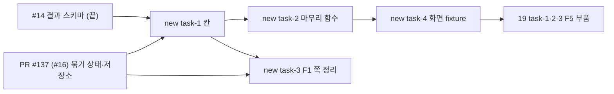
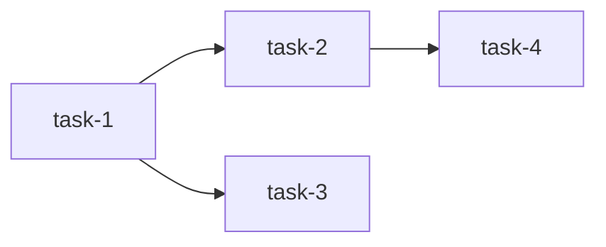
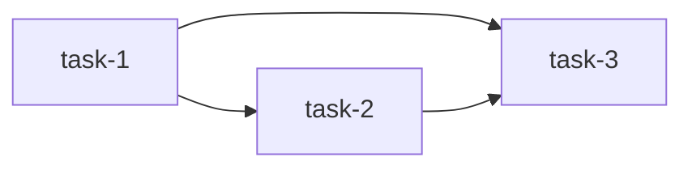

# F5 tasks (구현 계획 + 진행)

<!-- design.md를 바탕으로 쓴 구현 계획이다. 이슈 계획 하나 = 이슈 하나 = 브랜치 하나 = PR 하나.
     task마다 확인 방법(명령 한 줄 → 기대 결과). 네트워크·API 키 없이 돈다. 진행 칸은 Claude가 task를 끝낼 때마다 고친다. -->

- 이름: 이터레이션 M1-i3에 F5 이슈가 둘이라 계획 제목을 `m1-i3-<이슈번호>`로 쓴다 (F1 tasks.md와 같은 방식).
- 끝난 F5 이슈: #14 결과 스키마·상태 규칙 (계획은 [F1 tasks.md](../F1/tasks.md)의 `m1-i2-14`). F5 합격 기준 1·2·3의 데이터 쪽 대부분이 여기서 들어갔다.
- 순서: 검토할 사항 칸(`m1-i3-new`)의 task-1이 인터페이스라 먼저. 화면(`m1-i3-19`)은 task-1의 칸 모양만 정해지면 fixture로 같이 간다.
- 다른 이슈와 겹치는 파일: PR #137(#16)이 `CaseDocument.status`(필수), `case_grouping.py`의 `build_case_materials`, `case_missing_citation` fixture를 고친다. `m1-i3-new`는 **#137 머지 뒤 최신 main에서** 시작한다 (task-1·task-3 모두 같은 파일).

## m1-i3-new  (11/20~11/21)  상태: 초안  (이슈: 새로 만듦, 번호는 만든 뒤 적음)
**구현할 design 부분**: design.md 2절(마무리 함수, 문서 줄, 묶기 규칙), 3-2절(⑥ `review_items`, `CaseDocument.status`, 보류 작업 이름 규칙)   **맡은 합격 기준**: requirements.md 3 (검토할 사항 한곳, N = 줄 수, 전파 줄 묶기, 올리면 줄·보류가 사라짐), 근거 절 (원인 줄)
**목표** (한 줄): 검토할 사항 목록을 ⑥ `CaseMaterials`에 담아, 화면이 개수만이 아니라 줄을 받게 한다.
**끝나면 보여 줄 것** (데모 한 줄): `uv run pytest tests/core/schemas tests/core/f1 -q` 통과 + `case_missing_citation`·`case_scanned`의 ⑥에 `review_items` 줄이 있고 `review_items_count`와 같다.

### task-1: ⑥에 `review_items` 칸과 개수 검사
- 담당: 은진
- 합격 기준: requirements.md 3 (N = 목록 줄 수 = `review_items_count`)
- 고칠 파일: `src/patent_ai/core/schemas/case_materials.py`, `src/patent_ai/core/schemas/propagation.py`, `tests/core/schemas/test_propagation.py`, `tests/core/schemas/test_fixtures.py`, `tests/fixtures/case_missing_citation/case_materials.json`, `docs/data-model.md` 4절 ⑥ 줄
- 만들 함수·인터페이스 모양: `ReviewItem{kind, target, label, reason}`과 `ReviewKind`(Literal)를 `case_materials.py`로 옮기고(`propagation.py`가 `case_materials`를 import하므로 거꾸로 두면 순환), `propagation.py`는 둘 다 그대로 다시 내보낸다(`test_fixtures.py`가 `propagation`에서 import함). `CaseMaterials.review_items: list[ReviewItem] = []` + 검사 `review_items_count == len(review_items)`. `CaseDocument.status`는 #137에서 이미 들어온다. fixture에 `review_items` 줄을 넣는다.
- 테스트할 경우: 평소(줄 2 + 개수 2 → 통과) / 빈 입력(줄 0 + 개수 0 → 통과) / 실패(줄 2 + 개수 3 → `ValidationError`)
- 확인 방법: `uv run pytest tests/core/schemas -q` → 모두 통과
- 먼저: PR #137 머지 (공유 스키마 변경이라 이 task만 먼저 상대 리뷰를 받아도 된다)

### task-2: F5 마무리 함수 `finalize_case_materials` (모으기 + 문서 줄 + 묶기 + 개수)
- 담당: 은진
- 합격 기준: requirements.md 3 (전파 줄 묶기, 종류 순서, 결과 0개여도 빠진 자료 줄), 근거 절 (원인 줄)
- 고칠 파일: `src/patent_ai/core/schemas/propagation.py`, `tests/core/schemas/test_propagation.py`, `tests/fixtures/f5/case_scanned/` (새로: `oa_result.json`, `case_materials.json`)
- 만들 함수·인터페이스 모양: `finalize_case_materials(results: list[ResultBase], materials: CaseMaterials) -> CaseMaterials` — ① `collect_review_items(results, materials)` ② 문서 줄: `confirmed`가 아닌 문서마다 `{kind: "unverified" | "conflict"(문서 status 값대로), target: "materials.documents[i]", label: "<kind> <document_id>", reason: <status.reason, conflict면 "값이 서로 충돌">}` ③ 묶기: 이유가 `input_unverified`인 필드 줄은 `target` 앞부분(`oa_result[i]`, 첫 `.` 앞)으로 묶어 결과마다 한 줄(`reason = "앞 입력이 확인되지 않음: 칸 N개"`), 같은 `target`·`kind`는 하나, 순서 빠진 자료 → 충돌 → 확인되지 않음 → 직접 판단 → 직접 검토 → 다시 확인 ④ `review_items`·`review_items_count`를 채운 새 ⑥ (입력은 바꾸지 않음). 예외는 삼키지 않는다.
- 테스트할 경우: 평소(`case_scanned`: 문서 `body_missing` 원인 줄 1 + `oa_result[0]` 묶은 줄 1, `case_missing_citation`: 빠진 자료 줄 1 + 그 밖 줄) / 빈 입력(결과 0 + 빠진 자료 1 → 그 줄 1 + 경고) / 경계(다른 출원번호 문서 `conflict` → 문서 줄 1, 종류 섞임 → 정한 순서, 같은 줄 두 번 → 하나)
- 확인 방법: `uv run pytest tests/core/schemas -q` → 모두 통과
- 먼저: task-1

### task-3: F1 쪽 `build_case_materials` 정리 (개수 계산 빼기, 문서 status, 보류 작업 이름)
- 담당: 은진 (#16 주인 재아와 같은 파일이라 #16 머지 뒤, 리뷰는 재아)
- 합격 기준: requirements.md 3 (빠진 자료마다 한 줄, 기대는 작업만 보류, 올리면 줄·보류가 사라짐)
- 고칠 파일: `src/patent_ai/core/f1_oa_reader/case_grouping.py`, `tests/core/f1/test_case_grouping.py`, `tests/core/schemas/test_fixtures.py`, `tests/fixtures/case_missing_citation/case_materials.json`
- 만들 함수·인터페이스 모양: `build_case_materials(case_id, grouped, oa, received_citations, lookup_failures=None, page_status: dict[str, Status] | None = None) -> CaseMaterials` — 안의 `collect_review_items` 호출·개수 계산을 뺀다(`review_items`는 비우고 개수 0, 채우는 것은 `finalize_case_materials`). 문서 status = `worst_status([g.status, page_status.get(id)])` (#137이 넣은 `g.status`에 글자 추출 상태를 합침). 보류 작업 이름 `f3_compare:<oa.oa_id>:<c.label>` (design.md 3-2절).
- 테스트할 경우: 평소(`case_missing_citation` → `held_tasks` = `f3_compare:oa_1:D2`, `waiting_for` = "US 2099/0000001 본문") / 빈 입력(인용문헌 0건 → 경고 + 빠진 자료 0) / 경계(지원 안 하는 나라 → `ask_upload=false`, 스캔본 page_status → 문서 `body_missing`, 빠진 문헌을 `received_citations`에 더해 다시 부름 → 빠진 자료·보류 0)
- 확인 방법: `uv run pytest tests/core/schemas tests/core/f1 -q` → 모두 통과
- 먼저: task-1, PR #137 머지 (같은 파일)

### task-4: 화면용 네 값 fixture
- 담당: 은진
- 합격 기준: requirements.md 1·2 화면 줄 (스크린샷 기준 자료)
- 고칠 파일: `tests/fixtures/f5/case_all_statuses/oa_result.json`, `tests/fixtures/f5/case_all_statuses/case_materials.json`, `tests/core/schemas/test_fixtures.py`
- 만들 함수·인터페이스 모양: 지어낸 사건 하나. `confirmed` 출원번호, `unverified(not_extracted)` 제출기일, `not_found_in_scope` 값 하나, `conflict` 발송번호(후보 둘), `needs_human_review` 거절이유 1(42-3), 날짜 칸, 빠진 자료 1. ⑥은 `finalize_case_materials`로 만든 값.
- 테스트할 경우: 평소(두 파일이 스키마 검사 통과) / 빈 입력(해당 없음) / 실패(fixture의 `review_items`가 `finalize_case_materials`로 다시 만든 값과 다르면 실패)
- 확인 방법: `uv run pytest tests/core/schemas/test_fixtures.py -q` → 모두 통과
- 먼저: task-2

### 이번에 안 하는 것
- 지휘가 ⑥을 저장할 때 `finalize_case_materials`를 부르는 연결과, 그 실패 때 `failed` (#104 지휘 단계 기록·저장, #16 자료 올리기).
- "다시 확인 필요" 달기 (M1에 대상 결과 없음, F3 설계에서).
- 검토할 사항 새 엔드포인트 (⑥ 안에 담음, design.md 8절).
- F4 사람 선택 줄 "고르기" (#43).
- 문서(F1 requirements·architecture·product)의 "F3 대비" 글: 사람 말이라 그대로 둔다.

### 진행
- [ ] task-1
- [ ] task-2
- [ ] task-3
- [ ] task-4
- 다음: task-1
- 막힌 것: PR #137 머지 기다림 (그 뒤 최신 main에서 시작)

### 끝난 뒤 (이슈가 끝난 날)
- 된 것 / 안 된 것 / 다음 이슈로

## m1-i3-19  (11/20~11/21)  상태: 초안  (이슈 #19의 F5 부분. 이 계획 PR은 `Refs #19`)
**구현할 design 부분**: design.md 6절 (상태 표시 규칙, 사람 판단 표시, 검토할 사항 패널)   **맡은 합격 기준**: requirements.md 1·2·3의 화면 줄
**목표** (한 줄): 모든 결과 화면이 쓸 상태 표시·사람 판단 표시·검토할 사항 패널 부품을 만든다.
**끝나면 보여 줄 것** (데모 한 줄): 미리보기 페이지 `/#/f5-preview`에 `case_all_statuses`를 넣은 스크린샷에서 네 값·"직접 확인"·"직접 검토 필요"·검토할 사항 N건이 보인다.

- #19 주인은 재아다. 이 계획은 `web/src/components/status/`와 미리보기 `web/src/preview/F5Preview.tsx`만 만든다. `App.tsx`에는 미리보기로 가는 한 줄(해시 경로)만 더하고, 사건 화면 배치·올리기·목록은 #19 본 계획이 한다. 부품은 props만 받는다.
- 타입: 서버 OpenAPI 타입이 생기기 전까지 `web/src/components/status/types.ts` 하나에 임시로 둔다(`Status`·`Evidence`·`Origin`·`Flag`·`ReviewItem`·`CaseMaterials`, 파일 머리에 "OpenAPI 타입이 생기면 이 파일을 지우고 바꿈" 주석). #56 OpenAPI가 나오면 그 타입으로 바꾼다 (web/CLAUDE.md).
- fixture: `tests/fixtures/f5/case_all_statuses/`를 `web/` 밖에서 읽으려면 `vite.config.ts`의 `server.fs.allow`가 필요할 수 있다. 안 되면 미리보기는 fixture를 `web/src/preview/`로 복사하는 스크립트 없이 `import ... with { type: "json" }`로 읽고, 그것도 안 되면 이 계획에서 정한다.
- 앱 폴더라 `web/CLAUDE.md` 규칙(테스트 먼저 대신 빌드·린트 + 스크린샷)을 따른다.

### task-1: 상태 표시 부품과 임시 타입
- 담당: 은진
- 합격 기준: requirements.md 1 화면 줄
- 고칠 파일: `web/src/components/status/types.ts`, `web/src/components/status/StatusBadge.tsx`, `web/src/components/status/statusLabels.ts`, `web/src/preview/F5Preview.tsx`, `web/src/App.tsx` (미리보기 한 줄)
- 만들 함수·인터페이스 모양: `<StatusBadge status={Status | null} evidence?={Evidence[]} candidates?={...} />` — 글자 + 모양(● ○ ◌ ◐), `confirmed`면 `checked`, `unverified`면 이유 한국어, `not_found_in_scope`면 찾아본 범위, `conflict`면 후보 나란히. 쪽이 있고 원문에서 확인된 근거에만 원문 링크. status가 `null`이면 "확인되지 않음"으로 그림. 판본이 빈 근거는 "판본 확인되지 않음".
- 테스트할 경우: 평소(네 값) / 빈 입력(status 없음 → "확인되지 않음") / 실패·경계(쪽 없는 값 → 링크 없음, 판본 빈 값)
- 확인 방법: `cd web && npm run lint && npm run build` → 오류 없음 + `/#/f5-preview` 스크린샷 1장
- 먼저: m1-i3-new task-4 (fixture), 없으면 같은 모양의 손 fixture로 시작

### task-2: 사람 판단 표시와 금지 낱말 검사
- 담당: 은진
- 합격 기준: requirements.md 2
- 고칠 파일: `web/src/components/status/HumanJudgment.tsx`, `web/src/components/status/judgmentLabels.ts`, `web/src/preview/F5Preview.tsx`
- 만들 함수·인터페이스 모양: `<OriginMark origin={Origin} />`("AI" / "AI 기본값" / "내가 고름" / "내가 고침"), `<NeedsReview flags={Flag[]} reason={string} />`("직접 검토 필요"·"직접 판단 필요" 띠), `<RawDate rawText page />`(원문 글자 + "직접 확인", 날짜 계산 없음)
- 테스트할 경우: 평소(`needs_human_review` 1, 날짜 칸) / 빈 입력(flags 없음 → 띠 없음) / 실패(금지 낱말이 글자에 들어감 → 아래 검사가 잡음)
- 확인 방법: `cd web && npm run lint && npm run build && ! grep -rnE "적용된다|등록 가능|적법|거절 해소" src` → 오류 없음, grep 0줄 + 스크린샷 1장
- 먼저: task-1 (같은 미리보기 파일)

### task-3: 검토할 사항 패널
- 담당: 은진
- 합격 기준: requirements.md 3 화면 줄, 실패할 때 (불러오지 못함)
- 고칠 파일: `web/src/components/status/ReviewPanel.tsx`, `web/src/preview/F5Preview.tsx`
- 만들 함수·인터페이스 모양: `<ReviewPanel materials={CaseMaterials | null} error={string | null} onGo={(target) => void} onUpload={(missingIndex) => void} />` — "검토할 사항 N건"(N = `review_items.length`), 줄마다 종류·이름·이유, 빠진 자료 줄에 "올려 주세요", 줄을 누르면 `onGo(target)`. `error`가 있으면 "검토할 사항을 불러오지 못함" + 이유 (0건으로 그리지 않음). 패널 줄에는 원문 링크를 달지 않는다.
- 테스트할 경우: 평소(`case_all_statuses`, 줄 3개 이상) / 빈 입력(줄 0 → "검토할 사항 없음") / 실패(`error` 있음 → 실패 글)
- 확인 방법: `cd web && npm run lint && npm run build` → 오류 없음 + 스크린샷 3장(평소·빈·실패)
- 먼저: task-1, task-2

### 이번에 안 하는 것
- 사건 화면 배치·올리기·목록·다시 열기 (#19 본 계획). 부품을 사건 화면에 끼우는 것도 #19 본 계획.
- F4 "고르기" (#43).
- OpenAPI 타입 생성 (#56).

### 진행
- [ ] task-1
- [ ] task-2
- [ ] task-3
- 다음: task-1
- 막힌 것: 

### 끝난 뒤 (이슈가 끝난 날)
- 된 것 / 안 된 것 / 다음 이슈로
