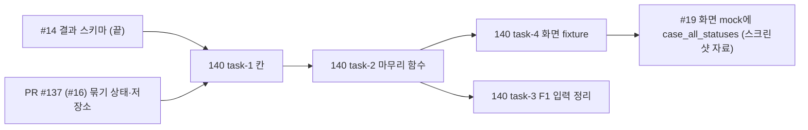
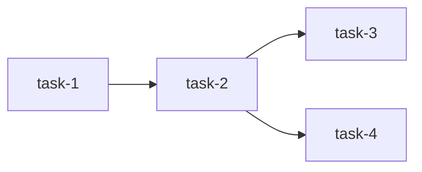

# F5 tasks (구현 계획 + 진행)

<!-- design.md를 바탕으로 쓴 구현 계획이다. 이슈 계획 하나 = 이슈 하나 = 브랜치 하나 = PR 하나.
     task마다 확인 방법(명령 한 줄 → 기대 결과). 네트워크·API 키 없이 돈다. 진행 칸은 Claude가 task를 끝낼 때마다 고친다. -->

- 이름: 이터레이션 M1-i3에 F5 이슈가 둘이라 계획 제목을 `m1-i3-<이슈번호>`로 쓴다 (F1 tasks.md와 같은 방식).
- 끝난 F5 이슈: #14 결과 스키마·상태 규칙 (계획은 [F1 tasks.md](../F1/tasks.md)의 `m1-i2-14`). F5 합격 기준 1·2·3의 데이터 쪽 대부분이 여기서 들어갔다.
- 순서: 검토할 사항 칸(`m1-i3-140`)의 task-1이 인터페이스라 먼저. 화면 부품은 #19 PR #151(머지됨)에 있고(`m1-i3-19`는 대체됨), 화면 mock fixture는 `scripts/web_fixtures.py`가 `build_case_materials`·`collect_review_items`를 불러 만들고 `tests/web/test_web_fixtures.py`가 커밋된 `web/src/api/fixtures/c_*.json`과 비교한다. 그래서 ⑥ 모양이나 경로가 바뀌는 **task마다** 그 커밋 안에서 fixture·생성 타입을 다시 뽑는다 (#140 PR 안에서 빨간 커밋이 남지 않게).
- 다른 이슈와 겹치는 파일: PR #137(#16)이 `CaseDocument.status`(필수), `case_grouping.py`의 `build_case_materials`, `case_missing_citation` fixture를 고친다. `m1-i3-140`는 **#137 머지 뒤 최신 main에서** 시작한다 (task-1·2·3 모두 같은 파일).

## m1-i3-140  (11/20~11/21)  상태: 초안  (이슈 [#140](https://github.com/merge-mates/patent-ai-workspace/issues/140))
**구현할 design 부분**: design.md 2절(마무리 함수, 문서 줄, 묶기 규칙), 3-2절(⑥ `review_items`, `CaseDocument.text_status`, 마무리 안 한 ⑥ 저장 거부, 보류 작업 이름 규칙)   **맡은 합격 기준**: requirements.md 3 (검토할 사항 한곳, N = 줄 수, 전파 줄 묶기, 올리면 줄·보류가 사라짐), 근거 절 (원인 줄)
**목표** (한 줄): 검토할 사항 목록을 ⑥ `CaseMaterials`에 담아, 화면이 개수만이 아니라 줄을 받게 한다.
**끝나면 보여 줄 것** (데모 한 줄): `uv run pytest -q` 통과 + `case_missing_citation`·`case_scanned`의 ⑥에 `review_items` 줄이 있고 `review_items_count`와 같다.

### task-1: ⑥ 칸 (`review_items`·`text_status`), 개수 검사, 마무리 안 한 ⑥ 저장 거부
- 담당: 은진
- 합격 기준: requirements.md 3 (N = 목록 줄 수 = `review_items_count`), 실패할 때 (0건으로 조용히 보이지 않음)
- 고칠 파일: `src/patent_ai/core/schemas/case_materials.py`, `src/patent_ai/core/schemas/propagation.py`, `src/patent_ai/core/f1_oa_reader/case_grouping.py`, `src/patent_ai/core/f1_oa_reader/case_repository.py`, `tests/core/schemas/test_propagation.py`, `tests/core/schemas/test_fixtures.py`, `tests/core/schemas/test_oa_result.py`, `tests/core/f1/test_case_grouping.py`, `tests/core/f1/test_case_repository.py`, `tests/fixtures/case_missing_citation/case_materials.json`, `scripts/web_fixtures.py`, `web/src/api/fixtures/c_*.json`(`cd web && npm run gen:fixtures`로 다시 뽑음), `web/src/types/generated/CaseMaterials.ts`(`npm run gen:types`) (새 칸 `review_items`·`text_status`), `docs/data-model.md` 4절 ⑥ 줄
- 만들 함수·인터페이스 모양: `ReviewItem{kind, target, label, reason}`과 `ReviewKind`(Literal)를 `case_materials.py`로 옮기고(`propagation.py`가 `case_materials`를 import하므로 거꾸로 두면 순환), `propagation.py`는 둘 다 그대로 다시 내보낸다(`test_fixtures.py`가 `propagation`에서 import함). `CaseMaterials.review_items: list[ReviewItem] | None = None` + 검사(목록이 있으면 `review_items_count == len(review_items)`). `CaseDocument.text_status: Status | None = None`. `build_case_materials`는 이 task에서 임시로 `review_items = collect_review_items([oa], materials)`와 그 길이를 같이 넣는다 (OA 전부를 받는 것은 task-3)(`model_copy`가 아니라 새로 만들어 검사를 거침, 지금 개수에 더하던 unsettled는 task-2의 문서 줄이 대신할 때까지 그대로 개수·줄 둘 다에서 뺌을 테스트에 적음). 검사는 `review_items is None`이면 `review_items_count == 0`도 같이 본다. 저장 거부는 메모리·Postgres 저장소가 둘 다 지나는 `plan_case_rows`(#137 `case_repository.py`)에 둔다: `review_items is None`이면 `ValueError`, 저장 전에 `CaseMaterials.model_validate(m.model_dump())`로 다시 검사.
- 테스트할 경우: 평소(줄 2 + 개수 2 → 통과, `case_missing_citation` 저장·다시 읽기) / 빈 입력(줄 0 + 개수 0 → 통과) / 실패(줄 2 + 개수 3 → `ValidationError`, `review_items=None` + 개수 2 → `ValidationError`, `review_items=None` 저장 → `ValueError`, `test_oa_result.py`의 `CaseMaterials(review_items_count=2)`는 목록을 같이 넣게 고침)
- 확인 방법: `uv run pytest -q` → 모두 통과 (`tests/web`의 화면 fixture 비교까지)
- 먼저: PR #137 머지 (같은 파일. 공유 스키마 변경이라 이 task만 먼저 상대 리뷰를 받아도 된다)

### task-2: F5 마무리 함수 `finalize_case_materials` (모으기 + 문서 줄 + 묶기 + 개수)
- 담당: 은진
- 합격 기준: requirements.md 3 (전파 줄 묶기, 종류 순서, 결과 0개여도 빠진 자료 줄), 근거 절 (원인 줄)
- 고칠 파일: `src/patent_ai/core/schemas/propagation.py`, `src/patent_ai/core/f1_oa_reader/case_grouping.py`, `tests/core/schemas/test_propagation.py`, `tests/core/f1/test_case_grouping.py`, `tests/core/f1/test_claim_rows.py`(309·361줄 `oa_result[0]` 기대값 → `oa_result[<oa_id>]`), `scripts/web_fixtures.py`, `web/src/api/fixtures/c_*.json`(`cd web && npm run gen:fixtures`로 다시 뽑음), `web/src/types/generated/CaseMaterials.ts`(`npm run gen:types`), `tests/fixtures/f5/case_scanned/` (새로: `oa_result.json`, `case_materials.json`)
- 만들 함수·인터페이스 모양: `finalize_case_materials(results: list[ResultBase], materials: CaseMaterials) -> CaseMaterials` — ① `collect_review_items(results, materials)` ② 문서 줄: 원인마다 한 줄. 묶기 `status`가 `confirmed`가 아니면 한 줄, `text_status`가 있고 `confirmed`가 아니면 또 한 줄. 모양 `{kind: "unverified" | "conflict"(그 칸 값대로), target: "materials.documents[i]", label: "<kind> <document_id>", reason: <그 칸의 reason, conflict면 "값이 서로 충돌">}` (design.md 2절과 같은 label 규칙). `text_status`가 `unverified(body_missing)`이면 그 문서의 묶기 `unverified(not_extracted)` 줄은 내지 않는다 (글자가 없어 생긴 결과). `collect_review_items`의 OA 경로를 `oa_result[{i}]`에서 `oa_result[{oa.oa_id}]`로 바꾼다 (`propagation.py`, 기존 테스트 기대값도). ③ 묶기: 이유가 `input_unverified`인 필드 줄은 `target` 앞부분(`oa_result[<oa_id>]`, 첫 `.` 앞)으로 묶어 결과마다 한 줄(`reason = "앞 입력이 확인되지 않음: 칸 N개"`), 같은 `(target, kind, reason)`은 하나, 순서 빠진 자료 → 충돌 → 확인되지 않음 → 직접 판단 → 직접 검토 → 다시 확인 ④ `review_items`·`review_items_count`를 채운 새 ⑥ (입력은 바꾸지 않음). 예외는 삼키지 않는다. `build_case_materials`는 task-1의 임시 코드 대신 끝에서 `finalize_case_materials([oa], materials)`를 부른다 (unsettled도 이제 문서 줄로 셈. OA 전부로 넘기는 것은 task-3). `scripts/web_fixtures.py`는 `collect_review_items`를 따로 부르지 않고 ⑥의 `review_items`를 쓴다.
- 테스트할 경우: 평소(`case_scanned`: 문서 원인 줄 1(`body_missing`, 묶기 `not_extracted` 줄 없음) + `oa_result[oa_1]` 묶은 줄 1, `case_missing_citation`: 빠진 자료 줄 1 + 그 밖 줄) / 빈 입력(결과 0 + 빠진 자료 1 → 그 줄 1 + 경고) / 경계(다른 출원번호 문서 `conflict` → 문서 줄 1, 다른 출원번호 + 스캔본 → 줄 2(`conflict`·`body_missing`, 원인이 달라 둘 다 남음), 종류 섞임 → 정한 순서, 같은 열쇠 두 번 → 하나)
- 확인 방법: `uv run pytest -q` → 모두 통과 (`tests/web`의 화면 fixture 비교까지)
- 먼저: task-1

### task-3: F1 쪽 `build_case_materials` 입력 정리 (사건의 OA 전부, 글자 추출 상태, 보류 작업 이름)
- 담당: 은진 (#16·#137도 은진, 같은 파일이라 #137 머지 뒤, 리뷰는 재아)
- 합격 기준: requirements.md 3 (빠진 자료마다 한 줄, 기대는 작업만 보류, 올리면 줄·보류가 사라짐)
- 고칠 파일: `src/patent_ai/core/f1_oa_reader/case_grouping.py`, `tests/core/f1/test_case_grouping.py`, `tests/core/schemas/test_fixtures.py`, `tests/fixtures/case_missing_citation/case_materials.json`, `scripts/web_fixtures.py`, `web/src/api/fixtures/c_*.json`(`cd web && npm run gen:fixtures`로 다시 뽑음), `web/src/types/generated/CaseMaterials.ts`(`npm run gen:types`) (`build_case_materials(…, oas, …)` 인자 바뀜)
- 만들 함수·인터페이스 모양: `build_case_materials(case_id, grouped, oas: list[OAResult], received_citations, lookup_failures=None, text_status: dict[str, Status] | None = None) -> CaseMaterials` — `oa` 하나 대신 사건의 OA 전부(올라온 순서)를 받아 OA마다 빠진 자료·보류를 만들고 끝에서 `finalize_case_materials(oas, materials)` (⑥은 사건마다 한 줄이라 앞 OA 줄이 사라지지 않게). 부르는 쪽(#137 저장소 테스트)도 같이 고친다. 문서마다 `status = g.status`(#137 그대로), `text_status = text_status.get(document_id)`(없으면 `None`, 합치지 않음). 보류 작업 이름 `f3_compare:<oa.oa_id>:<c.label>` (design.md 3-2절). `what`·`waiting_for`는 지금 꼴(`_citation_name` + " 본문", 예 "D2 US20990000001A1 본문") 그대로.
- 테스트할 경우: 평소(`case_missing_citation` → `held_tasks` = `f3_compare:oa_1:D2`, `waiting_for` = "D2 US20990000001A1 본문") / 빈 입력(인용문헌 0건 → 경고 + 빠진 자료 0) / 경계(지원 안 하는 나라 → `ask_upload=false`, 스캔본 `text_status` → 문서 `text_status = body_missing`이고 `status`는 묶기 값 그대로, 빠진 문헌을 `received_citations`에 더해 다시 부름 → 빠진 자료·보류 0, OA 둘인 사건 → 두 OA의 빠진 자료·보류와 `oa_result[oa_1]`·`oa_result[oa_2]` 줄이 다 있음)
- 확인 방법: `uv run pytest -q` → 모두 통과 (`tests/web`의 화면 fixture 비교까지)
- 먼저: task-2 (같은 파일)

### task-4: 화면용 네 값 fixture
- 담당: 은진
- 합격 기준: requirements.md 1·2 화면 줄 (스크린샷 기준 자료)
- 고칠 파일: `tests/fixtures/f5/case_all_statuses/oa_result.json`, `tests/fixtures/f5/case_all_statuses/case_materials.json`, `tests/core/schemas/test_fixtures.py`, `scripts/web_fixtures.py`, `web/src/api/fixtures/`(새 사건 json, `npm run gen:fixtures`)
- 만들 함수·인터페이스 모양: 지어낸 사건 하나 (폴더 이름은 `case_all_statuses`로 고정. 칸마다 null만 있지 않게 네 status 값·reason·checked·searched_scope·candidates가 다 들어 있어야 함). 화면 mock에도 넣는다: `scripts/web_fixtures.py`에 이 사건을 하나 더하고 `npm run gen:fixtures` (requirements 1·2 스크린샷 자료가 여기서 나옴). `confirmed` 출원번호, `unverified(not_extracted)` 제출기일, `not_found_in_scope` 값 하나, `conflict` 발송번호(후보 둘), `needs_human_review` 거절이유 1(42-3), 날짜 칸, 빠진 자료 1. ⑥은 `finalize_case_materials`로 만든 값.
- 테스트할 경우: 평소(두 파일이 스키마 검사 통과) / 빈 입력(해당 없음) / 실패(fixture의 `review_items`가 `finalize_case_materials`로 다시 만든 값과 다르면 실패)
- 확인 방법: `uv run pytest -q` → 모두 통과 (`tests/web`의 화면 fixture 비교까지)
- 먼저: task-2

### 이번에 안 하는 것
- 지휘가 F2~F4 결과까지 모아 `finalize_case_materials`를 다시 부르는 연결과, 그 실패 때 `failed` (#104 지휘 단계 기록·저장, #16 자료 올리기). M1의 F1 경로는 `build_case_materials`가 끝에서 부르므로 빈 목록이 저장되지 않는다.
- "다시 확인 필요" 달기 (M1에 대상 결과 없음, F3 설계에서).
- 검토할 사항 새 엔드포인트 (⑥ 안에 담음, design.md 8절).
- F4 사람 선택 줄 "고르기" (#43).
- 문서(F1 requirements·architecture·product)의 "F3 대비" 글: 사람 말이라 그대로 둔다.

### 진행
- [x] task-1
- [ ] task-2
- [ ] task-3
- [ ] task-4
- 다음: task-2
- 막힌 것: 없음 (PR #137 머지됨)

### 끝난 뒤 (이슈가 끝난 날)
- 된 것 / 안 된 것 / 다음 이슈로

## m1-i3-19  상태: 대체됨  (이슈 [#19](https://github.com/merge-mates/patent-ai-workspace/issues/19)의 F5 부분)
- 11/20: 상태 표시·사람 판단 표시·검토할 사항 패널 부품(`StatusTag`·`HumanCheckTag`·`ReviewPanel`·`labels.ts`)은 재아가 #19 사건 화면 PR #151에서 먼저 만들었다. 대응 방향 꼬리표(`AI 기본값`·`사람이 고름`·`사람이 고침 N곳`)는 PR #153. 그래서 이 계획(따로 부품·미리보기 만들기)은 하지 않고, design.md 6절을 그 화면 글자·모양에 맞췄다 (PR #151·#153 리뷰에서 약속).
- 화면에 남은 F5 일 (#19 몫, 이슈 #19 본문에도 같은 목록): ① 보류 작업 글을 `task` 코드 이름 대신 `waiting_for` + 작업 종류 한국어로 (#140 뒤) ② 검토할 사항 줄을 누르면 `target`(`oa_result[<oa_id>]…`)의 카드로 이동 ③ #140 뒤 ⑥의 `review_items`를 읽고, `None`이면 개수와 상관없이 "검토할 사항 (모름)" (지금 `ReviewPanel`은 목록이 없으면 `review_items_count`를 써서 None·개수 0이면 "0건"이 뜸) ④ 패널의 빠진 자료 줄에 "올려 주세요"와 보류 줄 (지금은 `MaterialsCard`에만 있음). "원문" 링크는 확인된 값만, 그 밖은 "후보 위치"는 PR #151에서 이미 됨.
- 금지 낱말 검사 명령: `! grep -rnE "적용된다|등록 가능|적법|거절 해소" web/src` (M1 고정 글자만, design.md 9절).
