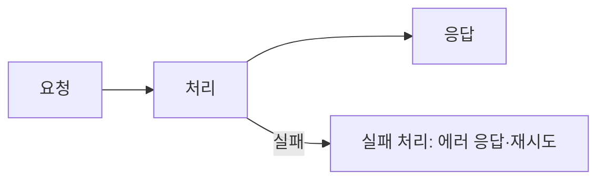

# <기능> 세부 설계
<!-- 모르는 곳은 [확인 필요: 무엇]으로 남긴다. [가정]은 모르지만 일단 정한 것, [확인 필요]는 아직 못 정한 것. -->

## 1. 합격 기준 ↔ 설계
| 기준 | 설계의 어디가 만족시키나 |
|---|---|

## 2. 흐름
<!-- 아래 단계와 같게 그린다. 실패 갈래는 하나만 그려도 된다 -->

1. 요청: 
2. 처리: 
3. 응답: 
- 실패하면: 
- 비면: 
- 느리면: 

## 3. 데이터 모양
```json
```
인터페이스 변경: 있음/없음 (AI 모듈 입력·출력, API)

## 4. 화면 (시연용)
- 시연 흐름 한 줄:
- 와이어프레임 (손그림 사진이나 ASCII):

## 5. AI
### 5-1. 공통 칸 (비교 실험이면 둘이 같이 정함, 구현 전에 확정)
- 인터페이스 (입력·출력 형식, API 계약): 
- 평가 세트·지표: goldsets/tune v<버전>, 지표 <이름> ≥ <문턱>
- 데이터: 
- 채점 스크립트: `eval/run_eval.py --config ...`
- 비용 상한(1회 채점): 

### 5-2. 각자 칸 (비교 실험이면 사람마다 한 단락, 아니면 하나)
- <사람>: 방식 한 단락 (모델, 프롬프트, 알고리즘 등) → `experiments/<실험>/`
- 모델 호출: 어디서, 몇 번, 대략 비용
- 프롬프트 파일: 
- 실험 설정(config): `config/<기능>.yaml`의 

## 6. 이 기능 안의 결정
| 고른 것 | 버린 것 | 이유 | 계기 (설계 / 구현 중 문제) | 근거 (실험 폴더, troubleshooting) |
|---|---|---|---|---|
<!-- 되돌리기 어렵고 + 이유를 모르면 이상해 보이고 + 진짜 선택지가 있었으면 docs/decisions/에 ADR로. 아니면 여기에. 팀원도 겪을 문제면 docs/troubleshooting/에 한 장 -->

## 7. 테스트 방법
- 어디서 테스트하나: 가장 바깥 경계 한 곳 (예: AI 모듈 입력 → 출력)
- 가짜 응답 / 녹화 응답: 
