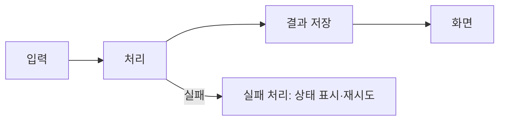

# <기능> 세부 설계
<!-- 모르는 곳은 [확인 필요: 무엇]으로 남긴다. [가정]은 모르지만 일단 정한 것, [확인 필요]는 아직 못 정한 것.
     안 맞는 칸은 지우지 말고 `해당 없음` 한 줄. requirements.md에 쓴 것(무엇, 합격 기준, 사람이 고르는 곳)은 다시 쓰지 않고 번호로 가리킨다. -->

## 1. 합격 기준 ↔ 설계
| 기준 (requirements 번호) | 설계의 어디가 만족시키나 |
|---|---|

## 2. 흐름
<!-- 아래 단계와 같게 그린다. 실패 갈래는 하나만 그려도 된다 -->

1. 입력: 
2. 처리: 
3. 결과 저장: 
- 실패하면 / 비면 / 느리면: 

### 2-1. 흐름 방식
- 코드 흐름 / 에이전트 루프 중 무엇인가, 왜: 
- 루프면: 쓰는 도구 목록(도구마다 입력·출력·실패 시 돌려주는 것), 멈추는 조건, 최대 단계 수(설정 파일 키 이름). 경계는 [ADR 0003](../../decisions/0003-tech-stack.md)
- 단계 기록: 루프의 각 단계를 어디에 남기나 (예: `agent_steps` 테이블)

## 3. 데이터 모양
### 3-1. 앞 기능에서 받는 것
- 어느 기능의 어느 결과인가 ([data-model.md](../../data-model.md) 4절 결과 스키마): 
- 받은 결과가 "확인되지 않음"·"충돌"이면 이 기능은 무엇을 하나: 

### 3-2. 다음 기능에 주는 것
```json
```
- 공통 속성(`status`·`evidence`·`origin`)은 [data-model.md](../../data-model.md) 3절 그대로. 이 기능에서 더하는 칸만: 
- 앞 기능 결과가 바뀌면 이 결과를 "다시 확인 필요"로 표시하나: 
- 인터페이스 변경: 있음/없음 (AI 모듈 입력·출력, API). 있으면 받는 기능 쪽에 알림

## 4. 판과 근거
- 쓰는 청구항 판: requirements의 필요한 판을 어느 보정서 기준으로 어떻게 고르나
- 쓰는 법령·심사기준 판: 어느 기준일인가 (통지서 날짜 기준 등)
- 근거 위치 적는 법: 문서 ID + 쪽·문단·조문 번호 등, 화면에서 원문 어디로 이어지나

## 5. 저장
- 읽는 테이블 / 쓰는 테이블 (예: `documents`, `claim_versions`, `oa_results`, `runs`, `result_inputs`. [data-model.md](../../data-model.md) 5절): 
- 검색을 쓰면: 키워드(BM25) / 벡터 / 둘 다, 어느 인덱스
- 외부 API에서 받는 자료: 먼저 저장하고 쓰나(`api_cache`), 판 표시는 어떻게 하나
- 외부 모델로 보내는 자료: [architecture.md](../../architecture.md) 7절 표 기준 보내도 되는지

## 6. 화면 (시연용)
- 시연 흐름 한 줄: 
- 와이어프레임 (손그림 사진이나 ASCII): 

## 7. AI
### 7-1. 공통 칸 (비교 실험이면 둘이 같이 정함, 구현 전에 확정)
- 인터페이스 (입력·출력 형식, API 계약): 
- 평가 세트·지표: `data/goldsets/tune/` v<버전> (git 밖), 지표 <이름> ≥ <문턱> (문턱을 모르면 [확인 필요: 기준선 측정 뒤])
- 데이터: 
- 채점 스크립트: `eval/run_eval.py --config ...` (프레임워크를 정한 뒤 생김)
- 실행 상한(비용·시간): 설정 파일의 키 이름만 적는다. 값은 실제 실행 뒤 정한다
- 결과에 남길 것: 모델 이름, 프롬프트 판, 설정 파일 판 (점수를 다시 낼 수 있게)

### 7-2. 각자 칸 (둘이 각자 구현하면 사람마다 한 단락, 아니면 하나)
- <사람>: 방식 한 단락 (모델, 프롬프트, 알고리즘 등) → `experiments/<실험>/`
- 모델 호출: 어디서, 몇 번
- 프롬프트 파일: 
- 실험 설정(config): `config/<기능>.yaml`의 

## 8. 이 기능 안의 결정
| 고른 것 | 버린 것 | 이유 | 계기 (설계 / 구현 중 문제) | 근거 (실험 폴더, troubleshooting) |
|---|---|---|---|---|
<!-- 되돌리기 어렵고 + 이유를 모르면 이상해 보이고 + 진짜 선택지가 있었으면 docs/decisions/에 ADR로. 아니면 여기에. 팀원도 겪을 문제면 docs/troubleshooting/에 한 장 -->

## 9. 테스트 방법
- 어디서 테스트하나: 가장 바깥 경계 한 곳 (예: AI 모듈 입력 → 출력)
- 가짜 응답 / 녹화 응답: 
- 이 기능이 내는 상태마다 나오는 경우를 하나씩 (예시 파일 `tests/fixtures/<기능>/…`)
