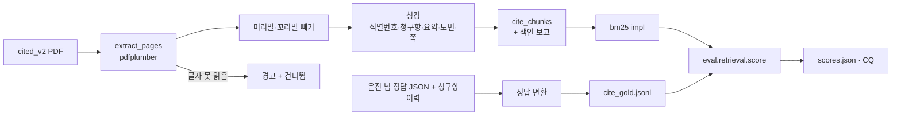

# 인용문헌 문단 검색 기준선 세부 설계 (이슈 #67)
<!-- 계약(../retrieval/design.md)을 고치지 않고 그 위에 청킹·색인·정답 변환·bm25 impl만 더한다.
     11/19 /interview 결과. 답 원본은 재아 노트 f67_interview_answers_1119.md (git 밖). -->

## 1. 합격 기준 ↔ 설계
| 기준 (requirements) | 설계의 어디가 |
|---|---|
| 1 두 번 같음 | 2절 처리 순서 고정(파일 이름 정렬, 쪽·줄 순서), 5절 조각 ID 규칙, bm25s 결과 같은 점수는 계약대로 `chunk_id` 오름차순 |
| 2 위치 | 3-2 조각 종류 표 |
| 3 머리말·꼬리말 | 2절 2단계, 색인 보고 `removed_lines` |
| 4 정답 변환 | 3-1 |
| 5 Hit@k | 7절, 계약 채점기 그대로 |
| 6 CQ | 계약 채점기 `cq.py` (0건 경고는 계약에 있음) |
| 7 테스트 | 9절 |

## 2. 흐름

1. 글자 추출: `extract_pages(pdf_path) -> list[PageText]`(쪽 번호, 줄 목록) 인터페이스 뒤에 pdfplumber 구현 하나. 이슈 #17(F1 `extract_pages`)과 같은 도구라 바꿀 때 한 번에 바꾼다. #17 코드가 머지되기 전이라 #67 안에 두고, #17이 머지되면 합칠지 그때 본다 [확인 필요: #17 머지 뒤].
2. 머리말·꼬리말 빼기: 쪽마다 맨 위 `header_footer.scan_lines`줄·맨 아래 같은 수의 줄에서, 숫자를 `#`로 바꾼 글자가 그 문헌 쪽의 `header_footer.min_page_ratio` 이상에서 되풀이되면 뺀다(공보 번호, 쪽 번호 `- 3 -` 등). 본문 줄은 쪽마다 글자가 달라 안 빠진다. 문헌별 뺀 줄 수를 색인 보고에 남긴다.
3. 청킹: 머리말을 뺀 줄을 쪽 순서대로 이은 뒤 나눈다 (쪽을 넘어가는 문단은 이어 붙는다). 3-2 표.
4. 색인: 조각을 `cite_chunks`에 쓴다(계약 `chunk_to_row`). 같은 판을 다시 쓰면 그 판을 지우고 다시 넣는다. 색인 보고(git 밖 `work/cite_search/<index_version>/index_report.json`): 문헌별 쪽 수, 조각 종류별 수, 뺀 줄 수, 건너뛴 문헌과 이유.
- 실패하면 / 비면: 문헌 단위로 건너뛰고 경고. 색인 전체가 0 조각이면 실패로 끝낸다.

### 2-1. 흐름 방식
- 코드 흐름 (색인·채점 스크립트). 에이전트 루프 아님.

## 3. 데이터 모양
### 3-1. 정답 변환 (은진 님 JSON → 계약 정답 파일 `cite_gold.jsonl`)
- 위치: `eval/retrieval/convert_cite_gold.py` (정답은 채점기 쪽만 읽는다). 출력 `data/goldsets/tune/retrieval/cite_gold.jsonl` (#66 법령 정답과 경로를 나눔), 내용이 바뀌었을 때만 `data/goldsets/VERSION` 올림.
- 한 줄 = 거절이유 × 청구항 하나 × 인용문헌 하나. `row_id` = `<발송번호>:r<순번>:c<청구항>:<doc_id>`.
- 청구항 키 범위(`"3-4"`, `"5-7"`)는 청구항마다 줄로 펼치고 항목을 복사한다.
- 항목: 식별번호 → `paragraph`(범위 `"0022-0025"`는 start·end 하나), 도면 → `figure`, 인용문헌_청구항 → `claim`, 기타 `"요약"` → `abstract`, 논문 기타 `"N쪽 …"` → `page` N (절·줄은 버림). 그 밖 기타 글자는 버린다.
- 빼는 줄: 같은이유(`"10": "1"`) → `exclude="same_as_other"`, 위치 항목이 하나도 없음(예 "단순 부가, 인용 위치 없음") → `no_location`. 42조(명확성) 거절이유는 인용문헌이 없어 cite 줄을 만들지 않는다.
- 질의: `cases/<출원번호>/<출원번호>_청구항이력.txt`에서 OA 당시 판의 그 청구항 전문. OA 당시 판 = `행정이력.txt` 줄 순서로 OA 발송번호 앞에 있는 접수번호의 청구항 변경(신규·수정·삭제)만 차례로 적용한 것 (날짜로 자르지 않음). 11/19 tune 8건은 모두 첫 보정이 OA 뒤라 출원서 판이 된다.
- 변환이 읽는 사건 파일은 `청구항이력.txt`·`행정이력.txt` 둘뿐이다. 등록공보·공개공보·결정서·결정본문·의견서·보정서는 채점 확인용이거나 OA 뒤 자료라 읽지 않는다 (은진 님, 11/19).
- 파일이 없거나 판·청구항을 못 찾으면 그 줄을 쓰지 않고 경고 + 건수 (계약 `exclude` 값에 없는 이유라 줄을 빼고 변환 보고에 남김). 11/19 기준 8건 모두 있음.
- 변환 뒤 `load_gold`와 `find_leaks`로 검사한다. 누출(질의에 `[0023]`·`도 3`)이 나오면 변환을 멈춘다.
- 변환 보고(git 밖 `work/cite_search/gold_convert_report.json`): 줄 수, 펼친 수, 빼는 이유별 수, 질의 없음 사건·줄 수.

### 3-2. 조각 (계약 `Chunk`, `edition.status = not_applicable`)
| 원문 | `chunk_kind` | `location.kind` | 위치 키 | 비고 |
|---|---|---|---|---|
| 한국 공보 식별번호 `【0023】`·`[0023]` 하나 | `body` | `paragraph` (start=end=23) | `p0023` | 본문에 `도 N`·`도면 N`이 있으면 `figures`에 |
| 청구항 하나 | `claim` | `claim` | `claim1` | `claims=[1]` |
| 요약 | `abstract` | `abstract` | `abs` | 대표도가 적혀 있으면 `figures` |
| 도면의 간단한 설명 중 도면 하나 | `figure_desc` | `figure` | `fig3` | `figures=[3]` |
| 논문 쪽 하나 (학회판만) | `body` | `page` (start=end=쪽) | `pg4` | |
- 글자층에 식별번호가 하나도 없는 한국 공보(11/19 tune에 2007년 공개공보 1건): 청구항·요약·도면 설명 조각만 만들고 본문은 조각으로 만들지 않는다. 번호를 지어내지 않는다. 경고 "식별번호 없음: 본문 조각 안 만듦"과 색인 보고에 남긴다 (재아 11/19). 그 문헌의 식별번호 정답 항목은 못 맞힘으로 남아 CQ에 보인다.
- 문맥(발명의 명칭·소제목)은 붙이지 않는다.
- 미국·그 밖 나라 공보: "지원 안 함" 경고로 건너뜀.

### 3-3. 다음 기능에 주는 것
- 계약 `SearchResult` 그대로. 인터페이스 변경 없음.

## 4. 판과 근거
- 청구항 판: OA 당시 청구항 (3-1 질의).
- 법령 판: 해당 없음.
- 근거 위치: `doc_id` + 위치 키.

## 5. 저장
- 쓰는 테이블: `cite_chunks` (색인 스크립트). 읽는 테이블: 같은 것 (bm25 impl, 채점기).
- 색인 판: `cite-idx-v1`. 조각 ID `<index_version>:<doc_id>:<위치 키>` (계약).
- `doc_id`: 한국은 [f1-oa-gold.md](../../evaluation/f1-oa-gold.md) 2.3 키 꼴(`KR20XX0000000A`, `KR10XXXXXXXB1`). 정답 파일·PDF 파일 이름이 이미 이 꼴이다. 논문은 2.3 꼴(`NPL: …`)에 `:`·공백이 있어 `row_id`·`chunk_id` 규칙과 부딪히므로 `NPL-<제목 줄임>-<학회 연도>`(구분자 `-`, 공백·`:` 없음)로 쓴다. 정답 표기 → `doc_id` 표는 채점기 쪽 `data/goldsets/tune/retrieval/cite_doc_ids.yaml`, PDF 파일 이름 → `doc_id` 표는 앱 쪽 `data/processed/cite_search/file_doc_ids.yaml`에 따로 둔다. 앱 코드가 정답에서 나온 내용을 읽지 않게, 그리고 tune 인용문헌 목록이 git에 들어가지 않게 둘 다 git 밖이다 (설정 파일에는 경로만). 한국 공보는 표기가 곧 `doc_id`라 표에는 논문 한 줄씩만 있다.
- 검색: 키워드(BM25). 벡터는 다음 PR.
- 외부 API·모델: 없음.

## 6. 화면
- 해당 없음.

## 7. AI
### 7-1. 공통 칸
- 인터페이스: 계약 `get_searcher("bm25", repo, settings)`. 계약 코드는 안 고친다.
- 평가 세트·지표: `data/goldsets/tune/retrieval/cite_gold.jsonl` (VERSION은 변환 때), 계약 지표 Hit@k·Recall@k(k = 1, 3, 5, 10)와 무작위 기준선 대비 배수. 문턱 [확인 필요: 기준선 측정 뒤].
- 채점: `uv run python -m eval.retrieval.score --config experiments/<실험>/config.yaml` (`--chunks` 없이 Postgres 색인).
- 결과에 남길 것: 토크나이저 이름·판, bm25s 판·방식·k1·b, 색인 판.

### 7-2. 구현 (재아)
- 토크나이저: Kiwi(`kiwipiepy`) 형태소 분석 → 체언·용언 어간·외국어·숫자 태그만 토큰. 태그 목록은 설정 파일.
- 점수: `bm25s`. IDF는 질의의 `doc_ids` 문헌 조각들로 센다(검색 범위 = 그 인용문헌 안). 문헌마다 색인을 검색 때 만든다 (문헌당 조각 수백 개 아래라 작음, 판단).
- 모델 호출: 없음.
- 실험 설정: `experiments/<실험>/config.yaml`의 `settings:`(tokenizer, bm25 방식·k1·b). 색인 설정은 `config/cite_search.yaml`(머리말 줄 수·비율, 조각 규칙, doc_id 표).

## 8. 이 기능 안의 결정
| 고른 것 | 버린 것 | 이유 | 계기 | 근거 |
|---|---|---|---|---|
| BM25만 이번 PR | BM25 + 벡터 2개 | 벡터는 #66 `embed()` 뒤. 16:30 기준선 숫자 | 11/19 재아 | 노트 answers 1119 |
| pdfplumber, 인터페이스 뒤 | Upstage 등 | #17과 같은 도구 | 11/19 재아 | #17 design |
| Kiwi + bm25s | 글자 2-gram, Mecab-ko, Postgres tsvector | pip 하나, 맥 둘 같음. tsvector는 ADR 0003에서 뺌. 결과(CQ) 보고 바꿈 | 11/19 재아 | kiwipiepy PyPI·bm25s GitHub (오픈소스) |
| 식별번호 하나 = 조각 하나 | 고정 길이 창 | OA가 식별번호를 짚음 | 인터뷰 C-1 | |
| 논문은 학회판만, 쪽 단위 | 두 판 다 / 논문 뺌 | OA가 학회판 쪽 범위를 짚음 | 11/19 재아 | |
| 질의는 청구항이력의 OA 당시 판만, 없으면 줄을 빼고 경고·건수 | 출원서·공보 청구항으로 대신 | 계약 "OA 당시 청구항 전문", 판 섞지 않음. 등록공보·결정서는 채점 확인용 | 11/19 재아·은진 | |
| 식별번호 없는 공보는 청구항·요약·도면 조각만 | 본문을 쪽 단위로도 / 문헌 통째로 뺌 | 번호를 지어내지 않고, 청구항·도면 정답은 맞힐 수 있게 | 구현 중 진짜 PDF 확인 (11/19 재아) | |
| tune 8건 전부 채점 | 청구항이력 있는 4건만 | 11/19 나머지 4건 사건 폴더가 들어옴 | 11/19 재아 (처음엔 4건만으로 정했다가 바꿈) | |
| 논문 `doc_id` `NPL-<제목 줄임>-<학회 연도>` | f1-oa-gold 2.3 `NPL: …` | `row_id`·`chunk_id`가 `:`로 칸을 나눔 | 설계 중 | 계약 gold.py `row_id` 정규식 |

## 9. 테스트 방법
- 경계: `extract_pages` 뒤(줄 목록 → 조각)와 정답 변환(JSON → gold 줄), bm25 impl(메모리 저장소 → `SearchResult`).
- PDF 글자 추출은 지어낸 작은 PDF 하나(테스트가 만들거나 fixture)로 한 번만. 나머지는 줄 목록 fixture.
- 경우: 지어낸 3쪽 공보에서 머리말·쪽 번호가 빠지고 본문 줄은 남음 / 쪽을 넘는 문단이 이어짐 / 청구항·요약·도면 설명 조각 / 미국 문헌 건너뜀 경고 / 식별번호 0개 경고 / 정답 범위 펼치기·같은이유·위치 없음·질의 없음 / 두 번 색인 같음 / bm25 같은 점수 순서.
- Postgres 쓰기는 `@pytest.mark.db`.
