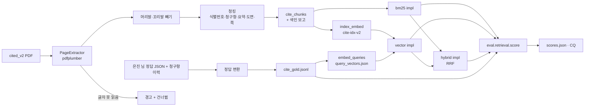

# 인용문헌 문단 검색 기준선 세부 설계 (이슈 #67)
<!-- 계약(../retrieval/design.md)을 고치지 않고 그 위에 청킹·색인·정답 변환·bm25 impl만 더한다.
     11/19 /interview 결과. 답 원본은 재아 노트 f67_interview_answers_1119.md (git 밖).
     11/20 /interview: 벡터(cite-idx-v2, text-embedding-3-small)·하이브리드(RRF)를 더함. 계약은 래퍼의 hybrid 막는 줄만 푼다. -->

## 1. 합격 기준 ↔ 설계
| 기준 (requirements) | 설계의 어디가 |
|---|---|
| 1 두 번 같음 | 2절 처리 순서 고정(파일 이름 정렬, 쪽·줄 순서), 5절 조각 ID 규칙, bm25s 결과 같은 점수는 계약대로 `chunk_id` 오름차순 |
| 2 위치 | 3-2 조각 종류 표 |
| 3 머리말·꼬리말 | 2절 2단계, 색인 보고 `removed_lines` |
| 4 정답 변환 | 3-1 |
| 5 Hit@k | 7절, 계약 채점기 그대로 |
| 6 CQ | 계약 채점기 `cq.py` (0건 경고는 계약에 있음) |
| 7 테스트 | 9절 |
| 8 벡터 Hit@k | 7-3, 계약 채점기 그대로 (`--chunks` 없이 `cite-idx-v2`) |
| 9 하이브리드 Hit@k | 7-4 |
| 10 세 방식 표 | 7-5 비교 카드 (`score --rows-out` 줄별 결과 + `eval/retrieval/compare.py`) |
| 11 벡터 색인 | 7-3 색인 단계 (`core/index_embed`가 같은 글은 한 번만), 비용은 호출 기록 |
| 12 조용히 안 뺌 | `vector` impl이 이미 멈춤(벡터 없는 조각, 녹화에 없는 질의), 하이브리드도 그대로 올림 |

## 2. 흐름

1. 글자 추출: `PageExtractor` Protocol `extract(pdf_path) -> list[PageText]`(쪽 번호, 줄 목록) 뒤에 `PdfplumberExtractor` 하나. 이슈 #17(F1, PR #109로 main에 머지됨)의 `core/f1_oa_reader/pages.py` `extract_pages`와 같은 도구(pdfplumber)다. 다만 retrieval은 core를 import하지 않아(ADR 0003 부르는 방향) 따로 둔다. 이름이 같은 `PageText`도 모양이 다르다: 여기는 쪽 하나 `{page, lines}`, core는 문서 한 건 `{document_id, pages, status}`. 도구를 바꿀 때는 두 곳을 같이 바꾼다.
2. 머리말·꼬리말 빼기: 쪽마다 맨 위 `header_footer.scan_lines`줄·맨 아래 같은 수의 줄에서, 숫자를 `#`로 바꾼 글자가 그 문헌 쪽의 `header_footer.min_page_ratio` 이상에서 되풀이되면 뺀다(공보 번호, 쪽 번호 `- 3 -` 등). 본문 줄은 쪽마다 글자가 달라 안 빠진다. 문헌별 뺀 줄 수를 색인 보고에 남긴다.
3. 청킹: 머리말을 뺀 줄을 쪽 순서대로 이은 뒤 나눈다 (쪽을 넘어가는 문단은 이어 붙는다). 3-2 표.
4. 색인: 조각을 `cite_chunks`에 쓴다(계약 `chunk_to_row`). 같은 판을 다시 쓰면 그 판을 지우고 다시 넣는다. 색인 보고(git 밖 `work/cite_search/<index_version>/index_report.json`): 문헌별 쪽 수, 조각 종류별 수, 뺀 줄 수, 건너뛴 문헌과 이유.
- 실패하면 / 비면: 문헌 단위로 건너뛰고 경고. 색인 전체가 0 조각이면 실패로 끝낸다.

### 2-1. 흐름 방식
- 코드 흐름 (색인·채점 스크립트). 에이전트 루프 아님.

## 3. 데이터 모양
### 3-1. 정답 변환 (은진 님 JSON → 계약 정답 파일 `cite_gold.jsonl`)
- 위치: `eval/retrieval/convert_cite_gold.py` (정답은 채점기 쪽만 읽는다). 출력 `data/goldsets/tune/retrieval/cite_gold.jsonl` (#66 법령 정답과 경로를 나눔), 공용 `data/goldsets/VERSION`(F1·법령과 같이 씀)은 쓰지 않고, 내용이 바뀌면 "VERSION을 올려야 함" 경고만 낸다 (11/19 PR #117 리뷰, 은진 님). 정답 파일마다 판을 두는 일은 채점 계약 쪽 다음 이슈.
- 한 줄 = 거절이유 × 청구항 하나 × 인용문헌 하나. `row_id` = `<발송번호>:r<순번>:c<청구항>:<doc_id>`.
- 청구항 키 범위(`"3-4"`, `"5-7"`)는 청구항마다 줄로 펼치고 항목을 복사한다.
- 항목: 식별번호 → `paragraph`(범위 `"0022-0025"`는 start·end 하나), 도면 → `figure`, 인용문헌_청구항 → `claim`, 기타 `"요약"` → `abstract`, 논문 기타 `"N쪽 …"` → `page` N (절·줄은 버림). 그 밖 기타 글자는 버린다.
- 빼는 줄: 같은이유(`"10": "1"`) → `exclude="same_as_other"`, 위치 항목이 하나도 없음(예 "단순 부가, 인용 위치 없음") → `no_location`. 42조(명확성) 거절이유는 인용문헌이 없어 cite 줄을 만들지 않는다.
- 질의: `cases/<출원번호>/<출원번호>_청구항이력.txt`에서 OA 당시 판의 그 청구항 전문. OA 당시 판 = `행정이력.txt` 줄 순서로 OA 발송번호 앞에 있는 접수번호의 청구항 변경(신규·수정·삭제)만 차례로 적용한 것 (날짜로 자르지 않음). 11/19 tune 8건은 모두 첫 보정이 OA 뒤라 출원서 판이 된다.
- 변환이 읽는 사건 파일은 `청구항이력.txt`·`행정이력.txt` 둘뿐이다. 등록공보·공개공보·결정서·결정본문·의견서·보정서는 채점 확인용이거나 OA 뒤 자료라 읽지 않는다 (은진 님, 11/19).
- 파일이 없거나 판·청구항을 못 찾으면 그 줄을 쓰지 않고 경고 + 건수 (계약 `exclude` 값에 없는 이유라 줄을 빼고 변환 보고에 남김). 11/19 기준 8건 모두 있음.
- 변환 뒤 `load_gold`와 `find_leaks`로 검사한다. 누출(질의에 `[0023]`·`도 3`)이 나오면 변환을 멈춘다.
- 변환 보고(git 밖 `work/cite_search/gold_convert_report.json`): 줄 수, 펼친 수, 빼는 이유별 수, 질의 없음 사건·줄 수.

### 3-2. 조각 (계약 `Chunk`, `edition.status = not_applicable`)
| 원문 | `chunk_kind` | `location.kind` | 위치 키 | 비고 |
|---|---|---|---|---|
| 한국 공보 식별번호 `【0023】`·`[0023]` 하나 | `body` | `paragraph` (start=end=23) | `p0023` | 본문에 `도 N`·`도면 N`이 있으면 `figures`에 |
| 청구항 하나 | `claim` | `claim` | `claim1` | `claims=[1]` |
| 요약 | `abstract` | `abstract` | `abs` | 대표도가 적혀 있으면 `figures` |
| 도면의 간단한 설명 중 도면 하나 | `figure_desc` | `figure` | `fig3` | `figures=[3]` |
| 논문 쪽 하나 (학회판만) | `body` | `page` (start=end=쪽) | `pg4` | |
- 글자층에 식별번호가 하나도 없는 한국 공보(11/19 tune에 2007년 공개공보 1건): 청구항·요약·도면 설명 조각만 만들고 본문은 조각으로 만들지 않는다. 번호를 지어내지 않는다. 경고 "식별번호 없음: 본문 조각 안 만듦"과 색인 보고에 남긴다 (재아 11/19). 그 문헌의 식별번호 정답 항목은 못 맞힘으로 남아 CQ에 보인다.
- 문맥(발명의 명칭·소제목)은 붙이지 않는다.
- 미국·그 밖 나라 공보: "지원 안 함" 경고로 건너뜀.

### 3-3. 다음 기능에 주는 것
- 계약 `SearchResult` 그대로. 인터페이스 변경 없음.

## 4. 판과 근거
- 청구항 판: OA 당시 청구항 (3-1 질의).
- 법령 판: 해당 없음.
- 근거 위치: `doc_id` + 위치 키.

## 5. 저장
- 쓰는 테이블: `cite_chunks` (색인 스크립트). 읽는 테이블: 같은 것 (bm25 impl, 채점기).
- 색인 판: `cite-idx-v1`(BM25). `cite-idx-v2` = v1 조각 그대로 + `embedding`(text-embedding-3-small). 하이브리드는 v2 하나로 두 점수를 다 낸다 (BM25는 `embedding`을 안 봄). 조각 ID `<index_version>:<doc_id>:<위치 키>` (계약).
- `doc_id`: 한국은 [f1-oa-gold.md](../../evaluation/f1-oa-gold.md) 2.3 키 꼴(`KR20XX0000000A`, `KR10XXXXXXXB1`). 정답 파일·PDF 파일 이름이 이미 이 꼴이다. 논문은 2.3 꼴(`NPL: …`)에 `:`·공백이 있어 `row_id`·`chunk_id` 규칙과 부딪히므로 `NPL-<제목 줄임>-<학회 연도>`(구분자 `-`, 공백·`:` 없음)로 쓴다. 정답 표기 → `doc_id` 표는 채점기 쪽 `data/goldsets/tune/retrieval/cite_doc_ids.yaml`, PDF 파일 이름 → `doc_id` 표는 앱 쪽 `data/processed/cite_search/file_doc_ids.yaml`에 따로 둔다. 앱 코드가 정답에서 나온 내용을 읽지 않게, 그리고 tune 인용문헌 목록이 git에 들어가지 않게 둘 다 git 밖이다 (설정 파일에는 경로만). 한국 공보는 표기가 곧 `doc_id`라 표에는 논문 한 줄씩만 있다.
- 검색: 키워드(BM25), 벡터(코사인), 하이브리드(둘의 RRF).
- 외부 API·모델: OpenAI 임베딩 `text-embedding-3-small` (**유료**, 11/20 재아). 조각 글은 색인 때 한 번, 질의는 채점 전에 `embed_queries`로 한 번. 둘 다 `core/llm` `embed()`(캐시·호출 상한)를 거친다. 앱 검색 때 질의 임베딩은 부르는 쪽이 `embed`를 넘긴다 (계약 design 4절).

## 6. 화면
- 해당 없음.

## 7. AI
### 7-1. 공통 칸
- 인터페이스: 계약 `get_searcher(impl, repo, settings, embed=None)`, `impl` = `bm25` / `vector` / `hybrid`. 계약 인터페이스는 안 고친다. 래퍼(`contract.py`)의 `mode == "hybrid"` 막는 줄만 푼다 (계약 design 4절 "hybrid를 넣기로 하면 구현과 래퍼의 막는 줄만 바꾼다"). 같은 PR에서 계약 `../retrieval/design.md`의 세 곳을 고친다: 4절 "부르기 전" 검사 줄의 `hybrid` → `ModeNotSupportedError`, 테스트 목록의 `hybrid` → `ModeNotSupportedError` 줄, 결정 표 `hybrid는 이름 자리만` 줄. 공유 자원이라 은진 님 리뷰.
- 평가 세트·지표: `data/goldsets/tune/retrieval/cite_gold.jsonl` (VERSION은 사람이 올림, 11/19 기준 2), 계약 지표 Hit@k·Recall@k(k = 1, 3, 5, 10)와 무작위 기준선 대비 배수. 세 방식 모두 같은 파일·같은 sha256 (11/20 기준 n=68). 문턱은 두지 않고 세 방식 표를 보고 재아가 고른다 (11/20).
- 채점: `uv run python -m eval.retrieval.score --config experiments/<실험>/config.yaml` (`--chunks` 없이 Postgres 색인).
- 결과에 남길 것: 토크나이저 이름·판, bm25s 판·방식·k1·b, 색인 판, 임베딩 모델·차원, RRF `k`·가중치, 임베딩 비용($)·호출 수.

### 7-2. 구현 (재아)
- 토크나이저: Kiwi(`kiwipiepy`) 형태소 분석 → 체언·용언 어간·외국어·숫자 태그만 토큰. 태그 목록은 설정 파일.
- 점수: `bm25s`. IDF는 질의의 `doc_ids` 문헌 조각들로 센다(검색 범위 = 그 인용문헌 안). 문헌마다 색인을 검색 때 만든다 (문헌당 조각 수백 개 아래라 작음, 판단).
- 모델 호출: 없음.
- 실험 설정: `experiments/<실험>/config.yaml`의 `settings:`(tokenizer, bm25 방식·k1·b). 색인 설정은 `config/cite_search.yaml`(머리말 줄 수·비율, 조각 규칙, doc_id 표).

### 7-3. 벡터 (재아, 11/20)
- 색인: `config/index/cite-idx-v2.yaml`(`index_version: cite-idx-v2`, `from: <cite-idx-v1 조각 JSONL>`, `embed_step: cite_search.embed`, `out: <v2 JSONL>`, 경로는 git 밖 `data/processed/cite_search/`). 순서: `cite_index --jsonl`로 v1 조각 JSONL → `python -m patent_ai.core.index_embed chunks --config config/index/cite-idx-v2.yaml` → v2 JSONL을 `cite_chunks`에 넣음.
  - 지금 막히는 곳: `read_chunks_jsonl`이 말뭉치를 `law`로 고정(`law_index_db.py` 93줄), 판 이름 검사가 `law-idx-v<N>`만, `edition.status = not_applicable` 조각을 거부. 그래서 `law_index_db`를 말뭉치 인자(`--corpus law|cite`)로 넓혀 cite에도 같은 검사(판 이름 `cite-idx-v<N>`, 섞인 판, 0개, 내용 해시)를 쓴다. cite는 `not_applicable`만 받는다. 파일 이름은 `retrieval/index_db.py`로 옮길지 tasks.md에서 정함. 공유 자원(색인 스크립트)이라 은진 님 리뷰.
  - 버린 안: `cite_index`에 `--from-jsonl`을 더함 (`write_index`에는 같은 판·다른 내용 검사와 넣은 수 검사가 없어 공유 DB 안전선이 법령과 달라짐).
- 임베딩할 글: 조각 `text` 그대로 (BM25와 같은 글, 앞말 안 붙임. 3-2 "문맥은 붙이지 않는다"와 같음). 질의: OA 당시 청구항 전문 그대로.
- 모델 설정: `config/cite_search.yaml`에 `embed:` 칸 (`model: text-embedding-3-small`, `batch_size`, `price_per_mtok_input`, `max_model_calls`, `max_retries`). 법령 `config/law_search.yaml`과 같은 모양. 다른 모델은 이 줄만 바꿔 새 판(`cite-idx-v3`)으로.
- 질의 벡터: `uv run --env-file <.env> python -m eval.retrieval.embed_queries --config config/index/cite-idx-v2.yaml --gold <goldsets_root>/tune/retrieval/cite_gold.jsonl --out work/retrieval/<실험>/query_vectors.json` (git 밖). 실험 config `settings.query_vectors`에 경로.
- 검색: 이미 있는 `vector` impl (PR #133) 그대로. 범위 = 질의 `doc_ids` 문헌 조각, 문턱 없음.
- 길이: `embed()`는 입력을 자르지 않아 최대 입력(8,192토큰, OpenAI 임베딩 가이드, 공식 문서)을 넘으면 API 오류로 멈춘다. tune 질의는 최대 542자 (11/20 잼, 105줄)라 넘지 않는다. 조각이 넘으면 색인 단계에서 멈추고 그 조각 ID를 보고한다.

### 7-4. 하이브리드 (재아, 11/20)
- 새 impl `hybrid` (`retrieval/hybrid.py`, `@register_impl("hybrid")`). 안쪽 검색기 둘을 `get_searcher("bm25", repo, settings)`와 `get_searcher("vector", repo, settings, embed)`로 만든다 (계약 검사 래퍼를 그대로 거침. 클래스를 직접 만들지 않는다). 각각 `mode="bm25"`·`"vector"`로 부른 뒤 RRF로 섞는다. 결과 `mode = "hybrid"`, `scope.k` = 바깥 `k`, hit는 섞은 순위 위 `k`개.
- 안쪽 `k` = `repo.count_chunks(corpus, index_version, doc_ids)` (범위 안 조각 전부). 0이면 안쪽을 부르지 않고 `unverified/body_missing`.
- 설정: 실험 config `settings` 하나에 두 검색기 칸과 하이브리드 칸이 같이 들어간다.
  ```yaml
  settings:
    tokenizer: kiwi
    pos_tags: [NNG, NNP, NNB, NR, VV, VA, XR, SL, SN, SH]
    bm25: {method: lucene, k1: 1.5, b: 0.75}
    query_vectors: work/retrieval/m2-i2-cite-search-vector/query_vectors.json  # 벡터 실험과 같은 녹화
    hybrid:
      rrf_k: 60
      weights: {bm25: 0.5, vector: 0.5}
  ```
  `hybrid` 칸이 없거나 `weights` 키가 `bm25`·`vector`가 아니면 `ValueError` (조용히 기본값을 쓰지 않음).
- RRF: 조각마다 `Σ w_m / (rrf_k + rank_m)` (m = bm25, vector). 한쪽 결과에 없는 조각은 그쪽 항이 0. 기본 `rrf_k = 60`, `w = 0.5 / 0.5` (11/20 재아가 추천대로 고름, 값은 실험 config `settings.hybrid`). 정렬은 `(-점수, chunk_id)` (계약).
- 섞기 전 깊이: 위 안쪽 `k`로 두 검색기 모두 범위 안 전체 순위를 받는다 (문헌 하나가 조각 수백 개 아래라 작음, 판단). BM25는 0점 조각을 안 돌려주므로 BM25 쪽은 겹치는 낱말이 있는 조각만 들어간다.
- 상태: 두 쪽 모두 `body_missing`이면 그대로, 섞은 hit가 0개면 `not_found_in_scope`. `skipped_unverified_edition`은 두 쪽 중 큰 값 (인용문헌은 판본 칸이 `not_applicable`이라 0).
- 모델 호출: 없음 (질의 벡터는 7-3 녹화 파일).

### 7-6. 2단계·가중합 (이슈 #212, 11/22 밤 실험용)
- 새 impl 둘. 둘 다 7-4처럼 안쪽 검색기를 `get_searcher`로 만들고, 결과 `mode = "hybrid"` (Mode에 다른 값이 없음), 정렬 `(-점수, chunk_id)`.
- `two_stage` (`retrieval/two_stage.py`): BM25가 범위 안 위 N개를 후보로 고르고, 그 후보만 벡터 점수로 다시 줄세운다. 점수 = 벡터 점수. 설정 `two_stage: {candidates: N}` (1 이상의 정수, 아니면 `ValueError`). BM25 후보가 0개면 순수 벡터로 되돌아가지 않고 `not_found_in_scope`.
- `weighted_sum` (`retrieval/weighted_sum.py`): 방식마다 돌려준 조각의 점수를 min-max로 [0, 1]에 맞추고(전부 같으면 1.0, 안 돌려준 조각은 0) `w_bm25·bm25 + w_vector·vector`. 설정 `weighted_sum: {weights: {bm25: w, vector: 1-w}}` (검사는 `hybrid.weights`와 같음).
- 기본 impl은 그대로 `hybrid`(RRF)다. 기본을 바꿀지는 재아가 실험 결과를 보고 정한다.

### 7-5. 비교 카드
- 같은 지문에서 비교: 채점기는 "지문이 다른 실험끼리는 점수를 비교하지 않는다"(`eval/retrieval/score.py` 지문 주석). v1과 v2는 `chunk_id` 앞말이 달라 지문이 다르므로, BM25도 `cite-idx-v2`로 다시 채점한다 (법령 `m2-i2-law-bm25-v2`와 같은 방식). v2 BM25 점수가 v1 기준선과 같은지도 카드에 한 줄.
- 실험 폴더 셋: `experiments/m2-i2-cite-search-bm25-v2/`(기준선), `experiments/m2-i2-cite-search-vector/`, `experiments/m2-i2-cite-search-hybrid-rrf/`.
- 줄별 결과: `eval.retrieval.score`에 `--rows-out <git 밖 경로>`를 더해 줄마다 `row_id`·`doc_ids`·처음 맞힌 순위 `first_hit_rank`(1부터, 없으면 null)·채점 때 가장 큰 k `k_max`를 JSONL로 쓴다. `compare.py`는 `k_max`가 없거나 `--k`가 `k_max`보다 크면 종료 1 (조용히 틀린 Hit@k를 막음, 구현 중 리뷰 11/20) (`RowResult`는 지금 메모리에만 있음). scores.json 모양은 안 바꾼다. 경로가 git에 들어갈 수 있으면 종료 1 (`cite_index --jsonl`과 같은 검사).
- 비교 도구: 새 `eval/retrieval/compare.py --rows bm25=<p> vector=<p> hybrid=<p> --k 10` → 표(마크다운): 방식별 Hit@1·3·5·10 전체 / 한국 공보(`doc_id`가 `KR`로 시작) / 논문(`NPL-`로 시작), 방식별 CQ 수(상위 10에 없음), "상위 10 안에서 한 방식만 찾은 줄" 수. 세 파일의 `row_id` 집합이 다르면 종료 1 (같은 정답 줄인지 검사). 표는 하이브리드 카드에 붙인다.
- 다음 칸에 남길 것: 다른 섞는 법(점수 맞춘 가중합, 가중치, 상위 N개만) 조사는 결과를 본 뒤 (11/20 재아).

## 8. 이 기능 안의 결정
| 고른 것 | 버린 것 | 이유 | 계기 | 근거 |
|---|---|---|---|---|
| BM25만 이번 PR | BM25 + 벡터 2개 | 벡터는 #66 `embed()` 뒤. 16:30 기준선 숫자 | 11/19 재아 | 노트 answers 1119 |
| pdfplumber, 인터페이스 뒤 | Upstage 등 | #17과 같은 도구 | 11/19 재아 | #17 design |
| Kiwi + bm25s | 글자 2-gram, Mecab-ko, Postgres tsvector | pip 하나, 맥 둘 같음. tsvector는 ADR 0003에서 뺌. 결과(CQ) 보고 바꿈 | 11/19 재아 | kiwipiepy PyPI·bm25s GitHub (오픈소스) |
| 식별번호 하나 = 조각 하나 | 고정 길이 창 | OA가 식별번호를 짚음 | 인터뷰 C-1 | |
| 논문은 학회판만, 쪽 단위 | 두 판 다 / 논문 뺌 | OA가 학회판 쪽 범위를 짚음 | 11/19 재아 | |
| 질의는 청구항이력의 OA 당시 판만, 없으면 줄을 빼고 경고·건수 | 출원서·공보 청구항으로 대신 | 계약 "OA 당시 청구항 전문", 판 섞지 않음. 등록공보·결정서는 채점 확인용 | 11/19 재아·은진 | |
| 식별번호 없는 공보는 청구항·요약·도면 조각만 | 본문을 쪽 단위로도 / 문헌 통째로 뺌 | 번호를 지어내지 않고, 청구항·도면 정답은 맞힐 수 있게 | 구현 중 진짜 PDF 확인 (11/19 재아) | |
| tune 8건 전부 채점 | 청구항이력 있는 4건만 | 11/19 나머지 4건 사건 폴더가 들어옴 | 11/19 재아 (처음엔 4건만으로 정했다가 바꿈) | |
| 논문 `doc_id` `NPL-<제목 줄임>-<학회 연도>` | f1-oa-gold 2.3 `NPL: …` | `row_id`·`chunk_id`가 `:`로 칸을 나눔 | 설계 중 | 계약 gold.py `row_id` 정규식 |
| 임베딩 모델 `text-embedding-3-small` (OpenAI, 유료) | 3-large / 로컬 bge-m3 | 법령(#66)과 같은 모델이라 말뭉치 차이만 보임. 비용 몇 센트. 다른 모델은 설정 한 줄 + 새 판 | 11/20 재아 (인터뷰) | 계약 design 결정 표 #66 줄 |
| 벡터 색인 = 새 판 `cite-idx-v2` (v1 조각 + `embedding`) | v1에 벡터만 채움 | "설정을 바꾸면 새 판" 규칙, 법령 v1→v2와 같음 | 11/20 인터뷰 기본값 | |
| 하이브리드도 같은 PR (Closes #67) | 벡터만 / PR 둘 | 새 코드가 RRF와 래퍼 한 줄로 작고, 같은 68줄로 세 방식을 한 카드에서 봄 | 11/20 재아 (인터뷰) | |
| RRF (`rrf_k=60`, 0.5/0.5) | 점수 맞춘 가중합 | 두 점수 단위가 달라 순위로 합침. 가중치 값을 tune에 맞추는 위험이 적음. 결과 본 뒤 다른 방법 더 찾음 | 11/20 재아 (인터뷰) | Cormack·Clarke·Büttcher, SIGIR 2009 "Reciprocal Rank Fusion" (학회 논문, k=60), [수업] study NLP_101 공부노트 565~566줄, RAG수업 1007 정리 124~126줄 |
| 하이브리드 안쪽은 `get_searcher`로 (래퍼 검사 유지), 안쪽 k = 범위 안 조각 수 | 클래스 직접 / 안쪽 k = 바깥 k | 계약 검사를 건너뛰지 않고, 바깥 k=1이어도 섞기 결과가 같음 | doc-review (11/20) | |
| BM25도 v2로 다시 채점해 같은 지문에서 비교 | v1 기준선 점수 그대로 | 채점기 규칙 "지문이 다르면 비교하지 않음" | doc-review (11/20) | 법령 m2-i2-law-bm25-v2 |
| `law_index_db`를 말뭉치 인자로 넓힘 | `cite_index --from-jsonl` | 공유 DB에 같은 안전 검사 | doc-review (11/20) | |
| 줄별 결과 `score --rows-out` + `compare.py` | scores.json에 묶음별 칸 | scores.json 모양(공유)을 안 바꿈. 한국/논문 나눔은 cite에만 필요 | doc-review (11/20) | |
| 채택은 문턱 없이 세 방식 표를 보고 재아가 | 주 지표 문턱 | 기준선 단계라 문턱 근거가 없음 | 11/20 인터뷰 기본값 | |

## 9. 테스트 방법
- 경계: `PageExtractor.extract` 뒤(줄 목록 → 조각)와 정답 변환(JSON → gold 줄), bm25 impl(메모리 저장소 → `SearchResult`).
- PDF 글자 추출은 지어낸 작은 PDF 하나(테스트가 만들거나 fixture)로 한 번만. 나머지는 줄 목록 fixture.
- 벡터·하이브리드 (11/20): 메모리 저장소 + 지어낸 벡터 fixture + 녹화 질의 벡터로. RRF 계산(두 목록에 다 있는 조각이 위로, 한쪽에만 있는 조각, 같은 점수는 `chunk_id` 순, 바깥 k=1이어도 1위가 같음), 한쪽만 `not_found_in_scope`일 때, 둘 다 `body_missing`일 때, `settings.hybrid` 빠짐 → `ValueError`, 래퍼가 `hybrid`를 받음, `index_embed`가 cite 판을 받고 판 앞말만 바뀜, DB 넣기 cite 검사(`@pytest.mark.db`), `--rows-out` 줄 수 = n, `compare.py` 한국/논문 나눔과 `row_id` 집합 다름 → 종료 1. 진짜 임베딩 호출은 테스트에 없음.
- 경우: 지어낸 3쪽 공보에서 머리말·쪽 번호가 빠지고 본문 줄은 남음 / 쪽을 넘는 문단이 이어짐 / 청구항·요약·도면 설명 조각 / 미국 문헌 건너뜀 경고 / 식별번호 0개 경고 / 정답 범위 펼치기·같은이유·위치 없음·질의 없음 / 두 번 색인 같음 / bm25 같은 점수 순서.
- Postgres 쓰기는 `@pytest.mark.db`.
