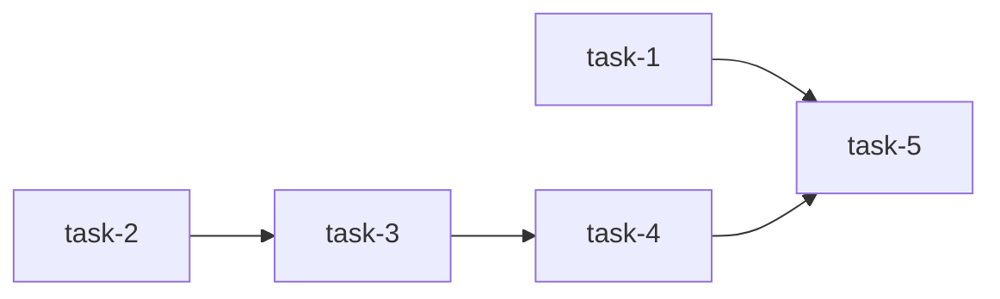

# 인용문헌 문단 검색 기준선 tasks (구현 계획 + 진행)

<!-- design.md를 바탕으로 쓴 구현 계획이다. 이슈 계획 하나 = 브랜치 하나 = PR 하나.
     이슈 #67에 PR 여러 개: m2-i1 = BM25 (Refs #67), 다음 계획 = 벡터 (Closes #67).
     requirements·design은 상태: 초안. 이 계획은 재아가 문서와 함께 승인한다 (상대 리뷰는 PR에서).
     어림 크기는 코드 + 테스트 줄. fixture 데이터 줄은 세지 않는다. -->

## m2-i1  (11/19)  상태: 승인 (11/19 재아)  (이슈 #67, Refs)
**구현할 design 부분**: design.md 2절(1~4단계), 3-1, 3-2, 5절, 7-2   **맡은 합격 기준**: requirements.md 1~7
**목표** (한 줄): tune 인용문헌 8건을 원문 위치가 붙은 조각으로 `cite_chunks`에 넣고, BM25 impl로 계약 채점기 Hit@k와 CQ를 낸다.
**끝나면 보여 줄 것** (데모 한 줄): `make db` → `uv run python -m patent_ai.retrieval.cite_index --config config/cite_search.yaml` → `uv run python -m eval.retrieval.score --config experiments/m2-i1-cite-search-bm25-baseline/config.yaml` → Hit@1·3·5·10, 무작위 대비 배수, CQ 건수.
**어림 크기**: 코드 약 560줄 + 테스트 약 380줄 = 약 940줄. 400줄을 넘지만 16:30 숫자가 이 다섯을 다 지나야 나와서 PR 하나로 두고, PR 본문에 커밋별 리뷰 순서(task 순서)를 적는다. task-1과 task-2~4는 서로 안 겹쳐 따로 봐도 된다.
**새 의존성** (재아가 고름, 11/19): `pdfplumber`, `kiwipiepy`, `bm25s` (`uv add`). 그 밖 라이브러리는 먼저 묻는다.
**doc_id 표 두 곳** (plan-reviewer 지적 반영): 정답 표기 → `doc_id`는 채점기 쪽 `data/goldsets/tune/retrieval/cite_doc_ids.yaml`(task-1), PDF 파일 이름 → `doc_id`는 앱 쪽 `data/processed/cite_search/file_doc_ids.yaml`(task-4). tune 인용문헌 목록이 git에 안 들어가게 둘 다 git 밖이고, git 안 설정에는 경로만 둔다. 한국 공보는 둘 다 표기 그대로라 표에는 논문 한 줄씩만 있다. 두 표의 `doc_id`가 같은지는 채점 때 계약 `excluded_body_missing` 건수로 보인다.

### task-1: 정답 변환 (은진 님 JSON + 청구항이력 → `cite_gold.jsonl`)
- 담당: 재아
- 합격 기준: requirements.md 4, 7
- 고칠 파일: `eval/retrieval/convert_cite_gold.py`, `eval/retrieval/claim_history.py`, `eval/retrieval/cite_gold.yaml`(표 경로·변환 설정만), git 밖 `data/goldsets/tune/retrieval/cite_doc_ids.yaml`(정답 표기 → `doc_id` 표, 재아가 만듦), `tests/retrieval_eval/test_convert_cite_gold.py`, `tests/retrieval_eval/test_claim_history.py`, `tests/fixtures/cite_search/`(지어낸 정답 JSON·청구항이력·행정이력·등록공보·결정본문)
- 만들 함수·인터페이스 모양:
  - `claims_at_oa(claim_history_path, admin_history_path, oa_no) -> dict[int, str]`: 행정이력 줄 순서로 OA 발송번호 앞에 있는 접수번호의 청구항 변경(신규·수정·삭제)만 차례로 적용. 날짜로 자르지 않는다. ` `는 줄바꿈으로. OA 발송번호가 행정이력에 없으면 `OaNotFound` (그 사건 줄을 빼고 셈).
  - `expand_claims("3-4,8") -> list[int]`
  - `convert(gold_json, cases_root, doc_ids) -> (list[GoldRow], ConvertReport)`: design 3-1 규칙에 더해
    - `row_id` = `<발송번호>:r<순번>:c<청구항>:<doc_id>`. 순번 = 정답 JSON 거절이유의 `순번` 칸 그대로 (42조처럼 줄을 안 만드는 거절이유도 번호를 차지). 같은 `row_id`가 두 번 나오면 멈춤.
    - 줄마다 `corpus="cite"`, `doc_ids=[doc_id]`(계약 preflight가 None을 막음).
    - 항목 칸: 식별번호 → `kind=paragraph, start, end`, 도면 → `kind=figure, figures=[n…]`(`3-4` 펼침, `4c`는 4), 인용문헌_청구항 → `kind=claim, claims=[n…]`, 요약 → `kind=abstract`, 논문 "N쪽" → `kind=page, start=end=N`(PDF 쪽 순서, 재아 11/19. N이 표의 쪽 수보다 크면 멈춤).
    - 그 청구항이 OA 당시 없거나 삭제됨 → 그 줄만 빼고 셈.
  - `ConvertReport`: 줄 수, 펼친 수, 빼는 이유별 수(`same_as_other`, `no_location`, 질의 없음 사건·줄, 청구항 없음).
  - CLI `uv run python -m eval.retrieval.convert_cite_gold --src <json> --cases data/raw/cases [--goldsets-root data/goldsets]` → `<goldsets_root>/tune/retrieval/cite_gold.jsonl` (#66 법령 정답과 경로를 나눔. 실험 config `gold: retrieval/cite_gold.jsonl`).
    - 순서: `GoldRow` 검증 + `find_leaks`를 메모리에서 다 끝낸 뒤에만 파일을 쓴다. 0줄도 실패. 실패는 종료 1, 메시지에는 `row_id`·건수만 (질의 글자는 안 찍음).
    - `<goldsets_root>/VERSION`: 없으면 1로 만들고, 새 파일 sha256이 기존 파일과 다를 때만 올린다. VERSION은 F1·#66과 같이 쓰는 파일이라, 올리면 다른 기능 실험 config `goldset_version`도 맞춰야 한다 (PR 본문에 한 줄).
    - 끝에 이유별 빼는 건수를 경고 한 줄로 찍음 (`logging.warning`).
    - 변환 보고 `work/cite_search/gold_convert_report.json`.
  - 읽는 사건 파일은 `청구항이력.txt`·`행정이력.txt`만 (등록공보·결정서·결정본문 안 읽음, 은진 님 11/19).
- 테스트할 경우 (모두 `tmp_path`, 진짜 `data/`를 안 건드림):
  - 평소: 범위 키 `"3-4"` → 줄 둘, 식별번호 `"0022-0025"` → start 22·end 25, 도면·청구항·요약·"3쪽" 항목이 같은 위치의 지어낸 `Chunk`에 `CiteMatcher.matches` = True. 쓴 줄을 `load_gold`로 다시 읽음. OA 뒤 보정은 질의에 안 들어감. 같은 입력 두 번 → VERSION 한 번만 오름
  - 빈 입력: 같은이유 → `same_as_other`, 위치 없음 → `no_location`(경고 줄은 caplog), 인용 없는 42조 → 줄 없음, 청구항이력 없는 사건 → 줄 없음 + 건수 + 경고, 결과 0줄 → 종료 1
  - 실패: 질의에 `[0023]` → 종료 1, 파일·VERSION 그대로. 표에 없는 문헌 → 종료 1. OA 발송번호 없음 → 그 사건 빼고 셈. 삭제된 청구항 → 그 줄 빼고 셈. `row_id` 중복 → 종료 1
  - 입력 경계: fixture 사건 폴더에 지어낸 `등록공보.pdf`·`결정본문.txt`를 같이 두고, 질의가 청구항이력 OA 당시 글자와 같음
- 확인 방법: `uv run pytest tests/retrieval_eval/test_convert_cite_gold.py tests/retrieval_eval/test_claim_history.py` → 통과
- 먼저: 없음

### task-2: 쪽 글자 추출 인터페이스와 머리말·꼬리말 빼기
- 담당: 재아
- 합격 기준: requirements.md 3, 7
- 고칠 파일: `src/patent_ai/retrieval/cite_index/__init__.py`, `.../pages.py`, `.../header_footer.py`, `config/cite_search.yaml`(`header_footer.scan_lines`·`min_page_ratio`), `pyproject.toml`·`uv.lock`(pdfplumber), `tests/retrieval/test_cite_pages.py`, `tests/retrieval/test_header_footer.py`, `tests/fixtures/cite_search/tiny.pdf`(지어낸 글자만)
- 만들 함수·인터페이스 모양:
  - `PageText{page: int, lines: list[str]}`, `PageExtractor` Protocol `extract(pdf_path) -> list[PageText]`, 구현 `PdfplumberExtractor` (#17 `extract_pages`와 같은 도구)
  - `strip_repeated(pages, scan_lines, min_page_ratio, keep_patterns) -> (list[PageText], removed: int)`: 위·아래 `scan_lines`줄 중 숫자를 `#`로 바꾼 글자가 쪽의 `min_page_ratio` 이상에서 나오면 뺌. 식별번호(`【0023】`·`[0023]`)·청구항 머리(`청구항 1`) 줄은 `keep_patterns`라 빼지 않는다.
- 테스트할 경우:
  - 평소: 지어낸 3쪽(머리말 `공개특허 10-20XX-000000X`, 꼬리말 `- 1 -`/`- 2 -`/`- 3 -`) → 머리말·쪽 번호 빠짐, 본문 줄 남음, removed = 6. 쪽 맨 위가 `【0012】`·`【0019】`·`【0025】`인 3쪽 → 식별번호 줄 남음
  - 빈 입력: 1쪽 문헌 → 아무것도 안 뺌, 글자 없는 쪽 → 빈 lines
  - 실패: `tiny.pdf` 추출 한 번(쪽 수·첫 줄), 없는 파일 → 오류
- 확인 방법: `uv run pytest tests/retrieval/test_cite_pages.py tests/retrieval/test_header_footer.py` → 통과
- 먼저: 없음. 시작할 때 진짜 PDF 한 개의 쪽 위·아래 줄 모양을 한 번 보고(출력은 `work/`에만) 기본값을 정한다.

### task-3: 청킹 (한국 공보 식별번호·청구항·요약·도면 설명, 논문 쪽)
- 담당: 재아
- 합격 기준: requirements.md 1, 2, 7
- 고칠 파일: `src/patent_ai/retrieval/cite_index/chunker.py`, `config/cite_search.yaml`(패턴), `tests/retrieval/test_cite_chunker.py`, `tests/fixtures/cite_search/kr_pages.json`(지어낸 줄 목록)
- 만들 함수·인터페이스 모양: `chunk_document(doc_id, pages, index_version) -> (list[Chunk], warnings)`. 나라는 `doc_id` 앞 글자로: `KR` → 공보 규칙, `NPL-` → 쪽 규칙, 그 밖 → `[]` + "지원 안 함" 경고. 조각 ID·종류·위치는 design 3-2 표에 더해
  - 도면 번호 읽기(본문 `figures`, 도면 설명): `도 3`, `도 3a`(→ 3), `도 3 내지 도 5`·`도 3-5`(→ 3,4,5), `도 3 및 4`(→ 3,4). 앞뒤가 숫자·글자에 붙은 것("온도 300℃")은 안 읽음 (`eval/retrieval/checks.py` 도면 규칙과 같은 경계).
  - 도면 설명 조각 키: 하위 글자를 넣음(`fig3a`, `fig3b`), `figures=[3]`. 같은 키가 또 나오면 경고하고 앞의 것만 남김 (식별번호·청구항 키도 같음, 조각 ID 중복 방지).
  - "도면의 간단한 설명"이 식별번호 문단 안에 있으면 그 문단 `p00xx` 조각과 도면별 `figN` 조각을 둘 다 만든다.
- 테스트할 경우:
  - 평소: `【0023】`·`[0023]` 두 꼴, 쪽을 넘는 문단 이어 붙음, 본문 "도 3 내지 도 5" → `figures=[3,4,5]`, "온도 300" → 없음, 청구항 1·2 → `claim1`·`claim2`, 요약 → `abs`, 도면 설명 `fig3a`·`fig3b`, 논문 → `pg1`…. 모든 조각의 `location`이 비지 않음. 같은 입력 두 번 → 조각 목록 같음
  - 빈 입력: 식별번호 0개 공보 → 경고 "식별번호 없음: 본문 조각 안 만듦", 청구항·요약·도면 조각만 (재아 11/19, 진짜 PDF에 1건). 그것도 0개면 조각 0개 + 경고
  - 실패: `US…` 문헌 → 건너뜀 경고, 같은 식별번호 두 번 → 경고하고 뒤의 것을 버림
- 확인 방법: `uv run pytest tests/retrieval/test_cite_chunker.py` → 통과
- 먼저: task-2 (`PageText`)

### task-4: 색인 명령 (PDF 폴더 → `cite_chunks` + 색인 보고)
- 담당: 재아
- 합격 기준: requirements.md 1, 2, 3
- 고칠 파일: `src/patent_ai/retrieval/cite_index/__main__.py`(`build_index`), `config/cite_search.yaml`(`index_version: cite-idx-v1`, `raw_root`, git 밖 표 경로 `data/processed/cite_search/file_doc_ids.yaml`(파일 이름 → `doc_id`, 건너뛸 파일 = 논문 원고판)), `tests/retrieval/test_cite_index.py`, `tests/test_cite_index_db.py`(`@pytest.mark.db`)
- 만들 함수·인터페이스 모양: `build_index(cfg, extractor) -> (list[Chunk], IndexReport)` (파일 이름 정렬 순서로, 같은 공보가 여러 사건 폴더에 있으면 한 번만, 내용 sha가 다르면 경고). `write_index(session, chunks)`: 같은 `index_version` 줄을 지우고 `chunk_to_row`로 넣음 (한 트랜잭션). 보고 `work/cite_search/<index_version>/index_report.json`: 문헌별 쪽 수·조각 종류별 수·`removed_lines`·건너뛴 문헌과 이유. CLI `uv run python -m patent_ai.retrieval.cite_index --config config/cite_search.yaml [--jsonl <out>]`.
- 테스트할 경우:
  - 평소: 가짜 extractor로 문헌 둘 → 조각·보고 숫자, 두 번 돌려 조각 같음. db 테스트: 두 번 써도 줄 수 같음
  - 빈 입력: 조각 0개 → 종료 1과 이유 한 줄
  - 실패: 한 문헌 추출 오류 → 그 문헌만 건너뛰고 보고에 남김. 표에 없는 PDF → 건너뛰고 경고·보고. `--jsonl`이 git에 들어갈 수 있는 경로(`git check-ignore` 실패) → 종료 1
- 확인 방법: `uv run pytest tests/retrieval/test_cite_index.py` → 통과, `make db && make test-db` → `test_cite_index_db.py` 통과
- 먼저: task-3

### task-5: `bm25` impl과 기준선 실험
- 담당: 재아
- 합격 기준: requirements.md 5, 6, 7
- 고칠 파일: `src/patent_ai/retrieval/bm25.py`(`@register_impl("bm25")`), `src/patent_ai/retrieval/tokenizer.py`(Kiwi), `pyproject.toml`·`uv.lock`(kiwipiepy, bm25s), `tests/retrieval/test_bm25.py`, `experiments/m2-i1-cite-search-bm25-baseline/config.yaml`·`card.md`
- 만들 함수·인터페이스 모양: `KiwiTokenizer(tags).tokenize(text) -> list[str]`, `Bm25Searcher(repo, settings, embed=None).search(...)`: `doc_ids` 문헌 조각만으로 bm25s 색인을 만들고 `get_scores`로 전 조각 점수를 받아 `(-score, chunk_id)`로 정렬, `min(k, 조각 수)`개만 (논문 9조각 < k 10). 0점 조각은 hit에 넣지 않음. `mode`가 `bm25`가 아니면 `ModeNotSupportedError`. settings: `tokenizer`, `pos_tags`, `bm25.method`·`k1`·`b`.
- 테스트할 경우:
  - 평소: 메모리 저장소 fixture에서 낱말이 겹치는 조각이 1위, 같은 점수는 `chunk_id` 순. 토큰에 조사·어미가 없음. 조각 3개에 k=10 → 오류 없이 3개 이하
  - 빈 입력: 겹치는 낱말 없음 → `not_found_in_scope`, 문헌 조각 없음 → `unverified/body_missing` (계약 래퍼 통과)
  - 실패: `mode="vector"` → `ModeNotSupportedError`
- 확인 방법: `uv run pytest tests/retrieval/test_bm25.py` → 통과. 점수 한 줄: `make db` → 정답 변환(task-1) → 색인(task-4) → `uv run python -m eval.retrieval.score --config experiments/m2-i1-cite-search-bm25-baseline/config.yaml` → `scores.json`, CQ 건수 (`/experiment`로 카드 채움)
- 카드에 남길 것: 토크나이저·bm25s 판과 k1·b (`scores.json`에 칸이 없어 card·config `settings`에만), 한국어 질의로 영어 논문은 BM25가 거의 0점이라 논문 줄은 CQ로 갈 것으로 봄.
- 먼저: task-1 (정답), task-4 (색인)

### 이번에 안 하는 것
- 벡터·임베딩 (다음 계획, Closes #67), 미국 칼럼:줄, 하이브리드, 토크나이저·청킹 비교
- `make` 색인 target (CLI로 충분, 필요하면 다음 계획)

### 진행
- [ ] task-1
- [ ] task-2
- [ ] task-3
- [ ] task-4
- [ ] task-5
- 다음: 승인 → /implement
- 막힌 것: 없음

### 끝난 뒤 (이슈가 끝난 날)
- 된 것 / 안 된 것 / 다음 이슈로
