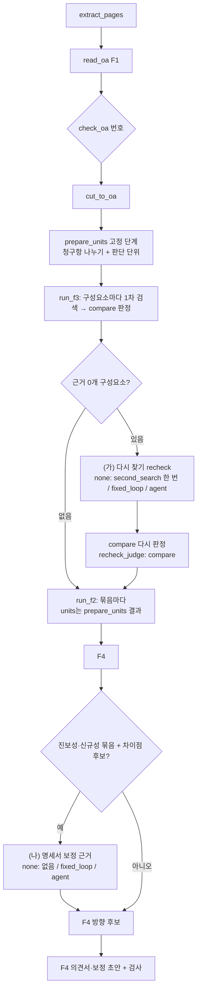

# 근거 다시 찾기 세부 설계
<!-- 이슈 #309. 방향(진행은 코드, 다시 찾기만 에이전트 후보)은 ADR 0004(제안, 비교 중). 결론은 7절 비교 뒤.
     [가정] = 모르지만 일단 정한 값, [확인 필요] = 아직 못 정한 것. 은진 님 확인이 필요한 칸은 10절 E1~E7. -->

## 1. 합격 기준 ↔ 설계
| 합격 기준 (requirements 번호) | 설계의 어디가 만족시키나 | 확인 |
|---|---|---|
| 1 (가) 못 찾은 구성요소만 | 2절 (가) 자리 = 지금 `second_search` 자리, 3절, 4절 | 가짜 응답 테스트 |
| 2 (나) 방향 전 명세서 근거 | 2절 (나), 3절, F4 `unit_variables`에 `amendment_basis` | 가짜 응답 테스트 + 프롬프트 변수 검사 |
| 3 없는 ID·도구 → 교정 | 4-2 도구 검사 | 단위 테스트 |
| 4 상한 → 그 구성요소만 보류 | 4-4 상한 | 단위 테스트 |
| 5 단계 기록 | 6절 `agent_steps` 두 칸 | DB 테스트(`@pytest.mark.db`) |
| 6 멈춤 없음 | 2절 그래프 (새 멈춤 노드 없음) | 그래프 테스트 |
| 7 A/B/C 비교 | 7절 | 실험 카드 |
| 8 (나) 위치 맞춤 | 7-2 | 실험 카드 |

## 2. 흐름 (진행은 코드, 다시 찾기만 바꿔 끼움)

- 지금 fixed_order 그래프와 다른 곳은 둘이다. ① `prepare_units`(청구항 나누기 `split_elements` 모델 호출 + 판단 단위 + 판 낮추기)를 F3 밖 고정 단계로 꺼낸다. 단계는 지금처럼 차례로 돌지만 F2 입력이 F3 결과에 기대지 않게 되어, 뒤에 F2·F3를 나란히 돌릴 자리가 생긴다 (D3. 이번 이슈에서 병렬로 돌리지는 않는다). 결과 키 `prepare_units` = `PreparedUnits{splits, units, held_tasks, status}`. `run_f3`는 그것을 받아 splits·units를 다시 만들지 않고, `F3Result.units`는 지금처럼 같은 단위를 싣는다 (`f4_input`·채점기가 `run_f3.units`를 읽는 길 그대로). `plan: agent`도 `cut_to_oa` → `prepare_units` → `decide` 고정 간선을 지난다. ② (가)·(나) 두 자리를 설정으로 바꿔 끼운다. 단계 순서·결과 키(`run_f3`·`run_f2`·`run_f4`)·멈춤(`check_oa`)은 그대로다.
- (가)는 지금 `second_search`(같은 질의로 상위 20까지 + 도면 설명 조각을 한 번 더, `compare.py` `_second_round`)가 있는 자리다. `recheck: none`이면 지금 그대로 `second_search` 설정을 따른다. `recheck`가 `none`이 아니면 `second_search`는 쓰지 않는다 (두 번 찾지 않게).
- (나)는 지금 없다. F4 방향 프롬프트(`directions.py` `unit_variables`)는 명세서를 보지 않고, 보정 초안 단계만 명세서 전체(또는 BM25 발췌 `amendment_spec_excerpt`, 기본 꺼짐)를 본다.
- 묶음·구성요소끼리 서로 기대지 않아 병렬로 돌 수 있다. 처음엔 순서대로 돈다 (같은 입력 → 같은 호출 순서, 캐시가 맞게).

### 2-1. supervisor로 볼 때
- 모양은 orchestrator-workers / supervisor as tools다: 위(코드)가 묶음·구성요소마다 다시 찾기 하위 에이전트를 부르고, 하위 에이전트의 검색 기록(질의·snippet)은 위 맥락으로 올라오지 않고 결과(문단 ID·이유)만 돌아온다 (context 격리).
- 위를 LLM으로 두지 않는 이유: 누구를 부를지가 "근거 0개 구성요소가 있나 / 보정 후보가 필요한 묶음인가"로 코드가 이미 안다 (D1·D8).
- 비교용 판 D(`supervisor: llm`): 같은 하위 에이전트 둘을 LLM supervisor가 도구(`ask_cite_search`·`ask_spec_search`)로 부르는 판. 시간이 남으면 1회 (7-1).

## 3. 하위 에이전트 둘
| | (가) 인용문헌 다시 찾기 | (나) 명세서 보정 근거 찾기 |
|---|---|---|
| 맡는 것 | 구성요소 × 인용문헌 하나 (1차에서 근거 문단 0개) | 묶음 하나의 차이점 (진보성·신규성) |
| 찾는 곳 | 그 OA 인용문헌 조각 (cite 색인, `doc_ids=[그 문헌]`) | 그 사건 최초 명세서 문단 (메모리 BM25. 벡터는 smoke 뒤) |
| 처음 받는 것 | 구성요소 글, 대비 대상 청구항 글, 1차에 보여 준 조각 ID(빼려고) | 차이점 구성요소 글, 대상 청구항 글, 심사관 요지, F4 보정 메모 |
| 내는 것 | `submit_evidence(paragraph_ids, why)` 또는 `give_up(reason, tried)` | `submit_basis(features[{text, paragraph_ids, why}])` 또는 `give_up` |
| 끝난 뒤 | `recheck_judge: compare`(기본): F3 compare가 낸 문단을 후보로 다시 판정. `agent`: 에이전트가 `submit_evidence`에 판정·인용 글자까지 내고 코드가 대조만 | F4 방향·보정 프롬프트 변수 `amendment_basis` |

### 3-1. (다) F2 법률 근거 찾기 (F2 주인 판단, E7)
- OA 전체 설계라 F2도 같은 칸에 둔다. 진행은 코드가 묶음마다 F2를 늘 부르고(지금과 같음), F2 안에서 근거(조문·심사기준·판례·심결)를 찾는 방법을 A 고정 검색 / B 고정 루프 / C 에이전트 루프 중 무엇으로 할지는 F2 주인이 정한다. 이번 이슈는 F2 코드를 바꾸지 않는다.
- 도구 모양을 맞추면 같은 루프(4-3)를 쓸 수 있다: `search_bm25`·`search_vector`(law 색인, `source`로 법령/심사기준/판례/심결)·`open_paragraph`·`submit_evidence`·`give_up`. 판본·적용 시점은 도구 결과에 붙인다.
- 잴 수 있는 것: 법령 조문 Hit@1·Recall@5. 심사기준·판례는 tune 정답 줄이 거의 없어 M3에는 못 잰다 → 판례·심결은 잴 수 있을 때까지 고정 검색 유지를 추천한다.

## 4. 도구와 루프
### 4-1. 도구 (Search → Visit → Select 모양을 우리 자료에 맞춤)
| 도구 | 인자 | 돌려주는 것 | description에 쓸 것 (언제 쓰고 언제 안 쓰나) |
|---|---|---|---|
| `search_bm25` | `query`(글, 200자 이하 [가정]), `k`(1~`k_max`, 기본 10 [가정]. strict 스키마의 정수 범위 지원은 확인 전이라 코드가 다시 검사) | 조각 ID·위치 이름·앞 `snippet_chars`자(160 [가정]) snippet·순위 | 낱말이 원문과 같을 것 같을 때 (부호·고유 용어). 같은 질의를 되풀이하지 않는다 |
| `search_vector` | `query`, `k` | 같음 | 표현이 다를 것 같을 때 (상위 개념·기능으로 쓴 말) |
| `open_paragraph` | `paragraph_id` | 문단 전체 글 + 앞뒤 문단 ID | snippet만으로 맞는지 모를 때. 고르기 전에 꼭 연다 |
| `submit_evidence` / `submit_basis` | 3절 | 검사 결과 (받음 / 오류 + 고칠 방법) | 연 문단에서 근거를 찾았을 때만 |
| `give_up` | `reason`(enum `not_in_document`·`ambiguous_element`·`need_figure`·`other`) + `tried`(짧은 글) | 끝 | 더 찾아도 안 나올 때 바로. 상한까지 재시도하지 않는다. 결과는 "조회 범위 내 없음" + 찾아본 범위(질의·종류·k) (5절) |
- 검색 도구는 지금 F3 검색기(`retrieval.contract.Searcher`)를 그대로 부른다: `search_bm25` = mode `bm25`, `search_vector` = mode `vector`, `doc_ids=[그 인용문헌]`. 둘째 점수(노이즈 범위)는 앱 설정이 아니라 실험 실행 쪽이 검색기를 감싸 `doc_ids`를 넓혀 준다 (5절). 그래서 `open_paragraph`·`submit`이 받는 조각 = 그 인용문헌 조각 ∪ 이 대화의 검색 결과에 나온 조각이다. 검색 결과 조각은 F3 검색 기록(`search_log`)에 2차(round 2) 줄로 남겨 채점기 `search_recall`이 지금처럼 센다.
- 도구 세분(검색 둘 vs `search(mode)` 하나)은 비교 축이다. 먼저 둘로 간다.
- snippet·문단 글은 외부 모델로 보내도 되는 자료(공개 공보·출원서, architecture.md "외부 모델로 보내는 자료" 표)다. 등록공보·다른 사건 의견서는 넣지 않는다.

### 4-2. 도구 검사 (교정 지시)
- 없는 조각 ID, 받는 범위(위 4-1) 밖 조각 ID, 그 대화에서 안 연 문단을 `submit` → 도구 결과에 `is_error: true` + 무엇이 틀렸고 어떻게 고치나 한 줄 (예: "D1-0012는 열지 않은 문단이다. open_paragraph로 먼저 연다"). 대화는 이어 간다.
- 목록 밖 도구 이름, 인자 모양이 틀린 호출 → 같은 꼴의 오류 결과. 도구 정의에 `strict: true`(+ `additionalProperties: false`, `required`)를 걸어 API 쪽에서도 막는다. 코드도 다시 검사한다 (기록된 응답·가짜 응답은 API 검사를 거치지 않는다).
- 병렬 도구 호출은 끈다(`disable_parallel_tool_use: true`): 앞 결과를 보고 다음을 정하는 루프라서.

### 4-3. 모델 호출 길 (`core/llm`)
- 지금 `call_model`은 프롬프트 글 하나 → 답 글 하나다. tool use 여러 차례 대화 길을 새로 둔다: `call_model_turn(step, system_variables, messages, tools, ctx)` → 그 차례의 답 블록(글·tool_use·thinking)과 토큰·비용.
- 차례 한 번 = 모델 호출 한 번 = 호출 상한(CallBudget) 한 번 = 캐시 키 하나. 캐시 키 = 단계·모델·시스템 프롬프트 파일 해시·시스템 변수·지금까지의 메시지·도구 정의 해시·effort·max_tokens. 앞 차례가 같으면 같은 키라, 같은 입력으로 다시 돌리면 대화 전체가 캐시에서 다시 나온다.
- 인터페이스: `Transport.converse(*, step, model, system: str, messages: list[dict], tools: list[dict], effort, max_tokens) -> ConverseResponse(content: list[dict], input_tokens, output_tokens, stop_reason)`, `call_model_turn(step, system_variables, messages, tools, *, ctx) -> TurnResult(content, model, input_tokens, output_tokens, cost, elapsed_ms, from_cache, stop_reason)`. 단계 이름은 `recheck.<칸>` (`config/recheck.yaml`의 칸, `core/llm/config.py` 규칙).
- 캐시: 키 = 위 값 + 지금 `make_cache_key`처럼 `attempt`(늘 1). 값 = 답 블록 목록 그대로(thinking 블록과 서명 포함)·토큰·stop_reason. 끝까지 받은 답(`stop_reason`이 `max_tokens` 아님)만 쓴다. 도구 입력 검사 실패는 모델 답이 틀린 것이 아니라 대화의 다음 차례(오류 tool_result)로 이어지므로 그 차례 답도 캐시에 쓴다. 같은 대화를 다시 돌리면 차례마다 적중한다.
- 기록된 응답(E2E): `RecordedTransport.converse`와 `scripts/record_llm.py`의 여러 차례 기록은 E2E task(309d 뒤)에서 더한다. 그 전까지 테스트는 가짜 전송층.
- 에이전트가 새로 쓴 질의의 벡터 검색은 질의마다 임베딩 호출(`f3.embed`)이 생긴다. 그 단계 상한(`max_model_calls`)에 같이 세고, smoke 뒤 상한을 다시 본다.
- 전송층: 진짜 전송층은 SDK `messages.create`(tools, `tool_choice: {type: auto, disable_parallel_tool_use: true}`, `output_config.effort`). 강제 `tool_choice`(any/tool)는 쓰지 않는다 (Opus 5.5·Sonnet 5.5는 400, Haiku 5.5는 받되 thinking을 건너뜀 → 모델 키우기 비교가 갈리지 않게 늘 auto, 공식 문서 define-tools). thinking 블록은 받은 그대로 다음 차례에 돌려준다. 가짜 전송층(FakeTransport)은 단계마다 차례 답 목록을 준다.
- 루프는 `core/agents/tool_loop.py` 공통 하나(에이전트 공통 루프는 `agents/`에 둔다는 core 규칙): 도구 표(이름 → 검사·실행 함수), 끝 도구(`submit*`·`give_up`), 상한을 받아 끝 결과(제출 / 포기 / 상한 / 실패)와 단계 줄 목록을 돌려준다. 하위 에이전트와 그 도구는 기능 폴더 안(`f3_claim_compare/recheck/`, `f4_response_draft/spec_basis.py`).
- 모델: Haiku 5.5 effort medium (지금 F3와 같음). 단계 설정은 `config/recheck.yaml`(아래 5절).

### 4-4. 상한
- 구성요소(또는 묶음) 하나: 도구 호출 8번, 모델 차례 10번 [가정]. 닿으면 그 구성요소만 `limit_reached` 보류 + 찾아본 질의 목록(`tried`)을 남긴다. 실행은 이어 간다.
- 예외를 잡는 자리: 다시 찾기는 구성요소 × 인용문헌 하나마다 `ModelCallFailed`·`ModelOutputInvalid`·`ModelCallLimitExceeded`(실행 합계 상한 포함)·`RecheckToolFailed`(검색 예외를 감쌈)를 그 자리에서 잡아 그 구성요소만 보류한다. 다시 판정(`_ask`)이 실패해도 같다. 그래서 `compare_unit`(compare.py의 묶음 단위 잡기)까지 올라가지 않고, 묶음의 1차 대비표는 그대로 남는다. 프로그래밍 오류는 잡지 않는다.
- 다시 찾기가 근거를 찾으면 그 구성요소는 차이점에서 빠진다. 그래서 "독립항에 차이점이 있으면 종속항 대비를 건너뜀"(`_independent_collapsed`) 판단도 다시 찾기 뒤 결과로 한다 (지금 second_search 뒤와 같은 자리).
- 실행 하나 합계 상한은 단계 설정 `max_model_calls`(지금 단계들과 같은 꼴). 값은 smoke 1회 뒤 잰 숫자로 고친다.

### 4-5. B 고정 루프 (비교 상대, CRAG 모양)
코드가 ① 1차 결과 판정(근거 0개면 부족) → ② LLM 한 번으로 질의 3개 [가정] 다시 쓰기(동의어·상위 개념·기능 표현) → ③ 질의마다 hybrid 검색 k=10 [가정], 1차에 보여 준 조각 빼고 합침 → ④ F3 compare 다시 판정. 1바퀴만 돈다. 에이전트(C)와 다른 점은 "다음 행동을 결과를 보고 모델이 고르느냐"뿐이다. (나)의 B는 질의 다시 쓰기 → 명세서 BM25 → 상위 5 [가정] 발췌를 근거 후보로 둔다.

## 5. 설정과 데이터 모양
- `config/recheck.yaml` (실험은 `experiments/<실험>/config.yaml`이 덮음):
  - `recheck: none | fixed_loop | agent` (기본 `none` = 지금과 같음)
  - `recheck_judge: compare | agent` (기본 `compare`)
  - `reflect: 0 | 1` (판 C+R, 기본 0), `supervisor: code | llm` (판 D, 기본 code)
  - `spec_basis: none | fixed_loop | agent` ((나), 기본 `none`) [가정: (가)와 따로 켜도록 칸을 나눔. 판 B·C는 둘 다 같은 값으로 돌린다]
  - `limits: {tool_calls: 8, turns: 10}` [가정], `search: {k_max: 10, snippet_chars: 160}`
  - 단계 칸 (step `recheck.<칸>`): `agent`·`rewrite`·`spec_agent`·`spec_rewrite`·`reflect`·`supervisor` (모델·effort·max_tokens·프롬프트·`max_model_calls`·`max_retries`, 가격 칸 Haiku 5.5 $0.10/$0.50 per MTok, 공식 문서 가격표 11/03 판)
  - 프롬프트 파일: `prompts/recheck/cite_agent.md`(시스템: 고르기 전에 문단을 연다 / 못 찾으면 바로 give_up / 같은 질의 되풀이 금지), `rewrite.md`, `spec_agent.md`, `spec_rewrite.md`, `reflect.md`, `supervisor.md`. 도구 description은 `prompts/recheck/tools/<도구>.md` (코드에 긴 글을 두지 않는다).
- 검색 범위 (둘째 점수): 앱 코드는 `data/goldsets/`를 읽지 않으므로 노이즈 범위를 앱 설정으로 두지 않는다. 실험 실행 스크립트가 노이즈 범위(OA 줄 → 문헌 ID)를 읽어 `run_f3`에 넘기는 검색기를 감싸고, `doc_ids=[인용문헌]` 검색을 `[인용문헌 + 그 줄의 노이즈 문헌]`으로 넓힌다. 1차 검색과 다시 찾기가 같은 감싼 검색기를 쓰므로 둘 다 같은 범위다. 근거 줄의 인용문헌 라벨은 그대로이고, 노이즈 문헌 조각을 근거로 고르면 채점기는 그 인용문헌 정답과 안 겹쳐 틀림으로 센다.
- 앞에서 받음: F3 1차 결과(구성요소 × 인용문헌별 근거 0개 여부, 1차에 보여 준 조각 ID), `JudgmentUnit`, 최초 명세서 쪽 글(`PageText`).
- 다음에 줌: F3 대비 줄 모양은 그대로(`why_retrieved`에 "다시 찾기(방식): 질의 …"), 검색 기록 2차 줄(`round=2`), 실험 지표용 `F3Result.recheck_log`(구성요소마다 방식·끝 상태·도구 호출 수·차례 수·질의·낸 ID, 원문 문단 글 없음, 기본 []).
- (나) `amendment_basis`는 F4가 안에서 만드는 값이라 F4 입력(`F4Input`, extra forbid)이 아니라 F4 결과의 묶음별 방향 후보 쪽 새 칸(`DirectionCandidates.amendment_basis`, 지금은 근거 칸이 없음, `core/schemas/` 결과 스키마 칸 추가라 공유 자원, 은진 님 리뷰)에 둔다. 모양 예: `{"unit_id": "...", "features": [{"text": "...", "paragraph_ids": ["0035"], "why": "..."}], "status": {...}}`. 문단 ID는 `spec_excerpt.split_paragraphs`가 읽는 식별번호(`【0035】` → `0035`). 채점(합격 기준 8)은 이 칸의 식별번호를 정답 `spec:[0035]`와 맞춘다.
- `spec_basis: none`이면 방향·보정 프롬프트 변수에 `amendment_basis` 키를 넣지 않는다 (프롬프트 글자·캐시 키·기록된 응답이 지금과 같게). none이 아니면 변수 하나와 프롬프트 자리 한 줄이 생긴다.
- 예시 (도구 주고받기):
  - 모델 → `{"type": "tool_use", "name": "submit_evidence", "input": {"paragraph_ids": ["cite-idx-v2:D1:0012"], "why": "구성요소의 '제어부'를 '컨트롤러'로 적음"}}`
  - 도구 결과(오류) → `{"type": "tool_result", "is_error": true, "content": "cite-idx-v2:D1:0012는 아직 열지 않은 문단이다. open_paragraph로 먼저 열고 다시 낸다"}`
  - 단계 기록 `tool_input` → `{"element_no": 3, "citation": "D1", "paragraph_ids": ["cite-idx-v2:D1:0012"]}` (why·문단 글 없음)
- 끝 상태 (requirements 1·근거, PRD F3 3번):
  - 근거 문단을 냄 → 지금처럼 대비 줄 근거 (B·C, `recheck_judge`에 따라 compare가 다시 판정).
  - 다 찾고도 없음 (B: 새 후보에서 compare가 근거 0개 / C: `give_up` 아무 이유든) → 판정은 1차 그대로, 줄 status "조회 범위 내 없음" + `searched_scope`에 다시 찾기 방식·질의·k·(C면) give_up 이유. 보류하지 않는다.
  - 끝까지 못 봄 (상한·호출 실패·검색 실패) → 판정 1차 그대로 + `held_tasks` 한 줄, 이유 코드 `limit_reached`·`tool_failed`·`model_call_failed` (이슈 #241 목록에 맞춤, E3). 이름은 지금 F3 보류 규칙에 맞춰 `f3_compare:<unit_id>:claim<N>:recheck:e<n>:<인용문헌>:<끝말>`로 쓴다. 끝말은 `bundle_errors`의 `limit_reached`·`call_failed`(= model_call_failed)와 새 `tool_failed`. 접두어가 `f3_compare:<unit_id>`라 F4 `_held_for`가 그 묶음 후보에 보류를 그대로 싣는다.

## 6. 저장
- `agent_steps`에 `unit_id`(text, null 가능)·`tool_input`(jsonb, null 가능: 도구 인자 중 질의 글·ID·k만, 원문 문단 글 없음) 두 칸을 Alembic 마이그레이션으로 더한다 (E2). 구성요소 ID는 `tool_input` 안.
- 다시 찾기 도구 호출 한 번 = `StepRecord` 한 줄(`step_kind = "code_tool"`, `tool_name = recheck.<도구>`, `result_id` = 결과 조각 ID를 쉼표로). 원문 글은 기록하지 않는다.
- 내보내는 길: 다시 찾기는 `run_f3` 안에서 도는데 `StepRecorder`는 지휘(orchestrator)에만 있다 (`RunContext`에 없음). 그래서 `RecheckLogRow`에 도구 호출 줄(`steps: [{turn, tool_name, tool_input, result_ids, is_error}]`)을 싣고, 지휘가 `run_f3` 단계 기록 바로 뒤에 그 줄들을 `StepRecord`(`unit_id`·`tool_input` 칸)로 옮겨 쓴다. `RunContext`·도구 인터페이스는 바꾸지 않는다.

## 7. 비교 계획
### 7-1. 판
| 판 | (가) 인용문헌 다시 찾기 | (나) 명세서 근거 | 설정 |
|---|---|---|---|
| A | 지금 `second_search` (같은 질의 상위 20 + 도면, 한 번) | 없음 | `recheck: none` |
| B | 고정 루프 (4-5) | 고정 루프 | `recheck: fixed_loop` |
| C | 에이전트 루프, 판정은 compare | 에이전트 루프 | `recheck: agent`, `recheck_judge: compare` |
| C-judge | 에이전트 루프, 판정까지 에이전트 | 같음 | `recheck: agent`, `recheck_judge: agent` |
| C+R (선택 1순위) | C + Reflexion 한 번 (8-1) | | `reflect: 1` |
| D (선택 2순위) | C + LLM supervisor | | `supervisor: llm` |

### 7-2. 세트·지표
- 세트: tune 10통(F3 검색 정답 + F4 정답)으로 smoke 1회씩. 판정용 2회는 두 사람 환경(같은 커밋·같은 색인 덤프)을 맞춘 뒤.
- 같은 커밋, 판마다 캐시 폴더 따로, 한 맥에서 이어서. 판끼리 캐시를 나누지 않아 1차 결과도 판마다 다시 나온다. 그래서 `*_rechecked`의 분모(1차에 못 찾은 구성요소가 있는 정답 줄)를 판 A 예측의 2차 검색 기록으로 고정해 모든 판에 같은 줄 집합을 쓴다 (채점기 선택 인자 `--rechecked-rows-from <판 A 예측 폴더>`, 없으면 자기 예측). 1차 흔들림은 2회 실행으로 본다.
- 예측 만들기: 실험 실행 스크립트(git 밖 `work/`, 사건마다 `run_case` fixed_order, 판 설정을 덮어씀) → `<폴더>/f3/<키>.f3.json`·`f4/<키>.json` → `uv run python eval/run_eval.py --config experiments/m3-i2-recheck-<판>/config.yaml --predictions <폴더>/f3`.
- 지표 (같은 채점기 `eval/f3`·`eval/f4`):
  - (가) `search_recall`(정답 문단이 검색·다시 찾기가 본 결과에 나온 비율), `selected_recall`(대비 근거로 고른 비율). 1차에서 못 찾은 구성요소가 있는 (청구항, 인용문헌) 줄만 센 한 줄을 더한다 (`*_rechecked`, 차이가 거기서만 나므로).
  - (가) 정밀도: 정답에 없는 낸 근거만 LLM-as-a-Judge로 관련 / 일부 / 무관 판정 (억지 근거 막기). 판정 기준은 노이즈 범위 판정(#178)과 같게, 판정 호출은 `eval/` 안에서 모델 호출 모듈을 거치고 프롬프트는 `eval/` 프롬프트 파일. 판정표는 git 밖.
  - (나) F4 정답 `added_from`의 `spec:[식별번호]`와 (나)가 낸 문단의 식별번호가 맞는 비율.
  - 끝 지표: F4 `direction_top1`.
  - 비용·시간: 모델 호출 수, 입력·출력 토큰, $, 걸린 시간. 도구 쓰임: 구성요소당 도구 호출 수, `give_up` 비율, `limit_reached` 수.
- 검색 범위 축 (둘째 점수): 그 OA 인용문헌만(주 점수) / 노이즈 범위(다른 사건 인용문헌 + 같은 IPC 공보를 섞은 범위, 색인 `cite-idx-v4`, [search-gold](../../evaluation/search-gold.md) 5절). 노이즈 범위는 주 점수를 대신하지 않는다. 노이즈에서 1차 검색이 크게 떨어지므로(Hit@10 0.706 → hybrid 0.382) 다시 찾기의 몫이 커지는 쪽을 본다.

### 7-3. 판정 규칙
- 주 지표: 1차에서 못 찾은 구성요소의 `selected_recall`. C가 B보다 높고 그 차이가 같은 판 2회 흔들림보다 크면(최소 0.05 [가정]) C. 비슷하면 싼 쪽. 지면 C를 쓰지 않고 이유와 숫자를 실험 카드와 8절에 남긴다.
- 끝 지표 F4 `direction_top1`은 다른 단계 영향이 커서 보조로만 본다.

### 7-4. 이미 있는 숫자
- 11/23 fixed_order tune 10통(판 A와 같은 설정, git 밖 일회용 실행의 채점 출력, 저장소 실험 카드 없음): `search_recall` 0.557(1차만 0.548, second_search +0.008), `selected_recall` 0.099, 약 $0.59 / 사건 합계 3,268초. → 지금 second_search의 몫이 작고, 고르기(compare) 손실도 크다. `compare_variant: recall`을 A·C 옆에 한 줄로 같이 잰다.
- 인용문헌 검색에서 LLM 질의 다시 쓰기(고정)만으로 Hit@10 0.706 → 0.79 수준 (이슈 #225 안건 9) → B가 만만치 않다. C는 그 위를 보여야 한다.
- 같은 모델도 하네스(도구·루프)에 따라 무효 검색 recall이 크게 달라진다는 외부 보고가 있다 (PatentAgentBench, arXiv 2610.35031, 공개 논문, 요약 숫자).

## 8. 결정 (고려했지만 안 쓴 대안 포함)
| # | 정한 것 | 안 쓴 대안 | 이유 |
|---|---|---|---|
| D1 | 진행은 코드, 에이전트는 다시 찾기 둘 | 묶음마다 LLM 지휘가 대비 / 근거 찾기 / 보류 중 고름 | 고르는 것이 결과에 거의 안 닿는다: 대비는 늘 해야 하고, 보류는 규칙으로 정해지고, 방향은 F4가 만든다. 결과를 보고 다시 고르는 일이 없다 |
| D2 | 같음 | 지금 `plan: agent` (사건 하나에 도구 4개 순서만 고름) | tune 10통 모두 같은 순서라 고를 것이 없다 |
| D3 | `prepare_units`를 고정 단계로 꺼냄 | F3 안에 그대로 / 도구로 만들어 모델이 부름 | F2는 단위만 필요한데 지금 F3 안에서 만들어져 F3를 기다린다. 도구로 만들면 모델은 늘 맨 처음 부를 뿐인 단순 래퍼 |
| D4 | 기본은 에이전트가 찾기까지, 판정은 compare | 에이전트가 판정도 | 바꿀 곳을 하나로 좁혀야 점수 차이의 원인을 읽는다. 판정까지 맡기는 판은 스위치(`recheck_judge: agent`)로 같이 잰다 |
| D5 | tool use (`auto` + `strict`) | JSON `{next_tool, reason}` 한 번씩 | 결과를 다시 보여 주는 여러 차례 대화라 tool_result 짝이 맞는 tool use가 맞다 |
| D6 | 멈춤 안 늘림, 보류 | 실행 중 사람 확인 | 멈춤마다 체크포인터·다시 시작이 붙는다 |
| D7 | 구성요소마다 대화 하나 (차례는 이어 감) | 결정마다 새 호출 | 앞 결과가 대화에 있어야 다음을 고른다. 대신 차례마다 캐시 키 하나 |
| D8 | 위는 코드 supervisor | LLM supervisor | 부를 대상이 코드로 정해진다. multi-agent는 토큰이 크게 늘어난다(Anthropic 2025-06, 회사 테크 블로그). 판 D로 숫자만 남긴다 |
| D9 | 학습 없음 | 반성 토큰 학습(Self-RAG), 궤적 SFT | 기간·데이터가 없다 |
| D10 | LangGraph 노드 안에서 루프 | SDK Tool Runner / Managed Agents | 고정 단계·단계 기록·상한·캐시가 그래프와 `core/llm`에 있다 (ADR 0003) |
| D11 | `recheck`가 none이 아니면 `second_search` 안 씀 | 둘 다 | 두 번 찾으면 판 차이의 원인이 섞인다 |

### 8-1. RAG 계열에서 우리 판의 자리 (공개 논문, 날짜·내용은 요약 기준)
| 계열 | 무엇 | 우리 |
|---|---|---|
| Self-RAG (2023-10) | 학습된 반성 토큰으로 검색·근거를 스스로 판정 | 안 씀 (D9) |
| CRAG (2024-01) | 평가기 판정 → 질의 재작성 → 재검색 (순서는 고정) | B |
| Adaptive-RAG (2024-03) | 질문 난이도로 검색 안 함 / 한 번 / 여러 번 | 코드가 이미 함 (근거 0개 구성요소만) |
| Agentic RAG | 검색을 도구로, 판정·재작성·멈춤을 에이전트가 루프에서 | C (Search → Visit → Select) |
| Reflexion (2023-03) | 실패 원인을 말로 적어 다음 시도에 씀 | C+R: Actor = C, Evaluator = F3 compare 다시 판정("근거 아님"이면 실패), Self-reflection = "왜 틀렸나·다음엔 무엇을 바꿀까" 한 줄로 그 구성요소를 한 번만 더 찾음. 같은 실행 안에서만 (사건을 넘는 기억 없음, 정답 누출 막기) |

## 9. 테스트
- 모델 호출 길: 차례마다 캐시 키가 다름·같은 대화는 캐시 적중·상한 셈·thinking 블록 되돌림 (가짜 전송층).
- 도구 검사(없는 ID·안 연 문단·다른 문헌·목록 밖 도구·스키마 밖 인자), 상한·실패 → 그 구성요소만 보류(1차 대비표 그대로), `give_up`(이유 넷 모두) → 보류 없이 "조회 범위 내 없음" + 찾아본 범위(이유를 `searched_scope`에 적음): 단위 테스트(가짜 응답).
- 그래프: 고정 단계 순서(`prepare_units` → `run_f3` → `run_f2` → `run_f4`), (가)는 근거 0개 구성요소만, (나)는 진보성·신규성 + 차이점 묶음만, 결과 키 같음.
- 프롬프트 변수에 등록공보·다른 사건 글 없음.
- 마이그레이션: `agent_steps` 두 칸 쓰고 읽기 (`@pytest.mark.db`).
- E2E 하나: 기록된 모델 응답으로 `recheck: agent` 사건 하나 `succeeded`, 결과 키 같음.

## 10. 남은 질문 (은진 님 칸)
- E1 `prepare_units`를 F3 앞으로 꺼내도 F2는 지금처럼 `units`만 받는다. 괜찮은가.
- E2 `agent_steps`에 `unit_id`·`tool_input` 두 칸 (마이그레이션 리뷰. 지금 `GET /runs/{id}` 응답에는 단계 줄이 없어 API 모양은 그대로).
- E3 보류 이유 코드를 #241 목록에 `limit_reached`·`tool_failed`·`model_call_failed`로 맞춤 (`give_up`은 보류가 아니라 "조회 범위 내 없음").
- E4 결과 키 그대로 → 서버 실행기 안 바뀜. 단, `prepare_units` 단계 이름이 단계 기록에 새로 보인다.
- E5 ADR 0004(제안) 방향과, #225 안건 9(F3 다시 찾기)를 이 이슈로 옮기는 것에 동의하는가.
- E6 두 사람 환경 확인용 A 1회 (은진 님 맥).
- E7 F2 안 근거 찾기를 (가)·(나)와 같은 도구 모양으로 할지, A/B/C 중 무엇으로 할지 (3-1).
