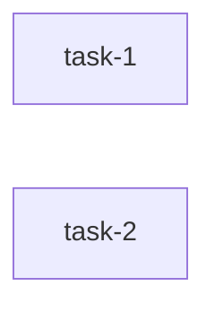
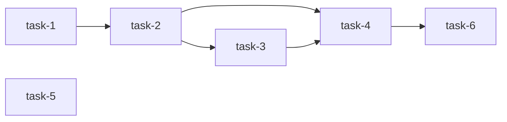
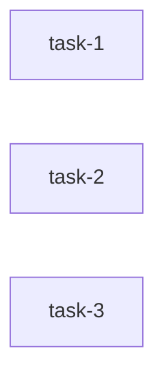
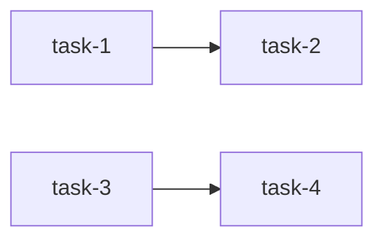

# 근거 다시 찾기 tasks (구현 계획 + 진행)

<!-- design.md를 바탕으로 쓴 구현 계획이다. 이슈 #309 하나에 계획 넷 = PR 넷 (쌓아 올림: 309a → 309b → 309c → 309d).
     309a·309b·309c는 `Refs #309`, 309d가 `Closes #309`. 어림 크기는 코드 + 테스트 줄 (fixture 데이터 줄은 세지 않음).
     비교 실험(합격 기준 7)은 309b 뒤에 smoke 1회씩 (판정용 2회는 두 사람 환경을 맞춘 뒤).
     시간이 모자라면 빼는 순서: 309d task-4(D) → 309d task-3(C+R) → 309c task-3(정밀도 판정) → 309d task-1·2((나), 합격 기준 2 필수라 남기면 이슈를 열어 둠) → 309c task-2(노이즈 범위). 309d를 못 하면 Closes PR이 없으니 이슈 #309는 열어 두고 남은 합격 기준을 이슈에 적는다. -->

## m3-i2-309a  (11/23)  상태: 승인 (재아 사전 승인 11/23, plan-reviewer 통과: 막음 없음, 고칠 것 15 반영)  (이슈 #309, Refs)  브랜치 `feat/309-recheck-agent`
**구현할 design 부분**: design.md 4-3(모델 호출 길), 2절 ①(`prepare_units` 고정 단계, D3)   **맡은 합격 기준**: requirements.md 6 (그리고 1·3·4의 바탕)
**목표** (한 줄): `core/llm`에 tool use 여러 차례 대화 길을 두고, 판단 단위 나누기를 F3 앞 고정 단계로 꺼낸다. 기본 동작(결과·호출)은 그대로.
**끝나면 보여 줄 것** (데모 한 줄): `uv run pytest tests/core/llm tests/core/agents tests/core/f3_claim_compare -q` 통과, 그래프 단계 기록에 `prepare_units`가 `cut_to_oa`와 `run_f3` 사이에 한 줄.
**어림 크기**: 코드 약 250줄 + 테스트 약 250줄. 두 task는 고칠 파일이 겹치지 않아 동시에 한다.

### task-1: tool use 한 차례 호출 길 (`call_model_turn`)
- 담당: 재아
- 합격 기준: requirements.md 3·4의 바탕 (차례마다 상한·캐시·기록)
- 고칠 파일: `src/patent_ai/core/llm/transport.py`, `src/patent_ai/core/llm/client.py`(또는 새 `src/patent_ai/core/llm/turns.py`), `src/patent_ai/core/llm/cache.py`, `src/patent_ai/core/llm/__init__.py`(내보내기만), `tests/core/llm/test_turns.py`
- 만들 함수·인터페이스 모양:
  - `ConverseResponse(content: list[dict], input_tokens: int, output_tokens: int, stop_reason: str | None)` (frozen dataclass). `content`는 API 답 블록을 JSON dict로 (text·tool_use·thinking 그대로, 다음 차례에 그대로 돌려준다).
  - `Transport` Protocol에 `converse(*, step, model, system: str, messages: list[dict], tools: list[dict], effort, max_tokens) -> ConverseResponse`를 더한다.
    - `AnthropicTransport.converse`: `complete`처럼 스트리밍(`messages.stream(...)` + `get_final_message()`, #172)으로 부른다. 인자 `model, max_tokens, system, messages, tools, tool_choice={"type": "auto", "disable_parallel_tool_use": True}, output_config={"effort": effort}`. 끊긴 스트림 usage는 `_partial_usage` 규칙 그대로. 전송 실패 때 budget에 셀 입력 토큰 한계는 system + messages + tools JSON의 UTF-8 바이트 수. 강제 `tool_choice`(any/tool)는 쓰지 않는다. 블록은 `block.model_dump(mode="json", exclude_none=True)`. SDK 예외 → `TransportError` 바꾸기는 `complete`와 같은 규칙(429·5xx만 다시 부를 만함, 상태 오류는 `NOT_BILLED`).
    - `FakeTransport.converse`: `responses[step]`가 목록이면 차례대로(답 또는 예외), 받은 호출(`step`, `system`, `messages` 사본, `tools`)을 `calls`에 쌓는다. 없는 step·목록 다 씀 → `ModelConfigError` (지금 `complete`와 같은 규칙).
  - `make_turn_cache_key(*, step, model, prompt_template, system_variables, messages, tools, effort, max_tokens) -> str` (sha256, `make_cache_key`와 같은 꼴. 하나라도 바뀌면 다른 키).
  - `call_model_turn(step, system_variables: dict, messages: list[dict], tools: list[dict], *, ctx: RunContext, config_dir=None, root=None, sleep=time.sleep) -> TurnResult`
    - `TurnResult(content, model, input_tokens, output_tokens, cost, elapsed_ms, from_cache, stop_reason)`.
    - 단계 설정은 `load_step_config(step, config_dir)` 그대로 (`config/<기능>.yaml`의 단계 칸). 시스템 프롬프트 = `render_prompt(cfg.prompt, system_variables, root)`.
    - `call_model`과 같은 선: ctx 필수, 진짜 전송층인데 `max_model_calls`가 없으면 `ModelConfigError`, 진짜 전송층은 기본 파일 캐시, `budget.check` → 전송 → `budget.add`, 재시도(`max_retries`, 2.0**n초), 호출마다 `CallRecord` 한 줄(`outcome` ok / cache_hit / transport_error / limit_exceeded / output_truncated).
    - `stop_reason == "max_tokens"`이면 `ModelOutputInvalid(..., stop_reason, "truncated")`를 던지고 캐시에 쓰지 않는다 (잘린 tool_use 입력을 쓰지 않게).
    - 성공한 답만 캐시에 쓴다. 캐시 적중이면 전송층을 부르지 않고 상한에 세지 않는다.
  - 중복을 줄이려 `call_model`과 나눠 쓸 작은 함수(비용 계산·기록)를 뽑아도 되지만 `call_model`의 동작·캐시 키는 바꾸지 않는다.
- 테스트할 경우: 평소(가짜 답 두 차례 → 두 번째 차례 messages에 첫 답 블록이 그대로 있음), 같은 messages 두 번 → 두 번째는 캐시 적중·전송 0회, messages 한 글자 다르면 다른 키, tools 다르면 다른 키, 상한 `max_model_calls: 1`이면 두 번째 차례에 `ModelCallLimitExceeded` + 기록 limit_exceeded, 429 한 번 뒤 성공(재시도·기록 두 줄), 잘림(`max_tokens`) → `ModelOutputInvalid`·캐시에 안 씀, 진짜 전송층 + 상한 없음 → `ModelConfigError`.
- 확인 방법: `uv run pytest tests/core/llm -q` → 통과 (기존 테스트 포함)
- 먼저: 없음

### task-2: `prepare_units`를 F3 앞 고정 단계로
- 담당: 재아
- 합격 기준: requirements.md 6 (새 멈춤 없음), design.md 2절 ①·D3
- 고칠 파일: `src/patent_ai/core/f3_claim_compare/run.py`, `src/patent_ai/core/agents/tools_f3.py`, `src/patent_ai/core/agents/orchestrator.py`, `src/patent_ai/core/agents/step_inputs.py`, `src/patent_ai/core/runs/run_case_executor.py`(`_NEXT_STEP` 두 줄), `tests/core/agents/test_prepare_units_stage.py`, `tests/core/f3_claim_compare/test_prepare_units.py`, 같이 깨지는 기존 테스트의 기대 순서만 고침: `tests/core/runs/test_run_case_executor.py`(지금 하는 일 목록), `tests/core/agents/test_fixed_order_f3_f4.py`(trace), `tests/e2e/test_e2e_case_flow.py`(trace)
- 만들 함수·인터페이스 모양:
  - `PreparedUnits(BaseModel)`: `splits: dict[int, SplitClaim]`, `units: list[JudgmentUnit]`, `held_tasks: list[HeldTask]`, `status: Status` (도구 결과는 `status`가 있어야 한다: units status의 가장 나쁜 값, 0개면 경고 + 확인되지 않음).
  - `prepare_units(oa_result, config: F3Config, *, ctx) -> PreparedUnits`: 지금 `run_f3` 안의 1) 청구항 나누기 → 2) 판단 단위 → 청구항 판이 확인되지 않았으면 단위 낮추기를 그대로 옮긴다.
  - `run_f3(..., prepared: PreparedUnits | None = None)`: 주면 그것을 쓰고, 안 주면 지금처럼 안에서 `prepare_units`를 부른다 (옛 호출·테스트 그대로).
  - 도구 등록: `prepare_units`를 `fixed_stage` 도구로 (`tools_f3.py`, 입력 `{oa_result, config}`). `RunF3Input`에 `prepared: PreparedUnits | None = None`.
  - 그래프: `cut_to_oa` → `prepare_units` → `decide` 고정 간선 (지휘가 건너뛸 수 없다, `max_steps`에 안 셈). 입력은 `step_inputs.prepare_input(results, case_id, texts)` (`f3_input`과 같은 꼴, 없으면 `InputMissing`으로 넘김).
  - `f3_input`은 `results["prepare_units"]`가 있으면 `prepared`로 넘긴다. `f2_input`은 `results["prepare_units"].units`를 쓰고, 없을 때만 지금처럼 `run_f3.units` (F2 인터페이스 그대로).
  - `_NEXT_STEP`: `"cut_to_oa": "판단 단위 나누는 중"`, `"prepare_units": "청구항–인용문헌 대비 중"`.
  - `plan: agent` 길도 같은 고정 간선을 지난다 (지휘 프롬프트·도구 목록은 안 바꾼다).
- 테스트할 경우: 평소(가짜 전송층 사건 하나: 단계 기록 순서 `extract_pages, read_oa, check_oa?, cut_to_oa, prepare_units, run_f3, run_f2, run_f4`, run_f3 결과가 `prepared` 없이 돈 결과와 같음, split_elements 호출이 한 번씩만), F2 입력 units가 `prepare_units` 결과와 같음, 청구항 글자 없음 → `prepare_units` 보류 줄이 F3 결과 held_tasks에 그대로, 단위 0개 → 경고 + status 확인되지 않음, `prepare_units` 모델 호출 실패 → 실행 failed (지금 `run_f3` 실패와 같은 코드). 청구항 글자가 없으면 `prepare_units`가 skipped로 넘긴 단계 목록에 보인다 (지금 `run_f3` skipped와 같은 이유 글, 그 뒤 `run_f3`·`run_f2`도 같은 이유로 넘김).
- 확인 방법: `uv run pytest tests/core/agents tests/core/f3_claim_compare tests/core/runs tests/e2e -q` → 통과
- 먼저: 없음

### 진행
- [x] task-1 (42588f0, 리뷰 통과·참고 5)
- [x] task-2 (f3d3c0c + 리뷰 고칠 것 둘 8e5f46a: 넘긴 단계 기록 종류 fixed_stage, 화면 넘김 라벨 `web/src/labels.ts` 두 줄 — 계획 밖 파일)
- 다음: 309b
- 막힌 것: 없음

## m3-i2-309b  (11/23)  상태: 승인 (재아 사전 승인 11/23, plan-reviewer 통과: 막음 없음, 고칠 것 15 반영)  (이슈 #309, Refs)  브랜치 `feat/309-recheck-cite` (309a 위에)
**구현할 design 부분**: design.md 3절 (가), 4-1·4-2·4-4·4-5, 5절 설정·보류, 7-2 `*_rechecked` 지표   **맡은 합격 기준**: requirements.md 1, 3, 4, 7(표의 재료)
**목표** (한 줄): F3 1차에서 근거 0개인 구성요소를 `recheck: none | fixed_loop | agent`(+ `recheck_judge: compare | agent`)로 다시 찾는다. 기본 `none`은 지금과 같다.
**끝나면 보여 줄 것** (데모 한 줄): `uv run pytest tests/core -q` 통과 + 실험 스크립트로 tune 10통 A·B·C smoke 1회 → `uv run python eval/run_eval.py --config experiments/m3-i2-recheck-<판>/config.yaml --predictions <폴더>`로 `search_recall`·`selected_recall`·`*_rechecked`.
**어림 크기**: 코드 약 600줄 + 테스트 약 500줄 = 약 1,100줄. 400줄을 넘지만 비교 숫자가 task-1~5를 다 지나야 나와 PR 하나로 두고, PR 본문에 커밋별 리뷰 순서(task 순서)를 적는다. task-1과 task-5는 파일이 안 겹쳐 따로 봐도 된다.

### task-1: 공통 도구 루프 (`core/agents/tool_loop.py`)
- 합격 기준: requirements.md 3, 4
- 고칠 파일: `src/patent_ai/core/agents/tool_loop.py`, `tests/core/agents/test_tool_loop.py`
- 만들 것:
  - `ToolSpec(name, description, input_model: type[BaseModel], run: Callable[[BaseModel], ToolOutcome], terminal: bool = False)`. API 도구 정의 = `{"name", "description", "input_schema": input_model 스키마(additionalProperties false, required 전부), "strict": True}`. strict 스키마에는 길이·범위·개수 제약 키(maxLength·minimum·maximum·maxItems·minItems·pattern)를 싣지 않는다 (API 거절을 피함, 제약은 description 글과 코드 검사로). 테스트로 그 키가 없는지 본다. description 글은 `prompts/recheck/tools/<도구>.md`에서 읽는다.
  - `ToolOutcome(content: str, is_error: bool = False, done: object | None = None, result_ids: list[str] = [], logged_input: dict = {})`. `done`이 있으면 루프가 끝난다 (끝 도구가 검사를 통과했을 때만 채운다).
  - `LoopLimits(tool_calls: int, turns: int)`, `LoopStep(turn, tool_name, logged_input, result_ids, is_error)`.
  - `run_tool_loop(step, system_variables, first_user: str, tools: list[ToolSpec], *, ctx, limits) -> LoopResult(outcome: Literal["submitted", "gave_up", "limit_reached", "model_call_failed", "tool_failed"], value: object | None, steps: list[LoopStep], turns: int, tool_calls: int, queries: list[str])`.
  - 차례마다 `call_model_turn` 한 번. 답의 tool_use마다: 목록 밖 이름 → 오류 결과("없는 도구 X. 쓸 수 있는 도구: …"), `input_model` 검사 실패 → 오류 결과(칸 이름과 이유, 받은 글자는 넣지 않음), 통과 → `run`. 한 차례의 tool_result는 user 메시지 하나에 모은다. tool_use가 없는 답(글만) → "도구로만 답한다: 끝낼 때 submit 또는 give_up" user 메시지를 붙이고 다음 차례.
  - 끝: 끝 도구 `done`이 `GiveUp`이면 `gave_up`, 그 밖이면 `submitted`. 도구 호출 수·차례 수 상한에 닿으면 `limit_reached`. `ModelCallFailed`·`ModelOutputInvalid` → `model_call_failed`. 실행 상한 `ModelCallLimitExceeded` → `limit_reached`. 도구 `run`이 `RecheckToolFailed`를 던지면 `tool_failed`. 프로그래밍 오류는 잡지 않는다.
  - `queries`: 도구 입력의 `query` 칸을 순서대로 (같은 글은 한 번).
- 테스트할 경우: 평소(검색 → 열기 → 제출 3차례), 바로 give_up, 없는 도구 이름 → 오류 결과 뒤 다시 고름, 스키마 밖 인자 → 오류 결과, 글만 답함 → 안내 메시지 뒤 계속, 도구 호출 상한 → limit_reached(마지막 도구는 안 돎), 차례 상한, 모델 호출 실패 → model_call_failed, 한 차례 tool_use 둘 → tool_result 둘이 user 메시지 하나.
- 확인 방법: `uv run pytest tests/core/agents/test_tool_loop.py -q` → 통과
- 먼저: 309a task-1

### task-2: 인용문헌 다시 찾기 도구 5개 (`f3_claim_compare/recheck/tools.py`)
- 합격 기준: requirements.md 3, 5(기록할 인자 모양)
- 고칠 파일: `src/patent_ai/core/f3_claim_compare/recheck/__init__.py`, `.../recheck/tools.py`, `tests/core/f3_claim_compare/recheck/test_recheck_tools.py`
- 만들 것: `CiteToolbox(searcher, repo, index_version, doc_id, label, exclude_ids: set[str], k_max: int, snippet_chars: int)` + `specs(judge: Literal["compare", "agent"]) -> list[ToolSpec]`.
  - `search_bm25(query ≤200자, k 1~k_max)` / `search_vector(...)`: `searcher.search(query, "cite", "bm25"|"vector", k, doc_ids=[doc_id])`. 결과 줄 = 조각 ID·위치 이름·앞 `snippet_chars`자·순위 (JSON 글). 1차에 보여 준 조각(`exclude_ids`)은 결과에 "(1차에 이미 봄)" 표시만 하고 남긴다. 걸린 조각 ID는 `hits`(순서 유지)에 쌓는다. 검색 예외 → `RecheckToolFailed`. 결과 0개 → 오류 아님, "결과 0개: 다른 말로 찾거나 give_up".
  - `open_paragraph(paragraph_id)`: 그 문헌 조각이면 전체 글 + 앞뒤 조각 ID, `opened`에 더함. 없는 ID·다른 문헌 → 오류 결과(교정 지시).
  - `submit_evidence`: judge=compare면 `{paragraph_ids: list[str] 1~5, why: str}`, judge=agent면 `{items: [{paragraph_id, quote}], judgment: disclosed|difference_candidate|unclear, why}` (판정은 구성요소 × 인용문헌 하나에 하나, `Judgment` 값 그대로). 없는 ID·다른 문헌·안 연 문단 → 오류 결과(무엇을 어떻게 고치나). 통과 → `done = Submitted(...)`.
  - `give_up(reason: not_in_document|ambiguous_element|need_figure|other, tried: str ≤300자)` → `done = GiveUp(...)`.
  - `logged_input`에는 질의·k·ID·reason만 (문단 글·quote 없음).
- 테스트할 경우: 메모리 저장소 + 가짜 검색기로 각 도구 평소, 없는 ID, 다른 문헌 ID, 안 연 문단 제출, 빈 목록 제출, 검색 0개, 검색 예외 → RecheckToolFailed, judge=agent 항목 모양.
- 확인 방법: `uv run pytest tests/core/f3_claim_compare/recheck -q` → 통과 (테스트 폴더에 `__init__.py`가 없으니 파일 이름을 다른 폴더와 겹치지 않게)
- 먼저: task-1

### task-3: 설정 `config/recheck.yaml`과 고정 루프(B)
- 합격 기준: requirements.md 1, 7
- 고칠 파일: `config/recheck.yaml`, `prompts/recheck/rewrite.md`, `prompts/recheck/tools/*.md`(도구 description, task-2가 읽음), `src/patent_ai/core/f3_claim_compare/recheck/config.py`, `.../recheck/fixed_loop.py`, `src/patent_ai/core/f3_claim_compare/inputs.py`(`F3Config.recheck` 칸), `src/patent_ai/core/agents/step_inputs.py`(설정 읽어 넣기), `tests/core/f3_claim_compare/recheck/test_recheck_config.py`, `.../test_recheck_fixed_loop.py`
- 만들 것:
  - `RecheckSettings`(frozen, extra forbid): `recheck`, `recheck_judge`, `reflect: 0|1`, `supervisor: code|llm`, `spec_basis: none|fixed_loop|agent`, `limits {tool_calls, turns}`, `search {k_max, snippet_chars, rewrite_k, rewrite_n}`. 같은 파일의 단계 칸(`agent`·`rewrite`…)은 step `recheck.<칸>`으로 `core/llm`이 읽는다 (`load_f3_settings`처럼 설정 칸 목록만 읽는다). `load_recheck_settings(config_dir=None)`: 칸이 빠지면 멈춘다 (`load_f3_settings`와 같은 규칙). 아직 구현 안 된 값(`reflect: 1`, `supervisor: llm`, `spec_basis` none 밖)은 그 task가 들어오기 전까지 `ModelConfigError`로 멈춘다 (켠 값이 조용히 무시되지 않게). `F3Config.recheck: RecheckSettings = 기본(none)` (옛 호출 그대로).
  - `rewrite_queries(element_text, claim_text, ctx) -> list[str]`: `call_model("recheck.rewrite", …, RewriteAnswer{queries: list[str] 1~3})`.
  - `fixed_loop_candidates(...)`: 질의마다 hybrid 검색 `rewrite_k`, 1차에 보여 준 조각 뺌, 검색 기록 2차 줄(`round=2`, `searched_scope`에 "다시 찾기(fixed_loop): 질의 3개") → 후보.
- 테스트할 경우: 설정 칸 빠짐 → ModelConfigError, 기본값 none, 질의 3개 → 검색 3번·기록 3줄, 새 조각 0개 → 경고, 다시 쓰기 실패 → 그 구성요소 보류(`model_call_failed`).
- 확인 방법: `uv run pytest tests/core/f3_claim_compare/recheck -q` → 통과
- 먼저: task-2 (같은 `recheck/` 폴더를 task-2가 만든다)

### task-4: (가) 자리 잇기: none / fixed_loop / agent + recheck_judge
- 합격 기준: requirements.md 1, 3, 4, 5(메모리 기록), 7
- 고칠 파일: `src/patent_ai/core/f3_claim_compare/compare.py`(`_compare_claim`의 `second_search` 갈래 옆에 한 갈래), `.../recheck/agent.py`, `.../recheck/run.py`, `src/patent_ai/core/f3_claim_compare/result.py`(`RecheckLogRow`, `F3Result.recheck_log` 기본 []), `prompts/recheck/cite_agent.md`, `config/recheck.yaml`(단계 칸), `tests/core/f3_claim_compare/recheck/test_recheck_run.py`
- 만들 것:
  - `recheck_missing(unit, view, missing, first, shown, config, ctx, searcher, repo, seen) -> dict[(n, label), _Judged]`: `_second_round`와 같은 입출력. `recheck: none`이면 부르지 않고 지금 `second_search` 그대로. none이 아니면 `second_search`는 돌지 않는다 (D11).
  - 검색은 `searcher` 인자 하나로만 한다 (1차·second_search·fixed_loop·agent가 같은 검색기 객체). 노이즈 범위는 309c task-2가 그 객체를 감싸 넓힌다.
  - fixed_loop: task-3 후보 → `_ask`(지금 compare 단계)로 다시 판정.
  - agent: (구성요소, 인용문헌)마다 `run_tool_loop("recheck.agent", …, CiteToolbox.specs(judge))`. 검색 결과는 검색 기록 2차 줄. `submitted` + judge=compare → 낸 조각을 후보로 `_ask`, judge=agent → 낸 항목의 quote를 `find_span`·`is_too_short`로 대조해 `_Judged`(맞지 않은 것은 `dropped`). `gave_up` → 판정 1차 그대로 + 줄 status "조회 범위 내 없음"(`_Judged.scope`에 "다시 찾기(agent): 질의 …, give_up 이유 …", 보류 없음). `limit_reached`·`model_call_failed`·`tool_failed` → 판정 1차 그대로 + 보류 `HeldTask(task="f3_compare:<unit_id>:claim<N>:recheck:e<n>:<label>:<limit_reached|call_failed|tool_failed>", waiting_for="찾아본 질의 …")` (끝말은 `bundle_errors` 규칙, 접두어가 F4 `_held_for`에 걸리게). 다른 구성요소 결과는 건드리지 않는다.
  - 근거 줄 `why_retrieved`: "다시 찾기(<방식>). 질의: …" (지금 "두 번째 검색." 앞말 자리).
  - 상한 다시 셈: agent·fixed_loop는 (구성요소 × 인용문헌)마다 `f3.compare` 한 번과 새 질의 임베딩(`f3.embed`)을 더한다. `config/f3.yaml` 두 상한은 그대로 두고, 실험 config가 덮을 값(`compare` 480, `embed` 1200 [가정])을 실험 카드에 적는다. 다시 찾기 안의 `ModelCallLimitExceeded`(임베딩 포함)는 `tool_failed`가 아니라 `limit_reached` 보류.
  - `RecheckLogRow(unit_id, claim, element_claim, element_no, citation, doc_id, mode, judge, outcome, tool_calls, turns, queries, submitted_ids, reason, steps: list[LoopStep 모양 dict])`를 `F3Result.recheck_log`에 (실험 지표·단계 기록용, 원문 문단 글·quote 없음).
  - 예외는 구성요소 × 인용문헌 하나마다 잡는다: `ModelCallFailed`·`ModelOutputInvalid`·`ModelCallLimitExceeded`·`RecheckToolFailed` (다시 판정 `_ask` 실패도). 묶음 단위 잡기(`compare_unit`)까지 올라가 1차 대비표를 버리지 않게. 끝말 `limit_reached`·`call_failed`는 `bundle_errors.held_error_status` 규칙 그대로, `tool_failed`는 확인되지 않음 + `not_extracted`.
  - `_independent_collapsed`(종속항 건너뜀) 판단은 다시 찾기 뒤 결과로 (지금 second_search 뒤와 같은 자리).
- 테스트할 경우 (가짜 전송층 + 메모리 저장소): 근거 0개 구성요소만 다시 찾음(다른 구성요소 줄 그대로), 다시 찾기 중 모델 호출 실패 → 그 구성요소만 보류·1차 대비표 그대로, none이면 지금 결과와 같음(second_search 켬), agent+compare 평소(낸 조각으로 compare 한 번 더), agent+agent 평소(quote 대조 통과·실패), give_up → 보류 없이 조회 범위 내 없음 + 찾아본 범위, 상한 → limit_reached 보류, fixed_loop 평소, recheck_log 줄, 검색 기록 2차 줄이 채점기 `search_recall` 집합에 들어감, 가짜 응답으로 `run_case`(fixed_order, `recheck: agent`) 사건 하나가 `succeeded`이고 멈춤은 `check_oa`뿐(새 waiting 없음)·결과 키 같음.
- 확인 방법: `uv run pytest tests/core -q` → 통과
- 먼저: task-2, task-3

### task-5: 채점기에 1차 못 찾은 줄만 센 지표 (`*_rechecked`)
- 합격 기준: requirements.md 7
- 고칠 파일: `eval/f3/score.py`, `eval/f3/pred.py`(필요한 칸만), `eval/f3/recheck_stats.py`(새), `tests/f3_eval/test_score_rechecked.py`, `tests/f3_eval/test_recheck_stats.py`
- 만들 것: 검색 정답 줄 중 그 (거절이유 단위, 청구항, 문헌)에 2차(round 2) 검색 기록이 있는 줄만 따로 센 `search_recall_rechecked`·`selected_recall_rechecked`와 그 줄 수 `rechecked_rows`(metrics). 선택 인자 `--rechecked-rows-from <예측 폴더>`(판 A 예측)를 주면 그 예측의 2차 기록으로 줄 집합을 정한다 (판마다 같은 분모, design 7-2). 2차 기록이 없으면 지표를 빼고 `skipped_metrics`에 "다시 찾은 줄 없음". 기존 지표 값은 바뀌지 않는다.
- 테스트할 경우: 2차 줄 있는 예측/없는 예측, `--rechecked-rows-from`로 다른 예측의 줄 집합, 기존 지표 그대로.
  - `recheck_stats(pred 폴더) -> dict`: `F3Result.recheck_log`에서 구성요소당 도구 호출 수(평균·최대), 차례 수, 끝 상태별 수(submitted·gave_up·limit_reached·model_call_failed·tool_failed), give_up 비율. 실험 실행 스크립트가 scores 옆에 낸다.
- 확인 방법: `uv run pytest tests/f3_eval -q` → 통과
- 먼저: 없음

### task-6: 실험 설정·카드 틀 (판 A·B·C·C-judge)
- 합격 기준: requirements.md 7
- 고칠 파일: `experiments/m3-i2-recheck-a/`·`-b/`·`-c/`·`-c-judge/`의 `config.yaml`(F3 채점 설정 + 판 설정 `recheck`·`recheck_judge` + 덮는 상한), `card.md`(틀: 판·세트·smoke 1회라 eval 규칙의 2회 비교가 아님·n 판마다), F4 채점 설정은 같은 폴더에 `config_f4.yaml`이 필요한지 run_eval 규칙을 보고 정함
- 확인 방법: `uv run python eval/make_index.py` → 표에 네 줄 (점수는 smoke 뒤)
- 먼저: task-4

### 진행
- [x] task-1 (d022329, 리뷰 통과)
- [x] task-2 (94f7726, 리뷰 고칠 것 2 → e8076d2)
- [x] task-3 (e2055e1, 리뷰 고칠 것 3 → e8076d2)
- [x] task-4 (de04ac3, 리뷰 고칠 것 1 → e8076d2. 계획 밖: `make_searcher`가 방식 라우터를 돌려줌 — hybrid 검색기가 bm25·vector 방식을 거부해 에이전트 검색 도구가 늘 실패할 뻔함)
- [x] task-5 (5899404)
- [x] task-6 (실험 넷 m3-i2-recheck-a·b·c·c-judge, smoke 1회씩)
- 고침 묶음 e8076d2 재리뷰 통과. 테스트 폴더는 `tests/core/f3/recheck/`로 모음 (계획의 `tests/core/f3_claim_compare/recheck/` 대신, 기존 F3 테스트 폴더).
- 다음: 309c (agent_steps 마이그레이션), 판정용 2회
- 막힌 것: 없음. 남은 것: agent 근거 줄 why 글이 "1위"로 나옴(낸 순서), 보류된 구성요소 줄 status가 1차 "조회 범위 내 없음"으로 남음 [사람 판단], compare·embed 상한을 config/f3.yaml에서 올릴지 (지금은 실험 스크립트가 덮음)

## m3-i2-309c  (11/23)  상태: 승인 (재아 사전 승인 11/23, plan-reviewer 통과: 막음 없음, 고칠 것 15 반영)  (이슈 #309, Refs)  브랜치 `feat/309-recheck-steps` (309b 위에)
**구현할 design 부분**: design.md 6절(저장), 5절 검색 범위(둘째 점수), 7-2 정밀도 판정   **맡은 합격 기준**: requirements.md 5, 7
**목표** (한 줄): 다시 찾기 도구 호출을 `agent_steps`에 `unit_id`·`tool_input`과 함께 남기고, 검색 범위(노이즈) 설정과 정밀도 판정 채점을 더한다.
**끝나면 보여 줄 것**: `make test-db`로 마이그레이션 테스트 통과, `uv run pytest -q` 통과.
**어림 크기**: 코드 약 300줄 + 테스트 약 250줄.

### task-1: `agent_steps`에 `unit_id`·`tool_input` (마이그레이션) + 다시 찾기 단계 기록
- 합격 기준: requirements.md 5
- 고칠 파일: `src/patent_ai/db/models.py`(또는 agent_steps 모델 파일), `migrations/versions/<새>.py`, `src/patent_ai/core/agents/steps.py`(`StepRecord.unit_id`·`tool_input` 기본 None), `src/patent_ai/core/runs/step_log_pg.py`, `src/patent_ai/core/agents/orchestrator.py`(`run_f3` 단계 기록 뒤에 `F3Result.recheck_log[].steps`를 `StepRecord`로 옮겨 씀, design 6절), `tests/db/test_agent_steps_tool_input.py`(`@pytest.mark.db`), `tests/core/agents/test_recheck_steps.py`
- 테스트할 경우: 두 칸 쓰고 읽기, null 허용, `tool_input`에 문단 글·quote 없음, 옛 줄 그대로.
- 확인 방법: `make test-db` → 통과 (DB 없이 `uv run pytest -q`도 통과)
- 먼저: 없음 (309b 위)

### task-2: 노이즈 범위 검색기 감싸기 (실험 실행 쪽, 앱 설정 아님)
- 합격 기준: requirements.md 7 (둘째 점수)
- 고칠 파일: `eval/f3/noise_searcher.py`, `tests/f3_eval/test_noise_searcher.py`
- 만들 것: `NoiseScopedSearcher(inner, scope: dict[str, list[str]])`: `doc_ids=[인용문헌]` 검색을 `[인용문헌, *노이즈 문헌]`으로 넓힌다 (scope 키 = 인용문헌 doc_id, 값 = 그 OA 줄의 노이즈 문헌). `load_noise_scope(path)`는 `eval/retrieval`의 노이즈 범위 파일(`experiments/m2-i3-cite-search-hybrid-noise-c` config `noise_scope`)을 읽는다 (채점기 쪽이라 `data/goldsets/` 읽기 허용). 실험 스크립트가 `run_f3(searcher=…, repo=…)`로 넘긴다. 앱 코드는 바꾸지 않는다.
- 테스트할 경우: 넓어진 doc_ids, scope에 없는 문헌은 그대로, 파일 없음 → 오류로 멈춤.
- 확인 방법: `uv run pytest tests/f3_eval -q` → 통과
- 먼저: 없음

### task-3: 낸 근거 정밀도 판정 (LLM-as-a-Judge, 채점기)
- 합격 기준: requirements.md 7 (정밀도)
- 고칠 파일: `eval/f3/precision_judge.py`, `eval/f3/prompts/precision_judge.md`, `config/eval_judge.yaml`(단계 칸) 또는 기존 채점 설정 자리, `tests/f3_eval/test_precision_judge.py`
- 만들 것: 예측의 "AI 찾음" 근거 중 정답 위치와 안 겹치는 조각만 골라 (구성요소 글, 조각 글) 짝마다 관련 / 일부 / 무관 판정 (`call_model`, 모델 호출 모듈을 거침). 판정표 jsonl은 git 밖(`work/f3/<실험>/precision_judge.jsonl`), scores에는 비율만.
- 테스트할 경우: 가짜 전송층으로 세 값, 겹치는 근거는 판정 안 함, 판정 0건이면 경고.
  - `recheck_stats(pred 폴더) -> dict`: `F3Result.recheck_log`에서 구성요소당 도구 호출 수(평균·최대), 차례 수, 끝 상태별 수(submitted·gave_up·limit_reached·model_call_failed·tool_failed), give_up 비율. 실험 실행 스크립트가 scores 옆에 낸다.
- 확인 방법: `uv run pytest tests/f3_eval -q` → 통과
- 먼저: 없음

### task-6: 실험 설정·카드 틀 (판 A·B·C·C-judge)
- 합격 기준: requirements.md 7
- 고칠 파일: `experiments/m3-i2-recheck-a/`·`-b/`·`-c/`·`-c-judge/`의 `config.yaml`(F3 채점 설정 + 판 설정 `recheck`·`recheck_judge` + 덮는 상한), `card.md`(틀: 판·세트·smoke 1회라 eval 규칙의 2회 비교가 아님·n 판마다), F4 채점 설정은 같은 폴더에 `config_f4.yaml`이 필요한지 run_eval 규칙을 보고 정함
- 확인 방법: `uv run python eval/make_index.py` → 표에 네 줄 (점수는 smoke 뒤)
- 먼저: task-4

### 진행
- [x] task-1 (85cce75, 마이그레이션 f1a6c3d8b905, 4fad2b1에서 도구 줄에 claim·element_claim 추가)
- [x] task-2 (5c110ff, 리뷰 수정 1965ded. eval 쪽 `NoiseScopedSearcher`·`load_doc_noise_scope(path, gold_rows)`로 정답 줄을 문헌으로 바꾼다. 노이즈 색인 cite-idx-v4가 이 맥 DB에 없어 실제 실행은 안 함)
- [ ] task-3 정밀도 판정: 뺌 (시간)
- #330 리뷰에서 #331 뒤로 마이그레이션을 잇고, 저장할 도구 인자를 제한했다. 고정 루프 검색과 뒤 청구항 실패 전에 쌓인 기록도 남긴다.
- 다음: 309d ((나) 명세서 근거 — 합격 기준 2 필수), task-3
- 막힌 것: 없음

## m3-i2-309d  (11/23)  상태: 승인 (재아 사전 승인 11/23, plan-reviewer 통과: 막음 없음, 고칠 것 15 반영)  (이슈 #309, Closes)  브랜치 `feat/309-recheck-spec` (309c 위에)
**구현할 design 부분**: design.md 3절 (나), 5절 `amendment_basis`, 8-1 Reflexion(C+R), 2-1 판 D   **맡은 합격 기준**: requirements.md 2, 8, 7(C+R·D 줄)
**목표** (한 줄): F4 방향 전에 최초 명세서 보정 근거를 찾아 `amendment_basis`로 넘기고, 선택 판 C+R·D를 스위치로 둔다.
**끝나면 보여 줄 것**: `uv run pytest tests/core -q` 통과, F4 방향 프롬프트 변수에 `amendment_basis`.
**어림 크기**: 코드 약 450줄 + 테스트 약 350줄 (task마다 따로 볼 수 있음).

### task-1: (나) 명세서 보정 근거 찾기 (`f4_response_draft/spec_basis.py`)
- 합격 기준: requirements.md 2, 3, 4
- 고칠 파일: `src/patent_ai/core/f4_response_draft/spec_basis.py`, `prompts/recheck/spec_agent.md`, `config/recheck.yaml`(단계 칸), `tests/core/f4_response_draft/test_spec_basis.py`
- 만들 것: `AmendmentBasis(unit_id, features: list[BasisFeature{text, paragraph_ids: list[str], why}], status: Status)` (명세서 없음 = status 확인되지 않음 + 이유 `body_missing`, features []). `find_amendment_basis(unit, differences, claims_text, spec: PageText | None, settings, ctx) -> AmendmentBasis`. `spec_basis` 설정은 `step_inputs.f4_input`이 `load_recheck_settings()`로 읽어 F4 입력 옆 인자로 넘긴다 (`tools_f4.py`·`step_inputs.py`도 고칠 파일). 명세서 문단은 지금 `spec_excerpt`·clarity의 메모리 BM25 색인을 그대로 쓴다. none → 빈 결과, fixed_loop → 질의 다시 쓰기 → BM25 상위 5, agent → `run_tool_loop`(도구 `search_bm25`·`open_paragraph`·`submit_basis`·`give_up`). 명세서 없음 → "확인되지 않음: 명세서 없음".
- 테스트할 경우: none → 부르지 않음, fixed_loop 평소, agent 평소(검색 → 열기 → submit_basis), 없는 식별번호 제출 → 오류 결과, 명세서 없음 → 확인되지 않음, 신규성 "차이 있음" 구성요소도 대상, 명확성 묶음은 안 돎.
- 확인 방법: `uv run pytest tests/core/f4_response_draft -q` → 통과
- 먼저: 없음

### task-2: F4 결과 `amendment_basis` (결과 스키마 칸)
- 합격 기준: requirements.md 2, 8
- 만들 것: `DirectionCandidates`(묶음별 방향 후보) 쪽 `amendment_basis` 칸(기본 None). `spec_basis: none`이면 프롬프트 변수에 키를 넣지 않는다 (글자·캐시 키 그대로). 문단 ID는 `spec_excerpt.split_paragraphs`의 식별번호.
- 고칠 파일: `src/patent_ai/core/schemas/`(방향 후보 근거 칸, 기본 None), `src/patent_ai/core/f4_response_draft/directions.py`(`unit_variables`에 변수 하나, none이면 없음), `.../amendment.py`(보정 초안 변수), `.../run.py`(진보성·신규성 + 차이점 후보 묶음만 부름), `prompts/f4/direction.md`·`amendment.md`(변수 자리 한 줄), `tests/core/f4_response_draft/test_amendment_basis_vars.py`
- 테스트할 경우: none이면 변수 키 없음(지금 프롬프트 글자와 같음), 있으면 변수 하나, 채점용 식별번호 추출(`spec:[0035]` 대조, `eval/f4/score.py`에 `amendment_basis_hit` 한 줄 — 고칠 파일에 `eval/f4/score.py`, `tests/f4_eval/`).
- 확인 방법: `uv run pytest tests/core/f4_response_draft tests/f4_eval -q` → 통과
- 먼저: task-1

### task-3: C+R (Reflexion 한 번, `reflect: 1`)
- 합격 기준: requirements.md 7
- 고칠 파일: `src/patent_ai/core/f3_claim_compare/recheck/run.py`, `prompts/recheck/reflect.md`, `tests/core/f3_claim_compare/recheck/test_reflect.py`
- 테스트할 경우: compare가 근거로 받으면 반성 안 함, 근거 0개면 반성 한 번 + 다시 찾기 한 번(두 번째도 0개면 조회 범위 내 없음), reflect 0이면 지금과 같음.
- 만들 것: agent가 낸 문단을 compare가 "근거 아님"(근거 0개)으로 판정하면, 한 줄 반성("왜 틀렸나·다음엔 무엇을 바꿀까", `call_model`)을 첫 메시지에 붙여 그 구성요소만 한 번 더 `run_tool_loop`. 같은 실행 안에서만.
- 확인 방법: `uv run pytest tests/core/f3_claim_compare/recheck -q` → 통과
- 먼저: 없음

### task-4: 판 D (LLM supervisor, `supervisor: llm`)
- 합격 기준: requirements.md 7
- 고칠 파일: `src/patent_ai/core/f3_claim_compare/recheck/supervisor.py`, `prompts/recheck/supervisor.md`, `tests/core/f3_claim_compare/recheck/test_supervisor.py`
- 잇는 곳: `recheck/run.py`의 `recheck_missing`이 `supervisor: llm`이면 묶음 단위로 supervisor를 부른다 (task-3과 같은 파일이라 task-3 뒤에, 순서로 함).
- 테스트할 경우: supervisor가 구성요소 둘을 차례로 부름, finish 없이 상한 → 남은 구성요소 보류, 하위 결과에 검색 기록이 위로 안 올라감.
- 만들 것: 묶음 하나의 근거 0개 구성요소 목록을 받은 LLM supervisor가 `ask_cite_search(element_no, citation, hint)` 도구로 하위 에이전트를 부르고 `finish`로 끝냄. 하위 에이전트 결과는 문단 ID·이유만 돌려줌 (context 격리).
- 확인 방법: `uv run pytest tests/core/f3_claim_compare/recheck -q` → 통과
- 먼저: 없음

### 진행
- [ ] task-1
- [ ] task-2
- [ ] task-3
- [ ] task-4
- 다음: task-1
- 막힌 것:
