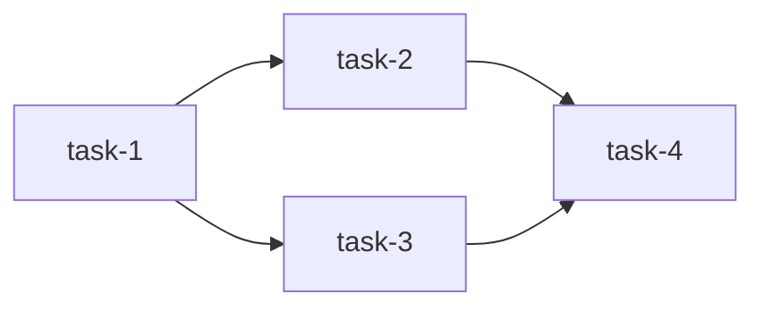
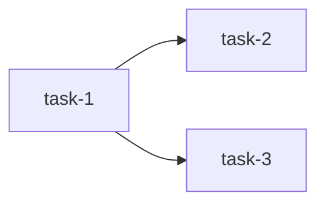
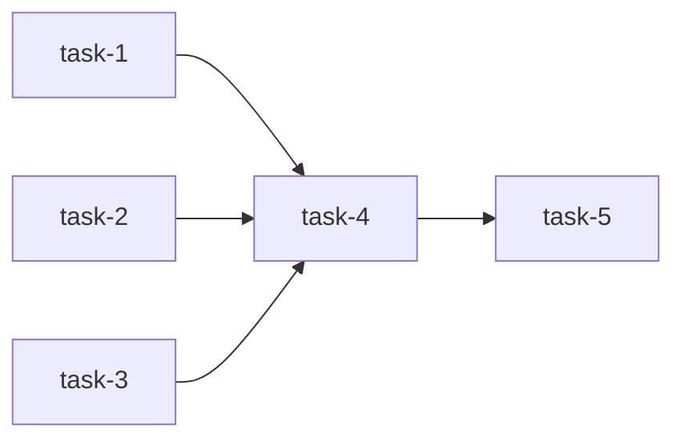

# 검색 계약 tasks (구현 계획 + 진행)

<!-- design.md를 바탕으로 쓴 구현 계획이다. 이슈 계획 하나 = 이슈 하나 = 브랜치 하나 = PR 하나.
     design.md 10절대로 셋으로 나눈다: m2-i1 = A1(검색 계약 코드), m2-i2 = A2(DB·덤프), m2-i3 = B(채점기).
     B와 이슈 #66·#67은 A1만 있으면 시작할 수 있다. A2는 A1 뒤 B와 동시에 해도 된다.
     requirements·design은 PR #96 리뷰 중(상태: 초안)이다. 두 문서가 승인되기 전에는 이 계획도 승인하지 않는다.
     어림 크기는 코드 + 테스트 줄이다. fixture 데이터 줄(JSONL·JSON·YAML)은 세지 않는다. -->

## m2-i1  (11/19)  상태: 승인  (A1, 이슈 #98. 11/18 승인, 상대 리뷰는 PR에서)
**구현할 design 부분**: design.md 3-2, 5-1 저장소 인터페이스, 7-1 검색 인터페이스, 7-2   **맡은 합격 기준**: requirements.md 1
**목표** (한 줄): #66·#67과 채점기가 바로 쓸 수 있는 검색 계약 코드(스키마·`Searcher`·공통 검사 래퍼·메모리 저장소·`fake` 구현)를 만든다.
**끝나면 보여 줄 것** (데모 한 줄): `uv run pytest tests/retrieval` 통과. 테스트 하나가 `get_searcher("fake", InMemoryChunkRepository.from_jsonl("cite", "tests/fixtures/retrieval/chunks_cite.jsonl"), {"index_version": "cite-idx-v1"}).search(...)`로 한 공보 안 상위 k를 돌려준다.
**어림 크기**: 코드 약 230줄 + 테스트 약 170줄 = 약 400줄.

### task-1: 스키마 (`Chunk`·`SearchHit`·`SearchResult`)
- 담당: 재아
- 합격 기준: requirements.md 1 (결과 모양, 상태 값)
- 고칠 파일: `src/patent_ai/retrieval/schemas.py`, `tests/retrieval/test_schemas.py`, `docs/data-model.md`(4절 아래 "도구 결과: `SearchResult`(검색, `retrieval/schemas.py`)" 한 줄)
- 만들 함수·인터페이스 모양:
  - `Corpus = Literal["law","cite"]`, `Mode = Literal["bm25","vector","hybrid"]`
  - `Location`, `Edition`, `Chunk`(design.md 5-1 칸에서 `embedding`·`created_at` 뺀 것 + 선택 `embedding: list[float] | None`)
  - `SearchHit(Chunk)` + `score`·`rank`, `SearchScope`, `SearchResult`(design.md 3-2 JSON 그대로)
- 테스트할 경우:
  - 평소: design.md 3-2 JSON 예시가 `SearchResult`로 읽히고 다시 같은 JSON으로 나옴
  - 빈 입력: `hits=[]` + `status=not_found_in_scope` 읽힘
  - 실패: `edition.status`에 정해진 값 밖 → 검증 오류, `status`가 `confirmed`/`conflict`인 검색 결과 → 검증 오류, `hits`가 있는데 `status`가 null이 아님 → 검증 오류 (검색 결과는 빈 결과일 때만 상태를 가짐)
- 확인 방법: `uv run pytest tests/retrieval/test_schemas.py` → 전부 통과
- 먼저: 없음

### task-2: `Searcher`·등록표·공통 검사 래퍼 `CheckedSearcher`
- 담당: 재아
- 합격 기준: requirements.md 1 (`impl` 고르기, `hybrid` 지원 안 함, 색인 판 검사)
- 고칠 파일: `src/patent_ai/retrieval/contract.py`, `src/patent_ai/retrieval/errors.py`, `src/patent_ai/retrieval/__init__.py`, `tests/retrieval/conftest.py`(등록표를 테스트마다 원래대로 되돌리는 fixture), `tests/retrieval/test_contract.py`
- 만들 함수·인터페이스 모양:
  - `class Searcher(Protocol)`, `register_impl(name)`, `get_searcher(impl, repo, settings) -> Searcher`(늘 `CheckedSearcher`로 감쌈)
  - 오류: `UnknownImplError`(등록된 이름 목록), `ModeNotSupportedError`, `UnknownIndexVersionError`, `IndexVersionMismatchError`
  - `CheckedSearcher` 검사는 design.md 7-1 그대로: 부르기 전 `k ≥ 1`·값·`hybrid`·색인 판 존재, 받은 뒤 개수 ≤ k·색인 판 같음·순서
- 테스트할 경우 (테스트 안에서만 등록하는 가짜 구현·가짜 저장소로):
  - 평소: 이름으로 고름, 정상 결과 그대로 통과
  - 빈 입력: `k=0` → `ValueError`, `settings`에 `index_version` 키가 없음 → `ValueError`, `doc_ids=[]` → `ValueError`
  - 실패: 없는 `impl`(메시지에 등록된 이름), `hybrid`, 저장소에 없는 `index_version`, 다른 색인 판 조각을 섞어 돌려주는 가짜 구현 → `IndexVersionMismatchError`, k보다 많이 돌려주는 가짜 구현 → 오류, 순서가 틀린 가짜 구현 → 오류
- 확인 방법: `uv run pytest tests/retrieval/test_contract.py` → 전부 통과
- 먼저: task-1

### task-3: `ChunkRepository`와 메모리 저장소
- 담당: 재아
- 합격 기준: requirements.md 1 (거를 문헌, 기준일, 법령 판본 모름 조각)
- 고칠 파일: `src/patent_ai/retrieval/repository.py`, `tests/fixtures/retrieval/chunks_cite.jsonl`, `chunks_law.jsonl`, `tests/retrieval/test_repository.py`
- 만들 함수·인터페이스 모양:
  - `class ChunkRepository(Protocol)`
    - `chunks(corpus, index_version, doc_ids=None, as_of=None) -> list[Chunk]`
    - `has_index_version(corpus, index_version) -> bool`
    - `count_chunks(corpus, index_version, doc_ids=None) -> int` (거를 문헌 조각이 0개인지 볼 때)
    - `count_unverified_edition(corpus, index_version, doc_ids=None) -> int` (기준일 검색에서 빠지는 조각 수)
  - `InMemoryChunkRepository.from_jsonl(corpus: Corpus, *paths)`: `Chunk`에는 말뭉치 칸이 없으므로 어느 표의 줄인지 인자로 받는다. 여러 말뭉치는 `from_jsonl`을 말뭉치마다 부른 뒤 `merge(...)`로 합친다.
- 테스트할 경우:
  - 평소: 색인 판으로 거름, `doc_ids`로 한 공보만, `as_of`로 그날 시행 법령 판본만 (`effective_to` 없음 = 현행)
  - 빈 입력: 없는 공보 → 빈 목록 + `count_chunks` 0. `doc_ids=[]` → `ValueError` (`None`만 "전체")
  - 실패: `as_of` 검색에서 법령 판본 `unverified` 조각은 빠지고 `count_unverified_edition`에 셈, 말뭉치와 색인 판 앞말이 다른 줄(`law` 표에 `cite-idx-v1`)을 읽으면 오류
- 확인 방법: `uv run pytest tests/retrieval/test_repository.py` → 전부 통과
- 먼저: task-1

### task-4: `fake` 구현 (녹화 벡터)
- 담당: 재아
- 합격 기준: requirements.md 1 (`not_found_in_scope`, `unverified(text_missing)`, `skipped_unverified_edition`)
- 고칠 파일: `src/patent_ai/retrieval/fake.py`, `tests/fixtures/retrieval/query_vectors.json`, `tests/retrieval/test_fake_search.py`
- 만들 함수·인터페이스 모양: `@register_impl("fake") class FakeSearcher`
  - `bm25`: 공백으로 자른 낱말이 질의와 겹치는 수
  - `vector`: 코사인 유사도 (녹화에 없는 질의 → `RecordedEmbeddingMissing`)
  - 점수 0 이하인 조각은 결과에서 뺀다
  - 거른 문헌 조각이 0개면 `status=unverified`, `status_reason=text_missing`. 결과가 0개면 `status=not_found_in_scope`
- 테스트할 경우 (모두 `get_searcher("fake", …)`로, 래퍼를 거쳐서):
  - 평소: bm25·vector 상위 k, 같은 점수 `chunk_id` 오름차순, 한 공보 안만, 기준일 거르기 + `skipped_unverified_edition`
  - 빈 입력: 겹치는 낱말 없는 질의 → `not_found_in_scope` + `scope`, 없는 공보 → `unverified(text_missing)`
  - 실패: 녹화 없는 질의 → `RecordedEmbeddingMissing`
- 확인 방법: `uv run pytest tests/retrieval` → 전부 통과
- 먼저: task-2, task-3

### 이번에 안 하는 것
- DB 표·Postgres 저장소·덤프 (→ m2-i2), 채점기 (→ m2-i3).
- 진짜 BM25·벡터 구현, 색인 스크립트, 청킹 (→ #66·#67). `hybrid` 구현.

### 진행
- [ ] task-1
- [ ] task-2
- [ ] task-3
- [ ] task-4
- 다음: 계획 승인 뒤 `/implement docs/features/retrieval/tasks.md m2-i1`. 머지되면 은진 님에게 "#66 시작 가능" 알림
- 막힌 것: 없음

### 끝난 뒤 (이슈가 끝난 날)
- 된 것 / 안 된 것 / 다음 이슈로

## m2-i2  (11/20)  상태: 초안  (A2, 이슈 번호는 승인 뒤)
**구현할 design 부분**: design.md 5-1 표·Postgres 저장소, 5-2   **맡은 합격 기준**: requirements.md 2, 6(있으면 좋음), 7(있으면 좋음)
**목표** (한 줄): 조각 표 두 개를 마이그레이션으로 만들고, Postgres 저장소와 말뭉치별 덤프·받기를 채운다.
**끝나면 보여 줄 것** (데모 한 줄): `make db` 뒤 `make test-db` 통과, `make index-dump CORPUS=cite`가 `data/index/cite-idx-v1.dump`와 `.revision`을 만든다.
**어림 크기**: 코드 약 200줄 + 테스트 약 150줄 = 약 350줄.

### task-1: 조각 표 ORM·마이그레이션
- 담당: 재아
- 합격 기준: requirements.md 2 (표 둘, 칸, 법령 판본 모름 저장)
- 고칠 파일: `src/patent_ai/db/models/__init__.py`, `src/patent_ai/db/models/chunks.py`(`ChunkColumns` mixin, `LawChunk`, `CiteChunk`), `src/patent_ai/db/migrations/env.py`(`patent_ai.db.models` import), `src/patent_ai/db/migrations/versions/<rev>_retrieval_chunks.py`, `pyproject.toml`·`uv.lock`(`pgvector`), `tests/retrieval/test_chunk_models.py`
- 만들 함수·인터페이스 모양: 칸은 design.md 5-1 표 그대로. CHECK: 법령 표 `index_version ~ '^law-idx-v[0-9]+$'`, 인용문헌 표 `'^cite-idx-v[0-9]+$'`, `edition_status IN ('confirmed','unverified','not_applicable')`. 마이그레이션은 `alembic revision --autogenerate`로 만든 뒤 읽고 고친다 (db/CLAUDE.md).
- 테스트할 경우 (DB 없이):
  - 평소: 오프라인 SQL(`alembic upgrade head --sql`)에 두 표, `CREATE EXTENSION IF NOT EXISTS vector`, 길이 없는 `vector` 칸이 있음. ORM 칸 목록이 두 표에서 같음
  - 빈 입력: 오프라인 SQL에 `edition_status`의 `NOT NULL`이 있음
  - 실패: 오프라인 SQL에 두 CHECK 문구가 있음 (실제 거부는 task-2 db 테스트)
- 확인 방법: `uv run pytest tests/test_migrations.py tests/retrieval/test_chunk_models.py` → 통과
- 먼저: m2-i1 task-1 (`Chunk` 칸)
- 주의: 지금 `migrations/versions/`가 비어 있다. 서버 이슈 #55와 head가 둘이 되면, 나중에 머지하는 쪽이 `down_revision`을 고친다 (db/CLAUDE.md).

### task-2: `PostgresChunkRepository`와 db 테스트
- 담당: 재아
- 합격 기준: requirements.md 7 (있으면 좋음)
- 고칠 파일: `src/patent_ai/retrieval/repository.py`(`PostgresChunkRepository`, `chunk_to_row(corpus, chunk)`·`row_to_chunk(row)` 변환 함수 더함), `tests/test_retrieval_db.py`(`@pytest.mark.db`)
- 만들 함수·인터페이스 모양: `PostgresChunkRepository(session)`. `ChunkRepository` Protocol의 네 메서드를 메모리 저장소와 같은 거르기로 구현한다.
- 데이터 정리: db 테스트는 세션을 트랜잭션 안에서 열고 테스트 끝에 되돌리는 fixture로 감싼다. 두 번째 `make test-db`에서도 같은 `chunk_id` 충돌이 없다.
- 테스트할 경우 (`@pytest.mark.db`):
  - 평소: m2-i1 fixture 조각을 두 표에 넣고, 메모리 저장소와 같은 질의에 같은 조각 ID가 나오는지 비교. 연달아 두 번 돌려도 통과
  - 빈 입력: 없는 색인 판 → `has_index_version` False
  - 실패: 법령 표에 `cite-idx-v1` 넣기 → CHECK 위반, `edition_status` 없이 넣기 → NOT NULL 위반
- 확인 방법: `make db && make test-db` → `test_retrieval_db.py` 통과 (CI는 Postgres 서비스 컨테이너)
- 먼저: task-1

### task-3: `make index-dump`·`index-load` 채우기
- 담당: 재아
- 합격 기준: requirements.md 2 (덤프), 6 (있으면 좋음, revision 검사)
- 고칠 파일: `Makefile`(index-dump·index-load, 45~46줄 옛 이름 예시 고침), `src/patent_ai/db/index_dump.py`(이름·revision 함수, `python -m patent_ai.db.index_dump`), `tests/retrieval/test_index_dump.py`, `docs/team/local-db.md`(`load-fixture` 손 확인 한 줄)
- 만들 함수·인터페이스 모양:
  - `dump_name(corpus, versions) -> str`: 가장 높은 색인 판 → `<말뭉치>-idx-v<n>.dump`. 숫자로 비교한다 (`v10` > `v9`).
  - `parse_alembic_current(text) -> str`: `" (head)"`를 떼고, 비어 있으면 오류.
  - `check_revision(dump_rev, current_rev) -> None`: 다르면 `RevisionMismatch`.
  - CLI `python -m patent_ai.db.index_dump <하위 명령>` (`main(argv) -> int`, 성공 0 / 실패 1, 실패하면 이유 한 줄):
    - `name <말뭉치>`: DB 표의 색인 판으로 덤프 이름을 찍음
    - `check-revision <.revision 파일>`: 현재 DB revision과 비교
    - `load-fixture <말뭉치> <jsonl>`: 손 확인용으로 fixture 조각을 그 말뭉치 표에 넣음 (같은 `chunk_id`가 있으면 건너뜀)
  - Makefile은 위 하위 명령을 부른다.
- 테스트할 경우:
  - 평소: `["cite-idx-v1","cite-idx-v2"]` → `cite-idx-v2.dump`, `v9`·`v10` → `v10`, `"abc123 (head)"` → `abc123`
  - 빈 입력: 색인 판 없음 → 오류, `alembic current` 출력이 빔(마이그레이션 전) → 오류
  - 실패: `CORPUS`가 `law`·`cite`가 아님, 다른 말뭉치 색인 판 섞임, revision 다름 → 오류. `.revision` 옆 파일이 없으면 경고만
- 확인 방법: `uv run pytest tests/retrieval/test_index_dump.py` → 통과. 손 확인: `make db` → `uv run python -m patent_ai.db.index_dump load-fixture cite tests/fixtures/retrieval/chunks_cite.jsonl` → `make index-dump CORPUS=cite` → `data/index/cite-idx-v1.dump`·`.revision` 생김
- 먼저: task-1

### 이번에 안 하는 것
- 채점기 (→ m2-i3), 색인 스크립트·실제 조각 (→ #66·#67).

### 진행
- [ ] task-1
- [ ] task-2
- [ ] task-3
- 다음: m2-i1 머지 뒤 `/implement docs/features/retrieval/tasks.md m2-i2`
- 막힌 것: 없음

### 끝난 뒤 (이슈가 끝난 날)
- 된 것 / 안 된 것 / 다음 이슈로

## m2-i3  (11/20~11/21)  상태: 초안  (B, 이슈 번호는 승인 뒤)
**구현할 design 부분**: design.md 2절, 7-1 정답 파일·채점기·CQ 파일, 7-3, 7-4, 7-5   **맡은 합격 기준**: requirements.md 3, 4, 5
**목표** (한 줄): 가짜 조각·가짜 정답으로 심사관 지정 위치 회수율·무작위 기준선·CQ 후보를 내는 채점기를 만든다.
**끝나면 보여 줄 것** (데모 한 줄): 테스트가 임시 폴더에 정답 세트 구조(`VERSION`, `tune/retrieval/gold_ok.jsonl`)를 만들고 `main(["--config", …, "--goldsets-root", <임시>, "--chunks", "tests/fixtures/retrieval/chunks_check.jsonl"], commit="test")`를 부른다. 그러면 `work/retrieval/<실험>/` 아래 `scores.json`(Hit@5 = 1, Recall@5 = 0.5, 무작위 Recall@5 ≈ 0.738)과 CQ 후보 파일이 생긴다.
**어림 크기**: 코드 약 270줄 + 테스트 약 180줄 = 약 450줄. CQ(task-5)를 떼면 `score.py`를 두 이슈가 같이 고쳐 병렬이 안 되고 PR만 늘어서 이 계획에 둔다 (11/18 결정). 약 450줄, PR 본문에 커밋별 리뷰 순서를 적는다.

### task-1: 정답 파일·실험 설정 읽기와 실행 전 검사 (누출 검사 포함)
- 담당: 재아
- 합격 기준: requirements.md 3 (실행 전 검사)
- 고칠 파일: `eval/__init__.py`, `eval/retrieval/__init__.py`, `eval/retrieval/gold.py`, `eval/retrieval/config.py`, `eval/retrieval/checks.py`, `pyproject.toml`·`uv.lock`(`pyyaml`, `[tool.pytest.ini_options] pythonpath = ["."]`), `tests/fixtures/retrieval/gold_*.jsonl`·`config_*.yaml`, `tests/retrieval_eval/test_checks.py` (`tests/eval/`로 두면 진짜 `eval` 패키지를 가리므로 이 이름. `__init__.py` 안 둠)
- 만들 함수·인터페이스 모양:
  - `GoldItem`, `GoldRow`, `load_gold(path) -> list[GoldRow]`, `load_config(path) -> RetrievalEvalConfig`
  - `RetrievalEvalConfig` 칸: `experiment`, `goldset`, `goldset_version`, `corpus`, `index_version`, `mode`, `impl`, `k: list[int]`, `gold`(세트 폴더 기준 상대 경로), `law_location_rule`(선택), `settings`(선택, 구현에 넘김)
  - `preflight(cfg, gold, repo, goldsets_root, chunks_mode: bool, scores_dir, cq_dir) -> None`. 걸리면 `RetrievalEvalError`를 내고, 메시지에는 `row_id`와 건수만 넣는다 (질의 글자 없음).
  - `find_leaks(row) -> list[str]`: 패턴은 design.md 7-3.
- 테스트할 경우:
  - 평소: 맞는 설정은 통과. "온도 300℃", "0.0023 중량%", "중량비 3:10", "제1항에 있어서", "기판(110)" 질의도 통과
  - 빈 입력: `gold_empty.jsonl` → 실패
  - 실패: 없는 색인 판, `goldset_version` ≠ `VERSION`, `gold:`에 `..`·절대 경로, `--cq-dir`이 git 안 경로(무시되지 않음, 예 `docs/x`), `gold_leak.jsonl`(`[0023]`·`도 3`·`제29조 제2항`) → 실패, `chunks_mode`인데 `scores_dir`이 `experiments/` 아래 → 실패. 메시지에 질의 글자가 없음
- 확인 방법: `uv run pytest tests/retrieval_eval/test_checks.py` → 전부 통과
- 먼저: m2-i1

### task-2: 맞음 판정 `CiteMatcher`·`LawMatcher`와 법령 위치 규칙 등록
- 담당: 재아
- 합격 기준: requirements.md 4
- 고칠 파일: `eval/retrieval/matchers.py`, `tests/retrieval_eval/test_matchers.py`
- 만들 함수·인터페이스 모양: `Matcher.matches(chunk, item, row) -> bool`, `MATCHERS`, `register_law_location_rule(name)`, 기본값 `overlap_or_label`
- 테스트할 경우:
  - 평소: `[0022-0025]` 안 `[0023]` 맞음, 칼럼:줄 `30050~40005` 겹침 맞음, 도면 3을 담은 본문 조각 맞음, 요약 조각 맞음, 법령 판본 같음 + 위치 같음 맞음
  - 빈 입력: 정렬 키 null → `loc_label` 글자가 같을 때만 맞음 (인용문헌·법령 둘 다)
  - 실패: 같은 공보 다른 문단 틀림, 다른 공보 틀림, 법령 판본 다름 틀림, 없는 위치 규칙 이름 → 오류
- 확인 방법: `uv run pytest tests/retrieval_eval/test_matchers.py` → 전부 통과
- 먼저: m2-i1 task-1 (`Chunk`)

### task-3: 계산식 (순수 함수)
- 담당: 재아
- 합격 기준: requirements.md 3 (Hit@k·Recall@k·무작위 기준선)
- 고칠 파일: `eval/retrieval/metrics.py`, `tests/retrieval_eval/test_metrics.py`
- 만들 함수·인터페이스 모양: `row_hit(matched_items_by_rank: list[set[int]], k: int) -> int`, `row_recall(matched_items_by_rank: list[set[int]], n_items: int, k: int) -> float` (순위마다 그 조각이 맞힌 항목 번호 집합), `random_recall(n, match_sizes, k) -> float`, `random_hit(n, union_size, k) -> float`
- 테스트할 경우 (기대값은 design.md 7-3 점검 예, `pytest.approx(abs=1e-3)`):
  - 평소: `random_recall(10, [4, 1], 5)` ≈ 0.738, `random_hit(10, 5, 5)` ≈ 0.996, 줄 Hit@5 = 1·Recall@5 = 0.5
  - 빈 입력: N < k이면 k' = N, `match_sizes` 중 0 → 그 항목 확률 0
  - 실패: N = 0 → 오류 (거를 문헌 조각 0개는 그 전에 빠져야 함)
- 확인 방법: `uv run pytest tests/retrieval_eval/test_metrics.py` → 전부 통과
- 먼저: 없음

### task-4: `score()`·CLI·`scores.json`
- 담당: 재아
- 합격 기준: requirements.md 3
- 고칠 파일: `eval/retrieval/score.py`(`score(cfg, repo, goldsets_root, commit) -> ScoreReport`, `main(argv, commit: str | None = None) -> int`), `tests/retrieval_eval/test_score.py`, `tests/fixtures/retrieval/chunks_check.jsonl`, 루트 `CLAUDE.md` "채점 명령" 줄
- 만들 함수·인터페이스 모양: design.md 7-1 채점기 (옵션 `--goldsets-root`·`--chunks`·`--scores-dir`·`--cq-dir`, 종료 코드, `scores.json` 칸)
- 테스트할 경우:
  - 평소: `gold_ok.jsonl` + `chunks_check.jsonl` → Hit@5 = 1, Recall@5 = 0.5, 무작위 Recall@5 ≈ 0.738, 배수 ≈ 0.68, `--chunks`라 출력이 `work/retrieval/<실험>/`에 감
  - 빈 입력: `gold_excluded.jsonl` → 빼는 이유별 건수, `gold_all_excluded.jsonl` → `main` 1 반환, 무작위 분모 0 → `recall_ratio@k` 키 없음 + `failures.recall_ratio_undefined`
  - 실패: `--chunks` 없음 → `main` 1 반환 + "Postgres 저장소 없음(m2-i2)" 한 줄, 줄 검색 예외(녹화 없는 질의) → `main` 1 반환, `--chunks` + `--scores-dir experiments/x` → 1 반환·파일 안 생김, `scores.json`에 `row_id`·질의 글자 없음, `commit`은 `main(..., commit="abc")`로 넣은 값
  - 무작위 분모 0 줄(정답 항목에 맞는 조각이 범위에 하나도 없는 줄)은 `gold_excluded.jsonl`에 둔다
- `--chunks` 없는 경로: m2-i3은 m2-i1에만 기대므로 `PostgresChunkRepository`를 import하지 않는다. m2-i2와 m2-i3 중 나중에 머지되는 쪽 task에서 `score.py` 한 줄로 연결한다 (`score.py`는 두 이슈가 겹치는 파일).
- 확인 방법: `uv run pytest tests/retrieval_eval/test_score.py` → 통과
- 먼저: task-1, task-2, task-3

### task-5: CQ 후보 파일과 모으기
- 담당: 재아
- 합격 기준: requirements.md 5
- 고칠 파일: `eval/retrieval/cq.py`(쓰기, 0건 경고), `eval/retrieval/cq_merge.py`(`main(argv) -> int`), `eval/retrieval/score.py`(`main`이 `write_cq`를 부르고 `failures.cq_candidates`에 셈), `tests/retrieval_eval/test_cq.py`, `tests/retrieval_eval/test_score.py`(CQ 파일 생김·건수)
- 만들 함수·인터페이스 모양: `write_cq(report, path)`, `merge_cq(paths) -> list[dict]`
- 테스트할 경우:
  - 평소: 가장 큰 k 안에 맞은 항목이 없는 줄만 쓰고 `why`는 빈칸, `main`을 부르면 `--cq-dir`에 파일이 생기고 `scores.json`의 `failures.cq_candidates`가 줄 수와 같음. 두 파일 교집합
  - 빈 입력: 후보 0건 → 경고 로그(`caplog`), 교집합 0건 → 경고. `cq_merge`에 파일 0개 → 종료 1, 1개 → 그 파일 그대로 복사
  - 실패: `goldset_version`·`gold_sha256`가 다른 파일끼리 → `main` 1 반환, 메시지에 다른 칸 이름
- 확인 방법: `uv run pytest tests/retrieval_eval/test_cq.py` → 통과
- 먼저: task-4

### 열린 항목 (메모)
- 조문 누출 검사는 조 번호만 본다. 정답이 "제29조 제2항"이면 질의의 "제29조 제1항"이나 "롤러 2조"도 누출로 잡힌다. #66에서 법령 질의 모양을 정할 때 같이 본다.
- `tests/retrieval/`, `tests/retrieval_eval/`에 `__init__.py`가 없다. 나중에 두 폴더에 같은 이름의 테스트 파일이 생기면 pytest 수집이 충돌한다. 그때 이름을 바꾸거나 패키지로 만든다.

### 이번에 안 하는 것
- 은진 님 정답 파일 변환 스크립트, 법령 위치 규칙 실제 값, 실제 tune 점수·`/experiment` 연결 (→ #66·#67).

### 진행
- [ ] task-1
- [ ] task-2
- [ ] task-3
- [ ] task-4
- [ ] task-5
- 다음: m2-i1 머지 뒤 `/implement docs/features/retrieval/tasks.md m2-i3` (m2-i2와 동시에 해도 됨)
- 막힌 것: 없음

### 끝난 뒤 (이슈가 끝난 날)
- 된 것 / 안 된 것 / 다음 이슈로
