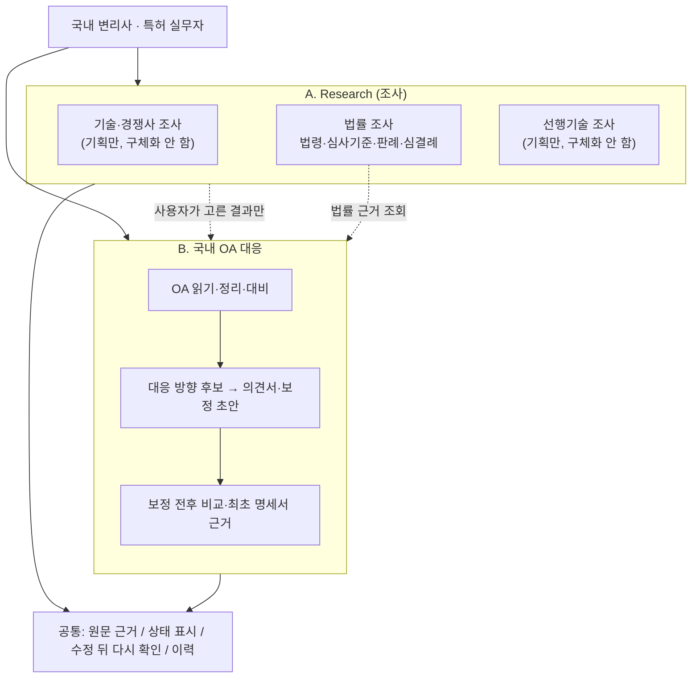
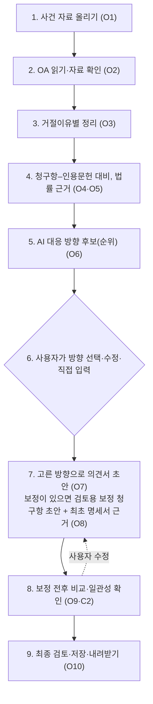

# Patent Professional AI Workspace — 서비스 기획서 v3.1

> **판:** v3.1 · 2026-11-13. 팀의 단일 기준 기획서다. 이전 판(v3.0)은 저장소에 두지 않는다.
> **지위:** 제공하려는 서비스 전체를 정의한다. 3주 첫 결과물의 범위와 일정은 [product.md](../product.md)(3주 PRD)에 있다.
> **결정 기록:** 큰 결정은 [ADR 0001](../decisions/0001-ai-amended-claim-draft.md)(AI 보정 초안), [ADR 0002](../decisions/0002-first-build-scope.md)(3주 범위)에 있다.
> **표시:** 확정 = 팀이 정함. 후보 = 설계에서 비교할 안, 채택 아님. 미정 = 데이터·설계 뒤에 정함.

---

## 1. 서비스 한 줄과 해결할 문제

국내 변리사·특허 실무자가 **법률 자료를 조사**하고 **국내 의견제출통지서(OA)에 대응**할 때, 출처·원문 위치·시점이 붙은 답변과 문서 초안을 만들고, 사람이 검토·수정·확정하게 돕는 AI 업무 공간이다. OA는 심사관이 거절이유를 알리고 의견서·보정서를 낼 기회를 주는 문서다.

| 업무 상황 | 반복되거나 어려운 일 (가설) | 서비스가 주는 것 |
|---|---|---|
| 법률·심사 쟁점 조사 | 법령·심사기준·판례·심결례를 찾고 그 시점에 맞는 판본인지 확인 | 질문 깊이에 맞춘 답변, 주장별 출처·판본·한계, 요청 시 검토 보고서 |
| 국내 OA 대응 | OA 읽기, OA 당시 청구항·인용문헌 맞추기, 지적별 대비, 대응 방향 정하기, 의견서·보정서 쓰기 | 거절이유별 정리, 대비 결과와 원문 위치, 대응 방향 후보, 의견서·검토용 보정 청구항 초안 |
| 결과물 검수 | AI가 쓴 문장의 근거 확인, 인용 오류·누락 수정 | 문장별 근거·상태 표시, 수정 뒤 다시 확인 |

위 문제는 **실무 자료에 근거한 가설**이다. 변리사 인터뷰·시간 측정·수요 검증은 하지 않았다.

프로젝트 목표: AI 에이전트·하네스·RAG를 실제 문제에 적용하고, 기획·설계·구현·검증 과정과 한계를 기록한다.

---

## 2. 사용자와 책임

- **1차 사용자:** 특허사무소·특허법인에서 조사·심사 대응을 맡는 변리사·실무자. 한국어, 국내 OA 중심.
- **초기 기술 분야:** 컴퓨터 비전. 세부 분야는 미정.
- **AI가 하는 일:** 자료 찾기·구조화·대비, 근거 후보와 논거 후보 제시, **거절이유 × 단위(진보성은 독립항 묶음, 명확성은 청구항)별 대응 방향 후보에 순위·이유·확신도 제시**, 고른 방향의 **의견서 초안과 검토용 보정 청구항 초안·최초 명세서 근거 후보 작성**, 검증과 오류 표시. (ADR 0001)
- **사람이 하는 일:** 대응 방향 선택, 논거·보정안 채택·수정·직접 작성, 법률 판단(사건에 실제로 적용되는가), 최종 승인·제출.
- AI의 순위는 "검토 순서 제안"이고 성공·등록을 보증하지 않는다. 확신이 낮으면 순위 없이 사람에게 넘긴다. 보정안이 법적으로 허용되는지(예: 최초 명세서·도면에 기재된 범위를 벗어났는가)는 전문가가 판단한다.

---

## 3. 설계 원칙 (확정)

1. **독립 업무, 선택 연결:** 법률 조사와 OA 대응은 서로 먼저 할 필요가 없다. 사용자가 고른 조사 결과만 OA로 가져간다.
2. **업무에 맞는 AI:** 입력·도구·처리·결과·검증 기준이 업무마다 다르다. 같은 RAG 메뉴에 프롬프트만 바꿔 끼우지 않는다.
3. **근거 우선:** 결과마다 원문 위치·판본·시점·확인 상태를 붙인다. 확인하지 않은 위치는 추측하지 않는다.
4. **생성 → 검증 → 부분 수정:** 모든 보고서·의견서에 같은 검토 경험을 준다.
5. **되는 일은 하고, 빠진 자료에 기대는 일만 멈춘다.** 필요한 자료는 모아서 한 번에 요청한다.
6. **못 찾음 ≠ 없음:** 검색에서 못 찾은 것을 기술적·법적으로 없다고 단정하지 않는다.
7. **에이전트는 필요할 때만:** 결과를 보고 다음 행동을 바꿔야 할 때 쓰고, 순서가 정해진 처리는 규칙·코드로 한다.
8. **데이터 정직성:** 자료가 있다는 것, 표본을 읽었다는 것, 전체를 쓸 수 있다는 것, 이용 허가가 있다는 것, 성능을 쟀다는 것을 구분한다.

---

## 4. 전체 지도

### 4.1 영역과 업무

- 두 영역은 독립이다. OA 대응은 법률 조사를 먼저 하지 않아도 되고, 필요하면 OA 대응 중에 법률 근거를 바로 조회한다.
- Research 안의 **집중 대상은 법률 조사**다. 기술·경쟁사 조사와 선행기술 조사는 서비스 범위에 남기되 지금은 구체화하지 않는다. (ADR 0002)
- OA 대응에는 청구항·명세서 대비 능력이 들어 있다.

### 4.2 기능 목록

업무보다 잘게 나눈 기능 단위다. 3주에 만드는 것은 [product.md](../product.md)에서 이 번호로 고른다. 구체화 정도: ● 흐름·예외까지 정함, ◐ 방향만 정함, ○ 아직 정하지 않음.

| 번호 | 기능 | 한 줄 | 구체화 |
|---|---|---|---|
| **법률 조사** | | | |
| L1 | 질문 받기 | 자유 입력 하나로 받고, 시점·자료 유형은 선택 조건 | ● |
| L2 | 조사 진행·방향 조정 | 방향을 짧게 보이고 바로 조사, 진행 중 추가·범위 변경·중단 | ● |
| L3 | 법령·심사기준 판본 조회 | 시점에 맞는 판본 후보를 찾고 확인 기준일 표시 | ● |
| L4 | 판례·심결례 조회 | 전문/요지 구분, 판단 부분과 당사자 주장 구분 | ◐ |
| L5 | 답변과 근거 연결 | 질문 깊이에 맞춘 답변, 주장별 출처·원문 위치·한계 | ● |
| L6 | 근거 검토 | 출처 존재·위치·판본 + 원문이 설명을 뒷받침하는지 | ● |
| L7 | 보고서 작성·갱신 | 요청 시 보고서, 추가 조사 결과는 제안 → 버튼으로 반영 | ● |
| L8 | 보고서 내보내기 | 출처·시점·미확인 상태를 보존한 파일 | ◐ |
| L9 | 조사 기록·이어 하기 | 대화·근거·보고서·수정 상태를 다시 열기 | ◐ |
| L10 | OA로 보내기 | 고른 결과를 출처·판본·미확인 상태와 함께 OA에 전달 | ● |
| **OA 대응** | | | |
| O1 | 사건 자료 올리기·확인 | OA·당시 청구항·명세서·인용문헌·이전 보정, 버전·미확인 표시 | ● |
| O2 | OA 읽기 | 식별 정보·거절이유·조항·대상 청구항·인용문헌·인용 식별번호 추출 | ● |
| O3 | 거절이유별 정리 | 이유별 요약 + 관련 청구항·인용문헌 연결, 상세 | ● |
| O4 | 청구항–인용문헌 대비 | 구성요소별 대비, 원문 위치, 재조회, 심사관 지적과 AI 결과 구분 | ● |
| O5 | 법률 근거 찾기 | OA 쟁점에 맞는 조문·심사기준·판례 (L3·L4 사용) | ◐ |
| O6 | 대응 방향 후보 | 묶음별 방향 후보(순위·이유·확신도), 지적별 대응·보정 핵심·근거·확인 사항, 사건 전체 검사 | ● |
| O7 | 의견서 초안 | 고른 방향으로 거절이유별 의견 작성 | ● |
| O8 | 검토용 보정 청구항 초안 | 고른 방향에 보정이 있으면 초안 + 최초 명세서 근거 후보 | ● |
| O9 | 보정 전후 비교 | 당시 청구항(v0) · 최초 명세서 · 보정안(v1) 비교, 근거 위치 | ◐ |
| O10 | 최종 검토·저장·내려받기 | 대응 현황, 확인 필요 사항, 검토본 저장, 내려받기 | ◐ |
| **공통** | | | |
| C1 | 근거·상태 표시 | 원문 위치·판본·확인 범위가 붙은 상태 | ● |
| C2 | 수정 뒤 다시 확인 | 사용자가 고치면 영향받는 문장·근거에 "확인 필요"와 재확인 | ● |
| C3 | 진행·보류 | 가능한 작업은 진행, 빠진 자료에 기대는 작업만 보류 | ● |
| C4 | 실행·수정 이력 | 무엇을 어떤 자료·버전으로 검사했는지, 누가 무엇을 바꿨는지 | ◐ |
| **기획만 (구체화 안 함)** | | | |
| T1 | 기술·경쟁사 조사 | - | ○ |
| P1 | 선행기술 조사 | - | ○ |

---

## 5. 법률 조사

### 5.1 목적과 사용 상황
- 변리사·실무자가 법령·시행령·시행규칙, 심사기준·실무가이드, 판례·심결례를 **대화로 조사**하고, 출처·시점·한계를 확인하면서 답변이나 보고서를 검토·수정한다. 대화가 조사를 이끄는 것이 기본 경험이다.
- 첫 대표 상황은 **OA 대응 중 법률 쟁점 조사**다. 사건 없는 조문·주제 조회도 같은 입력으로 받는다.
- 판례·심결례는 서비스 범위에 포함한다.

### 5.2 사용자 흐름

| 단계 | 사용자 | 시스템 | 사용자에게 보이는 것 |
|---|---|---|---|
| 1. 조사 시작 (L1) | 질문·쟁점·키워드·사건번호를 자유롭게 입력. 아는 배경·시점·자료 유형을 더할 수 있음. 처음부터 보고서를 요청할 수도 있음 | 목적·범위·시점·자료 유형 파악. 중요한 정보가 없으면 묻되 할 수 있는 조사부터 시작. 자연어와 선택 조건이 부딪히면 사용자에게 확인 | 파악한 조사 방향과 확인 사항 |
| 2. 조사·방향 조정 (L2) | 진행 상태 보기, 추가 조사·범위 변경·중단 후 새 질문 | 확인을 기다리지 않고 조사. 지시가 추가인지 범위 변경인지 불명확하면 확인 | 실제 수행한 주요 작업 상태만 (세부 과정 중계 없음). 범위를 바꾸면 알리고 이전에 확인한 자료는 보존 |
| 3. 시점·판본 확인 (L3·L4) | 필요하면 과거 사건 시점을 알려 줌 | 시점이 없으면 현행 자료부터 찾고 확인 기준일 표시. 과거 사건이면 당시 판본 후보부터 찾음. 판본 후보와 "이 사건에 적용되는가"를 구분하고, 확인할 부칙(경과 규정) 표시 | 확인 기준일·판본·시행 시점, 판본·적용 미확인 사항 |
| 4. 답변·원문 확인 (L5) | 답변을 읽고 근거를 눌러 원문 확인, 추가 질문 | 확인한 자료에서 주장을 뒷받침하는 부분과 출처·위치 연결. 미발견·조회 실패·본문 미확보 구분, 중요한 반대 자료도 검토 | 조사가 끝나면 질문 깊이에 맞는 답변, 주장별 출처·한계. 근거를 누르면 확인된 원문 부분 먼저 |
| 5. 보고서 (L7) | 시작할 때나 대화 중 보고서 요청 | 필요하면 더 조사한 뒤 확인된 근거와 불확실성을 반영해 초안 | 핵심 요약 먼저, 상세 분석 아래 |
| 6. 수정·다시 확인 (C2) | 보고서를 고치고 근거 재확인 요청 | 고친 문장과 연결 근거를 다시 확인. 고친 뒤 이전 인용을 검증된 근거처럼 다루지 않음 | 고친 곳에 "확인 필요", 재확인 결과 |
| 7. 추가 조사 반영 (L7) | 추가 조사 요청 | 추가 내용·출처·반영 제안을 만듦. 조사만 요청하면 보고서를 덮어쓰지 않음 | 제안을 검토하고 버튼으로 반영. 문장을 바꾸면 전후와 근거를 보여 줌 |
| 8. 저장·내보내기·OA로 보내기 (L8~L10) | 기록을 다시 열어 이어 하기, 파일 내보내기, 고른 결과를 OA로 | 대화·근거·보고서·수정 상태를 기록에 연결. 고른 결과에 출처·시점·원문 위치·미확인 상태를 같이 넘김 | 이어서 볼 조사 기록, 내보낸 파일, OA에 전달된 자료. 가져왔다고 그 사건에 적용된다고 판단하지 않음 |

### 5.3 예외와 확인 수준
- 미발견, 조회 실패, 요지만 확보, 원문 미확보, 원문 위치 미확인, 판본·적용 불명확, 자료 간 충돌을 확인한 수준대로 구분한다. 미발견을 자료 없음으로 단정하지 않는다.
- 심결문 전문이 없으면 확인한 공식 요지를 "요지"로 표시해 쓸 수 있다. 확인하지 않은 본문·위치는 만들지 않는다.
- 사용자가 준 날짜가 그 사건의 적용 기준일인지 자동으로 확정하지 않는다. 근거가 있다는 것, 주장을 뒷받침한다는 것, 사건에 법적으로 적용된다는 것은 각각 다르다.
- 실제로 쓴 출처를 기본으로 연결하고, 중요한 반대 자료·미확인 후보는 "추가 검토할 자료"로 따로 둔다.

### 5.4 근거 검토 (L6)
- 두 가지를 다 본다: ① 쓴 자료의 존재·유형·원문 위치·판본·시점 ② 작성된 설명을 그 원문이 실제로 뒷받침하는가. 판결 전문과 요지를 구분한다. 뒷받침하지 않으면 고치거나 더 조사하고, 확인이 어려운 부분은 표시한다.
- 원문 위치는 자료 유형·원문/요지, 작성 주체(당사자 주장/판단), 문서 식별자, 논리적 위치(예: 판결 "이유 1")와 PDF·인쇄 쪽수를 구분해 표시한다.

---

## 6. 국내 OA 대응

### 6.1 입력 자료 (O1)

| 자료 | 용도 | 없거나 불명확하면 |
|---|---|---|
| 대응할 OA 원문 | 지적·청구항·인용·식별 정보 확인 | OA 기반 분석 보류, 문서 요청 |
| OA 당시 청구항 | 심사관이 본 청구항과 문헌 대비, 대응안 작성 | 버전 확인·자료 요청. OA 정리는 계속하고, 그 청구항에 기대는 초안만 보류 |
| 최초 명세서·도면 | 원래 적힌 발명 내용, 보정 근거 후보 | 근거에 기대는 보정 검토·초안 보류 또는 제한 |
| 인용문헌 원문 | 심사관 인용과 청구항을 원문으로 대조 | 다시 조회한 뒤 그 문헌만 요청, 그 문헌 대비만 보류 |
| 이전 보정서·의견서·처리 자료 | 당시 청구항 버전, 과거 대응 맥락 | 필요한 항목 요청, 버전에 미치는 영향 표시 |
| 사건 식별 정보 | 출원번호·OA 발송번호로 사건·통지 구분 | 문서에서 뽑아 원문과 대조, 누락·충돌은 사용자 확인 |
| 사용자 방향·선호 (선택) | 핵심 청구항·보호 범위 등 | 모르는 선호를 사실로 가정하지 않음 |
| 법률 조사 결과 (선택) | 사용자가 고른 조사 결과 | 법률 조사를 먼저 할 필요 없음. 필요하면 OA 안에서 조회 |

- 청구범위가 명세서에 들어 있으면 따로 요구하지 않는다. 공개공보만으로 최초·당시 청구항을 확정하지 않는다. 이력 검색 실패를 "보정 없음"으로 단정하지 않는다.
- **인용문헌은 한국·미국 문헌만 다룬다.** 일본 등 다른 나라 문헌은 지원 범위 밖으로 표시한다.

### 6.2 OA에서 뽑는 정보 (O2)
출원번호, 발송번호, 통지일·제출기일, 통지 종류(최초거절이유통지/최후거절이유통지, 확인 가능할 때), 지적 대상 청구항, 거절이유 원문·조항, 청구항–이유 관계, 인용문헌과 인용 식별번호·도면, (있으면) 특허 가능한 청구항과 심사관 참고사항. 날짜·법적 기한은 자동으로 확정하지 않고 원문 위치를 남긴다. 청구항 하나에 거절이유가 여럿 붙을 수 있으므로 OA 원문·조항·청구항 관계를 그대로 보존한다.

### 6.3 사용자 흐름

1. **자료 확인:** 시스템이 사건 식별 정보·자료·청구항을 읽고 버전과 불확실성을 보여 준다. 할 수 있는 조사·재확인을 먼저 하고, 부족한 자료나 판단은 모아서 요청한다.
2. **거절이유별 정리:** 거절이유별 요약과 관련 청구항·인용문헌 연결, 선택한 이유의 상세를 보인다. 청구항별로도 볼 수 있다.
3. **대비:** OA 지적, OA 당시 청구항, 인용문헌, AI 대비 결과와 원문 위치를 연결한다. **심사관이 OA에 쓴 지적 / AI 대비 결과 / AI가 새로 찾은 문단**을 나눠 보인다. 근거가 부족하면 다른 문단·도면을 다시 찾고, 실패하면 찾아본 범위와 "조회 범위 내 없음"을 표시한다.
4. **대응 방향 후보:** AI가 거절이유 × 독립항 묶음마다 후보를 순위·이유·확신도와 함께 보인다. 각 후보에는 거절이유별 대응, (보정이 있으면) 핵심 변경, 근거, 확인 사항을 짧게 정리한다. 보정 없이 의견만 내는 길과 보정과 함께 의견을 내는 길을 모두 둔다. 사용자는 1등을 그대로 받거나 바꿀 수 있다. 종속항은 독립항을 따르고, 독립항이 무너진 묶음만 따로 본다(진보성). 명확성은 청구항마다 본다. (ADR 0001)
5. **선택:** 묶음마다 1등 후보가 미리 선택되어 있고, 사용자가 바꾸거나 고쳐 쓰거나 직접 방향을 입력한다. 확신이 낮은 묶음은 사용자가 고를 때까지 그 묶음 초안만 보류한다.
6. **초안:** 고른 방향으로만 의견서 초안을 쓰고, 보정이 포함되면 검토용 보정 청구항 초안과 최초 명세서 근거 후보를 같이 만든다. 사용자가 보정안을 직접 쓸 수도 있다. 의견서 초안 구성 후보: 사건 정보 → 지적 요지 → 고른 대응과 근거 → (보정이 있으면) 보정 설명 → 마무리. 법정 서식은 아니다. (ADR 0001)
7. **보정 전후 비교:** OA 당시 청구항(v0), 최초 명세서, 보정안(v1, AI 초안 또는 사용자 작성)을 따로 저장하고 비교한다. 바뀐 요소와 최초 명세서 근거 위치를 보인다. 적법성은 전문가가 판단한다. (ADR 0001)
8. **수정하면 다시 확인:** 보정안·논거가 바뀌면 영향받는 의견서 문장과 근거에 "확인 필요"를 표시하고 변경안을 보여 준다. 사용자가 쓴 글을 몰래 덮어쓰지 않는다.
9. **최종 검토:** 의견서 초안과 (있으면) 보정 청구항, 거절이유별 대응 현황, 확인 필요 사항을 함께 보인다. 대응 현황은 "문서에 대응을 적었다"는 뜻이지 거절이유가 풀렸다는 판정이 아니다. 미확인이 남아도 그 상태를 적은 채로 저장할 수 있다. 화면 문구는 "검토할 사항 2건", "인용문헌 원문을 찾지 못했습니다"처럼 구체적으로 쓴다. 자동 제출은 하지 않는다.

### 6.4 결과물과 검증 항목

| 결과 | 주요 내용 | 확인할 것 |
|---|---|---|
| 사건 자료 확인 결과 | 사건·OA 식별, 자료 목록, 청구항 버전, 미확인·충돌 | 문서 간 번호·시점·출처, 읽기 오류. 이력 미검색 ≠ 보정 없음 |
| OA 지적 정리 | 거절이유·대상 청구항·인용문헌과 OA 원문 위치 | OA 내용과 일치, 누락. 심사관 지적과 AI 해석 구분 |
| 청구항–문헌 대비 | 요소별 심사관 연결, AI가 찾은 문헌 내용·차이·불확실성 | 당시 청구항 버전, 문헌 식별·원문 위치·내용 뒷받침 |
| 대응 방향 후보 | 묶음별 방향 후보(순위·이유·확신도), 지적별 대응·보정 방향·근거·확인 사항 | 자료·논거 연결, 누락·모순·가정. 순위는 검토 순서 제안, 성공 보장 아님 |
| 검토용 보정 청구항 | AI 초안 또는 사용자 작성, 전후 변경, 최초 명세서 근거 후보 | 기준 버전, 변경 내용·근거 위치, 의견서와 연관. 적법성은 전문가 판단 |
| 의견서 초안 | 고른 방향과 근거로 쓴 문서 | 지적별 대응 누락, 인용번호·조문·시점, 주장–원문, 보정안과 일치 |
| 최종 검토 결과·이력 | 초안, 대응 현황, 미확인 사항, 출처·수정·검사 이력 | 어떤 자료·버전으로 무엇을 검사했는지, 사용자 채택 상태 |

### 6.5 지원하는 거절이유
- 거절이유는 특허법 제62조가 나열하고, OA는 이유마다 조문 번호를 적는다. 서비스는 OA의 모든 거절이유를 정리해 보이되, **AI 대비·대응 초안은 지원 유형에만** 만든다. 지원하지 않는 유형은 "직접 검토 필요"로 표시한다. (특허법 제62조)
- 첫 지원 유형은 [product.md](../product.md) 3.2절에 적는다. 넓혀 갈 순서는 미정.

### 6.6 출력 형식
- 검토·수정용 결과는 DOCX를 우선 후보로 둔다. DOCX를 특허로(전자출원 사이트) 제출용으로 보지 않는다. 특허로 제출 서식(HLZ·DTA 등)은 장기 후보, MD는 선택 후보.

---

## 7. 두 업무의 연결

- 법률 조사에서 사용자가 **고른 결과만** OA로 가져간다. 출처·판본·원문 위치·미확인 상태를 같이 넘긴다. OA 대응만 따로 쓰는 것도 항상 가능하다.
- 가져온 결과는 그 OA의 시점·사실관계에 맞는지 다시 확인한다. "이전에 검토됨"이 다른 사건에 맞는다는 보증은 아니다.
- OA 대응 중 필요한 법률 근거는 법률 조사 기능(L3·L4)을 불러 바로 조회한다. 법령·심사기준·판례·심결례를 OA 쟁점 분석·대응 방향·의견서 근거로 쓴다.
- 법률 조사에 OA 파일을 직접 첨부하는 것은 확장 후보다. 법률 조사는 질문·텍스트 맥락을 받고, OA 읽기는 OA 대응이 맡는다.

---

## 8. 공통 경험

### 8.1 근거·상태 표시 (C1)
- 결과마다 자료 종류·문서·원문 위치와 그 시점·버전을 연결한다. 사용자가 입력한 내용은 출처를 구분한다. 근거를 못 찾으면 그렇게 표시한다.
- 시스템이 확인한 것과 사람이 판단할 것을 나눈다. 예: "문단이 있다"와 "그 문단이 청구항 요소와 같은 뜻이다"는 다르다. "확인됨"에는 무엇을 확인했는지 범위를 붙인다.
- 상태는 최소 네 가지로 나눈다: **확인됨 / 확인되지 않음 / 조회 범위 내 없음 / 충돌** (저장소 `CLAUDE.md`와 같음). 화면에 보일 이름과 적용 단위는 화면 설계에서 정한다. 상태는 품질 표시이고 법적 승패가 아니다.
- 모든 항목에 상태 선택을 강요하지 않는다. 사람이 판단할 것을 모아 보여 준다.

### 8.2 수정 뒤 다시 확인 (C2)
사용자가 보고서·의견서·보정안을 고치면 영향받는 문장과 근거에 "확인 필요"를 붙이고, 재확인을 요청할 수 있게 한다. 자동 재검증의 시점·세부는 미정.

### 8.3 진행·보류 (C3)
가능한 작업은 계속하고, 부족한 자료에 기대는 작업만 보류한다. 보류 이유와 필요한 자료를 모아서 안내하고, 자료가 들어오면 그 작업을 다시 시작한다. 재조회는 무한 반복하지 않고 찾아본 범위와 미확보 상태를 남긴다. 재조회 횟수·순서·비용 한도는 미정.

---

## 9. 기술·경쟁사 조사, 선행기술 조사

서비스 범위에 남긴다. 지금은 입력·흐름·검증을 구체화하지 않는다. 두 기능 모두 결과를 사용자가 골라 OA로 가져올 수 있다는 원칙은 같다. (ADR 0002)

---

## 10. AI 구성 원칙

- **규칙·코드:** 파일 읽기, 번호·날짜·버전 정리, 형식 검사, 번호 비교. **검색(RAG):** 자료별 후보 검색, 원문·문단 조회. **LLM:** 구조화, 의미 비교, 답변·대응 방향·초안 작성, 의미 오류 검토. **에이전트:** 결과를 본 뒤 다음 자료·질의·재조회를 바꿔야 할 때.
- **역할 후보 (법률 조사):** 조사 진행(요청·시점 파악, 역할 호출·종료), 자료 조사(검색 도구, 출처·확인 상태 전달), 근거 검토(주장–원문·시점·누락 확인, 필요하면 재조사 요청).
- **역할 후보 (OA 대응):** 대비·분석과 별도 근거 검토를 나누는 안. 모든 단계에 검토 역할을 두지는 않는다.
- 멀티에이전트 패턴(수퍼바이저 여부), 역할 수, 모델·DB·프레임워크는 기술 설계에서 정한다 → [architecture.md](../architecture.md). 여건이 되면 역할 분리 있음/없음을 품질·시간·비용으로 비교한다.
- 법률·특허 문헌을 외부 LLM에 보내도 되는지는 자료별로 확인한 뒤 정한다.

---

## 11. 데이터

- 쓰는 자료는 기능에 맞춰 정하고, 확정된 것만 `docs/data/<출처>.md` 데이터 카드로 둔다. 3주에 필요한 자료 종류는 [product.md](../product.md) 8절.
- 자료가 있다는 것, 파일을 받았다는 것, 원문을 읽었다는 것, 사건으로 연결했다는 것, 이용 허가가 있다는 것, 성능을 쟀다는 것은 다른 단계다.
- 공개 열람 가능 ≠ 대량 수집·외부 LLM 전송·재배포 가능. 원문과 파일별 내용은 git에 올리지 않는다 (저장소 `CLAUDE.md`).
- OA 당시 청구항은 공개·등록 청구항과 다를 수 있다. 출원번호 + 발송번호(OA) / 접수번호(보정)로 묶고, 불명확하면 그 청구항에 기대는 작업을 보류한다.

---

## 12. 평가

| 업무 | 무엇을 재나 | 깊이 |
|---|---|---|
| OA 대응 | OA 추출 필드 정확성, 대비 근거 위치 Precision/Recall, 초안 오류 탐지(일부러 넣은 오류 포함), 보정 전후 변경 감지 | 정량 (심층) |
| 법률 조사 | 근거 검토: 출처 존재·위치·판본 일치, 원문이 설명을 뒷받침하는가. 실제 질문 원문 대조 + 일부러 오류를 넣은 사례(없는 출처, 주장–원문 불일치, 다른 시점 판본을 사건 적용으로 단정, 요지만 보고 전문을 읽었다고 쓰기). 오류 발견뿐 아니라 재조사·수정·미확인 표시까지 | 정량 |
| 기술·경쟁사, 선행기술 | 구현할 때 정함 | - |
| 공통 | 에이전트·역할 분리 유무 비교: 품질 변화 + 비용·지연·호출 수 | 여건 되면 |

- 평가하지 않는 것: 사건에 대한 법적 적용 적절성, 어느 방향이 법적으로 나은지 (실제 방향과의 일치만 잰다), 보정안의 적법성. 변리사 평가자가 없으므로 결과 보고에 검증 한계로 적는다.
- 정답 주의: OA에 심사관이 적은 문단 번호를 검색 입력에 그대로 넣고 검색 성능으로 세지 않는다. 일부러 넣은 오류로 잰 성능을 실제 오류 검출 능력과 혼동하지 않는다.

---

## 13. 하지 않는 것

- AI가 대응 방향을 확정하거나 자동으로 채택하는 것. 순위는 제안까지. 법적 타당성·등록 가능성 보증. (ADR 0001)
- 보정안의 적법성(신규사항 추가 등) 자동 판정. (ADR 0001)
- 근거를 못 찾았다는 이유로 반박 주장을 자동 채택하는 것.
- 자동 제출.
- 실제 고객 사건·미공개 발명을 동의 없이 수집하거나 외부 모델에 보내는 것.

---

## 14. 확장 후보 (지금 범위 밖)

| 후보 | 내용 |
|---|---|
| 선택적 사전 초안 | 사용자가 원하면 방향을 고르기 전에 후보마다 초안을 미리 준비 (ADR 0001) |
| AI 추가 검토 사항 | OA에 없는 잠재 쟁점 후보를 따로 보임 (법률적 결론 아님) |
| 법률 조사에 OA 파일 첨부 | OA를 올리면 법률 조사가 쟁점을 잡아 시작 |
| 법률 조사 중간 결과 | 조사 도중 부분 결과 보여 주기 |
| 보고서 자동 반영 | 추가 조사 결과를 검토 없이 자동 반영 (선택) |
| 한국·미국 외 인용문헌 | 일본 등 외국어 인용문헌 원문·번역 대조 |
| 새 선행문헌 넓게 찾기 | OA 지정 문헌 밖에서 새 문헌 자동 검색 |
| 특허로 제출 서식 | HLZ·DTA 등 제출 서식 파일 |
| 그 밖의 업무 | 무효자료 조사, 번역, FTO(침해 회피 검토), 사건·기한 관리 등 |

---

## 15. 남은 결정

| 무엇 | 정할 곳 |
|---|---|
| 멀티에이전트 패턴·역할 수, 모델·DB·검색·프레임워크 | 기술 구조 설계 ([architecture.md](../architecture.md)) |
| 재조회 횟수·순서·비용 한도, 중단 기준 | 에이전트 설계 |
| 상태의 화면 이름과 적용 단위 | 화면 설계 |
| 출력 파일 형식 | 구현 단계 |
| OA 당시 청구항을 이력에서 복원할 수 있나 | 데이터 실증 |
| 데이터 이용 조건 (저장·외부 LLM 전송·재배포) | KIPRIS Plus에 문의 ([questions.md](../team/questions.md)) |
| 과거 사건 시점의 법령·심사기준 판본 확보 | 데이터 확보 |
| 최초 명세서에서 보정 근거 요소를 찾는 세부 흐름 | OA 설계 |
| 지원 거절이유를 넓히는 순서 | 3주 뒤 |

---

## 16. 용어

| 용어 | 뜻 |
|---|---|
| OA (의견제출통지서) | 심사관이 거절이유를 알리고 의견서·보정서를 낼 기회를 주는 문서. 이 기획은 국내 OA 중심 |
| 최초거절이유통지 / 최후거절이유통지 | 첫 거절이유통지와, 보정으로 새로 생긴 거절이유에 대한 통지. 최후거절이유통지 뒤에는 보정 범위가 특허법 47조 3항으로 제한된다 ([보정 범위](domain/보정_범위.md)) |
| 거절이유 | 특허를 줄 수 없는 이유. 특허법 제62조가 나열. 예: 진보성(29조 2항, 통상의 기술자가 선행기술로부터 쉽게 발명할 수 있음), 명확성(42조 4항 2호, 발명이 명확하고 간결하게 기재되지 않음) |
| 청구항 | 특허로 보호받으려는 범위를 적은 문장. OA 당시 청구항 = 심사관이 본 그 시점의 판 |
| 인용발명 / 인용문헌 / 식별번호 | 심사관이 거절 근거로 든 선행기술 / 그것이 실린 문헌 / 명세서 문단 번호([0023] 등) |
| 의견서 / 보정서 | OA에 반박하는 글 / 청구항·명세서를 고치는 서류 |
| 신규사항 | 최초 명세서·도면에 기재되지 않은 내용. 보정으로 추가할 수 없다 |
| 판본 | 법령·심사기준의 시행일별 판(국가법령정보센터의 '연혁법령'). 같은 조문 번호라도 시점마다 내용이 다를 수 있음 |
| 부칙 | 법령 끝의 시행일·경과 규정. 옛 사건에 어느 판을 적용하는지 정함 |
| 심결례 | 특허심판원의 결정. 판례는 법원 판결 |
| RAG | 관련 원문을 찾아 모델의 근거로 넣는 방식 |
| 에이전트 | 도구 결과를 보고 다음 검색·조회·검증을 스스로 고르는 실행 방식 |
